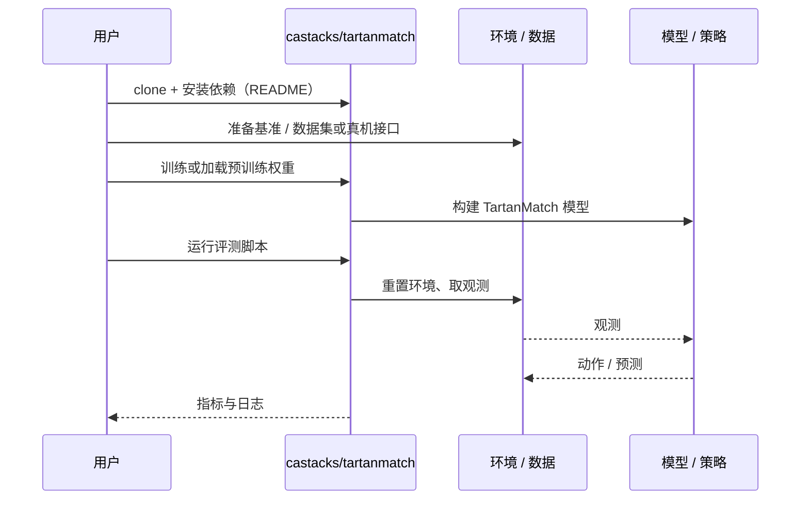

# TartanMatch（arXiv:2610.14513）

**TartanMatch**（*TartanMatch: Towards Universal Dense Correspondence Across Modalities*，[arXiv:2610.14513](https://arxiv.org/abs/2610.14513)，[项目页](https://tartanmatch.github.io/)，[代码](https://github.com/castacks/tartanmatch)）来自 [具身智能小站 2026-10-14 盘点](../../sources/blogs/wechat_embodied_station_41_papers_streamingwam_2026-10-14.md)，属「感知与 4D 世界」组。

## 一句话定义

**单一网络适配 RGB、事件、热成像、深度与投影 LiDAR 之间的稠密匹配，混合真实与合成数据训练零样本跨模态对应。**

## 英文缩写速查

| 缩写 | 英文全称 | 简要说明 |
|------|----------|----------|
| RGB | Red-Green-Blue | 彩色图像 |
| LiDAR | Light Detection and Ranging | 激光雷达 |
| Dense corr. | Dense Correspondence | 稠密对应 |

## 为什么重要

- 跨传感器对应是多模态定位与配准的基础。
- 开源结论：**已开源**（步骤 2.5，2026-10-14）。项目页链接的 GitHub 仓库可达（CMU AirLab）。
- 同期同组工作见 [流式动作块与世界模型记忆：具身智能小站 10-14 期 41 篇阅读坐标](../overview/embodied-station-2026-10-14-41-papers-technology-map.md)。

## 核心机制

| 项 | 内容 |
|----|------|
| **arXiv** | [2610.14513](https://arxiv.org/abs/2610.14513) |
| **开源** | **已开源** |
| **要点** | 共享网络 + 混合数据。 |
| **文内指标** | 以原文为准。 |

## 源码运行时序图

以下为按仓库入口（`castacks/tartanmatch`）推断的通用运行链路；入库日仅核实仓库可达，未逐文件阅读，具体脚本名以 README 为准。

## 实验与评测

- 以原文为准。
- **读法：** 本页为索引级摘要，依据公众号转述的官方摘要与仓库信息整理；逐项数字与 baseline 以原文 PDF 为准。

## 与其他工作对比

- 横向索引见 [流式动作块与世界模型记忆：具身智能小站 10-14 期 41 篇阅读坐标](../overview/embodied-station-2026-10-14-41-papers-technology-map.md)；同 arXiv 不重复造页。

## 结论

**跨模态稠密匹配可用一个模型统一，但零样本性能依赖训练模态覆盖。**

1. 开源边界：**已开源** — 项目页链接的 GitHub 仓库可达（CMU AirLab）。
2. 核心机制：共享网络 + 混合数据。
3. 复现与选型前核对任务协议、硬件与基准口径，勿直接横比公众号摘录数字。

## 关联页面

- [stereo-matching-foundation-models](../methods/stereo-matching-foundation-models.md)
- [lidar-sensing](../concepts/lidar-sensing.md)
- [embodied-station-2026-10-14-41-papers-technology-map](../overview/embodied-station-2026-10-14-41-papers-technology-map.md)

## 参考来源

- [tartanmatch_universal_dense_correspondence_arxiv_2610_14513.md](../../sources/papers/tartanmatch_universal_dense_correspondence_arxiv_2610_14513.md)
- [wechat_embodied_station_41_papers_streamingwam_2026-10-14.md](../../sources/blogs/wechat_embodied_station_41_papers_streamingwam_2026-10-14.md)
- [arXiv:2610.14513](https://arxiv.org/abs/2610.14513)

## 推荐继续阅读

- [arXiv PDF](https://arxiv.org/pdf/2610.14513)
- [项目页](https://tartanmatch.github.io/)
- [https://github.com/castacks/tartanmatch](https://github.com/castacks/tartanmatch)
