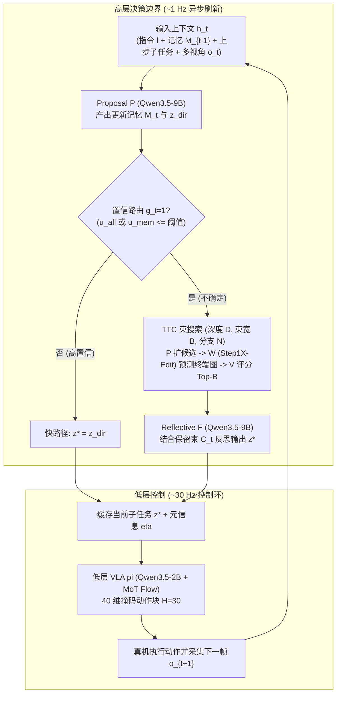
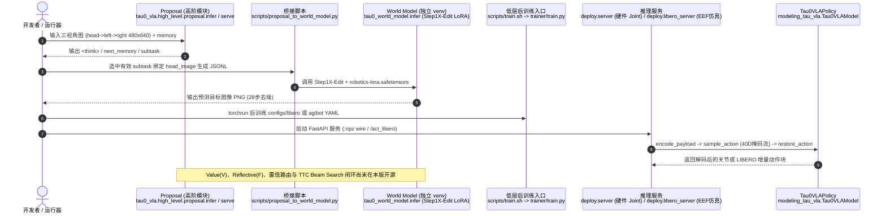

# τ₀-VLA：世界模型引导测试时计算的分层机器人基础模型

**τ₀-VLA**（*a Hierarchical Robot Foundation Model with World-Model-Guided Test-Time Computation*，[arXiv:2608.16885](https://arxiv.org/abs/2608.16885) v1，2026-08-17；[项目页](https://tau0-vla.github.io/)；[官方代码](https://github.com/sii-research/tau-0-vla)）由 **上海创智学院（Shanghai Innovation Institute）**、**智元机器人 Finch 团队（Agibot Finch）** 与 **香港中文大学（CUHK）** 联合提出。系统将长程操纵中的 **下一子任务生成** 显式建模为 **可扩展测试时计算（TTC）** 问题：平时依赖具备自纠错能力的 **可修订执行记忆** 快速下发子任务；遇到低置信决策节点时，启用 **Proposal (`P`) – World Model (`W`) – Value (`V`)** 的束搜索推演候选子任务的未来头部相机视觉后果，并经 **Reflective (`F`)** 反思生成最终指令，交由在 **40,115 小时** 异构真机与多模态数据上预训练的 **40 维统一接口低层 VLA**（`Qwen3.5-2B + MoT` 流匹配）跨本体闭环执行。

## 一句话定义

**分层机器人基础模型：高层结合可修订执行记忆与世界模型引导的测试时束搜索，在子任务边界先比较想象后果再决策；低层以 40 维统一流匹配 VLA（40,115 h 预训练）把子任务跨本体落地成连续动作块。**

## 英文缩写速查

| 缩写 | 英文全称 | 简要说明 |
|---|---|---|
| VLA | Vision-Language-Action | 视觉-语言-动作多模态基础控制策略 |
| TTC | Test-Time Computation | 测试时计算；按决策置信度在推理期动态追加搜索与验证算力 |
| WM | World Model | 世界模型（本文用 Step1X-Edit 从头部图像与子任务预测完成态图像） |
| MoT | Mixture-of-Transformers | 混合 Transformer 专家架构；低层动作流与 VLM 骨干通过联合注意力交互 |
| EEF | End-Effector | 末端执行器（本文同时支持 EEF 6D 旋转与关节角相对控制） |
| KI | Knowledge Isolation | 知识隔离；Stage 1 阻断动作损失梯度反传回 VLM 骨干的预训练稳定策略 |

## 为什么重要

- **长程任务的致命错误在「选错步」而非只调电机：** 在 13–25 步、最长达 12 分钟的真实家务（打扫房间、做番茄炒蛋、做奶茶）中，重复加盐或遗漏前置工具使用无法靠更精准的低层抓取弥补。固定同一低层策略时，仅加入显式子任务分解与记忆（无搜索的 Plan Once），4 项长程真机平均成功率即从整任务直出的 **27.50%** 跃升至 **45.00%**（Table I）。
- **把世界模型推到承诺执行前的分岔对比：** 与先由高层固定生成子任务再由世界模型补画目标图（如 \(\pi_{0.7}\) 相关路径）不同，τ₀-VLA 在子任务提交前对开放文本候选做「先提出–后想象终端图像–打分剪枝–反思修正」，在 OOD 排列的 Book Organization 上把下一步准确率从 `50.0%`（Plan Once）和 `57.5%`（Best-of-N）提升到 **`74.0%`**。
- **零额外人工标注的记忆自修复：** 在执行记忆中人为注入滞后、超前或失败冲突并监督模型输出修正后 `<memory>`（40.4M 合成样本），在项目页报告可带来 **+11.0 pp** 下一子任务准确率增益，且不需另采专门纠错数据集。
- **同生态两条「测试时想象」路线互补：** [τ₀-WM](./tau0-world-model.md)（5B 视频扩散 Joint WAM）在连续 **action chunk** 层面做闭环想象选优；τ₀-VLA 则在稀疏、语义清晰的 **开放语言子任务** 层面用单帧编辑世界模型做长程规划，二者针对不同时间尺度痛点。

## 核心原理与方法

### 1. 高层策略：可修订记忆、置信路由与四模型 TTC（§IV-B、§V-C、Appendix C-E/J）

在逻辑步 \(t\)，高层上下文化为 \(h_t = (\ell, M_{t-1}, z_{t-1}^\star, o_t)\)。**Proposal 模型 \(P\)**（基于 `Qwen3.5-9B`）一次性生成 `<think>/<memory>/<subtask>` 标签序列，得到更新后记忆 \(M_t\) 与直接提议 \(z_t^{\mathrm{dir}}\)。同一前向附带输出置信统计：

$$u_t^{\mathrm{all}} = \frac{1}{|\mathcal{I}_{\mathrm{all}}|}\sum_{i\in\mathcal{I}_{\mathrm{all}}} p_i,\qquad u_t^{\mathrm{mem}} = \frac{1}{|\mathcal{I}_{\mathrm{mem}}|}\sum_{i\in\mathcal{I}_{\mathrm{mem}}} \bigl(\lambda_i^{(1)} - \lambda_i^{(2)}\bigr),\qquad g_t = \mathbf{1}\bigl[u_t^{\mathrm{all}} \le \delta_{\mathrm{all}} \lor u_t^{\mathrm{mem}} \le \delta_{\mathrm{mem}}\bigr]$$

- **快路径（\(g_t=0\)）：** 直接采纳 \(z_t^\star = z_t^{\mathrm{dir}}\)，零额外计算。
- **TTC 路径（\(g_t=1\)，Algorithm 1）：** 从根节点出发做深度 \(D\)、分支因子 \(N\)、束宽 \(B\) 的全局束搜索：\(P\) 针对每条保留分支采样 \(N\) 个候选子任务；**World Model \(W\)**（基于 `Step1X-Edit`）仅依据单视角 **头部 RGB 图像** \(\tilde o(b)\) 与候选 \(z\) 预测终端头部图像 \(\hat o = W(\tilde o, z)\)；**Value 模型 \(V\)**（基于 `Qwen3.5-9B` 五档序数 VQA 映射到 \([0.05, 0.95]\)）按全局指令 \(\ell\) 与 \((\hat o, z)\) 累加打分。搜索期间记忆仅保留在分支局部，不覆盖主循环持久记忆 \(M_t\)；最终 **Reflective 模型 \(F\)**（`Qwen3.5-9B`）综合真实上下文 \(\bar h_t\) 与保留束 \(C_t\) 自回归生成可越出原候选集的 \(z_t^\star\)。

### 2. 低层策略：40 维统一掩码流匹配与三阶段共训（§IV-C、§V-B、Appendix C-B/D）

低层 \(\pi_\theta\) 由 **`Qwen3.5-2B` VLM 骨干** 与 **`MoT` 动作专家** 构成（源码实现中骨干混合 GatedDeltaNet 线性注意力与全注意力，专家全层采用全注意力并在骨干全注意力层交互），通过文本控制元信息 \(\eta\)（含 `<embodiment>`、`<eef/eef_wbc/joint>`、是否全身控制）和 **40 维统一状态/动作向量** 兼容多本体（`1–3/10–12` 左右 EEF 位移、`4–9/13–18` 左右 `Rot6D`、`19–20` 夹爪、`21–22` 腰、`23–24` 底盘、`25–40` 双臂各至多 8 关节）。未启用通道经对角掩码矩阵 \(M\) 在流路径与损失（Eq. 14–15，\(H=30\)、10 步 Euler 积分）中置零。预训练基于 **40,115 h** 异构真机数据（内部 23.4K h：G1 `21.9K h`、G2 `585 h`、ARX `578 h`、Franka `347 h`；公开 16.7K h 含 `9.25K h` UMI）与多模态共训，经 **Stage 1（KI 隔离）→ Stage 2（端到端共训）→ Stage 3（任务微调）**。部署端通过后台 ~1 Hz 更新子任务缓存 + 低层 ~30 Hz 异步控制闭环运行（Appendix C-F）。

### 流程总览

## 源码运行时序图

截至 **2026-09-21** 官方仓库快照（[sii-research/tau-0-vla](https://github.com/sii-research/tau-0-vla)，详细组件矩阵见 [sii_research_tau_0_vla.md](../../sources/repos/sii_research_tau_0_vla.md)），官方**已开源并可运行**：低层预训练权重、LeRobot v3 后训练、硬件 joint-control `deploy.server` / `deploy/openloop.py`、LIBERO 仿真后训练与 `deploy/libero_server.py`，以及高层 **Proposal (`P`)** 与 **World Model (`W`)** 的推理/LoRA 微调与桥接脚本；**Value (`V`)、Reflective (`F`)、置信路由 (`g_t`) 与完整 TTC `Search` 闭环代码尚未在仓库发布**。

## 工程实践

| 工程环节 | 仓库 / 论文验证规范 |
|---|---|
| **四套环境严格隔离** | 低层主环境须 `Python 3.11 + CUDA 12.8 + PyTorch 2.7.1`；高层 `Proposal` 与 `World Model` 均须各自独立 `Python 3.12` venv；`LIBERO` 仿真客户端单独 `Python 3.10 + MuJoCo 3.2.3` |
| **硬件 vs 仿真控制路由边界** | 硬件服务 `deploy/server.py` 强制执行 `_require_public_v1_joint_only`——公开 v1 **仅允许 joint-control checkpoint**；EEF 推理仅在 `deploy/libero_server.py`（`slots 0:9` + `18`）中面向仿真器开放 |
| **Data Spec 与维度锁死** | `train.py` 明确禁止在 YAML 中手写 `state_dim` / `action_dim` / `action_horizon`，强制由 `data_args.config_name` 与 checkpoint 内 `finch_data_spec/<route>/` 在部署时自动重建编码，防止训练/部署漂移 |
| **高层微调硬约束** | `Proposal` 微调（`tau0_vla.high_level.proposal.finetune`）要求保留 6 个 `<think>/<memory>/<subtask>` 特殊 token、固定 `head→left→right` 序与 `enable_thinking=False`；`World Model` 训练自动注入前缀 `"In a robotic workspace, a dual-arm robot: "` |
| **安全总线与路由阈值标定** | 硬件 `.npz` 总线拒绝 `pickle` 且限体大小，默认只监听 `127.0.0.1`；自接 TTC 时置信阈值 `δ_all` / `δ_mem` 须按目标任务在留出验证集上独立标定（Appendix C-J） |

## 实验与评测

### 1. 长程真实双臂移动操作（AGIBOT G1，Table I，每项 10 trials）

直接执行相同低层策略时，“无搜索分层（Plan Once）”即大幅拉开对整任务直出的优势；外部基线 `LingBot-VLA` 与 `GR00T N1.7` 在需要跨房间和隐式状态跟踪的长程任务上几乎无法完整通关：

| 方法 | Clean Room (25 步) | Prepare Ingredients (14 步) | Tomato and Egg Stir Fry (22 步) | Make Milk Tea (13 步) | **4 任务平均** |
|---|---|---|---|---|---|
| GR00T N1.7 | 0/10 (59.80%) | 1/10 (68.57%) | 0/10 (24.32%) | 0/10 (28.46%) | 2.50% (45.29%) |
| LingBot-VLA | 0/10 (66.60%) | 0/10 (35.00%) | 0/10 (12.27%) | 0/10 (63.85%) | 0.00% (44.43%) |
| \(\pi_{0.5}\) | 4/10 (86.20%) | 2/10 (73.93%) | 0/10 (49.77%) | 3/10 (82.31%) | 22.50% (73.05%) |
| τ₀-VLA（直出整任务） | 4/10 (92.80%) | 2/10 (66.43%) | 0/10 (65.00%) | **5/10** (96.15%) | 27.50% (80.10%) |
| **τ₀-VLA（分层 Plan Once）** | **5/10 (94.80%)** | **4/10 (82.86%)** | **4/10 (81.82%)** | **5/10** (91.92%) | **45.00% (87.85%)** |

- **典型长程机理：** `Tomato and Egg Stir Fry` 中“加盐”几乎不改变图像外观，无记忆的直出策略常反复加盐或遗漏，导致 SR 全 0%；分层记忆精确锁住工序完成度。

### 2. TTC 开环预测、真机闭环与算力–精度权衡（Fig. 4–5、Table III）

- **开环 next-subtask 预测（GPT-5.4 majority judge）：** 在未见初始排列的 **OOD Book Organization** 上，**TTC 达 `74.0%`**，显著高于 `Best-of-N`（`57.5%`）与 `Plan Once`（`50.0%`）；项目页补充综述该选择性 TTC 在各同域与分布偏移设置上总体带来 **+15–24 pp** 提升，而可修订记忆机制带来 **+11.0 pp** 提升。算力扫描（Fig. 5）显示准确率在低至中等 PFLOPs/sample 预算下快速抬升，随后渐进饱和。
- **固定低层策略下的 TTC 真机闭环增益（Table III，每组 10 trials）：**

| 评测任务 | Plan Once (SR / Progress) | **启用 TTC (SR / Progress)** |
|---|---|---|
| Make Milk Tea (G1) | 5/10 (91.92%) | **7/10 (95.38%)** |
| Book Organization (ARX AC One) | 6/10 (66.67%) | **9/10 (93.33%)** |
| Clean Room (G1) | 5/10 (94.80%) | **7/10 (97.60%)** |

### 3. 跨本体直出执行与 LIBERO 开源复现（Table II、`configs/libero/README.md`）

- **跨本体真机（Table II，直出模式各 10 trials）：** 在移动双臂 ARX AC One 的 `Collect Laundry` 达 **10/10 (97.00%)**（\(\pi_{0.5}\) `9/10`、`GR00T N1.7` `4/10`）；在双臂 Franka Research 3 同视觉状态区分指令的 `Tidy Makeup Table` 三分组分别达 **10/10 (95.00%)**、**9/10 (92.50%)**、**10/10 (95.00%)**。
- **官方开源 LIBERO 仿真基线（2026-09-20 发布，每任务 50 rollouts 共 2,000 episodes）：** `Spatial 97.40%`、`Goal 98.20%`、`Object 98.80%`、`Long 95.00%`，四套件平均 **97.35%**。

## 与其他工作对比

| 对比维度 | τ₀-VLA | [τ₀-WM](./tau0-world-model.md) | [π₀.₅](./paper-pi05-open-world-vla.md) | [LingBot-VLA 2.0](./lingbot-vla-v2.md) |
|---|---|---|---|---|
| **决策尺度与接口** | 开放语言 **子任务** 边界束搜索 + 低层 40D 流策略 | 连续 **action chunk** 层面多视角视频世界模型闭环 | 单次前馈高层语义子任务 + FAST/流匹配低层 | 整段语言指令直接驱动 55 维 MoE 策略 |
| **记忆与容错** | **40.4M 扰动记忆样本** 训练前进 / 回滚 / 重试 | 视频历史与条件帧滚动 | 文本历史上下文（无显式纠偏扰动） | 短时历史窗口 |
| **低层骨干与预训练** | `Qwen3.5-2B` + MoT（**40,115 h** 真机） | 5B Wan 扩散 Joint WAM | PaliGemma 类骨干 + 动作专家 | `Qwen3-VL` + MoE（55 维） |
| **Table I 4 任务长程均值** | **45.00%**（Plan Once） / **27.50%**（直出） | 不同评估集 | 22.50% | 0.00% |

## 局限与风险

- **高层闭环尚未完整开源：** 截至 `2026-09-21` 仓库快照，仅公开了 `Proposal` 与 `World Model`；用于束搜索评分的 **Value 模型 \(V\)**、最终反思 **Reflective 模型 \(F\)**、置信路由器以及 1 Hz/30 Hz 异步服务整合代码仍未发布，开发者无法直接开箱运行论文完整 TTC 闭环。
- **多模型推理算力与硬件延迟约束：** 虽然有置信路由与异步解耦，但 TTC 模式仍需并行维护 `Qwen3.5-9B` 与 `Step1X-Edit` 扩散去噪（默认 28 步，独立 GPU 显存占用大），对单机边缘端部署构成显著开销。
- **末段精细接触与视觉盲区：** 论文明确指出 Make Milk Tea 已完成前序 >91% 进程后，主要剩余失败仍发生在 **合盖与插吸管** 的局部接触控制阶段（需结合力触觉或高阶低层精调，高层语义切换无力挽救）；且世界模型仅看单路 **头部 RGB**，对腕部近景遮挡操作可能预测失真。
- **硬件端 EEF 服务暂受限：** 官方 `deploy.server` 明确只支持关节角控制部署，端到端 EEF 控制当前仅能通过 `deploy/libero_server.py` 在仿真器中验证。

## 结论

**τ₀-VLA 验证了「高置信快速响应 + 不确定节点以世界模型想象对比候选后果 + 扰动自愈执行记忆」的分层范式能把 13–25 步真机操作成功率推向新台阶，并已成为观察 SII / 智元开放生态工程演进的重要参照基线。**

1. **先打通「分层指令 + 可纠偏记忆」收益远超盲目堆搜索：** 无搜索的 Plan Once 已贡献从 `27.50%` 到 `45.00%` 的核心跳变，记忆扰动（catch-up / rollback / error-think）是防止长程状态漂移的最小可行底座。
2. **仅在低置信分支动用 TTC 束搜索：** OOD 与状态歧义决策点（如 Book Organization、`74.0%` vs `50.0%`）是世界模型想象最值回票价的地方；高频简单转移必须由路由拦截以保住实时吞吐。
3. **当前工程落地必须核对「开源边界」：** 可直接拿 `sii-research/tau-0-vla` 跑通低层 40D 后训练、LIBERO（`97.35%`）以及独立调用 `Proposal` 与 `World Model`，切勿误以为仓内已自带完整的 `Value/Reflective/SEARCH` 闭环管线。
4. **低层仍是接触瓶颈兜底项：** 当任务进到合盖、插孔等末段接触丰富子步时，高层推理已逼近上限（>95% Progress），需要与力控/精细策略联合优化。

## 关联页面

- [VLA（Vision-Language-Action）方法页](../methods/vla.md)
- [生成式世界模型方法页（Generative World Models）](../methods/generative-world-models.md)
- [操作任务页（Manipulation）](../tasks/manipulation.md)
- [τ₀-World Model（τ0-WM）](./tau0-world-model.md)
- [世界动作模型概念页（World Action Models）](../concepts/world-action-models.md)
- [Mimic-Video 方法页](../methods/mimic-video.md)
- [π₀.₅（HMI P059）](./paper-pi05-open-world-vla.md)
- [LingBot-VLA 2.0](./lingbot-vla-v2.md)
- [GE-Sim 2.0](./ge-sim-2.md)
- [机器人世界模型训练闭环分类学](../overview/robot-world-models-training-loop-taxonomy.md)

## 参考来源

- [τ₀-VLA 论文全文核对归档（arXiv:2608.16885）](../../sources/papers/tau0_vla_arxiv_2608_16885.md)
- [τ₀-VLA 官方项目页（tau0-vla.github.io）](../../sources/sites/tau0-vla-github-io.md)
- [sii-research/tau-0-vla 官方代码仓核对](../../sources/repos/sii_research_tau_0_vla.md)

## 推荐继续阅读

- arXiv 论文原文：<https://arxiv.org/abs/2608.16885>
- GitHub 官方仓库：<https://github.com/sii-research/tau-0-vla>
- 官方项目页：<https://tau0-vla.github.io/>
- Hugging Face 模型集合：<https://huggingface.co/sii-research/tau-0-vla>
