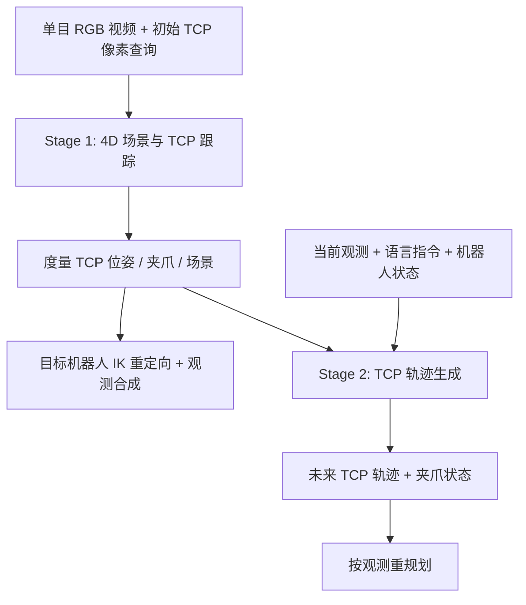
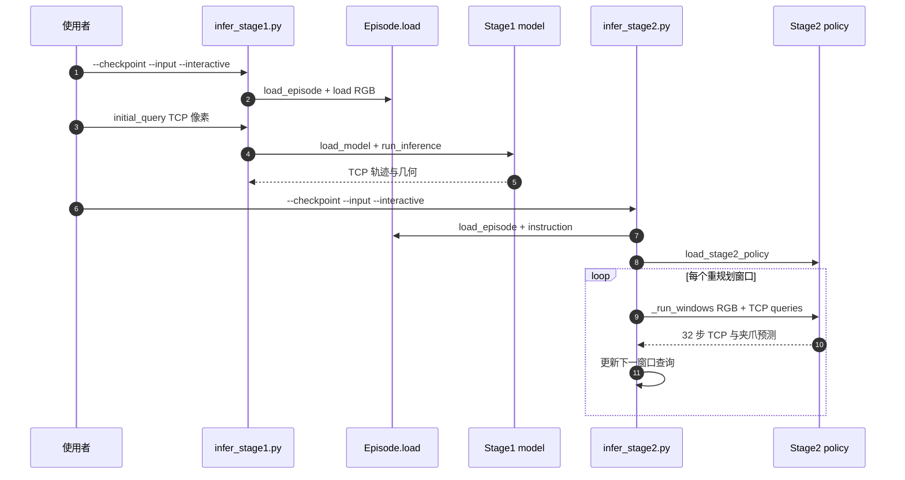

# TCP4D: A Unified Tool-Center-Point Tracking and Generation Model for Robot Manipulation｜统一工具中心点跟踪与轨迹生成

## 一句话定义

TCP4D 共享四维场景表示，先从单目 RGB 视频及初始 TCP 像素查询中跟踪度量 TCP 位姿、夹爪状态和场景几何，再结合语言和当前观测生成未来轨迹，支持跨机器人构型重定向。

## 英文缩写速查

| 缩写 | 英文全称 | 简要说明 |
|---|---|---|
| TCP | Tool Center Point | 末端工具工作点 |
| SE3 | Special Euclidean Group 3 | 三维刚体位姿 |
| DiT | Diffusion Transformer | 条件动作轨迹生成骨干 |

## 为什么重要

它把视频中的末端动作监督与机器人可执行的末端位姿联系起来，降低跨本体示范数据使用门槛；追踪与生成属于两个可分开评估的阶段。

## 核心原理

1. Stage 1：RGB 帧序列、相机与初始 2D TCP 查询进入共享四维几何表示，输出随时间变化的度量 TCP 6D 位姿、开合状态及场景几何。
2. Stage 2：读取近期 RGB、机器人状态、语言和上一阶段的轨迹特征，通过条件生成模型预测未来双臂 TCP 与夹爪状态；官方 RoboTwin checkpoint 每窗口输出 32 步，默认每 20 步重规划。
3. 跨构型数据增强：跟踪原机器人视频后将 TCP 路径重定向到目标机器人，并经渲染/修复生成配对观测；不能把视频跟踪误差当成新本体真机成功率。

## 流程总览

## 源码运行时序图

下图仅依照官方开源入口的静态调用链绘制，不表示已运行训练、实验或机器人。

## 工程实践

- 官方入口：python infer_stage1.py --checkpoint <path> --input <episode> --interactive；python infer_stage2.py --checkpoint <path> --input <episode> --interactive。
- 源码核对：Stage1 `infer_stage1.py` main→load_episode→initial_query→load_model→run_inference；Stage2 `infer_stage2.py` main→load_episode→load_stage2_policy→run_inference/_run_windows，32 步预测/20 步重规划。训练有 `train_stage1.py`、`train_stage2.py`，模型数据见 README/HF；未执行实际推理。
- 复现前检查输入格式、动作坐标系、依赖、评测种子以及硬件和 API 资源；作者报告数字不可当作本仓实测。

## 实验与评测

- 作者在 DROID 跟踪基准报告 TCP 误差 7.60 mm。
- RoboTwin 48 任务 clean-to-clean 轨迹生成平均成功率 69.19%；clean-to-random 为 10.94%，说明扰动泛化仍有缺口。

## 结论

**TCP4D 共享四维场景表示，先从单目 RGB 视频及初始 TCP 像素查询中跟踪度量 TCP 位姿、夹爪状态和场景几何，再结合语言和当前观测生成未来轨迹，支持跨机器人构型重定向。**

1. 先以论文明确的输入输出、数据拆分和评测协议定位方法适用范围。
2. 区分定量实验、官方开源可复现入口与本次未执行的实验步骤。
3. 重点跟进部署时的误差、计算开销以及任务/机器人构型迁移边界。

## 局限与风险

- 单目几何与相机标定误差可能污染 TCP 估计，跨本体还受目标机器人可达性与 IK 约束。
- 69.19% 对应特定 RoboTwin 评测设置，不能外推到任意真实机器人。
- 公开 Stage1/Stage2 推理、训练代码及模型；官方声明代码/模型 CC BY 4.0。

## 关联页面

- [manipulation ](../tasks/manipulation.md)
- [imitation-learning ](../methods/imitation-learning.md)
- [teleoperation ](../tasks/teleoperation.md)
- [相关纵深路线](../../roadmap/depth-cross-embodiment.md)

## 参考来源

- [论文原文与技术核对归档](../../sources/papers/tcp4d-arxiv-2611-23143.md)
- [官方项目页归档](../../sources/sites/tcp4d.md)
- [官方代码及开放状态归档](../../sources/repos/tcp4d.md)

## 推荐继续阅读

- [arXiv:2611.23143 全文](https://arxiv.org/html/2611.23143v1)
- [项目主页](https://livioni.github.io/TCP4D/)
- [官方源码](https://github.com/Livioni/TCP4D)
