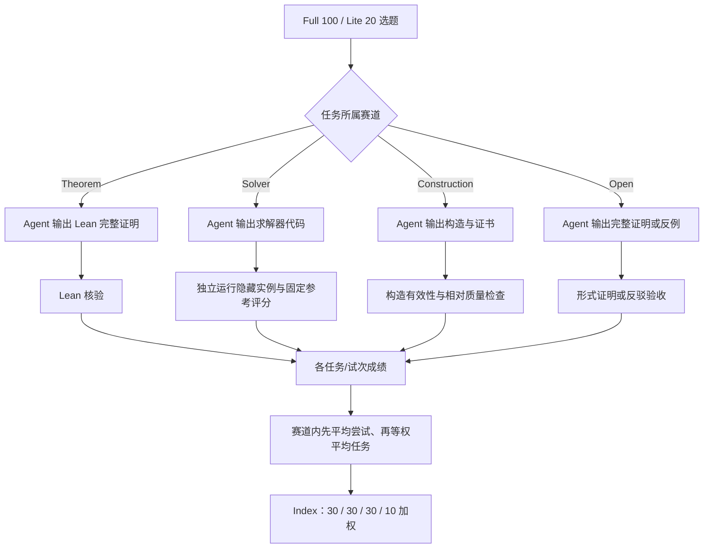
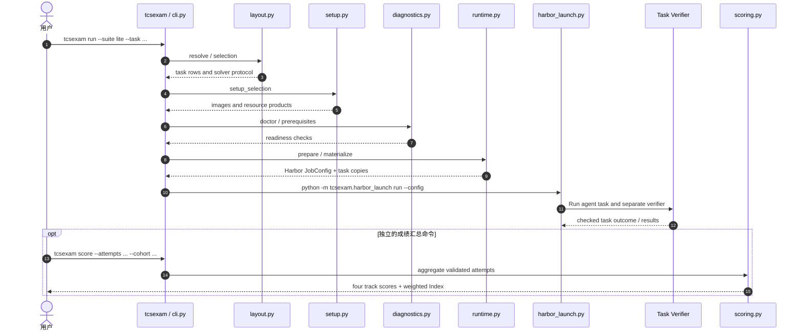

# TCSExam: Evaluating Frontier LLMs on the Full Range of TCS Research｜理论计算机科学研究全谱系评测

## 一句话定义

**TCSExam** 是评测 LLM + Agent 在**理论计算机科学研究任务**上可验证产出的基准：Full 100 题、Lite 20 题，覆盖定理证明、Solver 研发、离散构造与开放猜想；论文 [arXiv:2611.07962v1](https://arxiv.org/abs/2611.07962v1)，[可交互项目页](https://moonshotai.github.io/TCSExam/)，[任务/评测源码](https://github.com/MoonshotAI/TCSExam)。

## 英文缩写速查

| 缩写 | 英文全称 | 简要说明 |
|---|---|---|
| TCS | Theoretical Computer Science | 研究对象：理论计算机科学 |
| LLM | Large Language Model | 被评测模型；得分依赖其 agent 执行配置 |
| CLI | Command-Line Interface | 官方 tcsexam 命令行入口 |
| API | Application Programming Interface | 模型服务接口；不同模型/预算影响可比性 |
| K3 | Kimi K3 | 官方 Solver 固定参考计分锚点 |

## 为什么重要

通用 coding benchmark 不等于能完成**新构造、严格证明与研究级算法工程**。TCSExam 要求可被独立验收的 artifact：Lean 证明、隐藏实例上运行的 solver、满足约束的构造、或开放猜想的完整证明/反例。它是 [AI Agent 评测](../concepts/ai-agent-evaluation.md) 从可执行单测向形式研究任务扩展的案例；**不能将它当作机器人操作 / VLA / Sim2Real 成功率**。

## 核心信息

| 项 | v1 固定口径 |
|---|---|
| 论文 | [arXiv:2611.07962v1](https://arxiv.org/html/2611.07962v1)（2026-11-05） |
| 作者 | Yifan Luo、Zhengying Liu、Yang Yuan、Zhilin Yang、Andrew Chi-Chih Yao |
| 机构 | 清华大学、Moonshot AI、上海期智研究院 |
| 测试规模 | Full：100；Lite：20 |
| 代码状态 | 官方公开任务与评测框架；部分 Docker / Online judge 资源需另行准备 |
| 技术依赖 | Linux x86-64、Python 3.12+、Docker、Harbor 0.22.0、模型 API |

## 核心机制：四赛道与验收

| 赛道 | Full | Lite | 输出及最终判据 |
|---|---:|---:|---|
| 定理证明 Theorem | 20 | 5 | 完整 Lean 4 证明，通过形式核验 |
| 求解器 Solver | 30 | 5 | 可执行程序在隐藏实例测试，记固定参考相对分 |
| 构造 Construction | 20 | 5 | 离散对象/证书 + 校验与质量评分 |
| 开放猜想 Open | 30 | 5 | 完整证明或反驳（可验证）；局部进度不算解决 |

**Solver 协议分叉：** Full 主实验用 Online（开发时可请求受控裁判反馈）；Lite 默认 Offline（公开自测后进行隐藏验收）。两套协议在仓库有独立 task 目录；切换时必须分列报告，不得将其当作同一评测条件。

### 流程总览（依据论文 v1 方法与官方任务规范）

赛道各有不同 checker；以上是论文设计的数据/验收流，不是声称所有验证代码都在同一个进程。

## 源码运行时序图

按官方 `pyproject.toml`、`src/tcsexam/cli.py`、`runtime.py`、`scoring.py` 与 getting-started 静态核对。**运行评测和离线聚分是两步**，不是单条 `run` 命令直接输出论文 Index。

官方 runtime 使用 Harbor 0.22.0 执行隔离 task；`scoring.aggregate` 对缺失/失败评测保持区别，且拒绝混用在线/离线 Solver 试次。本次仅审阅运行入口与调用链，**未实际启动容器、API 或完整评测**。

## 实验与评测（论文 v1，非动态榜单）

**Index = 30 × 定理成功 + 30 × Solver 固定 Kimi K3 参考相对分 + 30 × Construction 原始分 + 10 × Open 完整解决率。**

- **Full 100 题：** GPT-6 Astra **71.9**（论文 Full 最高）；四项分赛道依次约为 70.0%、64.7%、104.9%、0%。构造得分可以超过 100%，故 Index 不是“100 道题答对率”。
- **Lite 20 题：** Opus 5.5 **72.3**（论文 Lite 第一），GPT-6 Astra **67.0**；Lite 与 Full 使用的任务数、某些模型及 solver 反馈协议不同，不能简单横向宣称模型优劣反转。
- **规模与相关性：** 两套件的 8 个共同系统排序 Spearman ρ≈0.93，但 Lite 选择考虑了先前模型表现，存在样本选择与泛化边界。
- **开放猜想贡献判断：** 论文包含对先前公开反例的形式化（如 Ryser/MIRUP）以及专门条件下的构造/定理成果；完整形式核验与“此前完全未知的新发现”是两个独立判断。
- **提交状态：** 公开 `scoring.py` 不把缺失验证强行计 0，报告结论应同时带上是否已评完、采用多少次试验、使用何种 Solver 协议。

## 结论

**TCSExam 的关键价值是把研究任务转成可独立核验的模型-Agent 输出，而不是给 LLM 一个脱离协议的统一数学能力百分比。**

1. 对照分数前固定 Full/Lite、Solver Online/Offline、模型 Agent、预算和尝试次数。
2. 区分形式上有效、历史基线改进与真正的新研究发现；特别核查已有公开反例。
3. Construction 104.9% 是相对指标，不能说超过百分百任务通过率。
4. 未跑完与已验证零分必须分开；源码评分器有明确状态区分。
5. 把验证器隔离、固定参考锚点与任务级来源记录迁移到机器人研究 Agent 的评测时，仍需重新定义机器人成功判据。

## 与其他工作对比

| 方向 | 本页 TCSExam | [AI Agent 评测](../concepts/ai-agent-evaluation.md) | [Math 2.0](../concepts/math-2-0.md) |
|---|---|---|---|
| 核心问题 | 理论计算机研究成果能否被形式/执行验收 | Agent 的 outcome / grader / trial 如何可靠设计 | AI 如何促进数学理解与研究协作 |
| 主要产出 | 完整证明、solver、构造或反例 | 评测设计方法、harness 与可靠终态指标 | 科研范式与价值讨论 |
| 边界 | 可验结果不直接等于新颖性、具身能力 | 方法论并非单个 TCS 榜单 | 愿景不等于实证基准 |

## 工程实践：复现与资料入口

1. [官方 README](https://github.com/MoonshotAI/TCSExam/blob/master/README.md) 与 [getting-started](https://github.com/MoonshotAI/TCSExam/blob/master/docs/getting-started.md)：Linux x86-64、Python 3.12+，安装 `pip install -e '.[runtime,backend]'`，先 `tcsexam validate`、`tcsexam list --suite lite`。
2. 通过 `tcsexam source-inputs` 和 `tcsexam build --suite lite --task discrete-bidding-games` 准备固定资源；`tcsexam doctor` 检查障碍后再 `tcsexam run`。
3. 独立的 `tcsexam score` 读取已核验 attempts / cohort 聚合；solver 相对得分由 `tcsexam solver-score` 计算。
4. **开源状态：** 官方项目代码 Apache-2.0；任务陈述/网站文档 CC BY 4.0，论文 PDF CC BY-NC-ND 4.0；第三方输入有独立权利。Online judge 需 backend 配置，不能把仓库可读理解为所有受限输入/凭证均已公开。

## 局限与风险

- 题目和实验资源的有效性、隐藏实例与形式规格的等价性影响成绩；只有部分候选可进一步证明有真实科研新颖性。
- Lite 不一定是未来模型无偏缩影；不同评测套件、反馈权限、Agent 脚手架、推理预算及模型 API 版本造成不可直接比较。
- Solver 计分依赖固定参考系统；Construction 可能大于 1；开放猜想仅完整证明/反驳得分，局部推进的科学价值并不被 Index 充分表达。
- **TCS 基准不是机器人 benchmark**；本文没有直接测量机器人控制、灵巧操作或 Sim2Real 部署。
- 本次仅做官方论文/网站/源码静态复核，未本机跑 `make ci-preflight`、TCSExam Docker 或模型评测。

## 关联页面

- [AI Agent 评测](../concepts/ai-agent-evaluation.md) — outcome、grader、试次与评测污染。
- [AI Auto-Research](../concepts/ai-auto-research.md) — 研究自动化的可执行验证节点。
- [Math 2.0](../concepts/math-2-0.md) — 正确证明与研究理解/新颖性之间的区别。
- [FlashProve](flashprove.md) — 证明“正确执行”与“结果内容正确”属于不同层级。
- [具身大模型评测基准选型闭环](../queries/embodied-eval-benchmark-selection-loop.md) — 基准设计与 grader 可信度的通用选型框架。

## 参考来源

- [TCSExam 论文 v1 全文阅读归档](../../sources/papers/tcsexam_arxiv_2611_07962.md)
- [官方项目与交互结果归档](../../sources/sites/tcsexam.md)
- [官方任务与源码运行链归档](../../sources/repos/tcsexam.md)

## 推荐继续阅读

- [arXiv v1 全文及附录](https://arxiv.org/html/2611.07962v1)
- [TCSExam 交互结果项目页](https://moonshotai.github.io/TCSExam/)
- [官方评测入门与源码](https://github.com/MoonshotAI/TCSExam/blob/master/docs/getting-started.md)
