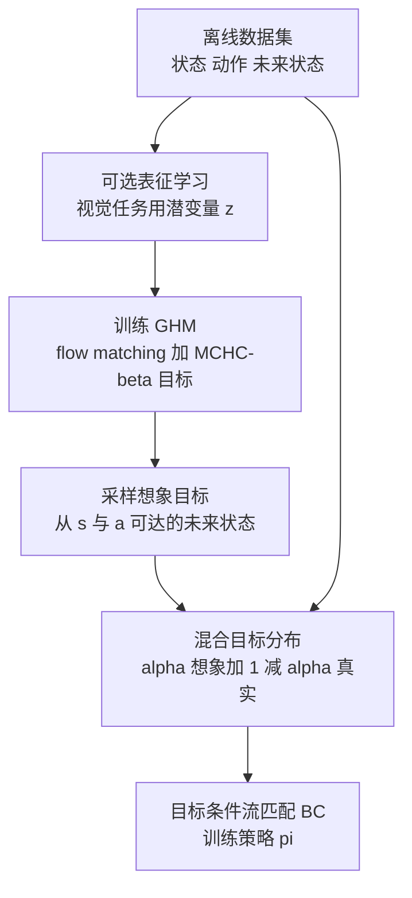
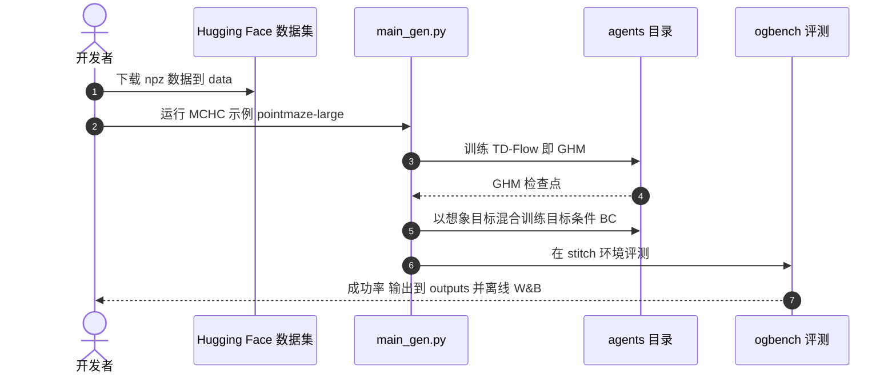

# TD-Aug：想象可达目标来增广目标条件行为克隆

**TD-Aug 训练一个几何视界模型（GHM）去逼近行为混合策略的后继测度，从中采样"从当前状态可达的未来状态"当作想象目标，与真实未来状态混合后训练目标条件行为克隆（BC），从而在离线数据上拼接出未见过的技能组合。**

论文 *Imagining Goals with Geometric Horizon Models for Policy Generalization*（[arXiv:2610.19129](https://arxiv.org/abs/2610.19129)，[项目页](https://td-aug.github.io/)，[代码](https://github.com/td-aug/td-aug)）。

## 英文缩写速查

| 缩写 | 英文全称 | 简要说明 |
|------|----------|----------|
| GHM | Geometric Horizon Model | 以几何折扣分布生成未来状态的模型，逼近后继测度 |
| MCHC-β | Monte-Carlo plus bootstrapped TD loss（β 版） | 论文提出的 GHM 目标：TD 自举混合数据轨迹的 MC 样本（展开写法为推测，论文给出符号） |
| GCFBC | Goal-Conditioned Flow Behavior Cloning | 目标条件流匹配行为克隆，作无增广基线 |
| OGBench | Offline Goal-conditioned Benchmark | 离线目标条件强化学习基准，使用其 stitch 数据集 |

## 为什么重要

- 离线数据里每条轨迹只覆盖局部，目标条件 BC 在"需要拼接不同轨迹"的任务上基本为零（pointmaze-giant 为 0%）。
- 世界模型逐步展开生成数据时误差会随视界累积；GHM 每次采样只需 O(1) 次 ODE 步，直接给出远距离未来状态。
- 增广的是"目标"而不是动作或观测，保持标准 BC 训练流程。

## 核心信息

| 项 | 内容 |
|----|------|
| **机构** | Mila（全部作者）；Khimya Khetarpal 另属 Université de Montréal 与 Google DeepMind；Khetarpal 与 Berseth 为共同指导（论文 HTML） |
| **基准** | OGBench：pointmaze stitch（medium / large / giant / teleport）、visual-antmaze stitch（medium / large）、操作（cube-double、cube-triple、puzzle-4x4，使用 oracle 目标表示） |
| **设置** | 每项 3 个种子、取最后 3 个检查点平均 |
| **开源** | **已开源**（2026-10-17 核查）：[td-aug/td-aug](https://github.com/td-aug/td-aug)，MIT；数据在 Hugging Face `daniellawson9999/tdaug-datasets`；基于 OGBench 与 TRA-OGBench |

## 核心原理

### 流程总览

- GHM 速度场用条件流匹配（CondOT 耦合）训练；MCHC-β 把 TD 自举与数据轨迹的 MC 样本混合，缓解纯 TD 样本发散与纯 MC 无法拼接的问题。
- 理论：α = 1 且样本精确时，增广等价于价值加权回归的一步策略改进（论文 Theorem 1）。

## 源码运行时序图

时序对齐仓库 README 的入口脚本 `main_gen.py`（先训 TD-Flow，再训带增广目标的策略）。

- **复现路径（README）：** conda `environment.yaml` 或 uv + `requirements.txt` → 下载数据 → `main.py` 训基线 GCFBC / `main_gen.py` 训 MCHC → `hyperparameters.sh` 列出 GCFBC、MC、TD2、MCHC、Dyn-Aug 命令；种子 0、1、2。
- 视觉实验另训图像编码器，操作实验另训动作先验（README）。

## 与其他工作对比

| 维度 | TD-Aug（本文） | [HER](../methods/her.md) | [行为克隆](../methods/behavior-cloning.md)（GCFBC 基线） | [离线 RL](../comparisons/online-vs-offline-rl.md)（HIQL / QRL 等） |
|------|------|------|------|------|
| 目标来源 | GHM 采样的想象可达目标 + 真实未来状态混合 | 把轨迹实际到达的状态重标为目标 | 仅数据轨迹中的真实未来状态 | 价值函数学习目标条件价值 |
| 能否跨轨迹拼接 | 能，GHM 经 TD 自举把不同轨迹接起来 | 只在单条轨迹内重标 | 弱（pointmaze-giant 为 0%） | 能，依靠价值传播 |
| 训练流程 | 保持标准 BC，只增广目标分布 | 依附 RL 的经验回放 | 监督学习 | 需训练价值 / Q 函数 |
| 本文报告结果 | pointmaze 平均 79，视觉 antmaze 56 | 未在本文直接对比 | pointmaze 平均 31 | pointmaze QRL 58、HIQL 30；视觉 antmaze HIQL 69 |

- **相对 HER：** HER 式重标只用"同一轨迹里真实到达的状态"，本文的 MC-Aug 对照接近这一思路（pointmaze 平均 37）；TD-Aug 用 GHM 自举想象跨轨迹可达状态，才拿到拼接收益。
- **相对行为克隆：** TD-Aug 不改 BC 的损失与架构，只换目标分布，理论上 α = 1 时等价于价值加权回归的一步策略改进。
- **相对离线 RL：** 在状态迷宫上 TD-Aug 超过 QRL / HIQL，但在视觉 antmaze 上仍落后 HIQL，说明数据层增广尚未全面取代价值型方法。
- 上表数字均为本文在 OGBench 同一设置下的报告；与其他论文结果不可横比。

## 工程实践

| 项 | 建议 |
|----|------|
| 先跑通 | pointmaze-large 的 GCFBC 与 MCHC 各一次，对比增广收益 |
| 关键超参 | MCHC 折扣 γ 状态 0.998 / 视觉 0.995 / 操作 0.99，ω 为 0.99（操作 0.98）；操作使用动作分块 h=10 并按比例调低折扣 |
| 训练量 | TD-Flow 3M 步（操作 1M），BC 1M 步（操作 2M，视觉 500k） |
| 无头渲染 | `export MUJOCO_GL=egl` |

## 实验与评测

- **Pointmaze stitch 平均成功率：** GCFBC 31；+Cluster-Aug 50；+Dyn-Aug 46；+MC-Aug 37；+TD-Aug₂ 45；+TD-Aug 79；QRL 58；HIQL 30。TD-Aug：medium 99、large 97、giant 54±17、teleport 66。
- **Visual-antmaze 平均：** AE-GCFBC 29 → +TD-Aug 56；但 HIQL 69 高于 TD-Aug，CRL 同为 56。
- **操作：** 论文文本称由 13 提升到 52（TD-Aug）。逐环境表在抓取时列头不清，项目页给出的平均数（TD-Aug 44、GCIQL 52）与 HTML 不一致，本页不给出逐环境数字，**未核实**。
- **消融：** 随视界增大 MCHC-β 的 EMD 最低；视觉潜空间中 TD-Aug₂ 差于 MC-Aug（作者归因于潜空间自举困难）。

## 结论

**TD-Aug 的收益来自"用 GHM 想象可达目标"这一数据层增广，在需要拼接的迷宫任务上增益最大，但并非所有基准都击败价值型方法。**

1. **增益集中在 stitch 任务** — pointmaze giant 从 0 到 54，large 从 26 到 97。
2. **视觉任务仍落后 HIQL** — 56 对 69，别当作通吃。
3. **目标混合比例 α 与折扣是关键超参** — 操作要随动作分块缩放。
4. **操作结果口径不清** — 用 oracle 目标表示，且表格存在来源间不一致，引用前请回查论文表 3。
5. **可复现** — 代码与数据已公开，MIT 许可，可直接做对照实验。

## 局限与风险

- 作者自述：MCHC-β 随 ω 增大是后继测度的有偏近似；TD²-β 样本弥散且可能反向；潜空间自举困难；操作实验使用 oracle 目标表示；向高维部分可观测机器人的扩展是开放问题。
- 仓库为单次提交、无 Release；论文 HTML 末尾约 10k 字符（含附录）未读（未核实）。

## 关联页面

- [行为克隆](../methods/behavior-cloning.md) — 被增广的策略学习范式
- [模仿学习](../methods/imitation-learning.md) — 离线数据学习背景
- [流匹配具身策略](../concepts/flow-matching-embodied-policy.md) — 流匹配策略与生成器的共通基础
- [在线与离线 RL 对比](../comparisons/online-vs-offline-rl.md) — 离线设定语境

## 参考来源

- [td_aug_arxiv_2610_19129.md](../../sources/papers/td_aug_arxiv_2610_19129.md) — 论文摘录与开源核查
- [td-aug-project.md](../../sources/sites/td-aug-project.md) — 项目页归档
- [td-aug.md](../../sources/repos/td-aug.md) — 仓库归档
- [arXiv:2610.19129](https://arxiv.org/abs/2610.19129)

## 推荐继续阅读

- [TD-Aug 项目页](https://td-aug.github.io/)
- [Hugging Face 数据集](https://huggingface.co/datasets/daniellawson9999/tdaug-datasets)
