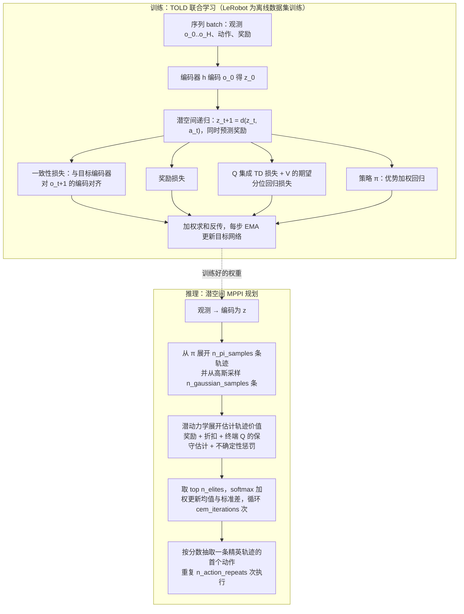
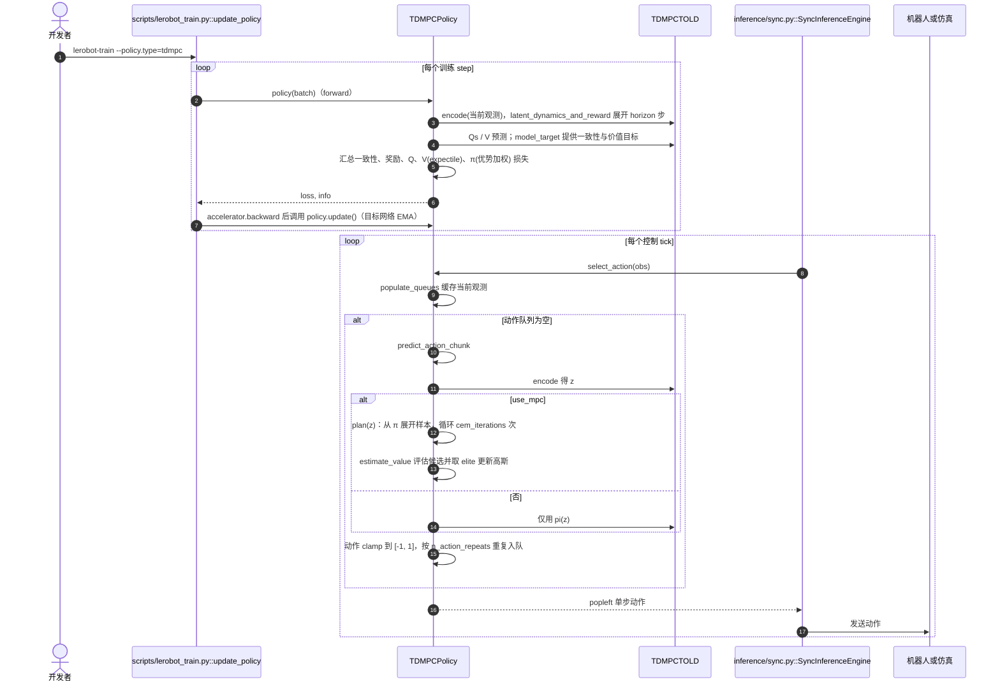

# TD-MPC：用时序差分学习训练模型预测控制

**TD-MPC**（*Temporal Difference Learning for Model Predictive Control*，[arXiv:2203.04955](https://arxiv.org/abs/2203.04955)，[项目页](https://nicklashansen.github.io/td-mpc)）由 Nicklas Hansen、Xiaolong Wang、Hao Su 提出（ICML 2022），是 LeRobot README「强化学习」类里的 **TDMPC**。本页依据 arXiv PDF 与 LeRobot 固定提交 `9e5ee98` 的 `policies/tdmpc/` 源码。**同名区分：** 后继工作 [TD-MPC2](./paper-td-mpc2.md)（arXiv:2310.16828）是另一篇论文，LeRobot 实现的不是它。

## 一句话定义

**TD-MPC 在学到的潜空间里滚动一个短视距动力学模型，用 MPPI 采样优化动作序列，并用 TD 学到的价值函数补上视距之外的长期回报。**

## 英文缩写速查

| 缩写 | 英文全称 | 简要说明 |
|------|----------|----------|
| TD-MPC | Temporal Difference learning for Model Predictive Control | 本方法 |
| TOLD | Task-Oriented Latent Dynamics | 论文里被学习的模型（编码器、动力学、奖励、价值、策略） |
| MPC | Model Predictive Control | 每步重规划、只执行首段 |
| MPPI | Model Predictive Path Integral | 论文用的采样式轨迹优化 |
| CEM | Cross-Entropy Method | LeRobot 代码注释里描述该优化循环的名称 |
| FOWM | Finetuning Offline World Models in the Real World | LeRobot 实现所参照的变体，arXiv:2310.16029 |
| EMA | Exponential Moving Average | 目标网络更新方式 |

## 为什么重要

- 论文摘要称：把无模型的价值学习与有模型的短视距规划结合，在 DMControl 与 Meta-World 的状态与图像任务上样本效率与渐近性能优于此前工作；实验覆盖 92 个任务（§5）。
- 是 LeRobot 里唯一的「学潜空间世界模型 + 在线规划」策略，与 [ACT](./paper-act.md)、[Diffusion Policy](./paper-diffusion-policy.md) 等直接模仿动作的策略取向不同。
- 世界模型/Latent MPC 路线的早期基线，后续 [TD-MPC2](./paper-td-mpc2.md) 在此基础上扩展。

## 流程总览

图依据：论文 §4–§5（TOLD 目标与 MPPI 规划）与 LeRobot `modeling_tdmpc.py` 的 `forward` / `plan` / `estimate_value`。

## 核心方法

- **TOLD 联合学习（论文 §4）：** 编码器 h、潜动力学 d、奖励 R、价值 Q、策略 π 一起训练，目标是奖励预测、价值（TD）预测与潜状态一致性三项的加权和；预测完全在潜空间递归，只有首个观测过编码器，梯度沿时间反传，目标网络用 EMA。
- **一致性损失：** 不去预测未来像素或状态，而是让预测的未来潜状态靠近目标编码器对真实未来观测的编码（Eq.10）。
- **策略 π：** 论文中 π 通过最小化时间加权的 −ΣQ(z, π(sg(z))) 学习（Eq.11，DDPG/SAC 式），主要用于 TD 目标和给规划提供候选，论文称复杂任务上它单独不如规划。
- **规划：** 视距 H=5，MPPI 6 轮迭代，每轮 512 条轨迹（约 5% 来自 π），探索参数从 0.5 线性退火到 0.05（论文 §5 实现细节）。
- **与 LeRobot 实现的差异（重要）：** LeRobot 源码文件头写明其实现的是 *Finetuning Offline World Models in the Real World*（FOWM）。`TDMPCPolicy.forward` 的注释写明：TD 目标用**状态价值 V(z)** 而非 Q(z, π(z))（见 FOWM 的 Eq.3），V 用期望分位（expectile）回归训练，策略 π 用**优势加权回归**而不是最大化 Q，规划里的价值估计加入 Q 集成的标准差作为不确定性惩罚（FOWM Eq.4）。因此 LeRobot 的训练损失与上面论文 Eq.11 的原版 TD-MPC **不同**；推理时的潜空间 MPPI 规划流程则与原版同构。FOWM 论文本次只读了 arXiv 摘要，上述对应关系依据 LeRobot 源码注释，未对照 FOWM 全文。

## 评测

- 本页只记录读到的口径：论文在 DMControl 与 Meta-World v2 共 92 个任务上评测，覆盖稀疏奖励、高维状态与动作、图像观测、多模态输入、目标条件与多任务设置（§5）；本页**未搬运**具体数值表。
- LeRobot 侧的复现状态（`TDMPCPolicy` docstring）：用 FOWM 原代码在 `xarm_lift_medium_replay` 上训练的权重移植到 LeRobot 后，评估成功指标一致；**未验证** 在 LeRobot 内训练能复现 FOWM 的结果；另验证过可以在 PushT 上训练。

## 结论

**TD-MPC 用「潜空间短视距规划 + 学到的终端价值」兼顾样本效率与长期回报，是 LeRobot 中的模型基 RL 入口；但 LeRobot 版是 FOWM 变体且训练复现未验证，用作基线前要先确认目标。**

- 数据需要带奖励（`next.reward`）和状态/单相机图像；LeRobot 默认配置面向 `xarm_lift_medium_replay`
- 推理每个控制步都要跑 MPPI 迭代（默认 6 轮、512 条高斯样本加 51 条策略样本），单步耗时比单次前向的模仿学习策略更长
- LeRobot 训练脚本是通用的离线训练循环，不含论文里的在线交互与回放采样环节（`lerobot_train.py` 只对数据集 batch 做更新并调用 `policy.update()` 更新目标网络；是否另有在线微调脚本本次未核对）
- 需要多任务/更大规模时应看 [TD-MPC2](./paper-td-mpc2.md)，不要把两者的数字混用

## 源码运行时序图

节点来自 LeRobot 固定提交 `9e5ee98`（路径相对 `src/lerobot/`），已对照 `policies/tdmpc/modeling_tdmpc.py`、`configuration_tdmpc.py`、`scripts/lerobot_train.py`、`inference/sync.py`。

官方原版 `nicklashansen/tdmpc` 与 FOWM 仓库 `fyhMer/fowm` 的入口本次未读，故不另画。

## LeRobot 实现要点

- **身份核对：** `docs/source/policy_tdmpc_README.md` 只含 TD-MPC 项目页链接与 Hansen 等 ICML 2022 的 BibTeX；`modeling_tdmpc.py` / `configuration_tdmpc.py` 文件头同时列出 TD-MPC（2203.04955）与 FOWM（2310.16029）两篇论文，并写明实现的是 FOWM。arXiv 摘要页核对 TD-MPC 标题、作者与日期无误。
- **默认配置（`configuration_tdmpc.py` 读到的值）：** `horizon=5`、`n_action_repeats=2`、`n_action_steps=1`、`latent_dim=50`、`q_ensemble_size=5`、`mlp_dim=512`、`discount=0.9`、`cem_iterations=6`、`n_gaussian_samples=512`、`n_pi_samples=51`、`n_elites=50`、`expectile_weight=0.9`、`optimizer_lr=3e-4`；默认面向 `xarm_lift_medium_replay`。
- **限制：** 仅支持 `n_obs_steps=1`、至多一路图像；`n_action_steps>1` 需 `n_action_repeats=1`、`use_mpc=True` 且不超过 `horizon`；源码注释称现有 xarm 数据集由 FOWM 环境生成，与 LeRobot 自己的 xarm 环境不匹配。
- **目标网络更新：** 源码注释称 FOWM 原代码每 2 步更新一次（衰减 0.99），LeRobot 改为每步更新并把动量调成 0.995。
- **硬件参考：** `docs/source/hardware_guide.mdx` 把 `tdmpc` 归入轻量级（约 2 至 6GB）。

## 局限与风险

- LeRobot 训练复现性未经 FOWM 验证（上游自述）。
- 推理需迭代规划，延迟与单次前向策略不可比。
- 论文与 LeRobot 损失不一致，引用实验结果时需区分是原版 TD-MPC、FOWM 还是 LeRobot 版。

## 与其他工作对比

| 工作 | 路线 | 备注 |
|------|------|------|
| TD-MPC（本页） | 潜空间动力学 + MPPI + TD 价值 | 状态与图像连续控制 |
| [TD-MPC2](./paper-td-mpc2.md) | TD-MPC 的可扩展后继 | 不同论文，LeRobot 未实现 |
| [PlaNet](./paper-planet-latent-dynamics.md) | 潜动力学 + 在线规划 | 更早的潜空间规划工作 |
| FOWM（本库无独立页） | 离线预训练世界模型加在线微调 | LeRobot 实际参照的变体 |

## 关联页面

- [Model-Based RL](../methods/model-based-rl.md)
- [强化学习](../methods/reinforcement-learning.md)
- [潜空间想象](../concepts/latent-imagination.md)
- [TD-MPC2](./paper-td-mpc2.md)
- [PlaNet](./paper-planet-latent-dynamics.md)
- [LeRobot](./lerobot.md)

## 参考来源

- [tdmpc_arxiv_2203_04955](../../sources/papers/tdmpc_arxiv_2203_04955.md)
- [lerobot](../../sources/repos/lerobot.md) — 固定提交 9e5ee98 的 `policies/tdmpc/` 与文档
- [arXiv:2203.04955](https://arxiv.org/abs/2203.04955)
- [FOWM arXiv:2310.16029](https://arxiv.org/abs/2310.16029)（仅读摘要）
- [项目页](https://nicklashansen.github.io/td-mpc)
- [LeRobot TDMPC 文档](https://github.com/huggingface/lerobot/blob/9e5ee9859480e425a97a6836bb3fee479539beb5/docs/source/policy_tdmpc_README.md)
