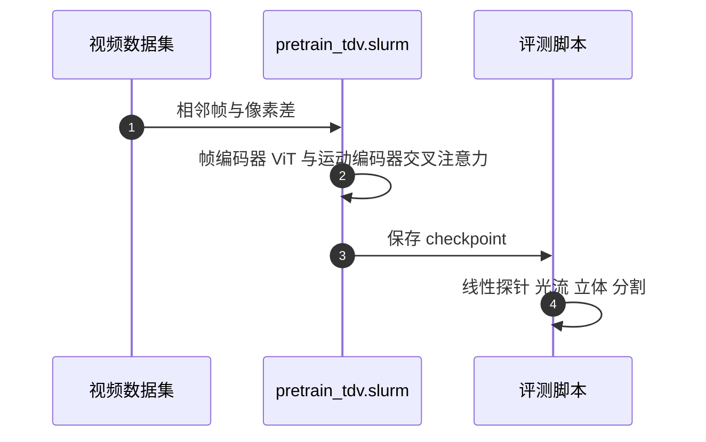

# TDV（仅用时序差分的视觉表示学习）

**TDV** 只假设「过去导出未来」这一时序因果，不使用视觉领域常用的裁剪、色彩扰动、掩码或对比损失，直接从视频学习视觉表示。

## 英文缩写速查

| 缩写 | 英文全称 | 简要说明 |
|------|----------|----------|
| TDV | Temporal Differences for Vision | 本文方法名（文中以标题缩写使用） |
| ViT | Vision Transformer | 帧编码器骨干 |
| KNN | k-Nearest Neighbors | 文中用于评估冻结特征的语义检索指标 |
| DINO | self-DIstillation with NO labels | 文中对照的强视觉自监督方法 |

## 为什么重要

多数视觉自监督依赖大量人工设计的不变性（如裁剪、色彩扰动）。TDV 显示，在足够数据下可以去掉这些归纳偏置；这对理解「世界模型需要多少先验」有参考价值。

## 核心信息

- 代码：<https://github.com/ninaddaithankar/TDV>（Apache-2.0）
- 项目页：<https://temporal-difference-vision.github.io/>
- 作者与机构：本次入库未核对（项目页与仓库未在本次抓取中列出）

## 核心原理（方法栈）

1. **帧编码器**：标准 ViT，全程不做裁剪与色彩扰动。
2. **运动编码器**：输入相邻帧像素差。
3. **耦合**：通过交叉注意力把运动特征绑定到当前帧特征。
4. **目标**：仅依靠时序因果进行预训练，无额外对比或掩码目标。

## 源码运行时序图

复现路径：Python 3.11 + PyTorch（CUDA 12.6），编辑 `job_scripts/pretrain_tdv.slurm` 后提交训练；评测需在脚本中配置 checkpoint 与数据路径。

## 实验与评测

- 文章转述：光流、立体深度等稠密空间任务上，TDV 接近或超过 DINO、iBOT。
- 文章转述：ImageNet KNN 上 ViT-B Top-5 为 17.05，DINO 同规格为 40.89，语义任务差距明显。
- 数字来自文章转述，未在论文原表中核对。

## 工程实践

- 训练依赖 SLURM 集群脚本；README 给出线性探针、光流、立体、分割四类评测脚本。
- 无独立推理脚本；评测脚本需要已配置的数据集与 checkpoint。

## 局限与风险

- 语义表示明显弱于 DINO 一类方法，不宜直接替代通用视觉骨干。
- 文章称数据规模越大优势越明显，但这是转述的对照结论，尚需论文原文确认。

## 与其他工作对比

| 维度 | TDV | [LeVJEPA](./paper-levjepa.md) |
|------|-----|------------------------------|
| 归纳偏置 | 无（仅时序因果） | 保留 SIGReg 等分布正则 |
| 强项 | 稠密空间任务 | 视频预训练效率 |

## 结论

**去掉视觉归纳偏置在稠密空间任务上可行，但语义能力是明显代价。**

1. **偏置取舍** — 去掉手工不变性后，空间任务表现接近强基线。
2. **语义代价** — ImageNet KNN 差距大，不适合作为通用语义特征。
3. **数据依赖** — 文章称大数据下优势更明显，需以论文实验为准。
4. **代码可用** — 训练与评测脚本齐全，便于复验。

## 关联页面

- [LeVJEPA](./paper-levjepa.md) — 同样面向视频自监督，但保留分布正则
- [LeJEPA](./paper-lejepa.md) — 视觉 JEPA 的分布匹配前序工作
- [LeWorldModel](./paper-lewm.md) — 视觉世界模型的端到端对照

## 参考来源

- [TDV 论文归档](../../sources/papers/tdv_arxiv_2606_15956.md)
- [TDV 仓库归档](../../sources/repos/tdv.md)
- [深蓝具身智能文章归档](../../sources/blogs/wechat_deepblue_lecun_jepa_11_papers_2026-10-20.md)

## 推荐继续阅读

- [TDV 项目页](https://temporal-difference-vision.github.io/)
- [TDV 论文 PDF](https://temporal-difference-vision.github.io/static/pdfs/tdv.pdf)
