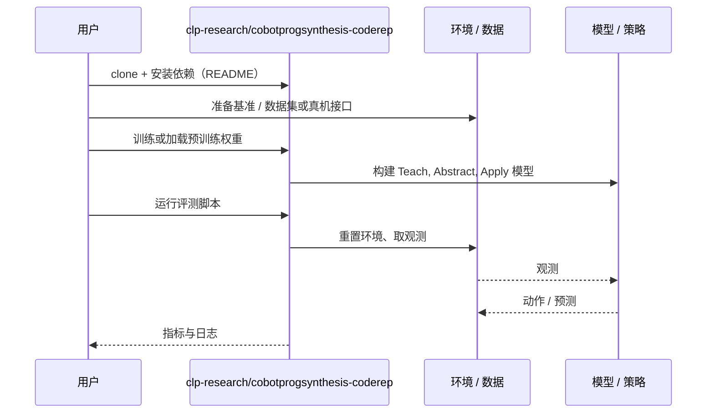

# Teach, Abstract, Apply（arXiv:2611.00297）

**Teach, Abstract, Apply**（*Teach, Abstract, Apply: A Framework for Dialogue-Driven Task Learning with Collaborative Robots*，[arXiv:2611.00297](https://arxiv.org/abs/2611.00297)，[代码](https://github.com/clp-research/cobotprogsynthesis-coderep)）来自 [具身智能小站 2026-11-03 盘点](../../sources/blogs/wechat_embodied_station_49_papers_sacq_action_aware_quantization_2026-11-03.md)，属「世界模型、记忆与交互」组。

## 一句话定义

**将自然语言教学、流程抽象和技能复用串联起来，在协作搭建任务中检验交互成本与成功表现；人参与实验仍属初步验证，需关注任务范围。**

## 英文缩写速查

| 缩写 | 英文全称 | 简要说明 |
|------|----------|----------|
| Teach, Abstract, Apply | Teach, Abstract, Apply: A Framework for Dialogue-Driven Task Learning with Collaborative Robots | 本文方法 / 基准的简称 |

## 为什么重要

- 通过对话积累可复用技能。
- 开源结论：**已开源**（步骤 2.5，2026-11-03）。仓库可达（git ls-remote）。
- 同期同组工作见 [动作感知量化、失败定位与可验证自主：具身智能小站 11-03 期 49 篇阅读坐标](../overview/embodied-station-2026-11-03-49-papers-technology-map.md)。

## 核心机制

| 项 | 内容 |
|----|------|
| **arXiv** | [2611.00297](https://arxiv.org/abs/2611.00297) |
| **开源** | **已开源** |
| **要点** | 将自然语言教学、流程抽象和技能复用串联起来，在协作搭建任务中检验交互成本与成功表现；人参与实验仍属初步验证，需关注任务范围。 |
| **文内指标** | 公众号未给具体数字，本页不引用。 |

## 源码运行时序图

以下为按仓库入口（`clp-research/cobotprogsynthesis-coderep`）推断的通用运行链路；入库日仅核实仓库可达，未逐文件阅读，具体脚本名以 README 为准。

## 实验与评测

- 公众号未给具体数字，本页不引用。
- **读法：** 本页为索引级摘要，依据公众号转述的官方摘要与仓库信息整理；逐项数字与 baseline 以原文 PDF 为准。

## 与其他工作对比

- 横向索引见 [动作感知量化、失败定位与可验证自主：具身智能小站 11-03 期 49 篇阅读坐标](../overview/embodied-station-2026-11-03-49-papers-technology-map.md)；同 arXiv 不重复造页。

## 结论

**通过对话积累可复用技能：将自然语言教学、流程抽象和技能复用串联起来，在协作搭建任务中检验交互成本与成功表现；人参与实验仍属初步验证，需关注任务范围。**

1. 开源边界：**已开源** — 仓库可达（git ls-remote）。
2. 核心机制：将自然语言教学、流程抽象和技能复用串联起来，在协作搭建任务中检验交互成本与成功表现；人参与实验仍属初步验证，需关注任务范围。
3. 复现与选型前核对任务协议、硬件与基准口径，勿直接横比公众号摘录数字。

## 关联页面

- [world-action-models](../concepts/world-action-models.md)
- [generative-world-models](../methods/generative-world-models.md)
- [vla](../methods/vla.md)
- [llm-robotics-control-interfaces](../concepts/llm-robotics-control-interfaces.md)
- [embodied-station-2026-11-03-49-papers-technology-map](../overview/embodied-station-2026-11-03-49-papers-technology-map.md)

## 参考来源

- [teach_abstract_apply_arxiv_2611_00297.md](../../sources/papers/teach_abstract_apply_arxiv_2611_00297.md)
- [wechat_embodied_station_49_papers_sacq_action_aware_quantization_2026-11-03.md](../../sources/blogs/wechat_embodied_station_49_papers_sacq_action_aware_quantization_2026-11-03.md)
- [arXiv:2611.00297](https://arxiv.org/abs/2611.00297)

## 推荐继续阅读

- [arXiv PDF](https://arxiv.org/pdf/2611.00297)
- [https://github.com/clp-research/cobotprogsynthesis-coderep](https://github.com/clp-research/cobotprogsynthesis-coderep)
