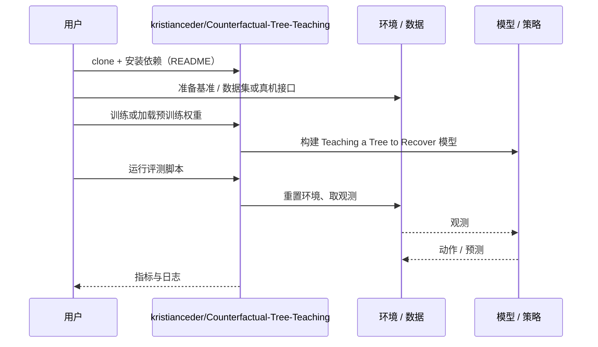

# Teaching a Tree to Recover（arXiv:2610.39775）

**Teaching a Tree to Recover**（*Teaching a Tree to Recover: Online Distillation of an LLM Supervisor with Counterfactual Replay*，[arXiv:2610.39775](https://arxiv.org/abs/2610.39775)，[代码](https://github.com/kristianceder/Counterfactual-Tree-Teaching)）来自 [具身智能小站 2026-10-30 盘点](../../sources/blogs/wechat_embodied_station_28_papers_event2reward_progress_rewards_2026-10-30.md)，属「奖励学习与 VLA 策略」组。

## 一句话定义

**利用反事实回放判断恢复动作是否必要或有害，在线更新决策树。**

## 英文缩写速查

| 缩写 | 英文全称 | 简要说明 |
|------|----------|----------|
| Teaching a Tree to Recover | Teaching a Tree to Recover: Online Distillation of an LLM Supervisor with Counterfactual Replay | 本文方法 / 基准的简称 |

## 为什么重要

- 把语言模型的脱困经验教给决策树。测试时无需调用语言模型即可处理熟悉类型的异常；当前主要证据来自预设导航布局的仿真。
- 开源结论：**已开源**（步骤 2.5，2026-10-30）。仓库可达（git ls-remote）。
- 同期同组工作见 [进度奖励、接触监督与规划验证：具身智能小站 10-30 期 28 篇阅读坐标](../overview/embodied-station-2026-10-30-28-papers-technology-map.md)。

## 核心机制

| 项 | 内容 |
|----|------|
| **arXiv** | [2610.39775](https://arxiv.org/abs/2610.39775) |
| **开源** | **已开源** |
| **要点** | 利用反事实回放判断恢复动作是否必要或有害，在线更新决策树。 |
| **文内指标** | 公众号转述：测试时无需调用语言模型即可处理熟悉类型的异常；当前主要证据来自预设导航布局的仿真。 |

## 源码运行时序图

以下为按仓库入口（`kristianceder/Counterfactual-Tree-Teaching`）推断的通用运行链路；入库日仅核实仓库可达，未逐文件阅读，具体脚本名以 README 为准。

## 实验与评测

- 公众号转述：测试时无需调用语言模型即可处理熟悉类型的异常；当前主要证据来自预设导航布局的仿真。
- **读法：** 本页为索引级摘要，依据公众号转述的官方摘要与仓库信息整理；逐项数字与 baseline 以原文 PDF 为准。

## 与其他工作对比

- 横向索引见 [进度奖励、接触监督与规划验证：具身智能小站 10-30 期 28 篇阅读坐标](../overview/embodied-station-2026-10-30-28-papers-technology-map.md)；同 arXiv 不重复造页。

## 结论

**把语言模型的脱困经验教给决策树：测试时无需调用语言模型即可处理熟悉类型的异常；当前主要证据来自预设导航布局的仿真。**

1. 开源边界：**已开源** — 仓库可达（git ls-remote）。
2. 核心机制：利用反事实回放判断恢复动作是否必要或有害，在线更新决策树。
3. 复现与选型前核对任务协议、硬件与基准口径，勿直接横比公众号摘录数字。

## 关联页面

- [reinforcement-learning](../methods/reinforcement-learning.md)
- [vla](../methods/vla.md)
- [imitation-learning](../methods/imitation-learning.md)
- [embodied-station-2026-10-30-28-papers-technology-map](../overview/embodied-station-2026-10-30-28-papers-technology-map.md)

## 参考来源

- [teaching_a_tree_to_recover_arxiv_2610_39775.md](../../sources/papers/teaching_a_tree_to_recover_arxiv_2610_39775.md)
- [wechat_embodied_station_28_papers_event2reward_progress_rewards_2026-10-30.md](../../sources/blogs/wechat_embodied_station_28_papers_event2reward_progress_rewards_2026-10-30.md)
- [arXiv:2610.39775](https://arxiv.org/abs/2610.39775)

## 推荐继续阅读

- [arXiv PDF](https://arxiv.org/pdf/2610.39775)
- [https://github.com/kristianceder/Counterfactual-Tree-Teaching](https://github.com/kristianceder/Counterfactual-Tree-Teaching)
