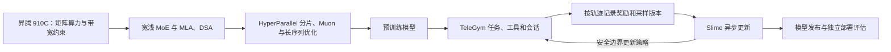
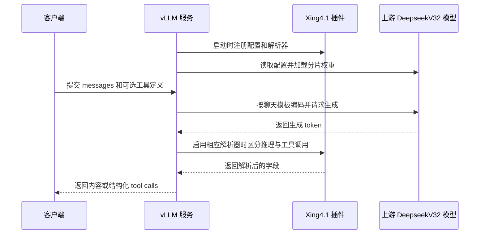

# TeleChat to Xing4: Advancing Frontier Agentic Models on Domestic Chips and Frameworks · 从 TeleChat 到 Xing4：昇腾与 MindSpore 上的智能体模型

## 一句话定义

Xing 4 技术报告把长上下文模型结构、昇腾集群训练和 TeleGym 智能体强化学习放在同一条链路中解释；配套的 Xing4.1-Preview 公开了可单独部署的模型权重与推理接入资料。

## 英文缩写速查

| 缩写 | 英文全称 | 简要说明 |
|---|---|---|
| MoE | Mixture of Experts | 每个 token 只路由到部分专家 |
| MLA | Multi-head Latent Attention | 压缩键值表示，降低缓存体积 |
| DSA | DeepSeek Sparse Attention | 用索引筛选历史键值，再计算稀疏注意力 |
| HSDP | Hybrid Sharded Data Parallelism | 高带宽域内分片，域间复制 |
| MTP | Multi-Token Prediction | 多 token 预测训练目标，也可提供单独的推测解码路径 |
| TTFT | Time to First Token | 从提交请求到收到首 token 的时间 |
| TPOT | Time per Output Token | 输出阶段平均每 token 耗时 |

## 核心信息

| 项目 | 技术报告与发布口径 |
|---|---|
| 机构 | 中国电信人工智能（TeleAI），星辰 AGI 实验室 |
| 报告版本 | arXiv:2611.22115v1，2026-11-17 |
| 报告中的已公开小模型 | Xing4.0-29B-A4B：29B 总参数、4B 激活、256K 上下文，40 层、64 个路由专家，每 token 选择 4 个，另有共享专家 |
| 报告中的大模型研究配置 | 285B 总参数、约 17B 激活、最长约 1M token；作者报告在 8,192 张昇腾 910C 上用 MindSpore 预训练 |
| 后续权重发布 | Xing4.1-Preview 模型卡给出 285B/17B、1M；已核对 Hugging Face 和 ModelScope 的 PyTorch safetensors 文件清单，另有原生 MindSpore 权重入口 |
| 公开边界 | 有权重、模型代码、部署指南和 vLLM 兼容插件；未核实完整预训练语料、TeleGym 任务集与端到端后训练栈的公开发布 |

## 为什么重要

长上下文服务不只是增加最大 token 数。MLA 减少驻留缓存，DSA 减少历史访问，IndexShare 在报告配置中减少重复索引；三者优化的是不同的成本。训练则要同时处理通信、激活显存和主机调度。Preview 是可取得的发布物，报告里的仿真、集群测量、推理组件并非发布容器的默认实测能力。

## 核心原理与训练流程

- **模型结构：** 285B 配置保留前 3 层稠密 FFN，其余采用 MoE；45 层、隐藏维数 4,096，256 个路由专家，每 token 取 8 个，另有 1 个共享专家。与 60 层候选相比，45 层方案提高专家 FFN 宽度、减少逐层调度开销。MLA 压缩 KV，DSA 选 Top-K，报告还研究跨层索引复用及 DSpark 分块推测解码；后两者不能仅凭公开配置文件认定已在具体部署启用。
- **分布式预训练：** HyperParallel 在超节点内把参数分片，超节点间保留副本，重叠域内 AllGather、ReduceScatter 与域间融合 AllReduce；支持的 Muon 布局由每个矩阵的指定 rank 做一次全矩阵正交化，再把更新切片分回原 rank。选算子保留、逐层提前执行索引器反向、Q 块配对与按文档裁剪 KV 窗口分别处理重算开销、激活生命周期与不均衡访存。
- **TeleGym 后训练：** 统一 episode 生命周期与沙箱适配，但保留各 harness 的工具与会话语义。中间服务器关联模型请求、工具结果和评估奖励，Slime 负责采样调度与优化。按任务规范生成并执行验证样例，不把未完成前缀当成带终止奖励的样本。
- **异步与恢复：** 有界超采样限制待完成和待训练的组；策略同步时暂停接收生成请求，在安全边界替换权重并恢复原任务。各段保存采样时的 log probability 和策略版本，用于识别滞后数据；训练检查点另外持久化缓冲区与任务游标。主机侧把训练线程的 CPU 亲和性与可迁移中断隔离结合，减少集体通信的拖尾。

## 评测与证据边界

| 证据 | 作者报告的数字 | 读法 |
|---|---|---|
| 报告表 1–2：285B 注意力 | 256K、32 张 910C 的分离式推理仿真里，MLA + DSA + IndexShare 的预填充吞吐为 MLA 的 4.68 倍，解码吞吐 1.27 倍 | 不是 1M 线上 API 实测 |
| 报告表 5：285B 推测解码 | 六项数学或编程工作负载中 DSpark 输出吞吐为无推测基线的 2.67–3.77 倍 | 未据此认定 Preview 默认启用 DSpark |
| 报告表 7、8、10、11：训练剖析 | 1,024 卡、262,144 token 下，朴素流水 36.4 s/步，HSDP 31.8 s，再换 owner Muon 为 28.9 s；从 28.9 s 分别单独加选择性重算或索引器逐层反向为 26.9 s 或 24.5 s | 不是把独立消融串联；表 7 口径也不等同于摘要列出的 16.1% |
| 报告 §5：CPU 调度 | 绑核加隔离在 512 卡报告提升 1–2%，8,192 卡提升 5–10% | 集群、任务和对照配置限定结论 |
| Preview 模型卡：编码与 Agent | SWE-Bench Pro V2 Hard51 74.5、Terminal-Bench 2.1 80.8、AA.LCR 79.67 | 发布方评估；Hard51 是子集，Terminal-Bench 的模型间对照还用了不同 harness |

## 工程实践：公开推理链路

对照 [官方部署指南与插件源码](../../sources/repos/xing4-1-preview.md)：以 vLLM 为例，插件在服务和工作进程启动时注册模型配置识别和 Xing 系列解析器，模型执行走上游 `DeepseekV32ForCausalLM`。复用 `xing4_0` 解析器名称不意味着加载了 4.0 权重。工具调用解析成结构化输出后，是否授权并执行仍由调用方决定，不由模型插件完成。

## 与其他工作对比

[Agnes/SGLang 专用化](paper-agnes-inference-framework-specialization.md) 从 Blackwell/PCIe 现有推理栈切入，按硬件与负载选择预填充、解码和缓存路径；Xing 4 报告还改变模型深宽、稀疏注意力及昇腾的训练拓扑。两者可用于定位长上下文成本，但基线模型、硬件、上下文和并发不同，预填充倍数不能横比。TeleGym 的轨迹与策略版本设计则更接近 [编码 Agent 验证闭环](../methods/coding-agent-verification-loops.md) 的执行与回归问题，区别在于其结果还要作为强化学习训练数据。

## 局限与风险

约 17B 激活不等于只加载 17B 权重。官方指南的 8×80 GB 是 BF16 权重部署量级参考；并发、工作区与 KV 缓存会占用额外资源，1M 位置上限不保证在该配置下可同时承载多个 1M 请求。未下载全量权重、未跑集群训练或长上下文复测。评测披露也不意味着该模型已验证机器人控制或安全实机任务。

## 结论

这份报告适合作为算力架构、长上下文和智能体后训练的系统设计案例，选型时应把论文研究配置与可部署工件分开验证。

- 存储与显存按总权重、KV、并发和运行时开销核算，先确定实际请求上限。
- 比较长上下文服务时固定提示词长度、并发、后端和版本，同时测 TTFT、TPOT、尾延迟和成功率。
- 比较 coding agent 时锁定 harness、工具预算、评测子集及采样设置，分别记录模型与执行层故障。
- 自建异步后训练时记录 episode、采样版本与 log probability，验证暂停恢复和检查点边界后再扩大集群。

## 关联页面

- [AI 模型推理与服务部署](../methods/ai-model-serving-inference.md)：复测实际服务中的并发、延迟和缓存预算。
- [智能体工具调用接口](../methods/agent-tool-use-interface.md)：区分生成、解析和执行责任。
- [编码 Agent 验证闭环](../methods/coding-agent-verification-loops.md)：设计可执行且可判定的任务。

## 参考来源

- [Xing 4 技术报告 v1 归档](../../sources/papers/telechat_xing4_arxiv_2611_22115.md)
- [Xing4.1-Preview 模型卡与权重归档](../../sources/models/xing4-1-preview.md)
- [官方部署资料与实际插件源码归档](../../sources/repos/xing4-1-preview.md)

## 推荐继续阅读

- [原文 §2.2 与 §2.4](https://arxiv.org/html/2611.22115v1#S2)：先核对注意力和推测解码的各自基线。
- [原文 §4](https://arxiv.org/html/2611.22115v1#S4)：查看任务生命周期、样本滞后和恢复边界。
