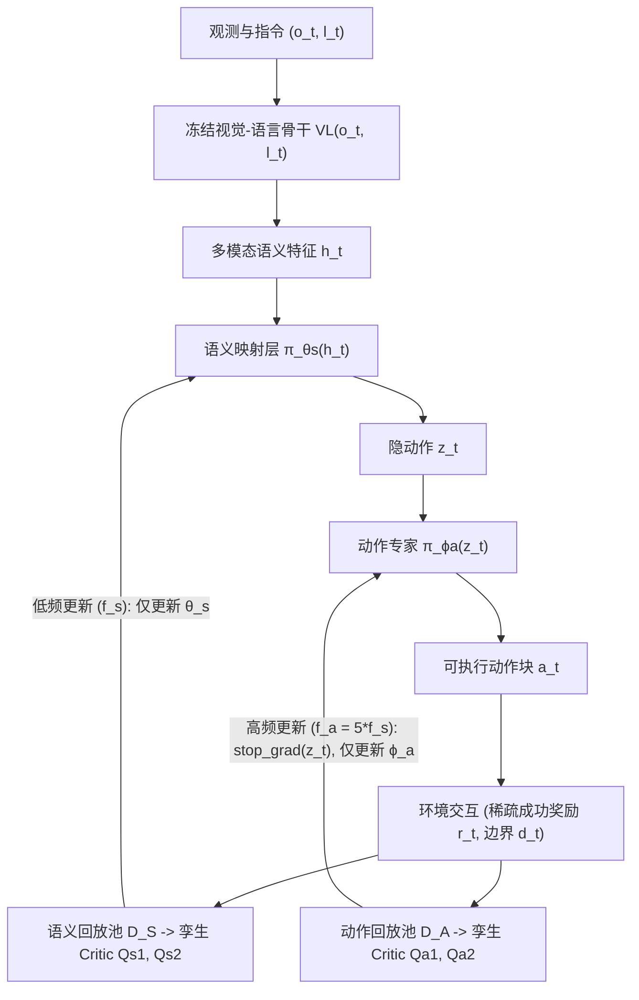

# TEMPO: Semantic-Action Decoupled RL Post-Training for VLAs

## 一句话定义

**TEMPO**（arXiv:2608.07314 v2）是一种面向[视觉-语言-动作策略（VLA）](../methods/vla.md)的语义-动作双时间尺度[强化学习后训练](../methods/reinforcement-learning.md)框架：完全冻结预训练 VLM 骨干，仅为**语义映射层**与**底层动作专家**各自设立独立 TD3 回放与评论员循环，并以低于动作专家的频率（推荐 $f_a:f_s = 5:1$）更新语义映射，抑制隐动作漂移（latent-action drift）同时保持高频控制反馈吸收。

## 英文缩写速查

| 缩写 | 英文全称 | 简要说明 |
| :--- | :--- | :--- |
| **TEMPO** | Semantic-Action Decoupled RL Post-Training for VLAs | 本文提出的双环双时间尺度 VLA 在线 RL 后训练框架（勿与 arXiv:2609.16864 同名动态操作框架混淆） |
| **TD3** | Twin Delayed Deep Deterministic Policy Gradient | 孪生延迟深度确定性策略梯度算法；TEMPO 语义环与动作环各自独立运行一套 TD3 |
| **VLA** | Vision-Language-Action Model | 视觉-语言-动作联合策略模型（主实验以 FLOWER 与 VLA-Adapter-Pro 为验证底座） |
| **Avg. Len.** | Average Sequence Length | CALVIN 连续五指令链条平均连续完成任务数（满分 5.0） |
| **SR5** | 5-Task Consecutive Success Rate | CALVIN 五指令序列全通关成功率（%） |

## 为什么重要

现有 VLA 在线 RL 后训练（如 VLA-RL、SimpleVLA-RL 等）普遍把可训练模块放入单一 RL 闭环按同一频率联合更新，忽视了语义表征模块与连续控制模块在梯度尺度与平稳性上的根本冲突：

1. **抑制隐动作目标漂移（Latent-Action Drift）：** 语义映射层输出隐动作 $z_t$ 作为动作专家的条件输入。如果语义映射随每个批次高频大幅摆动，动作专家就必须在不断移动的条件流形上学习动作分布，严重拖慢并恶化收敛（实验中 $1:1$ 等频双环漂移高达 0.641，SR5 反而跌至 `77.7%`，低于预训练 FLOWER 的 `77.8%`）。
2. **保护互联网规模预训练语义：** 直接对 VLM 主干施加在线 RL 梯度既耗算力又容易破坏图文先验；冻结 $\text{VL}$，仅微调轻量语义映射层 $\pi_{\theta_s}$，在保留语义泛化的同时允许任务条件接口适配。
3. **验证跨架构可迁移性：** v2 版本除了在 FLOWER 上取得优势，也将同一双环 5:1 策略接入 `VLA-Adapter-Pro` 逐层 K/V 投影模块，验证了「慢语义 + 快控制」原则在不同解码接口上均可复现稳定增益。

## 核心原理与方法架构

TEMPO 将 FLOWER（或同类模块化 VLA）分解为三段计算图 $h_t = \text{VL}(o_t, \ell_t) \rightarrow z_t = \pi_{\theta_s}(h_t) \rightarrow a_t = \pi_{\phi_a}(z_t)$，并围绕它们搭建两条隔离梯度流且异步调度更新频率的 TD3 学习环：

### 1. 模块级双 TD3 学习环（Sec. III-B–D, Eq. 3–12）

- **共享交互，隔离优化空间：** 环境返回稀疏完成奖励 $r_t \in \{0, 1\}$；在长程多指令序列中，**每当当前活跃子指令结束时 $d_t = 1$**，在子指令边界严格截断 Bellman 自举。
- **语义级 TD3：** 缓冲区 $D_S = \{(h_t, z_t, r_t, h_{t+1}, d_t)\}$，孪生 Critic $Q^s_1, Q^s_2$ 最小化目标 $y^S_t = r_t + \gamma(1 - d_t)\min_i \bar{Q}^s_i(h_{t+1}, \bar{\pi}_{\theta_s}(h_{t+1}))$ 的 TD 误差，Actor 目标 $L_s = -\mathbb{E}[Q^s_1(h_t, \pi_{\theta_s}(h_t))]$ **仅将梯度传给语义映射参数 $\theta$**。
- **动作级 TD3：** 缓冲区 $D_A = \{(h_t, z_t, a_t, r_t, h_{t+1}, d_t)\}$，重算当前隐动作时显式使用截断梯度 $z_t^{\text{sg}} = \operatorname{sg}(\pi_{\theta_s}(h_t))$，通过 $L_a = -\mathbb{E}[Q^a_1(z_t^{\text{sg}}, \pi_{\phi_a}(z_t^{\text{sg}}))]$ **仅更新动作专家参数 $\phi$**。

### 2. 双时间尺度频率比（Sec. III-E, Eq. 13–14）

记每轮动作与语义 Critic 更新步数分别为 $N_a, N_s$，延迟 Actor 更新周期为 $d_a, d_s$，有效更新频率比定义为 $\rho = \frac{f_a}{f_s} = \frac{N_a d_s}{N_s d_a}$。主配置取 $\rho = 5:1$（总 Critic 更新固定为 6,600 次时分配为 $5{,}500 : 1{,}100$，Actor 为 $2{,}750 : 550$），使动作专家快速吸收在线控制反馈，同时维持隐动作条件分布的准静态稳定性。

## 实验评测与方法对比

### 1. CALVIN ABC→D 长程连续操作主对比（v2 Table I & III）

在未见过的环境 D 上执行五条自然语言子指令连续长程序列（汇报 3 种子均值标准差或 1M 步对比组）：

| 方法 | 类型 / 底座 | SR1 (%) | SR3 (%) | SR5 (%) | Avg. Len. |
| :--- | :--- | :---: | :---: | :---: | :---: |
| $\pi_0$ | 预训练流匹配 VLA | 93.8 | 76.7 | 59.9 | 3.84 |
| $\pi_{0.5}$ | 开放世界 VLA | 92.7 | 77.3 | 61.2 | 3.85 |
| UNIVLA | 统一动作潜空间 VLA | 98.9 | 89.0 | 75.1 | 4.41 |
| DeFI | 解耦前向/逆向动力学 | 97.9 | 90.7 | 81.2 | 4.51 |
| FLOWER（预训练参照） | 高效流视觉-语言策略 | 99.4 | 90.7 | 77.8 | 4.49 |
| FLOWER-RL（单环 TD3） | 同频联合优化（3 种子） | 99.43 ± 0.35 | 91.87 ± 0.74 | 78.70 ± 0.70 | 4.52 ± 0.028 |
| **TEMPO（3 种子）** | **双环双频 TD3** | **99.83 ± 0.15** | **92.77 ± 0.15** | **81.70 ± 0.40** | **4.58 ± 0.005** |
| **TEMPO（5:1 典型配置）** | 5,500:1,100 Critic 步 | **100.0** | **92.9** | **81.7** | **4.59** |

### 2. 核心消融与隐动作漂移测量（Tables II–VII）

- **双组件缺一不可（Table II）：** 相比完整版（`SR5 81.7 / Avg.Len. 4.59`），固定语义映射只调动作专家（`w/o projection update`）降至 `79.8 / 4.54`，固定动作专家只调语义映射（`w/o expert update`）降至 `79.6 / 4.55`。
- **更新频率比与隐动作漂移（Tables III–V，108 条固定探索输入，`lift_blue_block_slider` 50 次试验）：**
  - 等频双环 `1:1` 产生最大漂移 $D_{\text{drift}} = 0.641$（`FLOWER-RL` 为 `0.611`），任务成功率仅 `66.0%`（`FLOWER-RL` 为 `68.0%`），CALVIN SR5 跌至 `77.7% / Avg.Len. 4.46`；
  - 将频率比拉开至 `4:1` 与 `5:1` 时，隐动作漂移分别大幅回落至 **`0.409`** 与 **`0.424`**，单任务成功率跃升至 **`98.0%`** 与 **`96.0%`**，`10:1` 下 CALVIN SR5 亦保持 `81.2% / 4.57`（耗费 13.387 PFLOPs vs 5:1 的 12.276 PFLOPs）。
- **后训练任务集规模效应（Table VI）：** 在 10:1 设置下对比训练子任务数 $1 / 2 / 4 / 7 / 34$，单任务微调 SR5 为 `81.2%`，纳入全部 34 项子任务反降至 `79.2% / 4.54`（仍优于预训练基线），表明后训练任务数据配比需仔细平衡。
- **跨策略底座通用性（Table VII）：** 将 TEMPO 应用于 `VLA-Adapter-Pro`（将其逐层 K/V 投影作为慢更新语义接口，5:1），3 种子 SR5 由 `77.23 ± 1.31%` 提升至 `79.17 ± 0.78%`（Avg. Len. `4.437 → 4.487`）。

### 3. Synria Alicia-D 三项真机任务评测（v2 Sec. IV-C, Fig. 4）

真机采用 6-DoF **Synria Alicia-D** 机械臂与单自由度夹爪，配置 Intel RealSense D435i（第三人称）及 D405（腕部）；每任务收集 60 条人类演示（共 180 条）做初始化后进行在线 RL 微调，在 3 个随机种子下对三项多阶段任务开展评估（每检查点评测 20 次）：(a) 推方块入抽屉（block sliding）、(b) 从抽屉取车放置桌面（car retrieval）、(c) 移开遮挡积木再将桌面小车放入抽屉（car placement）。当抽屉初始开合不足或目标被积木遮挡时，FLOWER-RL 往往直接硬抓目标而失败，而 TEMPO 稳定习得“先开抽屉/先移走障碍积木”前置子动作，后期累积评估奖励曲线持续明显高于 FLOWER-RL。

## 结论

**TEMPO 验证了 VLA 在线 RL 后训练不必以统一节奏“整体端到端刷梯度”——冻结 VLM 并将「慢更新语义映射」与「快更新动作专家」拆分为两条 5:1 异步 TD3 闭环，能有效压缩隐动作漂移并显著提升长程仿真与多阶段真机操作稳定性。**

- **节奏准则：** 严禁在不设频差（1:1）时同时放开语义与动作 RL 循环，这会引发严重条件漂移（$D_{\text{drift}} = 0.641$）甚至逊于预训练底座；建议优先尝试 $4:1 \sim 5:1$ 的动作-语义频率比。
- **梯度边界：** 对长程多指令拼接任务（如 CALVIN），必须在每条子指令完成处强制截断 Bellman 自举（$d_t=1$），并对输入动作专家的 $z_t$ 施加 stop-gradient 以确保两条 TD3 环解耦。
- **多任务警惕：** 同时向在线 RL 投喂全量 34 个子任务反而会稀释单任务精度，多任务后训练应控制并发任务子集并做采样均衡。
- **复现现状：** 截至 2026-11-14，论文声明的 `anonymous.4open.science` 页面已返回 HTTP 404 且未释出官方源码或权重，当前仅可按论文双环 TD3 算法与 FLOWER / VLA-Adapter-Pro 公开底座自行复现。

## 工程实践

- **开源与项目页核查结果：未开源（HTTP 404）。**
  - 原论文 `arXiv:2608.07314v2`（2026-11-12）提供的项目页链接 <https://anonymous.4open.science/w/tempo-page/> 在 2026-11-14 原件抓取验证中返回 **HTTP 404**，匿名托管空间已过期或未开放内容，目前无公开代码库与权重。
  - **重名区分提醒：** GitHub 上公开的 `tempo-robot/TEMPO` 属于另一篇动态操作论文（`arXiv:2609.16864`，CoRL 2026，聚焦 `TEMPO_MOT` 场景光流与 `TEMPO_ACT` 本体历史注入），与本篇双时间尺度 TD3 后训练毫无代码关联。
- **自复现关键配置参数（源自 Table IV 与 Sec. III–IV）：**
  - **算力与更新量（1M env steps 参照）：** `5:1` 设置需约 `12.276 PFLOPs`（5,500 次动作 Critic / 2,750 次动作 Actor 更新 vs 1,100 次语义 Critic / 550 次语义 Actor 更新，延迟参数 $d_a = d_s = 2$）。
  - **块级动作 MDP：** 整个闭环在[动作分块（Action Chunking）](../methods/action-chunking.md)尺度而非单帧步长上执行奖励归因与 TD3 回放更新。

## 源码运行时序图

**不适用。** 经 2026-11-14 核实，原论文标注的唯一项目页面 `https://anonymous.4open.science/w/tempo-page/` 返回 HTTP 404，作者尚未公开任何可运行的 GitHub 源码、训练脚本或权重检查点，因此无源码入口与调用链可供映射。

## 局限与风险

1. **尚未开源导致复现门槛高：** 匿名项目页已失效（HTTP 404），官方双环异步 TD3 调度、Twin Critic 结构参数与真机硬件接口细节未随代码公开，第三方基于 FLOWER 复现存在调参偏差风险。
2. **假定模块可显式拆分为语义接口与动作专家：** 依赖如 FLOWER 或 VLA-Adapter-Pro 的模块化接口（存在清晰语义投影 $z_t$ 或 K/V 接口），对高度耦合的单一自回归离散 token VLA 需重新定义可分离瓶颈。
3. **固定频率比缺乏自适应调度：** 论文手工搜索 $4:1$ / $5:1$ 等静态频率比，跨任务难度剧烈变化或隐动作 drift 突然放大时缺少根据监测指标自动降频/回滚的闭环控制。

## 关联页面

- 方法与机制：[VLA 综述](../methods/vla.md) · [动作分块（Action Chunking）](../methods/action-chunking.md) · [强化学习与后训练](../methods/reinforcement-learning.md) · [DeFI 解耦动力学 VLA](../methods/defi-decoupled-dynamics-vla.md)
- 基准与对照：[CALVIN 基准](./calvin-benchmark.md) · [在线 RL vs 离线 RL](../comparisons/online-vs-offline-rl.md) · [Temporal-GRPO](./paper-temporal-grpo.md)
- 领域脉络与路线图：[VLA 开源复现图景 (2025)](../overview/vla-open-source-repro-landscape-2025.md) · [VLA 周报技术版图 (2026-08-10)](../overview/vla-weekly-trends-2026-08-10-part1-technology-map.md) · [VLA 深度路线图](../../roadmap/depth-vla.md)

## 参考来源

- **论文精读归档：** [arXiv:2608.07314v2 TEMPO 论文归档](../../sources/papers/tempo_arxiv_2608_07314.md)
- **项目页 404 核查档案：** [anonymous.4open.science/w/tempo-page 访问核实档案](../../sources/sites/tempo-anonymous-4open.md)
- **行业追踪摘要：** [多模态 VLA 周报（2026-08-10 Part 1）](../../sources/blogs/wechat_duomo_vla_weekly_trends_2026-08-10_part1.md)

## 推荐继续阅读

- 想对比同样在“冻结骨干/分模块适配”上做文章的长程基准冠军工作，请看：[DeFI 解耦前向与逆向动力学](../methods/defi-decoupled-dynamics-vla.md)。
- 想对比同一时间段不需要双时间尺度拆分、而是重构 Critic 或优化目标的在线 RL 思路，请看：[WCM 世界评论员模型](./paper-wcm-world-critic-model.md) 与 [Prism-GRPO](./paper-prism-grpo.md)。
