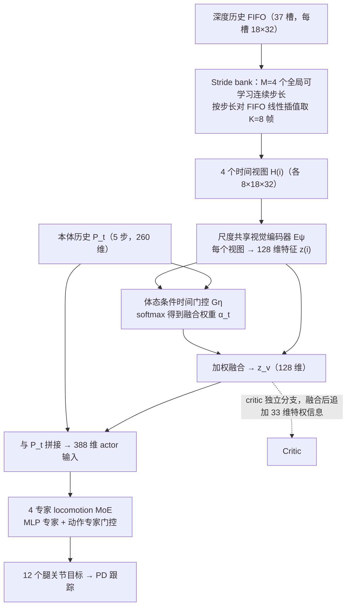

# TempoLoco（arXiv:2610.14753）

**TempoLoco**（*Beyond Fixed Visual History: Learning Motion-Adaptive Temporal Receptive Fields for Complex-Terrain Quadruped Locomotion*，[arXiv:2610.14753](https://arxiv.org/abs/2610.14753)，[项目页](https://capability-aware.github.io/)）来自 [具身智能小站 2026-10-14 盘点](../../sources/blogs/wechat_embodied_station_41_papers_streamingwam_2026-10-14.md)，属「导航、足式与规划」组。

## 一句话定义

**从长深度历史学习互补时间视图，再按本体状态与地形动态融合，让视觉提前量适应运动能力。**

## 英文缩写速查

| 缩写 | 英文全称 | 简要说明 |
|------|----------|----------|
| TRF | Temporal Receptive Field | 时间感受野 |
| B2 | Unitree B2 | 四足平台 |
| RL | Reinforcement Learning | 强化学习 |

## 为什么重要

- 固定视觉历史无法随速度/地形变化调整提前量。
- 开源结论：**部分开源**（步骤 2.5，2026-10-14）。项目页链接 HaoZhangRobotics/capability_rl 与 capabilitylab（可达），与本文代码的对应关系待核实；页面另含「coming soon」。
- 同期同组工作见 [流式动作块与世界模型记忆：具身智能小站 10-14 期 41 篇阅读坐标](../overview/embodied-station-2026-10-14-41-papers-technology-map.md)。

## 流程总览

图依据：论文 §III-A/B/C/D 与 Fig. 2（actor 路径；actor 与 critic 各有独立 stride bank、编码器与门控，PPO 联合优化；训练期另有均匀融合 warm-up、多样性与利用率正则，未入图）。

## 核心机制

| 项 | 内容 |
|----|------|
| **arXiv** | [2610.14753](https://arxiv.org/abs/2610.14753) |
| **开源** | **部分开源** |
| **要点** | 复杂地形仿真 + 带固定机械臂的 B2 真机。 |
| **文内指标** | 以原文为准。 |

## 源码运行时序图

**部分开源** — 项目页链接 HaoZhangRobotics/capability_rl 与 capabilitylab（可达），与本文代码的对应关系待核实；页面另含「coming soon」。 待可运行代码公开后补图。

## 实验与评测

- 以原文为准。
- **读法：** 本页为索引级摘要，依据公众号转述的官方摘要与仓库信息整理；逐项数字与 baseline 以原文 PDF 为准。

## 与其他工作对比

- 横向索引见 [流式动作块与世界模型记忆：具身智能小站 10-14 期 41 篇阅读坐标](../overview/embodied-station-2026-10-14-41-papers-technology-map.md)；同 arXiv 不重复造页。

## 结论

**感知时间窗应随运动状态自适应，而非固定帧数。**

1. 开源边界：**部分开源** — 项目页链接 HaoZhangRobotics/capability_rl 与 capabilitylab（可达），与本文代码的对应关系待核实；页面另含「coming soon」。
2. 核心机制：复杂地形仿真 + 带固定机械臂的 B2 真机。
3. 复现与选型前核对任务协议、硬件与基准口径，勿直接横比公众号摘录数字。

## 关联页面

- [locomotion](../tasks/locomotion.md)
- [stair-obstacle-perceptive-locomotion](../tasks/stair-obstacle-perceptive-locomotion.md)
- [pie-perceptive-locomotion](../methods/pie-perceptive-locomotion.md)
- [embodied-station-2026-10-14-41-papers-technology-map](../overview/embodied-station-2026-10-14-41-papers-technology-map.md)

## 参考来源

- [tempoloco_motion_adaptive_temporal_receptive_fields_arxiv_2610_14753.md](../../sources/papers/tempoloco_motion_adaptive_temporal_receptive_fields_arxiv_2610_14753.md)
- [wechat_embodied_station_41_papers_streamingwam_2026-10-14.md](../../sources/blogs/wechat_embodied_station_41_papers_streamingwam_2026-10-14.md)
- [arXiv:2610.14753](https://arxiv.org/abs/2610.14753)
- [arXiv PDF](https://arxiv.org/pdf/2610.14753)：已通读方法部分（实验与附录以略读为准）：§I Introduction、§III Method（A–D）、§IV-A 实验设定

## 推荐继续阅读

- [arXiv PDF](https://arxiv.org/pdf/2610.14753)
- [项目页](https://capability-aware.github.io/)
