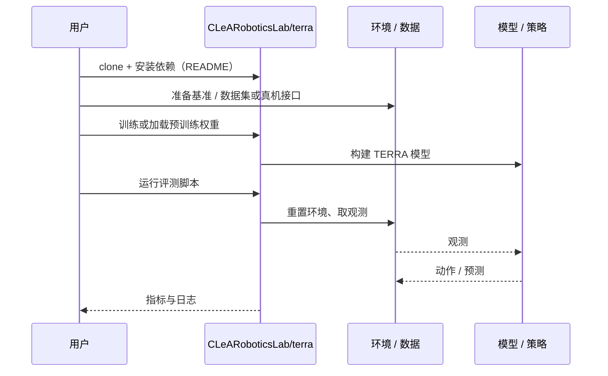

# TERRA（arXiv:2610.38657）

**TERRA**（*Explore Where It Matters: Targeted Exploration for Efficient Rover Adaptation*，[arXiv:2610.38657](https://arxiv.org/abs/2610.38657)，[项目页](https://terra-explore.github.io/)，[代码](https://github.com/CLeARoboticsLab/terra)）来自 [具身智能小站 2026-10-30 盘点](../../sources/blogs/wechat_embodied_station_28_papers_event2reward_progress_rewards_2026-10-30.md)，属「世界模型与预测」组。

## 一句话定义

**TERRA 用奖励加权误差适配世界模型，再预测哪些探索能暴露任务相关缺陷。**

## 英文缩写速查

| 缩写 | 英文全称 | 简要说明 |
|------|----------|----------|
| TERRA | Explore Where It Matters: Targeted Exploration for Efficient Rover Adaptation | 本文方法 / 基准的简称 |

## 为什么重要

- 把探索预算用在影响任务的模型误差上。真机松软坡面试验展示少量在线尝试的适配价值，结论限于所测车辆与地形。
- 开源结论：**已开源**（步骤 2.5，2026-10-30）。仓库可达（git ls-remote）。项目页 HTTP 200。
- 同期同组工作见 [进度奖励、接触监督与规划验证：具身智能小站 10-30 期 28 篇阅读坐标](../overview/embodied-station-2026-10-30-28-papers-technology-map.md)。

## 核心机制

| 项 | 内容 |
|----|------|
| **arXiv** | [2610.38657](https://arxiv.org/abs/2610.38657) |
| **开源** | **已开源** |
| **要点** | TERRA 用奖励加权误差适配世界模型，再预测哪些探索能暴露任务相关缺陷。 |
| **文内指标** | 公众号转述：真机松软坡面试验展示少量在线尝试的适配价值，结论限于所测车辆与地形。 |

## 源码运行时序图

以下为按仓库入口（`CLeARoboticsLab/terra`）推断的通用运行链路；入库日仅核实仓库可达，未逐文件阅读，具体脚本名以 README 为准。

## 实验与评测

- 公众号转述：真机松软坡面试验展示少量在线尝试的适配价值，结论限于所测车辆与地形。
- **读法：** 本页为索引级摘要，依据公众号转述的官方摘要与仓库信息整理；逐项数字与 baseline 以原文 PDF 为准。

## 与其他工作对比

- 横向索引见 [进度奖励、接触监督与规划验证：具身智能小站 10-30 期 28 篇阅读坐标](../overview/embodied-station-2026-10-30-28-papers-technology-map.md)；同 arXiv 不重复造页。

## 结论

**把探索预算用在影响任务的模型误差上：真机松软坡面试验展示少量在线尝试的适配价值，结论限于所测车辆与地形。**

1. 开源边界：**已开源** — 仓库可达（git ls-remote）。项目页 HTTP 200。
2. 核心机制：TERRA 用奖励加权误差适配世界模型，再预测哪些探索能暴露任务相关缺陷。
3. 复现与选型前核对任务协议、硬件与基准口径，勿直接横比公众号摘录数字。

## 关联页面

- [world-action-models](../concepts/world-action-models.md)
- [generative-world-models](../methods/generative-world-models.md)
- [vla](../methods/vla.md)
- [embodied-station-2026-10-30-28-papers-technology-map](../overview/embodied-station-2026-10-30-28-papers-technology-map.md)

## 参考来源

- [terra_targeted_exploration_rover_adaptation_arxiv_2610_38657.md](../../sources/papers/terra_targeted_exploration_rover_adaptation_arxiv_2610_38657.md)
- [wechat_embodied_station_28_papers_event2reward_progress_rewards_2026-10-30.md](../../sources/blogs/wechat_embodied_station_28_papers_event2reward_progress_rewards_2026-10-30.md)
- [arXiv:2610.38657](https://arxiv.org/abs/2610.38657)

## 推荐继续阅读

- [arXiv PDF](https://arxiv.org/pdf/2610.38657)
- [项目页](https://terra-explore.github.io/)
- [https://github.com/CLeARoboticsLab/terra](https://github.com/CLeARoboticsLab/terra)
