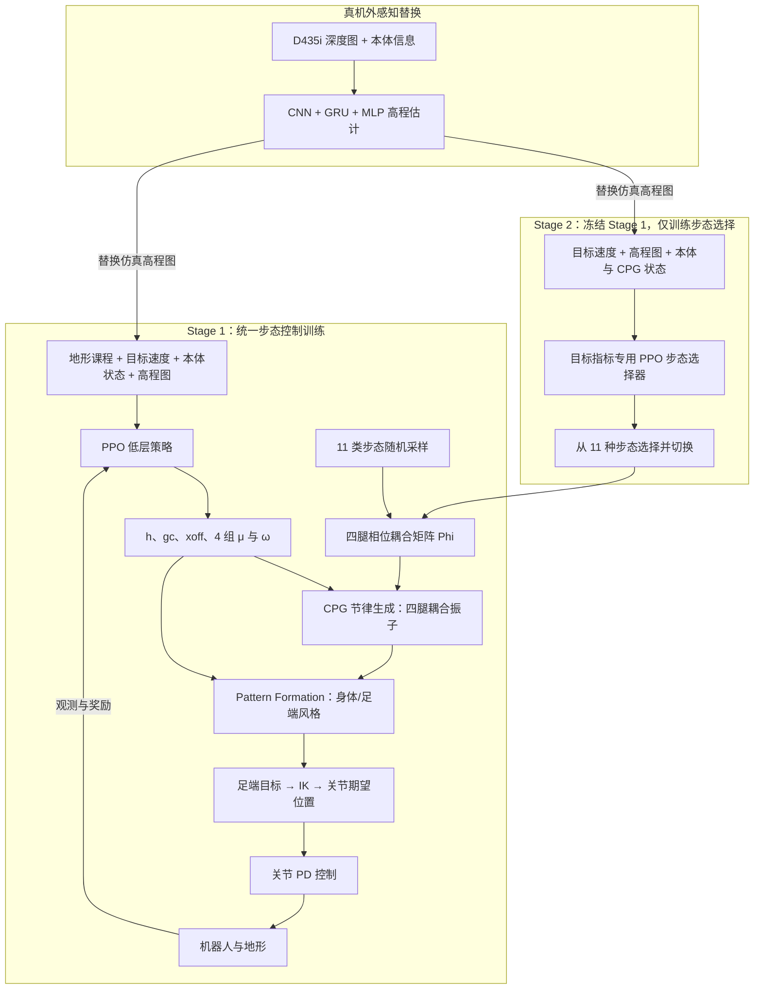

# 学习地形自适应四足运动的最优步态与风格 / Learning Optimal Gaits and Styles for Terrain-Adaptive Quadruped Locomotion

**Bellegarda 与 Ijspeert（2026，arXiv:2611.25958v1）**以 CPG 耦合振子指定步态、用 PPO 自适应运动风格，再以独立选择策略按地形、速度与指标切换步态；对应[论文全文](https://arxiv.org/html/2611.25958v1)和[项目主页](https://guillaume10.github.io/terrain-gaits/)。

## 一句话定义

**把“怎样走”（连续 CPG/身体风格）和“走哪种步态”（11 选 1）分开学习**，避免单阶段策略过早收敛到一种步态，按不同任务指标选出适合当前地形的控制方式。

## 英文缩写速查

| 缩写 | 英文全称 | 简要说明 |
|------|----------|----------|
| CPG | Central Pattern Generator | 中枢模式发生器；四腿耦合振子产生步态相位 |
| RL / DRL | (Deep) Reinforcement Learning | 采用 PPO 学习连续步态参数与离散选择 |
| PPO | Proximal Policy Optimization | Stage 1 与 Stage 2 的策略优化算法 |
| COT | Cost of Transport | 机械功率与体重×速度归一后的相对能耗指标 |
| IK | Inverse Kinematics | 将足端轨迹转为关节目标角 |
| PD | Proportional–Derivative Control | 1 kHz 关节位置闭环输出力矩 |
| GRU | Gated Recurrent Unit | 真机深度图高程估计器的时序记忆单元 |
| OOD | Out-of-Distribution | 未在训练难度或风格范围内见过的测试条件 |

## 为什么重要

- 单一 RL 步态常隐式收敛到 trot，却未必在缝隙、台阶和不同能耗/稳定性指标下最优。
- 本文把 **11 种步态×7 类地形×5 档难度×4 种速度**作为系统性比较问题，不把“最好”误写成全场景通用结论。
- CPG 明确区分节律相位和步态风格，使策略在不同速度、障碍与机器人尺寸之间具有可解释的控制接口；是真正与[步态生成](../concepts/gait-generation.md)和[地形适应](../concepts/terrain-adaptation.md)交汇的案例。

## 论文与实现要点

| 项目 | 原文核验结果 |
|------|--------------|
| 论文 | [arXiv:2611.25958v1](https://arxiv.org/abs/2611.25958)，2026-11-19，预印本 |
| 作者 | Guillaume Bellegarda；Auke Ijspeert |
| 机构 | 法国 Inria／洛林大学／法国国家科学研究中心（CNRS）；瑞士洛桑联邦理工学院（EPFL） |
| 训练 | Isaac Gym / PhysX；Go1；4096 并行环境；RTX 3090；PPO |
| 频率 | 策略动作约 33 Hz；CPG 微分方程积分和关节 PD 1 kHz |
| Stage 1 动作 | 11 维：机身高度 `h`、摆腿离地高度 `g_c`、足前后偏移 `x_off`、四腿振幅设点 `μ_i` 和角频率 `ω_i` |
| Stage 2 输出 | 11 维步态选择向量，经 `argmax` 选择对应的相位耦合矩阵 |
| 传感 | 仿真中 17×11 高程图；真机 D435i 深度图经 CNN/GRU/MLP 估计同类高程输入 |
| 官方代码 | 截至 2026-11-23，项目页未列出可核实的源码仓库入口；暂不能独立复现 |

## 流程总览

*依据：原文 Fig. 2、Methods（Rhythm generation / Stage 1 / Stage 2 / Heightmap encoder）。箭头按模块的输入与执行流整理，图中 Stage 1 与 Stage 2 代表先后训练而非同时更新两套 PPO。*

## 核心原理

1. **强耦合 CPG 指定相位，不直接硬写每条腿的接触时刻。** 振子相位演化包含 `ω_i + Σ r_j w_ij sin(θ_j−θ_i−φ_ij)`，其中 `φ_ij` 来自所选步态 4×4 相位偏置矩阵；实验采用 `w_ij=10` 维持强耦合。节律层输出的 `r_i, θ_i` 进入足端轨迹解析映射（Methods Eq. 1–4）。
2. **Stage 1 强制覆盖。** 几秒一次随机步态与转换，策略在相同的速度跟踪、角速度、功率、动作变化等奖励下学 11 种步态，**不另外加入步态风格奖励**；机身高度、脚抬高和前后偏移由策略自行调整。
3. **Stage 2 分离目标。** 冻结 Stage 1，另训一个每次输出 11 类步态选择的 PPO 网络；改变能耗、机身角速度或关节加速度目标，只需重训选择器，而不重训通用执行器。
4. **感知部署。** 模拟真值高程图换成 D435i 单目深度流估计：48×16 输入，经 CNN、256 隐单元 GRU 与 MLP 回归高程点阵，使用 DAgger + MSE 训练，Stage 1/2 权重保留不变。

## 实验与评测

| 测试问题 | 已报告结果与解读 |
|----------|------------------|
| 哪种步态最好？ | 11 种步态在至少一种地形/难度/速度/指标组合中达到最优或并列最优；“最优”限定在候选集合，5% 内算并列（Fig. 3） |
| Trot 是否省电？ | 在此训练、场景与 COT 定义下，仅约四分之一组合里能耗最优；不等于生物学所有场景的结论 |
| 强制步态能否遵从？ | 大多数测试场景在规定支撑相中达到约 95–100% 接触实现率，跨宽缝隙降低（补充 Fig. 2） |
| 分布外越障 | 训练缝隙最大 0.55 m，测试 0.8 m；另展示 0.55 m 墙、0.4 m 台阶及摆腿高度强制至 0.24 m（Fig. 5） |
| 跨机型 | Go1 训练策略零样本迁移到 Go2、Aliengo、B2（后者质量约 Go1 的 5 倍），物理 IK 按机型转换（Fig. 5） |
| 真机 | Go1/Go2 的机载高程估计下，演示 0.7 m 缝隙和 0.21 m 障碍；Stage 2 在线切步态（Supplementary Video 2） |
| 前腿/后腿双足模式 | 在 Stage 1 补充目标 pitch 跟踪奖励即可使用相同步态相位耦合（Fig. 6），并非现成四足策略无需训练直接双足 |

**指标口径：** 作者用 100 个机器人在 10 m 路段上按四种速度、五档难度评测；COT 为平均功率 `|P|/(mgv)`，机身角速度及 12 关节平均绝对加速度分别近似衡量稳定性和平滑度。除成功率外，其余指标只统计完成穿越的机器人，因此不能脱离成功率独立判断效率。

## 与其他工作对比

- **对比单步态 RL 与单一评价指标基线（Fig. 3）：** 无步态先验的标准端到端 RL 通常在训练中收敛到单一 trot 步态，而在本文「11 种步态 × 7 类地形 × 5 档难度 × 4 种速度」的矩阵评测中，trot 仅在约四分之一组合中能耗（COT）最优，11 种步态均在至少一种工况下取得最优或并列最优；将步态选择（Stage 2）与连续执行（Stage 1）解耦后，切换能耗、平稳度或关节平滑度目标时无需重训低层控制器。
- **对比 [Trainable CPG-ENN](./paper-trainable-cpg-quadruped-locomotion.md) 等节律控制工作：** 同属显式节律发生器与学习控制结合，CPG-ENN 侧重在无外感知/等变结构下端到端学单一步态或连续过渡，而本文通过强耦合 4×4 相位偏置矩阵（$w_{ij}=10$）覆盖 11 种离散步态并结合 D435i 深度估计高程图，在真机上完成 0.7 m 缝隙与 0.21 m 障碍演示，同时具备零样本跨 Go2 / Aliengo / B2 的运动学 IK 迁移能力。

## 结论

**论文证明：在该 11 种预定义步态与设定的地形/目标指标范围内，最优步态是条件选择问题；将步态执行与选择分离具有可复用价值。**

1. 训练时显式轮换全部步态，降低单步态局部最优的覆盖问题。
2. 将步态相位与步态风格分离：CPG 负责相位约束，PPO 负责连续参数，IK/PD 负责关节执行。
3. 用多指标评估（穿越成功率、COT、机身角速度、关节加速度），不要只看速度和单次越障视频。
4. 新性能目标优先评估重训 Stage 2 的代价，认识到其无法重新优化冻结的 Stage 1。
5. 真机复现要分别检查机载高程预测、不同机型 IK、相位耦合时序和 1 kHz 底层控制，而非只移植 PPO 权重。

## 工程实践

- **任务拆分：** 先为每种步态定义 4×4 相位耦合矩阵，在 7 类地形上随机采样步态与课程难度；然后冻结连续策略，仅训练不同评价目标的步态选择器。
- **训练配置参考：** 4096 个 Isaac Gym/PhysX Go1 环境；PPO clip 0.2、5 epochs、discount 0.99、GAE 0.95，MLP [512,256,128] / ELU（Supplementary Table 1），这些是论文报告值，不是已验证公开配置文件。
- **部署检查：** 33 Hz 高层策略与 1 kHz CPG/PD 时序解耦；检查深度相机延迟及高程图估计分布漂移，监控实际落足与预期相位差异、打滑、偏心越障和控制饱和。
- **与既有工作关系：** 和[可训练 CPG-ENN](./paper-trainable-cpg-quadruped-locomotion.md)同属显式节律+学习控制，但本文重点为**跨地形 11 步态评价、风格自适应与二阶段选择**，不应合并为同一论文节点。

## 局限与风险

- Stage 2 冻结低层网络后只能在候选步态之间选，不能针对新目标重新学习最优连续步态参数。
- 相位耦合控制的是振子相对时序而非地面接触事实；宽缝隙可出现接触跟踪失效。
- 碰撞偏心的混合障碍和横向移步能力不足，适用范围偏矢状面运动；泥、雪、水、可变形地形与根本不同腿机构尚未验证。
- 原文与演示报告的成功案例不等于随机现场条件下的稳定成功率；跨论文不同跑酷技能数量、速度与指标口径不可直接比。

## 源码运行时序图

**不适用（截至 2026-11-23）**：官方项目页虽出现“Code”文字，但未找到可核实的源码仓库链接；没有可阅读的官方训练/推理/部署入口，不能据论文框架图编造源码运行调用关系。若后续发布仓库，再核对入口并补 Mermaid `sequenceDiagram`。

## 关联页面

- [Locomotion](../tasks/locomotion.md)
- [Terrain Adaptation](../concepts/terrain-adaptation.md)
- [Gait Generation](../concepts/gait-generation.md)
- [Reinforcement Learning](../methods/reinforcement-learning.md)
- [Sim2Real](../concepts/sim2real.md)
- [Trainable CPG-ENN](./paper-trainable-cpg-quadruped-locomotion.md)
- [感知越障纵深路线 Stage 3](../../roadmap/depth-perceptive-locomotion.md)

## 参考来源

- [论文原文核对归档](../../sources/papers/terrain-adaptive-quadruped-gaits_arxiv_2611_25958.md)
- [官方项目页归档](../../sources/sites/terrain-adaptive-quadruped-gaits.md)
- [arXiv v1 HTML 全文含附录](https://arxiv.org/html/2611.25958v1)；[PDF](https://arxiv.org/pdf/2611.25958)
- [官方项目主页](https://guillaume10.github.io/terrain-gaits/)

## 推荐继续阅读

- [原文 supplementary：步态定义、参数与对照实验](https://arxiv.org/html/2611.25958v1)
- [经典 CPG-RL（作者 2022，见本文引用）](https://doi.org/10.1109/LRA.2022.3218167)
