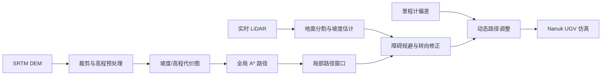

# Terrain-Aware Local Path Planning with Global DEM Data Integration for Autonomous UGV Navigation

## 一句话定义

该方法把 **SRTM DEM 上的全局 A\*** 与 **LiDAR 驱动的局部地形/障碍分析** 组成两层 UGV 导航系统：先规划大范围低成本路线，再用实时传感器针对近场地形修正路径。

| 项目 | 内容 |
|---|---|
| 作者机构 | 纽芬兰纪念大学（Memorial University of Newfoundland）；Compusult Ltd. |
| 年份与来源 | 2026，arXiv 预印本（arXiv:2608.17038） |
| 开源状态 | 未发现公开代码；作者公开主页和实验室发表页无代码入口 |
| 验证平台 | Gazebo 仿真；Compusult Nanuk UGV URDF |

## 英文缩写速查

| 缩写 | 英文全称 | 简要说明 |
|------|----------|----------|
| UGV | Unmanned Ground Vehicle | 无人地面车辆，本文仿真平台为 Nanuk UGV |
| DEM | Digital Elevation Model | 数字高程模型，提供大范围地形高程先验 |
| SRTM | Shuttle Radar Topography Mission | 论文使用的全球高程数据来源，空间分辨率约 30 m |
| LiDAR | Light Detection and Ranging | 用于局部点云地面分割、坡度估计和避障 |
| GPF | Ground Plane Fitting | 论文使用的 LiDAR 地面分割方法之一 |
| RANSAC | Random Sample Consensus | 用于拟合局部地面模型的鲁棒估计方法 |

## 为什么重要

卫星 DEM 支持长距离路线选择，却难以描述石块、坑沟和车辆附近的快速变化；车载 LiDAR 有较细的局部几何，却不提供大范围全局路线。本文采用分层导航：DEM/A* 管区域尺度代价，LiDAR/局部修正处理全局图分辨率以下的近场障碍。

## 核心原理

### 流程总览

### 全局 DEM 路径

论文使用 SRTM 1 Arc-Second Global DEM（约 30 m 分辨率），以圣约翰斯为中心提取约 1 km 半径区域。预处理后根据高程 $z(x,y)$ 计算坡度 $s(x,y)$，代价由坡度与高程加权组成，并对极端高程施加惩罚；A* 在全局代价图上搜索路径。

30 m 源数据适合表达区域尺度坡势，不足以刻画石块、沟坎或坑洞。把数据插值成更密网格不会新增地形观测，因此近场感知与修正是这套架构的必要补充。

### 局部感知与路径修正

局部模块接收 LiDAR 点云，使用 Ground Plane Fitting 与 RANSAC 分割地面，估计坡度与可通行性，再识别障碍并进行自适应转向。动态调整模块根据里程计计算相对于目标轨迹的横向偏差，以比例控制修正行驶方向；主动避障期间，系统用 override 信号暂停该偏差修正，避免两类控制同时争夺方向。

## 工程实践

| 模块 | 论文做法 | 工程关注点 |
|---|---|---|
| 地图先验 | SRTM DEM、约 1 km 半径区域 | 坐标投影、源分辨率和高程误差；插值不等于恢复细节 |
| 全局规划 | 高程/坡度代价图上的 A* | 代价权重影响高程偏好与坡度惩罚，需记录归一化方法 |
| 局部感知 | LiDAR 地面分割、坡度分析、障碍检测 | 地面模型受姿态、遮挡与点云密度影响 |
| 轨迹控制 | 里程计横向误差比例修正；避障时 override | 定义全局轨迹、局部避障和路径回归之间的优先级 |
| 验证环境 | Gazebo、Blender 自定义地形、Nanuk UGV URDF | 当前是仿真验证，不能直接推断户外真机性能 |

## 实验、评测与对比读法

论文比较提出方法与直线轨迹基线，测试平缓无障碍地形和包含陡坡/坑洞的挑战地形：

| 指标 | 挑战地形：本文方法 | 挑战地形：直线基线 |
|---|---:|---:|
| 避障率 | 95% | 0% |
| 平均遇到坡度 | 2.7° | 8° |
| 到达目标时间 | 77 s | 被困 |
| 路径偏差 | 4.25 m | 被困 |

无障碍平缓地形上，两者均报告 43 s 到达时间、0.7° 平均坡度和 0 m 路径偏差。挑战场景下的改进以绕行和耗时为代价；应同时看避障、安全与任务耗时。指标来自论文仿真对照，文中未提供真机统计。

## 源码运行时序图

**不适用：**截至 2026-10-14，作者个人学术主页和课题组发表列表均未提供代码仓或可运行仿真工程。论文对 Gazebo、ROS topic 和 Nanuk URDF 的描述不足以构成可复现的源码运行入口。

## 局限与风险

- **仿真到真机尚未验证：**论文将 Compusult Nanuk UGV 外场测试列为未来工作；Gazebo 指标不能直接当作户外部署性能。
- **全局 DEM 分辨率有限：**SRTM 约 30 m 网格难以编码负障碍和局部小物体；LiDAR 局部感知受视距、点云密度与地面分割质量约束。
- **比较基线较弱：**实验对照为直线轨迹，足以展示传感闭环价值，但不足以证明优于成熟局部规划器、滚动代价图或优化式规划方法。
- **控制与规划细节有限：**论文没有充分给出不同车辆动力学下的参数扫掠；路径修正增益和避障/回归策略迁移时需要重新验证。
- **代码未公开：**当前无法从作者公开页面直接复跑论文中的 Gazebo 场景和指标。

## 结论

**这项工作的主要价值是把大尺度 DEM 全局搜索与近场 LiDAR 闭环修正串成清楚的 UGV 导航架构；现有证据只支持仿真可行性。**

- 若任务有区域高程先验，可用 DEM/A* 提供全局路线；局部安全仍需车载传感器和避障层。
- 挑战地形报告避障率 95%、平均坡度由 8° 降至 2.7°，同时路径偏差增加至 4.25 m、耗时增至 77 s；安全提升伴随绕行代价。
- 30 m DEM 的插值格点不代表 30 m 以下的几何细节可用；精细可通行性判断来自局部传感器。
- 结果是 Gazebo 对直线基线的比较，不是与 Nav2 DWB、TEB 或 MPC 对比，也不是实车验证。
- 作者公开页面未链接代码；复现前需确认项目实现与 Nanuk URDF 的可获取性。

## 关联页面

- [A* 全局路径规划](../methods/a-star.md)
- [DWA 局部路径规划](../methods/dwa.md)
- [平滑导航路径生成](../methods/smooth-navigation-path-generation.md)
- [Terrain Adaptation](../concepts/terrain-adaptation.md)
- [Off-Road Global Nav](./paper-offroad-global-nav.md) — 越野地形代价学习与全局路径规划的相邻工作

## 参考来源

- [论文摘录与开源核查](../../sources/papers/terrain_aware_ugv_navigation_arxiv_2608_17038.md)
- [作者与课题组页面核查](../../sources/sites/terrain-aware-ugv-dem-navigation.md)

## 推荐继续阅读

- [arXiv HTML 正文](https://arxiv.org/html/2608.17038v1)
- [A* 全局路径规划](../methods/a-star.md) 与 [DWA 局部路径规划](../methods/dwa.md) — 对照经典全局/局部规划分层

