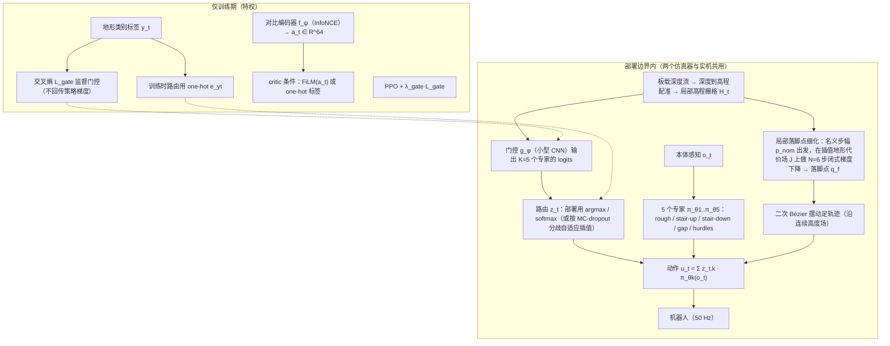

# Terrain Traversal Without Motion Priors：专家路由人形地形穿越

## 流程总览

图依据：论文 §III-A–D / Fig. 1。

## 一句话定义

用地形分类器路由五个专家，并通过模型式连续落足优化，构建无需动作先验和蒸馏的人形感知行走系统。

## 英文缩写速查

| 缩写 | 英文全称 | 简要说明 |
|------|----------|----------|
| MoE | Mixture of Experts | 用门控组合多个专家 |
| RL | Reinforcement Learning | 学习运动控制策略 |
| Sim2Sim | Simulation-to-Simulation Transfer | 在另一仿真器中检验迁移 |
| CI | Confidence Interval | 评测成功率的不确定性区间 |

## 核心信息

| 项 | 内容 |
|----|------|
| 论文 | [arXiv:2610.14061](https://arxiv.org/abs/2610.14061)，预印本 |
| 作者 | Thanh Ly、Chien Le、Truong-Duy Dang、Duy M. H. Nguyen、Duy-Dung Le、Vien Anh Ngo、An T. Le |
| 项目页 | [方法与实验](https://fai-rl-tech.github.io/moe-perceptive/) |

## 主要技术路线

1. 传感得到局部高程图；地形分类器将输入路由至五专家混合策略。训练门控使用特权地形类别监督，部署 actor 不直接接收该标签。
2. 基于模型的规划器确定落足目标，并在插值地形代价场上执行六步闭式梯度优化，实现栅格以下的连续修正。
3. 自监督深度时序对比表征作为 critic 条件的对照实验，不能误认为主结果所用的路由方式。

与 [CMoE](./paper-cmoe.md) 的无标签对比式门控可作研究对照；本文报告尝试的四种无标签路由均趋于均匀激活，特权标签监督产生更明显的专家分工。

## 评测与局限

- 在第二个部署保真仿真器中，85 米、五段航点路线完成 **18/20（90%）**，Wilson 95% 置信区间约 70%–97%；五个单独地形段中四段均为 20/20。
- 同时移除专家混合与连续落足修正的联合消融，在楼梯和栏杆段均为 0%；该联合对照不能单独归因于任一组件。
- 72.4% 的落足修正跨过至少一个栅格边界；训练分布内单专家与五专家表现相当。
- 这是 **Sim2Sim** 结果，不能当成真机成功率。项目页标注投稿审稿中；截至 2026-10-27 未发现可运行源码、数据或权重链接。

## 与其他工作对比

| 工作 | 地形适应机制 | 与本文的差异 |
|------|--------------|--------------|
| [CMoE](./paper-cmoe.md) | 高程图 MoE + SwAV 式地形对比学习门控，单阶段 PPO | 同样针对 MoE 门控均匀激活；CMoE 用无标签对比学习解决，本文改用特权地形标签监督门控，并加入模型式落足优化；CMoE 有 G1 真机结果与开源代码，本文仅 Sim2Sim |
| [FootQuery](./paper-footquery-perceptive-humanoid-locomotion.md) | 用预测触地点查询深度历史 | 落足信息由策略隐式学习；本文由外部规划器显式给出落足目标并做连续梯度修正 |
| [Perceptive Humanoid Parkour](./paper-hrl-stack-22-perceptive_humanoid_parkour.md) | 动作先验（motion matching 参考）+ DAgger/PPO 蒸馏 | 正是本文要去掉的两项：动作先验与教师–学生蒸馏 |
| [显式楼梯几何条件化](./paper-explicit-stair-geometry-humanoid-locomotion.md) | 预测楼梯几何参数直接条件化策略 | 只针对楼梯这一类地形；本文用五专家覆盖多类地形 |

取舍：显式规划器与专家路由使失败更易归因，但五类地形的划分与特权标签都要人工设计；与已上真机的同类方法相比，本文缺少真机证据。

## 结论

该工作为动作先验之外的感知越障提供了有规划器参与的仿真证据，实机效果仍待验证。

- 对比专家路由时，检查门控是否真正按地形分工。
- 将连续落足修正与专家路由分别消融，避免将联合收益误归因。
- 上机前评估感知误差、延迟及跨仿真器与真实动力学差距。
- 复现前重新核查代码、权重和实验配置是否发布。

## 源码运行时序图

不适用：截至核查日项目页未提供可运行源码入口。

## 关联页面

- [楼梯与障碍感知运动](../tasks/stair-obstacle-perceptive-locomotion.md)
- [落足规划](../concepts/footstep-planning.md)
- [特权训练](../concepts/privileged-training.md)

## 参考来源

- [论文归档](../../sources/papers/terrain_traversal_arxiv_2610_14061.md)
- [项目页归档](../../sources/sites/terrain-traversal-without-motion-priors.md)
- [arXiv PDF](https://arxiv.org/pdf/2610.14061)：已通读方法部分（实验与附录以略读为准）：§III-A–D、摘要与 §I–II 相关部分

## 推荐继续阅读

- [论文原文](https://arxiv.org/abs/2610.14061)
