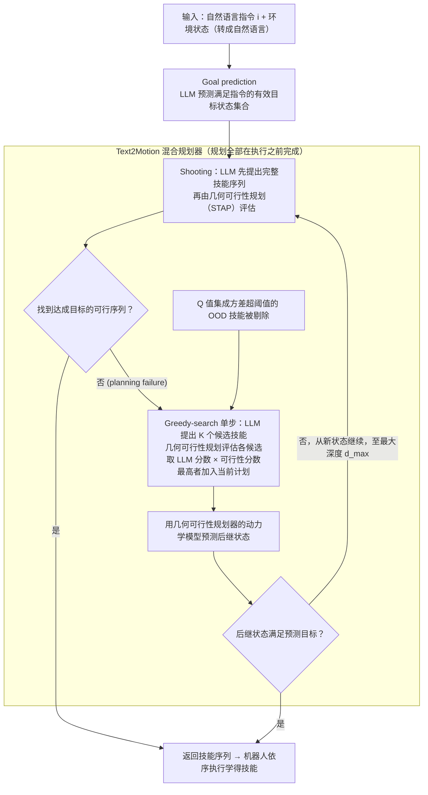

# Text2Motion

**Text2Motion**（[arXiv:2303.12153](https://arxiv.org/abs/2303.12153)）收录于 Lumina [Embodied-AI-Guide 微信专辑](../../wiki/overview/embodied-ai-guide-wechat-album-curator.md)。本页为独立详情节点；实验数字以原文为准。

## 流程总览

图依据：论文 §3.2–3.3、§4（Fig. 2、Fig. 3、Algorithm 3）、§4.5。

## 一句话定义

**自然语言指令 → LLM 预测符号目标并提出技能序列（shooting / greedy-search 混合）→ 几何可行性规划验证，返回已验证可达目标的技能序列（依据 arXiv:2303.12153v5 摘要、§4）。**

## 英文缩写速查

| 缩写 | 英文全称 | 简要说明 |
|------|----------|----------|
| VLA | Vision-Language-Action | 视觉–语言–动作策略 |
| LLM | Large Language Model | 大语言模型 |
| IL | Imitation Learning | 模仿学习 |
| BC | Behavior Cloning | 行为克隆 |

## 核心信息

| 项 | 内容 |
|----|------|
| **机构** | 斯坦福大学（计算机系；航空航天系）：Lin、Agia 等，Bohg 组（依据 v5 作者页脚） |
| **arXiv** | [2303.12153](https://arxiv.org/abs/2303.12153) |
| **开源** | 论文给出项目页 sites.google.com/stanford.edu/text2motion（代码仓库论文未写明，待核实） |

## 实验与评测

- **本页为索引级节点**（Lumina Embodied-AI-Guide 微信专辑）：正文固化定位与开源边界，**未转存原文实验表**。
- **回原文须核对的证据**：各任务族上 Text2Motion / shooting / greedy-search 与 saycan-gs、innermono-gs 的成功率（论文 §5.5–5.6）。
- **读法：** 先对齐本体、任务集与成功判定，再读任何数字；勿把专辑摘要当实验结论。

## 与其他工作对比

| 维度 | 读法 |
|------|------|
| **对照工作** | 论文实验基线为 SayCan 与 Inner Monologue 的改造版（saycan-gs、innermono-gs；§5），并含自身 shooting / greedy-search 消融；论文未与 [LLM+P](./paper-llm-p.md) / [AutoTAMP](./paper-autotamp.md) 比较，这两者仅为站内同族（LLM 辅助任务/运动规划）参照 |
| **横比口径** | 论文摘要：长程任务成功率 82%，此前最佳语言规划方法 13%；口径以原文任务集（§5.4）为准，换技能库 / 规划器须重测。 |
| **开源状态** | **待核实** — 复现前以项目页 / 官方仓实际链接为准 |

## 结论

Text2Motion 与 LLM+P/AutoTAMP 在站内同属 LLM 辅助规划（论文本身未与后两者比较）。

- 关键点：LLM 只负责提技能与预测目标，几何可行性（Q 函数 + 几何可行性规划）负责验证，跨技能的几何依赖在搜索中被显式解决
- 长程任务靠 shooting 先试、失败转 greedy-search 逐步扩展

## 源码运行时序图

**不适用**

## 关联页面

- [paper-llm-p](./paper-llm-p.md)
- [paper-autotamp](./paper-autotamp.md)

## 参考来源

- [wechat_lumina_embodied_practice_part1_llm_planner_2026-09-20.md](../../sources/blogs/wechat_lumina_embodied_practice_part1_llm_planner_2026-09-20.md)
- 核对（2026-11-02）：对照 arXiv:2303.12153v5（Autonomous Robots 特刊）摘要、§4–§5：原「文本→结构化运动目标→经典规划器求轨迹」改为 LLM 提技能序列+几何可行性规划；补机构（斯坦福）与项目页；「对照工作」改为论文实际基线 SayCan / Inner Monologue；流程图与论文一致（含 shooting 失败转 greedy-search、LLM 预测目标状态），未改。
- [arXiv PDF](https://arxiv.org/pdf/2303.12153)：已通读方法部分（实验与附录以略读为准）：§3 Problem setup / planning objective、§4 Methods（§4.1 Goal prediction、§4.2–4.4 shooting / greedy-search / Text2Motion、§4.5 OOD detection）

## 推荐继续阅读

- [arXiv:2303.12153](https://arxiv.org/abs/2303.12153)
