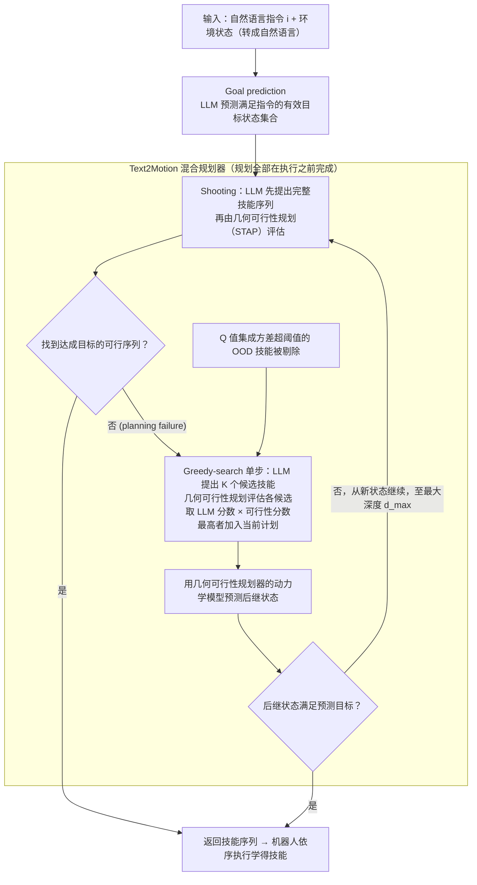

# Text2Motion

**Text2Motion**（[arXiv:2303.12153](https://arxiv.org/abs/2303.12153)）收录于 Lumina [Embodied-AI-Guide 微信专辑](../../wiki/overview/embodied-ai-guide-wechat-album-curator.md)。本页为独立详情节点；实验数字以原文为准。

## 流程总览

图依据：论文 §3.2–3.3、§4（Fig. 2、Fig. 3、Algorithm 3）、§4.5。

## 一句话定义

**文本指令 → 结构化运动目标 → 经典规划器求轨迹。**

## 英文缩写速查

| 缩写 | 英文全称 | 简要说明 |
|------|----------|----------|
| VLA | Vision-Language-Action | 视觉–语言–动作策略 |
| LLM | Large Language Model | 大语言模型 |
| IL | Imitation Learning | 模仿学习 |
| BC | Behavior Cloning | 行为克隆 |

## 核心信息

| 项 | 内容 |
|----|------|
| **机构** | — |
| **arXiv** | [2303.12153](https://arxiv.org/abs/2303.12153) |
| **开源** | 待核实 |

## 实验与评测

- **本页为索引级节点**（Lumina Embodied-AI-Guide 微信专辑）：正文固化定位与开源边界，**未转存原文实验表**。
- **回原文须核对的证据**：本页结论已点明「长程看子目标分解」——回原文须核对长程任务上子目标分解的正确率，以及它与整体规划成功率的关系（分解错则后续全错）。
- **读法：** 先对齐本体、任务集与成功判定，再读任何数字；勿把专辑摘要当实验结论。

## 与其他工作对比

| 维度 | 读法 |
|------|------|
| **对照工作** | 与 [LLM+P](./paper-llm-p.md) / [AutoTAMP](./paper-autotamp.md) 同族（都由 LLM 产生符号 / 几何规划输入）；差异在落到 motion planner 的接口层次 |
| **横比口径** | 成功率随所接 motion planner 的能力变化；换规划器须重测，不可把接口层结论当策略层结论。 |
| **开源状态** | **待核实** — 复现前以项目页 / 官方仓实际链接为准 |

## 结论

Text2Motion 与 LLM+P/AutoTAMP 同族。

- 关注 motion planner 接口
- 长程看子目标分解

## 源码运行时序图

**不适用**

## 关联页面

- [paper-llm-p](./paper-llm-p.md)
- [paper-autotamp](./paper-autotamp.md)

## 参考来源

- [wechat_lumina_embodied_practice_part1_llm_planner_2026-09-20.md](../../sources/blogs/wechat_lumina_embodied_practice_part1_llm_planner_2026-09-20.md)
- [arXiv PDF](https://arxiv.org/pdf/2303.12153)：已通读方法部分（实验与附录以略读为准）：§3 Problem setup / planning objective、§4 Methods（§4.1 Goal prediction、§4.2–4.4 shooting / greedy-search / Text2Motion、§4.5 OOD detection）

## 推荐继续阅读

- [arXiv:2303.12153](https://arxiv.org/abs/2303.12153)
