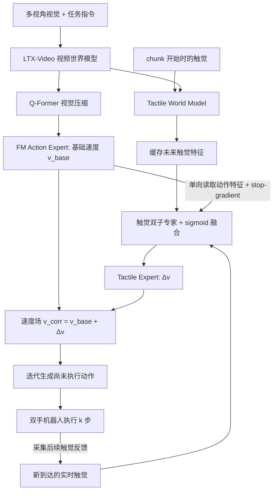

# TF²-Steering：以触觉预测与反馈引导速度场的动作精修 / Action Refinement with Tactile Forecasts and Feedback via Velocity-Field Steering

**TF²-Steering**（Yiming Chen 等，2026；[论文](https://arxiv.org/abs/2611.01483)、[作者项目页](https://yiming-cc.github.io/tf2-steering/)）来自浙江大学、上海创智学院、西湖大学与复旦大学。此页从 2026-11-04 的摘要索引升级为对 **arXiv v1 正文 + 附录** 的结构化解读；保留唯一论文项目实体，未拆出重复项目节点。

## 一句话定义

**视觉 world-action 策略负责生成基础动作，触觉世界模型预测将发生的接触，实时触觉反馈提供当前接触证据；独立触觉专家在 Flow Matching 的每轮速度场积分中加上 Δv，按执行进度反复精修尚未执行的动作。**

## 英文缩写速查

| 缩写 | 英文全称 | 简要说明 |
|---|---|---|
| TF² | Tactile Forecasts and Feedback | 触觉预测 + 实时触觉反馈两路输入 |
| FM | Flow Matching | 动作专家学习随时间变化的生成速度场 |
| WA | World-Action | 视频世界模型与动作生成专家的主干组合 |
| MoE | Mixture of Experts | 预测触觉与实时触觉两子专家的加权融合 |
| VAE | Variational Autoencoder | 将触觉图像编码进世界模型潜在空间 |
| PSR | Progress Success Rate | 里程碑式部分完成进度评分，非二值成功率 |
| DoF | Degrees of Freedom | 真机 UR5e 机械臂和 Sharpa 灵巧手的关节自由度 |

## 为什么重要

- **视觉常看不见接触状态：** 旋盖、拉拉链、细口插入等任务依赖接触力、摩擦与滑动，靠视觉提示容易在最后几毫米失败。
- **直接拼接触觉不一定有效：** 论文的 π₀.₅ + tactile 在仿真平均 56.0%（纯视觉 π₀.₅ 为 55.7%），真机 PSR 35.2%（纯视觉为 40.2%）；作者认为视觉主导预训练与输入分布变化会限制触觉收益。
- **修正“生成过程”而非“生成结果”：** 在 FM 的速度场中注入触觉修正能改变后续生成方向；动作已经生成完再加残差的消融效果明显更差。

## 核心机制

### 架构：保留视觉主干，单向注入触觉

1. **视觉 WA：** 多视角 LTX-Video（加入跨视角注意力）提取视觉先验，Q-Former 压缩为 query 特征，再由 FM action expert 输出基础速度场。论文报告在单张 RTX 4090 上生成一段动作约 240 ms，此数值**不是完整真机回路的实测延迟保证**。
2. **Tactile World Model：** 缩小的 LTX-Video 结构（约 500M 参数）接收当前触觉与视觉上下文，预测未来触觉；推理时使用末层隐藏特征作为 tactile forecast，不解码为图像。视觉特征 → 触觉预测是单向注意力。
3. **Forecast–Feedback Tactile Expert：** 每个 block 含预测触觉和实时触觉两个子专家，各自 sigmoid 加权后融合；触觉专家单向读取 action expert 的特征。单向 attention mask 与 stop-gradient 阻断触觉梯度干扰基础动作路径。

论文 §3.1 的速度场修正公式：

$$
\mathbf v^{\mathrm{corr}} = \mathbf v^{\mathrm{base}}_\theta + \Delta\mathbf v_\phi.
$$

基础动作损失与触觉 steering 损失分别为：

$$
\mathcal L_{\mathrm{act}}=\lVert \mathbf v_\theta^{\mathrm{base}}-\mathbf v^\star\rVert_2^2,\quad
\mathcal L_{\mathrm{steer}}=\lVert \mathbf v^\star-(\mathrm{sg}[\mathbf v_\theta^{\mathrm{base}}]+\Delta\mathbf v_\phi)\rVert_2^2.
$$

其中 sg 是停止梯度；触觉的 steering loss 不更新基础动作专家，但基础专家在联合训练时仍可以通过自己的 action loss 更新。不能把“梯度隔离”误读成“全程冻结主干”。

### 异步重规划：预测固定，反馈更新

低频视频/触觉世界模型在 chunk 开始时生成并缓存先验；动作以 k 步子块执行。每个 k 步完成后，使用最新触觉更新剩余未执行动作，已经执行的动作直接丢弃。训练随机采样反馈延迟 d，仅在反馈后的长度 W 窗口内计算 steering loss，并添加相对步号 ρᵢ = i − d（论文 §3.2，公式 3–4）。**k 是可调整的精修频率参数，文中未给出可泛化的固定最佳频率。**

## 流程总览

依据论文 Fig. 2 与 §3.1–3.2；图中的预测先验在一个 chunk 内缓存，循环的是**尚未执行动作**的精修，不是每次都重跑世界模型。

### 三阶段训练

在已有 WA 主干视觉动作预训练基础上，论文继续：

| 阶段 | 数据/更新对象 | 核心目的 |
|---|---|---|
| Stage 1：触觉预测预训练 | OpenNeoData / T-REX / FTP-1-Sharpa = 30/40/30；固定视觉主干，只训练 tactile world model；50k steps / batch 1024 | 建立跨接触场景的未来触觉预测能力 |
| Stage 2：触觉 steering 预训练 | 90% 触觉数据 + 10% 原视觉数据；联合训练各模型与 Q-Former；50k steps / batch 512；Δv 输出零初始化 | 让触觉专家学会修正 FM 速度场，同时保住视觉基线 |
| Stage 3：任务后训练 | 仿真 / 真机演示，继续联合目标 | 将预训练机制适配具体任务和机器人 |

注意：**100k steps / batch 512 的视觉-动作主干预训练**发生在上述三阶段之前；Stage 2 的训练集并非 100% 触觉样本。附录还给出 128 维统一 action/state 槽位与有效掩码，需适配不同机器人关节接口。

## 工程实践

| 设计点 | 原文配置 / 落地要点 |
|---|---|
| 模型接口 | 当前多视角图像 + 任务指令 + 本体 / 触觉；输出 chunk 动作；触觉专家共享 noised action 和 FM 时间步 |
| 视频先验 | LTX-Video 单次前向；训练图像 192×256，视频预测目标 24 帧 / 15 fps |
| 触觉预测 | 约 500M 的 tactile world model；VAE 需先适配触觉视频，推理缓存末层 feature |
| 反馈延迟训练 | Stage 2 偏移采样 0、4、8、12 steps；steering loss window 10 steps；相对时序编码 |
| 动作时序 | 预训练动作为 30 Hz、horizon 50；执行期每 k 步重采样剩余动作，世界先验保持固定 |
| 真机系统 | 双 UR5e（6 DoF/臂）+ 双 Sharpa 手（22 DoF/手）；D455 顶相机 + 2×D405 腕相机；Manus 手套 + Meta Quest 遥操 |
| 演示 | 真机六任务各 100 条 30 Hz 示教，共 600 条；真实接触与进度评分需按任务标定 |

**实际部署注意：** 必须明确触觉相机、机器人状态与执行器的时戳匹配，确保新触觉只作用于未执行动作，避免把已下发动作重新覆盖。此条是基于论文异步协议的工程建议，**不是论文报告已完成的系统安全验证**。

## 源码运行时序图

**不适用（截至 2026-11-10 未发布可运行官方实现）**：作者项目页显示 Code 字样但没有对应 GitHub 源码 URL，也未确认有作者模型权重。已按论文绘制上述**方法流程图**，但没有真实代码入口/调用链，不能杜撰 sequenceDiagram；代码公开后应再阅读官方 README、训练入口与运行模块并补图。

## 实验与评测

### 6 项 UniVTAC 仿真：任务成功率

作者自评方法在单视角四任务和多视角两任务各训练一个 group-level checkpoint，每任务 50 次评测（ACT、VITaL 引用 UniVTAC 已发布数据）。

| 方法 | 6 任务平均成功率 |
|---|---:|
| ACT | 42.8% |
| VITaL | 36.3% |
| π₀.₅ | 55.7% |
| π₀.₅ + tactile | 56.0% |
| FTP-1 | 57.7% |
| **TF²-Steering** | **68.3%** |

原文摘要报告领先最强对照 **+10.7 pp**；由于表格只显示一位小数，68.3 − 57.7 直接相减为 10.6 pp，差异来自显示精度。关键插装任务 Insert Hole：TF² 94.0%，π₀.₅ 56.0%，FTP-1 26.0%；但 Pull Out Key 等任务未全面领先，不能称每个任务都 SOTA。

### 6 项双手真机：任务进度成功率 PSR

| 方法 | 六任务平均 PSR |
|---|---:|
| ViTacFormer | 6.1% |
| π₀.₅ | 40.2% |
| π₀.₅ + tactile | 35.2% |
| FTP-1 | 52.7% |
| T-Rex | 62.4% |
| **TF²-Steering** | **71.5%** |

每任务 **20 trials**，得分来自部分里程碑（例：拉拉链 0.2 抬起包 / 0.6 开始拉动 / 1.0 完全闭合，按最远阶段累计进度而非求和）。因此 **71.5% 是平均 PSR，不能当成 71.5% 的完整任务二值成功率**。领先最强对照 T-Rex **9.1 pp**。

### 消融：速度场 steering 不是普通动作残差

三项真机（Twist Cap / Close Zipper / Split Cups）的宏平均 PSR：

| 配置 | PSR | 相对完整模型 |
|---|---:|---:|
| **完整 TF²** | **72.3%** | — |
| 去预测触觉（只保留实时触觉） | 69.7% | −2.7 pp |
| 去实时触觉（只保留预测触觉） | 63.0% | −9.3 pp |
| 去两种触觉 | 61.7% | −10.7 pp |
| 最终动作空间残差（不修正 FM 速度场） | 61.3% | −11.0 pp |
| 去异步推理 | 66.7% | −5.7 pp |
| 去单向注意力隔离 + stop-gradient | 62.7% | −9.7 pp |

三个任务消融表的平均数不能与六任务主结果直接对减；这里**实时触觉贡献大于预测触觉**，而两者联合最好。去 tactile pretraining 的图示对比在四个任务上均下降（论文 Fig. 4），但本文未把图示误抄成精确数字。

## 与其他工作对比

| 路线 | 触觉进入动作的位置 | 与 TF² 的关键区别 |
|---|---|---|
| π₀.₅ + tactile | 作为额外图像输入端到端微调 | 视觉主导先验可能没有有效使用触觉，甚至输入分布偏移 |
| T-Rex | 级联 FM、执行期触觉反应 | 同属实时触觉改进方向；TF² 显式加入未来触觉预测 + Δv steering |
| FTP-1 | 大规模通用触觉策略预训练 | 重在跨触觉传感器基础策略；TF² 另强调视觉动作主干的速度场修正接口 |
| [OmniTacTune](./paper-omnitactune-tactile-residual-adaptation.md) | 生成完的基础动作上做触觉残差 + 真机 RL | 与 TF² 生成过程内的 Δv 机制不同；跨论文不做无条件数值排名 |

## 结论

**值得迁移的是“预测先验 + 实时反馈 + 生成期速度修正”的接口设计，而非直接把论文的局部 PSR 当成普适成功率。**

1. **动作生成时修正优于事后补丁：** 本文三任务消融 72.3% vs 61.3% PSR，速度场插入位置是核心。
2. **实时反馈是主贡献，预测提供补充：** 单独去实时触觉 −9.3 pp，单独去预测 −2.7 pp。
3. **异步执行不能忽略：** 去掉异步重采样 −5.7 pp；真正落地须管理 chunk 的执行边界和延迟。
4. **保持视觉基线独立：** 单向 attention + stop-gradient 分离触觉损失与 action expert，规避触觉数据规模小所致的视觉先验干扰。
5. **数据与预算很重：** 要先训练 WA 主干，再进行触觉预测/steering 预训练及任务后训练；不能当成零样本小插件。
6. **评测读数：** 仿真 68.3% 是任务二值成功率均值；真机 71.5% 是允许部分得分的 PSR，20 trials/任务；口径不同。
7. **复现现状：** 训练配置在附录较完整，但项目代码入口尚未公开；实验数值目前无法据此独立复跑。

## 局限与风险

- 作者仅验证 UniVTAC 与实验室双手桌面任务；对可移动机器人、不同触觉传感器、多变光照/场景、长期跨任务泛化没有直接证据。
- 真机 20 次/任务，报告部分完成 PSR；未见统计置信区间或显著性检验，收益大小有评测条件依赖。
- 双世界模型和多阶段预训练增加训练/推理资源，论文的 240 ms action chunk 时间不代表全链路实时性；没有提供完整真机系统安全证明。
- 项目站点截至 2026-11-10 未链接可运行代码；尽管论文描述细节丰富，仍不能核验具体调度器、网络和安全实现。

## 关联页面

- [触觉感知](../concepts/tactile-sensing.md) — 传感与接触信息接口
- [接触丰富操作](../concepts/contact-rich-manipulation.md) — 任务特点与成功判据
- [灵巧运动学](../concepts/dexterous-kinematics.md) — 手部高维动作接口
- [OmniTacTune](./paper-omnitactune-tactile-residual-adaptation.md) — 对照事后动作残差与 RL 自适应
- [2026-11-04 具身论文技术地图](../overview/embodied-station-2026-11-04-57-papers-technology-map.md) — 本项目原始入库线索

## 参考来源

- [TF²-Steering 官方论文来源归档（全文通读 v1）](../../sources/papers/tf2_steering_tactile_forecast_arxiv_2611_01483.md)
- [TF²-Steering 作者项目页来源归档（Code 开放状态复查）](../../sources/sites/tf2-steering-tactile-forecast.md)
- [arXiv 官方 HTML 全文（含附录、原表与公式）](https://arxiv.org/html/2611.01483)

## 推荐继续阅读

- [arXiv PDF v1](https://arxiv.org/pdf/2611.01483)
- [官方项目主页与真机任务演示](https://yiming-cc.github.io/tf2-steering/)
- [UniVTAC 论文](https://arxiv.org/abs/2602.10093) — 仿真实验的协议上下文
