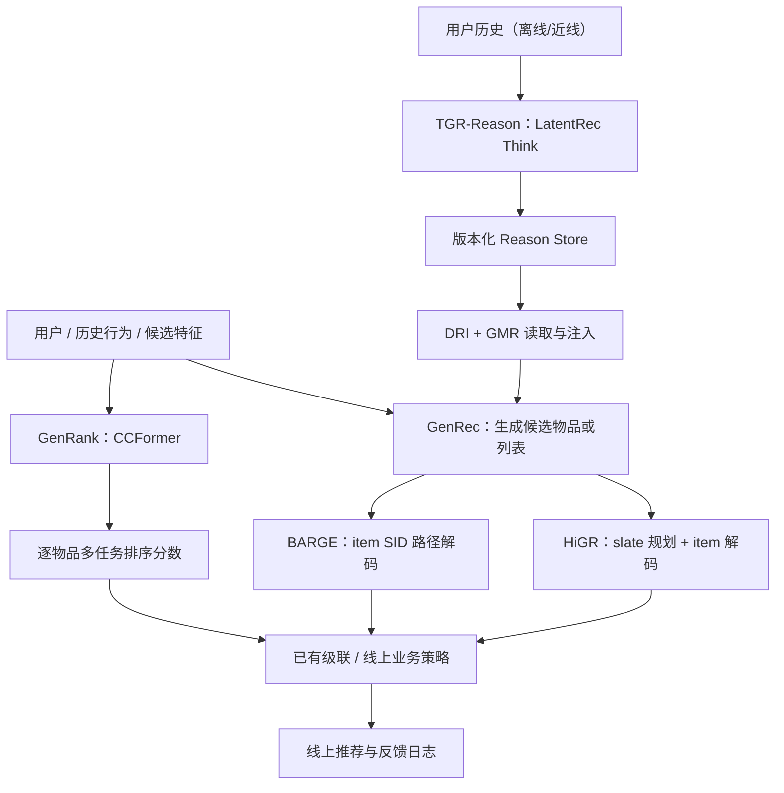

# TGR：腾讯工业生成式推荐与推理技术栈

## 一句话定义

**TGR（Tencent Generative Recommendation）** 是腾讯针对大规模在线推荐的生成式技术体系，沿 **GenRank（排序架构）、GenRec（物品/列表生成）、Reason（预计算推理信号）** 三条路线升级传统级联推荐，而不是宣称已经训练成一套端到端统一模型。

## 英文缩写速查

| 缩写 | 英文全称 | 简要说明 |
|---|---|---|
| TGR | Tencent Generative Recommendation | 本报告总体系 |
| SID | Semantic ID | 分层离散物品标识 |
| DRI | Direct Reasoning Injection | 离线 Reason token 直接作为生成器软条件 |
| GMR | Group Memory Retrieval | 依据推理 SID 找群体记忆辅助推荐 |
| STS | Soft Token Selection | 将 latent 计算状态投影到可解码的 soft token |
| ORPO | Odds Ratio Preference Optimization | HiGR 的列表偏好优化目标 |

## 为什么重要

工业推荐的传统流程检索→粗排→精排→重排各自优化，算力扩张与全局质量不一定同步。TGR 的价值在于明确区分：**保留 per-item score 的高效排序器**、**直接生成候选/列表的模型**、以及**不占用在线请求关键路径的推理/记忆增强**，三者相互配合但并未被混写成同一种模型。

## 核心信息

| 项 | 说明 |
|---|---|
| 报告 | TGR Team，arXiv:2609.00986v1，2026-09-01 |
| 机构 | 腾讯（Tencent） |
| 相关独立论文 | [HiGR](./paper-higr-tencent-slate-recommendation.md)（arXiv:2512.24787v5，CIKM 2026） |
| 工程平台 | Numerous-Torch 为报告中的训练/serving 基础设施；[TRS 官网](https://trs.tencent.com/) 是单独的推荐平台入口，不能混同开源代码 |
| 开源状态 | 报告未提供可验证的整套训练或在线服务源码入口 |

## 核心原理

### GenRank：CCFormer

将特征按 **user profile / behavior sequence / target item** 分成 token 字段，采用定向 cross-attention（user→sequence、target→sequence、target→user），再加行为历史 subspace token mixing 与层级序列压缩。保持 per-item 多任务预测结果，以便与现有在线级联兼容；target 不互相注意便于并行批量打分。

### GenRec：BARGE 与 HiGR 并列

- **BARGE**：针对层次化 SID 自回归预测里 item 边界不清、错误前缀造成的 semantic drift，用 item context-aware attention、hierarchical path reranking、双路径解码减轻偏航。
- **[HiGR](./paper-higr-tencent-slate-recommendation.md)**：针对整张列表，PCRQ-VAE 构造可规划 SID，HSD 把 slate planner 与 item generator 解耦，ORPO 用列表偏好对对齐业务目标。
- 两者是**不同的生成模式和不同 tokenizer**（OSQ-VAE / PCRQ-VAE），不是在同一条线上串联运行。

### Reason：离线生成、在线注入

LatentRec 在离线训练 Qwen3-1.7B Think backbone 的潜变量推理与 STS，再离线物化 Reason token。在线请求读取版本化 Reason Store，通过 DRI 注入 soft prompt、GMR 检索群体行为记忆；Reason Store 采用按行为时间截止点决定新旧的条件写入，防止离线任务覆盖较新的近线更新。

### 流程总览

图示三条方向可协作；**不是**声称所有 GenRank/GenRec/Reason 模块已经统一部署为单一模型或每次请求都串联全部分支。

## 源码运行时序图

**不适用**：截至 2026-11-18，技术报告及给定官方资源未公开可核查的 CCFormer、BARGE、HiGR、TGR-Reason 全栈训练/部署代码入口；不能把论文架构图伪装为源码运行序列。

## 工程实践

| 位置 | 可借鉴的工程取舍 |
|---|---|
| 排序 | CCFormer 仍输出 per-item score，低风险逐步替换现有级联；注意区分 GFlops 与实际端到端服务时延 |
| 物品生成 | BARGE 的 SID 错误前缀会累积，增宽 beam 无法根治 semantic drift |
| 列表生成 | HiGR 把跨物品全局结构与每物品短 SID 解码拆开，减少长 beam 成本 |
| 理解用户 | Reason tokens 离线/近线提前生成，线上只做 KV 读取和注入，避免 request-time 推理延迟 |
| 一致性 | 用 model/codebook version + behavior_cutoff 做条件更新，不能只按异步作业完成时间排序 |

## 实验与评测

- **CCFormer**：工业同栈对照 HSTU 约 **2.21× 训练提速**；五个线上场景 A/B 显著，已全量上线两个；视频推荐 CTR **+3.57%**、另一广告场景广告收入 **+1.71%**，不是同一实验口径。
- **BARGE**：两个工业场景的 Hit@5 相比 OneRec 约 **+10.2%–16.9%**；全量上线后的 CTR **+0.60%**、阅读时长 **+1.70%**。
- **HiGR**：对比基线约 **5× 解码加速**；线上平均观看时长 **+1.22%**、视频播放次数 **+1.73%**；详见独立论文。
- **TGR-Reason**：新用户离线 Hit@1 相对提升 **+477.8%**；线上有效消费率 **+1.75%**、新用户曝光转化率 **+13.09%**（都是报告给定对照及场景）。

## 结论

**TGR 展示的是一条循序升级生产推荐栈的技术路径，而非已统一完成的一个大模型。**

1. **架构取舍**：保留 GenRank 的逐项排序接口，让新 Transformer 架构先进入成熟级联。
2. **生成粒度区分**：BARGE 解决单物品 SID 路径生成，HiGR 解决整张列表的结构和偏好对齐。
3. **推理与服务解耦**：Reason tokens 提前计算，可在在线延迟预算内利用复杂语义。
4. **一致性优先**：异步 Reason Store 必须按行为时间与模型版本判断新鲜度，避免较旧数据覆盖。
5. **A/B 读数需分场景**：不同模型和不同业务的 CTR、观看、转化提升不能相加。
6. **落地边界**：工业级服务能力不代表公开模型/源码已可复现。

## 与其他工作对比

| 工作 | 与 TGR 的关系 |
|---|---|
| HSTU | GenRank 的工业序列排序对照；CCFormer 保留输出接口并改进序列计算 |
| OneRec / TIGER | GenRec 的 SID 生成对照；BARGE 修路径偏航，HiGR 修长列表生成效率 |
| [HiGR 独立论文](./paper-higr-tencent-slate-recommendation.md) | 是 TGR-GenRec 其中一支，不应将两篇不同 arXiv 合并到同一详情节点 |
| 机器人 VLA | 都可借鉴 token 表示和长序列建模，但推荐目标不含物理状态转移与控制约束 |

## 局限与风险

- 报告明确**仍是耦合的多个模型**：CCFormer 输出 per-item 分数，GenRec 有两个不同生成模型/分词器。
- 物品冷启动仍依赖 tokenizer 的语义质量；TGR-Reason 新用户增益不能写成新品冷启动增益。
- ORPO 三目标权重当前跨用户/场景共享；实时意图变化仅间接通过输入上下文，推理并非逐请求深度思考。
- TRS 产品平台的对外能力与 TGR 论文中腾讯内部生产部署不应当作同一个可下载开源仓库。

## 关联页面

- [HiGR：独立列表生成论文](./paper-higr-tencent-slate-recommendation.md)
- [Transformer](../concepts/transformer.md) — CCFormer 通过注意力与序列压缩做规模化排序
- [统一多模态 Token](../methods/unified-multimodal-tokens.md) — 不同 token 接口的跨域对照
- [Policy Optimization](../methods/policy-optimization.md) — 目标优化思想的类比，不是同一 RL 策略

## 参考来源

- [TGR 技术报告原文与核对](../../sources/papers/tgr_arxiv_2609_00986.md)
- [HiGR 独立原文归档](../../sources/papers/higr_arxiv_2512_24787_v5.md)
- [TRS 官网入口及访问限制](../../sources/sites/tencent-trs-recommendation-platform.md)

## 推荐继续阅读

- [TGR 全文 HTML](https://arxiv.org/html/2609.00986v1)
- [HiGR v5 全文](https://arxiv.org/html/2512.24787v5)
- [CIKM 2026 官方会议日程](https://cikm2026.diag.uniroma1.it/cikm-program/CIKM2026_program.html)
