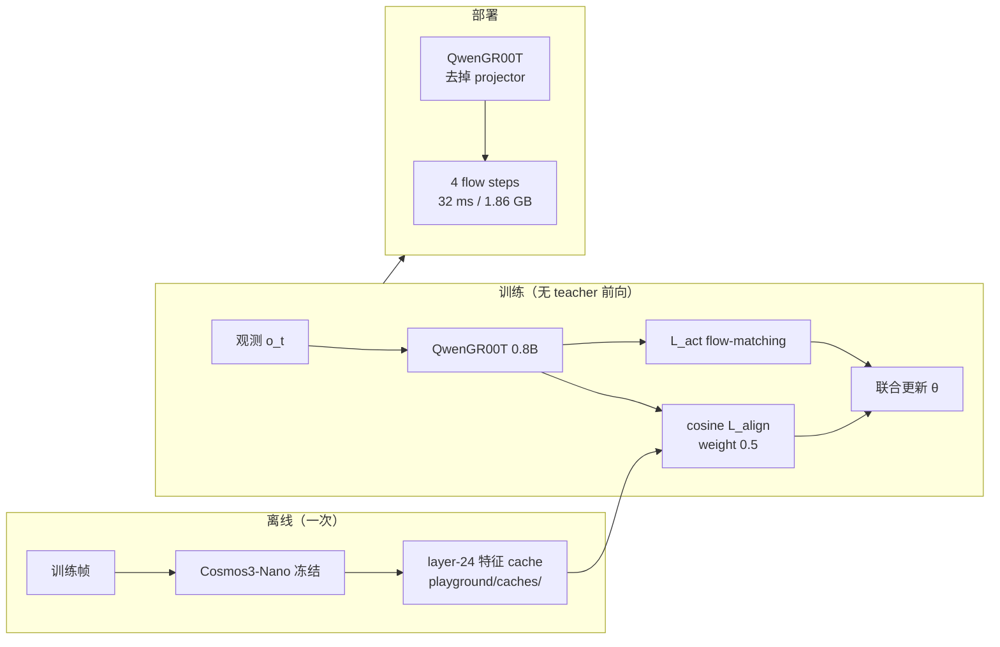
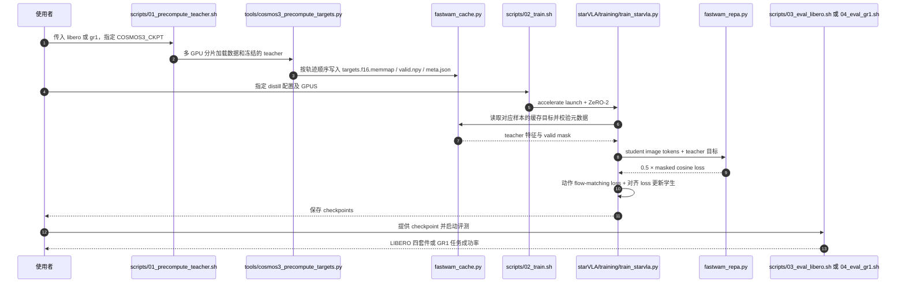

# THAW-VLA｜像世界模型一样思考，像 VLA 一样行动（Think Like a World Model, Act Like a VLA）

**THAW-VLA**（*Think Like a World Model, Act Like a VLA: Distilling World-Model Representations into Compact Robot Policies*，UW–Madison / UIUC，[arXiv:2609.24682](https://arxiv.org/abs/2609.24682)）把 **世界模型的物理 grounding** 以 **表征蒸馏** 方式注入 compact VLA：冻结 teacher（默认 **Cosmos3-Nano**）对训练帧 **一次性预计算** layer-24 特征并缓存；学生 **QwenGR00T**（Qwen3.5-VL 0.8B + flow-matching expert，[StarVLA](../methods/star-vla.md)）在常规 action loss 上加 **cosine 对齐项**（权重 0.5），训练结束 **丢弃 projector**，部署网络结构与未蒸馏 baseline **相同**；作者测得的推理延迟及显存占用均为 **32 ms / 1.86 GB（RTX 5090）**，不等于不同训练所得权重或动作逐比特相同。

## 一句话定义

用离线缓存的世界模型中间特征监督 VLA 视觉通路，让 0.8B 策略继承 WAM 级 grounding，而不在控制环里跑生成式世界模型。

## 英文缩写速查

| 缩写 | 英文全称 | 简要说明 |
|------|----------|----------|
| VLA | Vision-Language-Action | 视觉-语言-动作策略 |
| WAM | World Action Model | 联合预测未来与动作的世界动作模型 |
| REPA | Representation Alignment for Generation | 中间特征对齐范式；本文用于世界模型→VLA 的训练辅助损失 |
| LIBERO | Lifelong Benchmark for Robot Manipulation | 四套件仿真操作基准 |
| GR1 | Fourier GR1 humanoid | RoboCasa-GR1 人形双臂设定 |

## 为什么重要

- **解耦 grounding 与生成：** WAM 的因果/时序结构在 **特征** 里，不必在部署时 roll future — 直接回应 [world-action-models](../concepts/world-action-models.md) 的 **推理成本** 痛点。
- **零部署税：** 相对 DreamZero 等秒级 WAM，THAW-VLA 0.8B 在 RTX 5090 上 **32 ms / 1.86 GB**，图结构与 undistilled QwenGR00T 一致 — 增益可归因 **表征** 而非容量或 test-time compute。
- **小模型追大模型：** RoboCasa-GR1 上 0.8B 从 48.2%→50.5%，距 4B 同架构约 4.3 pt；真机 fruit pick-place 可与 4B π₀.₅ 对齐。
- **Teacher 可换：** V-JEPA2-AC、Fast-WAM、Cosmos3-Nano 均提升同一学生 — 说明信号是 **广谱表征先验**，非两网 fragile 对齐。

## 核心信息

| 作者 | Trung Dao、Sankalp Yamsani、Jaden Park、Joohyung Kim、Yong Jae Lee |
|------|------|

| 字段 | 内容 |
|------|------|
| 机构 | 威斯康星大学麦迪逊分校（UW–Madison）、伊利诺伊大学厄巴纳-香槟分校（UIUC） |
| arXiv | [2609.24682](https://arxiv.org/abs/2609.24682) |
| 项目页 | <https://thaw-vla.trung-dt.com/> |
| 开源状态 | 代码：[GitHub](https://github.com/trungdt880/THAW-VLA)，MIT；[HF 模型集合](https://huggingface.co/collections/termanteus/thaw-vla) 可公开浏览到 LIBERO 与 RoboCasa-GR1 的模型文件（2026-11-12）；README 仍保留历史 `private` 文案 |
| 真机 | AgileX Nero 单臂；TRIP-Bag 双臂 handover |

## 流程总览

## 核心原理

- **学生：** QwenGR00T = Qwen3.5-VL backbone + GR00T-style flow-matching action expert；$\mathcal{L}_{\mathrm{act}}$ 为 velocity regression on action chunk。
- **对齐：** 学生各视角 image token mean-pool 后经双层 MLP projector 映射到 teacher 特征维度，按视角计算 `1 − cosine`；teacher/student **无需同维**，梯度不回传至 cache。
- **默认 teacher：** Cosmos3-Nano 完整系统为 16B，实际仅提取其中 Qwen3-VL-8B understanding tower 的 LM layer 24；每视角 4096 维，LIBERO 双相机缓存宽度 8192，GR1 单 ego 为 4096。
- **目标函数：** `L = L_act + 0.5 L_align`；动作监督仍来自示范动作，不使用 teacher 输出动作。teacher cache 按 `(trajectory_id, base_index)` 排序，`steps_hash` 不一致时会拒绝训练读取。
- **对照实验：** distill/baseline config 仅差 `use_repa` 与 cache 存在 — 用同尺寸学生隔离 alignment 项贡献。

## 源码运行时序图

以下入口与模块来自官方 README、`scripts/01_precompute_teacher.sh`、`scripts/02_train.sh`、`tools/cosmos3_precompute_targets.py` 和 `starVLA/model/modules/distill/fastwam_repa.py`，用于解释代码调用关系；未实际复跑训练。

推理服务不加载 teacher、teacher cache 或训练期 projector；动作专家仍运行四个 flow steps。细节见 [源码归档](../../sources/repos/thaw-vla.md)。

## 工程实践

| 检查项 | 建议 |
|--------|------|
| Teacher 成本 | README 要求自备 Cosmos3-Nano checkpoint（约 33 GB），提取特征后训练不再加载 teacher；LIBERO 预计算论文报告约 4 GPU·1 小时 |
| 环境隔离 | transformers / robosuite 版本冲突 — 按 README 分四个 venv，勿混装 |
| 复现实验 | distill 与 baseline 成对 config；并发训练改 `MAIN_PORT` |
| Checkpoint | HF 权重须放在 `checkpoints/` 子目录且带 `dataset_statistics.json`，否则动作未归一化 SR≈0 |
| 部署读法 | 推理 **4 flow steps**；alignment 模块已剥离 — 与 [VLA](../methods/vla.md) 小模型部署栈一致 |
| 开源边界 | 代码 MIT 全链路；HF LIBERO/GR1 checkpoint **已公开**；Cosmos3 teacher 仍需自备 ~33 GB |

## 实验与评测读法

- **LIBERO：** 四套件均值 95.3%→**97.9%**（0.8B）；仿真 **4 evaluation runs** 均值（2 seeds × 2 GPUs）。
- **RoboCasa-GR1：** 48.2%→**50.5%**；单 ego、29-D 双臂；仍低于 4B 强基线（如 ACE-Ego-0 72.8%）。
- **真机：** 三任务各 30 trials；0.8B 蒸馏模型 93.3% / 60.0% / 46.7%，分别比未蒸馏 +10.0 / +13.3 / +6.7 个百分点；果实抓放 93.3% 与 4B π-style 参照持平。失败多为放置或抓取接触阶段失误。
- **消融：** 换 InternVL 1B / Qwen3-VL 4B、对齐层 L8–L24、三类 teacher 均能应用；**RoboCasa 学生/层消融仅单次 A100、部分为四分之一训练日程**，不可与主表四次评测均值混为一谈。

## 与其他工作对比

| 维度 | THAW-VLA（本页） | 在控制环里跑生成式世界模型 | 不做蒸馏的同尺寸 VLA |
|------|-------------------|-----------------------------|------------------------|
| WM 参与时机 | **仅训练期**，teacher 特征离线缓存一次 | **推理期** 每步前向 | 不参与 |
| 部署开销 | 与 baseline **网络结构相同**（4 flow steps / 32 ms / 1.86 GB） | 显著增加延迟与显存 | 同本页 |
| 收益来源 | 视觉通路继承 WAM 级 grounding | 显式未来预测 | — |
| 报告增益 | LIBERO **97.9%**、真机 **+10 pt** | — | 基线 |
| 主要代价 | 需一次性缓存 teacher 特征（磁盘 + 预处理） | 在线算力 | — |

- **这是「把世界模型的知识搬走，但不把世界模型搬上车」：** projector 在训练结束即丢弃，因此它 **不属于** 推理期使用世界模型的那一类方法；比较时若把它和在线 WM 方法放在同一延迟轴上，会错判它的成本结构。
- **权重状态存在文档滞后：** 2026-11-12 匿名访问 Hugging Face 的 LIBERO / RoboCasa-GR1 模型页和 Files 列表可见 `final_model.pt`；作者 GitHub README 仍写 `private; request access`。以实时仓库权限为准，不能把 README 的旧说明当成当前访问限制。
- **teacher 效果不等价：** LIBERO 消融中 Cosmos3-Nano 97.9%、Fast-WAM 96.9%、V-JEPA2-AC 96.5%；不同 teacher 的提升幅度不同，不能推断「任意世界模型都会带来 +10 pt」。

## 结论

**THAW-VLA 证明 WAM 的物理 grounding 可以「训练时借、部署时不还」，是小 budget VLA 追大模型精度的可复现配方。**

1. **离线 cache + cosine 对齐** 是唯一新增项；部署图与 undistilled 相同 — 适合工业 latency 预算。
2. **0.8B 在 LIBERO 从 95.3% 提升到 97.9%**，说明在所测四套件上表征对齐有收益；论文未充分证明任意 OOD 场景也成立。
3. **Teacher 族无关性**（JEPA / Fast-WAM / Cosmos）支持「时序预测目标 → 特征先验」叙事，非单点 hack。
4. 复现需 **Cosmos3 预计算 + 四 venv**，先检查 HF checkpoint 文件、配置及归一化统计的一致布局；作者 README 的旧 private 描述与 HF 公开页面不一致。
5. 与 [GIFT](./paper-gift-intermediate-feature-training.md) 同属 **中间特征监督** 线，但 THAW-VLA teacher 来自 **WAM** 且 **零推理税**。

## 局限与风险

- **Teacher 依赖：** 默认 Cosmos3-Nano 体积与预计算算力不低；换小 teacher 增益递减但仍为正。
- **复现协议：** 论文 GR1 主结果为每环境 20 次/四轮汇总；当前官方 README 评测脚本说明为每环境 50 次。比较不同运行前应对齐具体协议。
- **GR1 绝对 SR：** 50.5% 距 SOTA 4B 仍有差距 — 蒸馏 **缩小** 而非 **消除** 规模差距。
- **真机样本：** 三任务 × 30 trials — 统计力有限；placement 失败提示仍缺精细接触建模。
- **权重访问：** Hugging Face 文件列表目前公开，但是否能完整下载、加载或复现作者报告值尚未在本次操作中实测，不能将页面可见等同于复现成功。

## 关联页面

- [VLA](../methods/vla.md)
- [StarVLA](../methods/star-vla.md)
- [World Action Models](../concepts/world-action-models.md)
- [GIFT 中间特征训练](./paper-gift-intermediate-feature-training.md)
- [Manipulation](../tasks/manipulation.md)

## 参考来源

- [thaw_vla_arxiv_2609_24682.md](../../sources/papers/thaw_vla_arxiv_2609_24682.md)
- [thaw-vla-trung-dt-com.md](../../sources/sites/thaw-vla-trung-dt-com.md)
- [thaw-vla.md](../../sources/repos/thaw-vla.md)
- [arXiv:2609.24682 v3 全文（2026-10-09）](https://arxiv.org/html/2609.24682v3)

## 推荐继续阅读

- [THAW-VLA 项目页](https://thaw-vla.trung-dt.com/)
- [GitHub: trungdt880/THAW-VLA](https://github.com/trungdt880/THAW-VLA)
- [StarVLA](https://github.com/starVLA/starVLA)
- [Fast-WAM（arXiv 相关 WAM teacher 消融）](../entities/paper-sa-2606-05254-flash-wam-modality-aware-distillation-for-world.md)
