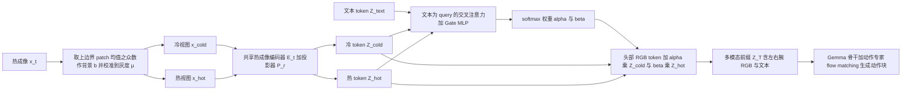

# Thermo-VLA（arXiv:2611.11981）

**Thermo-VLA**（*Thermo-VLA: A Thermal-Aware Vision-Language-Action Model with Gated Residual Modulation for Robotic Manipulation*，[arXiv:2611.11981](https://arxiv.org/abs/2611.11981)，Jingxuan Chen 等，v1 于 2026-11-09 提交）。本页依据论文全文与项目页补充材料写成，核对范围见 [来源归档](../../sources/papers/thermo-vla_arxiv_2611_11981.md)。

## 一句话定义

**在 π0.5 之上增加 ThermoRes Encoder：把热成像拆成「比背景冷 / 比背景热」两个属性视图，由语言条件的 softmax 门控决定二者权重，并以残差形式加到头部相机 RGB token，使策略能按温度选目标。**

## 英文缩写速查

| 缩写 | 英文全称 | 简要说明 |
|------|----------|----------|
| VLA | Vision-Language-Action | 视觉–语言–动作策略 |
| RGBT | RGB + Thermal | RGB 加热成像输入；论文里 π0.5(RGBT) 指把热像直接当作额外视觉输入的基线 |
| ThermoRes | Thermal Residual (Encoder) | 论文提出的模块：双分支属性分解 + 门控残差注入（§III-B） |
| RGBRes | RGB Residual (Encoder) | 同一残差机制换成红 / 绿 / 蓝属性视图的颜色迁移版（§V-A） |
| EE | End Effector | 末端执行器（Fig. 1 中的右手位移曲线） |
| PCA | Principal Component Analysis | 主成分分析；论文用它度量残差的低秩程度（表 S4） |
| MLP | Multi-Layer Perceptron | 门控网络，10240→512→256→2（表 S3） |
| LN | Layer Normalization | 层归一化，门控输入前使用（式 3） |

## 为什么重要

- 现有 VLA 以 RGB 为主，指令涉及温度这类不可见属性时无法原生感知（§I）；论文指出已有热成像操作多是识别并抓取显著热目标，相对温度比较、条件选择、排除式推理探索较少（§I，作者自述）。
- 作者提出的要点是：热信息不与 RGB 并列拼接，而是作为受语言调制的残差叠加在 RGB 表示上，RGB 路径保持恒等通道（§III-B 2）。这是一种「在不动主干的前提下给 VLA 加一个物理属性」的接入方式，论文还在颜色属性上做了迁移验证（§V）。
- 评测放在双臂人形（Unitree G1）真机上，而不是固定视角单臂（§I，作者自述与已有工作对比）。

## 核心原理与流程总览

输入：头部与左右腕 RGB、头部热成像 x_t、语言指令 l、机器人状态 s_t；输出：长度 H 的连续动作块，每步 2×d_a 维，d_a=8（7 个臂关节 + 1 个手开合）（§III-A）。

1. **双分支属性分解（§III-B 1，式 2）：** 因同一物体在不同场景灰度不同，先取上边界多个 patch 均值的众数为背景参考 b，把背景映射到固定灰度 µ（表 S3：µ=80，范围 0–255），再把偏离背景的部分分成 x_cold（低于背景）与 x_hot（高于背景）两个视图；两分支共用 SigLIP 系热成像编码器与 RGB 投影器，故 token 维度与 RGB 一致。
2. **门控残差注入（§III-B 2，式 3–4）：** 文本 token 为 query、冷 / 热 token 为 key-value 做交叉注意力（8 头，头维 256，两分支共享参数），拼接 [文本; O_c; O_h; O_c−文本; O_h−文本] 经 LN 与 MLP 后 softmax 得 [α, β]；产生 Z_rgb^cold = Z_rgb^head + α·Z_cold 与 Z_rgb^hot = Z_rgb^head + β·Z_hot 两份头部 RGB token。
3. **动作生成（§III-C）：** 前缀 Z_T = [头部冷份; 头部热份; 左腕; 右腕; 文本] 送入 Gemma 骨干与动作专家，沿用 π0.5 的 flow matching；动作块 H=50，积分 10 步（表 S3）。
4. **颜色迁移 RGBRes（§V-A）：** 把热成像换成红 / 绿 / 蓝三个通道的黑白属性视图，门控输出 α′、β′、γ 三个权重，其余结构不变。

## 工程实践

- **硬件（附录 II）：** Unitree G1 EDU、Dex3-1 三指灵巧手，只控制双臂与双手；头部 D435i（640×480，30 Hz）、两腕 D405、Tiny1-C 热像（256×192，25 Hz，装在 D435i 右侧，与 RGB 刚性固定）；训练用 A800 80GB，推理用 RTX 5090 48GB。
- **数据（§IV-A、附录 IV）：** PICO XR 遥操作，沿用 Unitree 官方 XR 遥操作流程，半自动采集（自动回到初始位姿），热成像同步记录，存为扩展的 LeRobot v3 格式（见 [LeRobot Dataset v3](../concepts/lerobot-dataset-v3.md)、[Unitree G1](../entities/unitree-g1.md)）。共 1,307 条示范（表 I：156/303/236/340/173/99）。
- **RGB-only 任务的热信号处理（附录 IV-B）：** Task I、III 复用 Task II、IV 的热数据，用 Cutie 抹掉目标物体的热响应、保留机器人手的热信号（RobotSeg 在手被遮挡时会丢手，故未采用）。
- **训练（附录 III）：** 所有 π0.5 系模型从同一预训练 π0.5 权重出发，AdamW、40K 步、batch size 8、学习率 2.5×10⁻⁵、100 步 warm-up、余弦衰减，随机种子固定 1000；按训练损失曲线选 40K 步为预算。
- **评测协议（§IV-A）：** 每条指令 20 次；Task I–IV 目标放对杯垫才算成功；操作员戴隔热手套复位物体，各方法同一 trial 的摆放大致一致。
- **显式对齐实验（附录 V，作者自述）：** 在 RGB–热成像间用 SuperPoint + MINIMA(LightGlue) 做显式匹配，成功率与标准 Thermo-VLA 相当但增加推理延迟，作者据此认为固定相机位姿下无需显式对齐（具体数字附录未给）。
- **复现：** 项目页 Code、Data 均为 Coming Soon，论文未给仓库；本页不写 `code:`。

## 实验结果（论文数字）

| 任务（表 II，每指令 20 次） | ACT | π0.5 | π0.5(RGBT) | ThermoAct | Thermo-VLA |
|------|-----|------|-----------|-----------|-----------|
| I 位置选瓶 | 0.75 | 0.93 | 0.85 | 0.45 | 0.88 |
| II 冷瓶选择 | / | / | 0.80 | 0.45 | 1.00 |
| III 物体身份选择 | 0.69 | 0.84 | 0.71 | 0.49 | 0.76 |
| IV 冷 / 热物体选择 | / | / | 0.85 | 0.55 | 0.86 |
| V 咖啡加糖（少冰 / 多冰） | / | / | 0.50 | 0.00 | 0.58 |
| VI 死鼠笼移除（模拟目标） | / | / | 0.55 | 0.50 | 1.00 |

- 摘要：四个温度相关任务均值 0.86，比 π0.5(RGBT) 高 18 个百分点；按表 II 自行平均，π0.5(RGBT) 为 0.675，差约 18.5 点，与作者说法吻合。
- 泛化（表 III，Thermo-VLA / π0.5(RGBT) / ThermoAct）：未见物体 0.79 / 0.64 / 0.38；光照变化 0.76 / 0.68 / 0.35；未见桌布 0.79 / 0.72 / 0.34；Task IV 温度重赋予 0.60 / 0.10 / 0.50。摘要的「0.78」与三项均值 (0.79+0.76+0.79)/3 相符，该均值不含 0.60 的温度重赋予项（我的计算）。
- 消融（表 IV）：见上节要点；热残差置零后 Task II/IV 约 0.50/0.45，作者解读为模型仍能做基本抓放，但不能按温度选目标。
- 颜色迁移（表 V）：π0.5 0.707/0.307/0.600/0.675（均值 0.572）→ 加 RGBRes 0.873/0.453/0.900/0.875（均值 0.775）；Task VII 为 LIBERO 仿真，Task VIII 为真机。作者说明 Task VII 用仿真是因为现有仿真器缺少足够真实的热成像（附录 IV）。

## 与其他工作对比

| 工作 | 关注点 | 与本文的区别 |
|------|--------|--------------|
| 本文 Thermo-VLA | 冷 / 热双分支 + 语言门控残差，把热成像注入 π0.5 的头部 RGB token | RGB 路径保持恒等，热信息只作受门控的加性残差 |
| [π0.5](./paper-pi05-open-world-vla.md) 与 π0.5(RGBT) 基线 | 原版只用 RGB；RGBT 把热像直接当额外视觉输入 | 原版无法完成温度任务；RGBT 在四个温度任务均值约 0.675，低于本文 0.86（表 II） |
| ThermoAct（论文基线） | Gemini 2.0 Flash 规划 + π0 执行的层级热感知方案 | 结构不同量级；表 II 温度任务 0.45/0.55/0.00/0.50；本仓库暂无对应页面 |
| [ACT](./paper-act.md)（论文基线） | CVAE + Transformer 动作块，纯 RGB | 只参与 RGB-only 任务（Task I/III 0.75/0.69），不处理温度 |

## 结论

**Thermo-VLA 说明把热成像拆成冷 / 热两个属性视图、再由语言门控以残差注入 RGB token，可以在不改 VLA 主干的情况下让双臂人形按温度选择目标。**

1. 四个温度相关真机任务均值 0.86，比 π0.5(RGBT) 高约 18 个百分点，增益集中在 Task II 与 Task VI（表 II）。
2. 未见物体、光照、桌布三项泛化均值约 0.78，温度属性重赋予 0.60 对 RGBT 的 0.10（表 III）。
3. 同一残差机制换成颜色属性（RGBRes）也有效，平均 0.572 → 0.775（表 V）。
4. 局限：只区分冷热不含温度幅值，RGB-only 任务略低于原版 π0.5，每指令仅 20 次、单种子，代码与数据未公开（§VI）。

## 与文章说法的核对

对照公众号文章《机器人动作块太长，什么时候该重新规划？》（2026-11-11，53 篇论文速览）中的 Thermo-VLA 条目（题为「仅看外观不够，让 VLA 感知物体冷热」）。文章原句：「通过语言门控的热成像残差，在需要时把温度线索注入视觉动作模型。真机冷热相关任务展示增益；温度表征主要区分冷热，常规视觉任务的能力保持仍有待改善。」

| 文章说法 | 核对结论 |
|----------|----------|
| 语言门控的热成像残差 | 属实：文本 token 作 query 的交叉注意力 + Gate MLP 预测权重，热信息以残差加到 RGB token（§III-B，式 3–4）。 |
| 「在需要时」注入 | 需限定：门控是对冷 / 热两分支做 softmax（α+β=1，式 3），决定的是冷热偏重，并非开关式的「需要才注入」；RGB-only 任务的热输入是被抹掉目标热响应后的数据（附录 IV-B），论文没有单独报告门控在这类任务上的取值。「按需」是对机制的意译（我的判断）。 |
| 真机冷热相关任务展示增益 | 属实且有数字：真机 Task II/IV/V/VI 为 1.00/0.86/0.58/1.00，均值 0.86，对 π0.5(RGBT) 高约 18 点（表 II、摘要）。注意：每个设置只有 20 次试验、单一种子、无置信区间；Task IV 仅比 π0.5(RGBT) 高 0.01，作者自己也称优势有限（§IV-A 2）；增益主要来自 Task VI（0.55→1.00）与 Task II（0.80→1.00）。热成像相关实验全部为真机，仿真只用于颜色迁移（Task VII）。 |
| 温度表征主要区分冷热 | 与论文局限一致：分解只给「低于 / 高于背景」两个视图，Task V 中 cold 与 cool 难分，作者计划加入温度幅值信息（§VI）。Task V 仅 0.58。 |
| 常规视觉任务的能力保持仍有待改善 | 与论文一致：RGB-only 的 Task I/III 上 Thermo-VLA（0.88/0.76）低于原版 π0.5（0.93/0.84），作者归因于 π0.5 的大规模 RGB 预训练与缺少热成像预训练，并计划预训练热成像编码器（§IV-A 2、§VI）。但相对 π0.5(RGBT)（0.85/0.71）与 ThermoAct（0.45/0.49）退化最小，论文也据此称其「仍具竞争力」。 |
| 文章未给代码 / 未提开源 | 项目页 Code、Data 均为 Coming Soon，未开源（2026-11-11 核对）。 |

整体：文章该条是对摘要与局限段的准确缩写，未出现与论文冲突的数字；需要补充的是上面「在需要时」的限定，以及增益集中在两个任务、样本量小这一点。

## 局限

**论文自己承认的（§VI）：**
- 热成像编码器没有大规模热数据预训练，RGB-only 能力略低于原版 π0.5；
- 冷 / 热分解不含温度幅值，无法区分 cold 与 cool（Task V）；
- 残差机制向其他模态（如深度的 near/far 属性视图）的扩展仍是未来工作。

**我看到的未验证之处：**
- **样本量与统计：** 每指令 20 次，成功率粒度 0.05；未报告多种子或置信区间，附录说明种子固定为 1000。
- **任务特异性：** 训练损失曲线按任务给出（图 S2），论文未明说是每任务单独训练还是多任务联合，推测为每任务训练（推测，未核实）；因此跨任务泛化与单模型多技能能力没有被检验。
- **基线对比的公平性：** ThermoAct 是「Gemini 2.0 Flash 规划 + π0 执行器」的层级结构（§II-C），与 π0.5 系的单模型并非同量级对比；其低分里有多少来自结构差异，论文未拆分。
- **RGB-only 任务的构造：** Task I/III 的热输入由人工标注 + 分割抹除目标热响应得到（附录 IV-B），并非真实无温度线索采集，可能影响这些任务上的比较。
- **目标与场景范围：** Task VI 的「死鼠」是模拟目标；任务集中于抓放、放杯垫或倒糖，温度范围仅冷 / 热 / 少冰多冰几档；泛化测了光照与桌布，没有测相机视角 / 位姿变化（相机固定，附录 V 仅作了初步对齐扩展）。
- **低秩 / 颜色迁移的解读：** 「残差沿少数主方向」基于 PCA 与平均余弦相似度（表 S4），热成像任务 top-32 只保留 83–90% 能量，论文用「approximately low-rank」「may generalise」措辞；颜色迁移的基线只有 π0.5，且颜色任务的残差余弦 0.999 说明其残差高度同向，是否对应「通用物理属性」属作者推论。
- **开源与复现：** 代码、数据均未公开，所有数字尚不能独立复现；论文状态为 under review（项目页）。

## 关联页面

- [VLA 方法页](../methods/vla.md)
- [π0.5（open-world VLA）](../entities/paper-pi05-open-world-vla.md)：本文的基线与骨干
- [π0 论文页](../entities/paper-pi0.md)
- [Flow matching 具身策略](../concepts/flow-matching-embodied-policy.md)：动作生成方式
- [多模态基础](../concepts/multimodality-basics.md)
- [传感器融合](../concepts/sensor-fusion.md)
- [视触觉融合](../concepts/visuo-tactile-fusion.md)：同为「给 VLA 加物理模态」的对照
- [Unitree G1](../entities/unitree-g1.md)
- [LeRobot Dataset v3](../concepts/lerobot-dataset-v3.md)
- [模仿学习](../methods/imitation-learning.md)

## 参考来源

- [sources/papers/thermo-vla_arxiv_2611_11981.md](../../sources/papers/thermo-vla_arxiv_2611_11981.md)
- [arXiv:2611.11981](https://arxiv.org/abs/2611.11981)
- [项目页](https://j-x-chen.github.io/Thermo-VLA-web/)（含补充材料；Code / Data 标 Coming Soon）

## 继续阅读

- [arXiv PDF（v1）](https://arxiv.org/pdf/2611.11981v1)
- [VLA 方法页](../methods/vla.md)
- [视触觉融合](../concepts/visuo-tactile-fusion.md)
