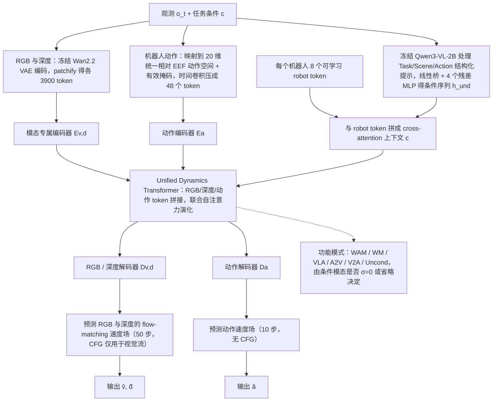

# Thinker-WM：共享多模态表征的具身统一世界模型

**Thinker-WM**（*Thinker-WM: A Unified World Model with Shared Multimodal Representations for Embodied Intelligence*，[arXiv:2610.18447](https://arxiv.org/abs/2610.18447)，[项目页](https://thinkercosmos.ubtrobot.com/thinker-wm/)，[代码](https://github.com/UBTECH-Robot/Thinker-WM)，[模型](https://huggingface.co/UBTECH-Robotics/Thinker-WM)）由 UBTECH Thinker Team 发布。

## 一句话定义

**把 RGB、度量深度与机器人动作放进共享动态表征，并用同一参数化覆盖世界预测、动作建模与策略推理。**

## 英文缩写速查

| 缩写 | 英文全称 | 简要说明 |
|------|----------|----------|
| WM | World Model | 预测未来世界观测的生成模型；本页指 Thinker-WM 本身 |
| WAM | World Action Model | 世界预测与动作生成联合建模的模型族 |
| RGB | Red-Green-Blue | 彩色视频观测模态 |
| HF | Hugging Face | 官方模型权重发布入口 |
| CC BY-NC-SA | Creative Commons Attribution-NonCommercial-ShareAlike | 代码仓库标注的非商用署名-相同方式共享许可证 |

## 流程总览

图依据：论文 §3.1 式 (4) / Fig. 2、§3.2、§3.3、§3.4（Table 2 / Fig. 5）、§3.5。

## 核心机制

论文提出 Unified Dynamics Transformer（统一动态 Transformer）作为共享中间骨干：各模态经专属编码器进入共享表征，在动态表征中共同演化，再由专属解码器生成不同模态。由此把外观、几何和动作联系起来，同时保留其输出结构差异。

| 能力 | 任务形式 |
|------|----------|
| 联合视频-动作生成 | 从条件生成视频与动作 |
| 世界预测 | 预测未来世界观测 |
| 策略推理 | 从视觉 / 语言条件预测动作 |
| 动作条件生成 | 给定动作生成对应视觉变化 |
| 视频到动作 | 从视频推断动作 |
| 逆动力学 | 从状态变化推断动作 |

论文还使用轻量 motion probe 测试冻结视觉表征中是否可恢复运动信息。

## 数据与评测结果（论文自报）

- 训练数据规模：约 **20K 小时第一视角视频、10K 小时真机数据、1K 小时仿真数据**，其中约 **4K 小时真机数据含对齐深度监督**（论文摘要口径）。
- 作者报告模型在 **EWMBench、WorldOlympiad、WorldArena** 三个具身世界模型评测上排名第一。
- 这些是论文报告结果；跨论文比较前需核对 benchmark 版本、评测协议和指标。

## 开源状态与复现边界

- **论文：** 已公开预印本。
- **代码：** 官方 GitHub 仓库提供推理实现；README 声明支持六种推理模式。仓库许可证标为 **CC BY-NC-SA 4.0**。
- **训练复现：** 不应从推理仓库推断完整训练代码或训练数据已公开。
- **权重：** Hugging Face 官方入口由发布方链接；仓库 README 的下载说明仍留有占位符，权重内容、可下载性和许可需查看模型卡与文件列表。

## 与相近工作对比

- 与单一视频世界模型相比，Thinker-WM 将度量深度和机器人动作纳入共享动态表示及生成任务。
- 与 World Action Model（WAM）相关：WAM 通常突出动作条件下的世界预测或世界-动作联合生成；Thinker-WM 论文进一步把深度几何预测和多种模态输入/输出任务放在统一模型中。比较时应以各自任务协议为准。
- 同方向可对照 [DepthWorld](./paper-depthworld-3d-world-model.md)：后者聚焦机器人操作中的几何一致性与深度世界预测。

## 结论

**Thinker-WM 的主张是「RGB + 度量深度 + 动作」可共享一套动态表征，并用同一组参数覆盖六类视频-动作任务；目前可用的是推理代码与论文自报排名，训练侧复现边界尚不清楚。**

1. 架构要点是「模态专属编解码 + 共享 Unified Dynamics Transformer」，与只在像素空间建模的视频世界模型相比，把深度几何与动作作为一等输出。
2. 三项具身世界模型基准（EWMBench / WorldOlympiad / WorldArena）第一为论文摘要口径；引用前须核对榜单版本、任务子集与指标。
3. 训练语料约 31K 小时（第一视角视频 20K + 真机 10K + 仿真 1K），其中仅约 4K 小时真机带深度监督；README 口径与论文不完全一致，以论文为准。
4. 开源仅覆盖推理（六种模式，CC BY-NC-SA 4.0 非商用），不能据此推断训练代码或数据已公开；权重下载以 HF 模型卡为准。
5. 选型上可作为 WAM 路线中「多任务统一参数化」的代表；若关注操作中的几何一致性，可与 DepthWorld 对照阅读。

## 关联页面

- [生成式世界模型](../methods/generative-world-models.md)
- [世界-动作模型](../concepts/world-action-models.md)
- [DepthWorld：机器人操作的 3D 世界模型](./paper-depthworld-3d-world-model.md)

## 参考来源

- [论文归档](../../sources/papers/thinker_wm_arxiv_2610_18447.md)
- [代码仓库归档](../../sources/repos/thinker-wm.md)
- [项目页归档](../../sources/sites/thinker-wm.md)
- [模型仓库归档](../../sources/models/thinker-wm.md)
- [arXiv PDF](https://arxiv.org/pdf/2610.18447)：已通读方法部分（实验与附录以略读为准）：§3 模型架构（3.1–3.6）、§6 训练策略；§4 数据、§5 基础设施、§7 Motion Probe、§8 实验仅略读
