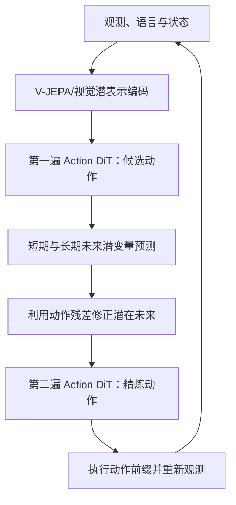

# ThinkWAM: Rethinking Latent Futures for Action Refinement / 用提议—再思考—精炼在执行前修正动作

## 一句话定义

**ThinkWAM**：ThinkWAM 先生成候选动作与未来潜状态，依据动作残差修正多时域未来后再生成动作；LIBERO 98.70%、LIBERO-Plus 84.76%；101.2 ms 为真机平台两遍推理而非 LIBERO 延迟。

## 英文缩写速查

| 缩写 | 英文全称 | 简要说明 |
|---|---|---|
| WAM | World-Action Model | 将未来状态推断与动作决策耦合 |
| V-JEPA | Video Joint-Embedding Predictive Architecture | 视觉潜表示的未来预测基础 |
| DiT | Diffusion Transformer | 用于动作生成的 Transformer |
| LIBERO | Lifelong Benchmark for Robot Learning | 操作任务成功率评测 |

## 为什么重要

一次动作采样可能把错误轨迹交给执行器；与其在真实世界犯错后恢复，不如在动作发出前，用模型预测的未来状态诊断并修正动作提议。

## 核心原理

1. 第一遍把当前视觉、语言与状态编码为潜变量并提出动作块，同时对多个时间尺度的未来潜表示进行预测。
2. 把初次动作与潜在未来之间的偏差反馈为动作残差线索，对未来潜变量再思考和修正；第二遍动作生成以修正后的潜在未来为条件。
3. 将“未来先验”用于执行前在线 refinement，而非宣称模型真的在外界运行了未来视频；短时动态与较长时程目标共同影响动作修正。

## 流程总览

## 源码运行时序图

**不适用**：截至 2026-11-18，官方项目主页未提供可核实的完整可运行训练或推理入口；不能将论文方法图冒充源码运行时序图。

## 工程实践

- 关注动作残差在静态背景扰动、遮挡、目标偏移下是否改善完成率，而不是只看离线潜预测误差。
- 评测记录 first-pass / refinement / second-pass 三段耗时，评估 100 ms 级额外推理是否仍满足动作 chunk 的安全与节拍预算。
- 在线精炼不能替代碰撞检测、运动约束和真实机器人硬实时底层控制。

## 实验与评测

- LIBERO 成功率 98.70%；LIBERO-Plus 成功率 84.76%，均应使用各自对应协议对比。
- 两遍推理约 101.2 ms 指 Galaxea A1Z 真机配置；LIBERO 评测配置约 153.48 ms，测时与硬件不同。
- 两次动作生成延迟是部署成本；单次采样模型与该两遍方案应在相同设备、相同动作前缀和同一成功率协议下比较。

## 结论

**ThinkWAM 的价值应以相同任务协议、训练数据与推理测时边界判断，不能仅依据宣传规模或单一成功率。**

1. 第一遍把当前视觉、语言与状态编码为潜变量并提出动作块，同时对多个时间尺度的未来潜表示进行预测。
2. 把初次动作与潜在未来之间的偏差反馈为动作残差线索，对未来潜变量再思考和修正；第二遍动作生成以修正后的潜在未来为条件。
3. 关注动作残差在静态背景扰动、遮挡、目标偏移下是否改善完成率，而不是只看离线潜预测误差。
4. 评测记录 first-pass / refinement / second-pass 三段耗时，评估 100 ms 级额外推理是否仍满足动作 chunk 的安全与节拍预算。

## 与其他工作对比

| 对照 | 关键差异 |
|---|---|
| ScaleVLA | ScaleVLA 放大骨干规模；本工作在推理链中显式加入未来修正。 |
| ResWAM | ResWAM 在训练中学习未来特征残差，而本工作在执行前修正预测未来和动作提议。 |

## 局限与风险

- 更高的两遍推理计算开销及未来潜表示误差可能引入新失败模式。
- 官方项目页在本次核查中未提供可核实的可运行源码入口；源码运行时序图不适用。

## 关联页面

- [动作分块](../methods/action-chunking.md)
- [基于模型的强化学习](../methods/model-based-rl.md)
- [机器人操作](../tasks/manipulation.md)
- [ResWAM](./paper-reswam-2611-19559.md)
- [ScaleVLA](./paper-scalevla-2611-21607.md)
- [WAM 纵深路线](../../roadmap/depth-wam.md)

## 参考来源

- [论文全文归档](../../sources/papers/thinkwam-2611-21258.md)
- [arXiv 原文 v1](https://arxiv.org/html/2611.21258v1)
- [官方项目页归档](../../sources/sites/thinkwam-2611-21258.md)

## 推荐继续阅读

- [ThinkWAM: Rethinking Latent Futures for Action Refinement](https://arxiv.org/abs/2611.21258)
- [官方项目页](https://thinkwam-project.github.io/)

