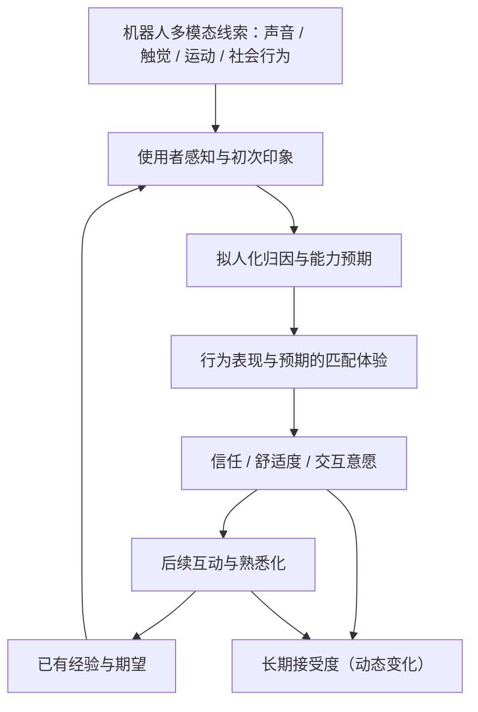

# Through human eyes / 透过人类的眼睛：感知与交互如何影响人形机器人接受度

**Through human eyes: How perception and interaction shape humanoid robot acceptance** — Katharina Kühne、Yuefang Zhou、Martin H. Fischer，*Science Robotics* 11(120)，eaek1050，2026-11-11，DOI [10.1126/scirobotics.aek1050](https://doi.org/10.1126/scirobotics.aek1050)。

> **原文核读状态：未完成。** 已核实 PubMed 的书目/摘要和波茨坦大学（作者所属机构）新闻稿。出版商全文暂不可读取；以下将作者机构解读与工程延伸明确分开，不把新闻稿充当论文全文。

## 一句话定义

本文是一篇关于**人形机器人接受度**的 Review：它把用户的信任、舒适度与行为意向放在持续的多模态感知和社会互动中理解，而非只看机器人的技术性能。

## 英文缩写速查

| 缩写 | 英文全称 | 简要说明 |
|------|----------|----------|
| HRI | Human-Robot Interaction | 人机交互，本文研究情境 |
| HRC | Human-Robot Collaboration | 人机协作，接受度影响协作部署体验（关联概念） |
| UX | User Experience | 用户体验，记录接触和互动过程中的主观感受 |

## 为什么重要

- **任务成功不等于被用户接纳。** PubMed 摘要强调动态多模态交互会影响信任、舒适和行为意向。
- **外观与行为需共同考虑。** 波茨坦大学官方解读指出，声音、触觉、运动和社会行为会影响初次感知；过度拟人化可能制造机器人难以兑现的期待。
- **接受度会随时间改变。** 长期使用场景不能仅依据一次演示后的打分判断人机关系。

## 流程总览

以下为**依据作者所在机构公开解读整理的概念关系图**，不是论文原图，也不是已经在全文核实的因果模型；箭头表示新闻稿描述的影响路径，不代表已验证的定量效应。

## 核心机制（当前可核实范围）

### 多感官感知与社交线索

作者所在机构的新闻稿强调，声音、触摸、动作和社会行为会塑造人们与机器人相处时的体验。**这是作者机构发布的论点概述**；全文中各模态的细分机制与引用证据仍待核读。

### 拟人化与期望管理

拟人化（anthropomorphism）让使用者以理解人类的方式解释机器人行为。新闻稿提示：更强的人形相似性不必然带来更高接受度，外观承诺与实际交互能力若不匹配，可能带来不适和拒绝。

### 反复互动的时间维度

个人经验、先验期待与多次接触会改变对机器人是否可信、讨喜或令人不安的判断。长期接受度因此不是一次静态问卷的同义词。

## 工程实践（知识库延伸建议，非原文实证）

| 产品阶段 | 建议观察 | 不应混同 |
|----------|----------|----------|
| 外观/首见 | 拟人化程度、第一印象、预期任务能力 | 外形逼真度不等于信任 |
| 首次交互 | 语音、姿态、动作反馈的一致性及任务完成 | 技能成功率不等于接受度 |
| 反复使用 | 信任/舒适度变化、继续使用意愿、失败后的恢复体验 | 单次好评不等于长期接受 |
| 机器人交付 | 在明确安全边界下做用户参与评估 | 该综述并未提供可直接照搬的控制算法 |

与 [人形机器人智能语音交互](../methods/humanoid-voice-interaction.md) 的区别：该方法页聚焦 ASR→LLM→技能→TTS 的可执行系统，本论文讨论用户**如何体验和接受**这样的系统，两者不是同一种评测目标。

## 实验与评测：核读边界

- PubMed 将本文登记为 **Review**；目前没有可核验的文章专属用户实验样本、量化基准、数据集或消融结果。
- 波茨坦大学新闻稿描述的是理论分析与既有研究的概括，**不据此杜撰新的实验统计**。
- 待全文：核对作者实际采用的理论框架、文献证据强度、量化结果是否来自所引文献，以及局限性陈述。

## 与相关研究对比

| 工作 | 核心问题 | 本页定位 |
|------|----------|----------|
| [人形机器人智能语音交互](../methods/humanoid-voice-interaction.md) | 语音到机器人技能执行的工程链路 | 如何看待交互之后的用户感知 |
| [PACE：对话引导人格适配](./paper-pace-persona-adaptation.md) | 社交机器人可控人格表达与用户反应 | 更宽泛的感知、拟人化和长期接受度 |
| [Moshi：全双工语音对话](./paper-moshi-speech-text-realtime-dialogue.md) | 连续语音生成与交互时延 | 语音体验如何进入用户的接受度判断 |

## 结论

**这是一篇以心理与具身交互视角讨论“机器人为什么被接受”的综述，而非提高运动控制成功率的新算法论文；现阶段只能引用公开摘要和作者机构解读，正式机制与证据仍需全文核读。**

1. 评估人形产品时，分开记录技术成功率与用户信任、舒适度、使用意愿。
2. 同时检查声音、动作、触碰和社交线索，避免单以视觉拟真度取代交互体验。
3. 核查机器人外观引发的能力预期，降低不必要的人形能力暗示。
4. 在真实场景重复评估，观察熟悉化及失败恢复后的体验变化。
5. 以上工程建议属于知识库延伸，**不能当作本文直接验证的设计规范或数值结论**。

## 源码运行时序图

**不适用（当前材料）**：这是一篇 HRI 接受度综述，不是提供可运行训练/推理入口的机器人算法实现；出版商全文和补充材料尚待核实。

## 局限与风险

- **全文不可得**：Science.org DOI 页面访问受限；论文中的正式模型、图表、引用范围与实证强度尚未核对，因此本页维持 Draft。
- **证据层级清晰**：一手的论文摘要与作者机构新闻稿是两类材料，不能代替通读论文全文。
- **相关性不是因果证明**：概念流程用于组织讨论，不代表每条关系已由本文做实验确认。
- **设计外推需验证**：跨文化、群体、场景与机器人形态的接受度差异应由相应用户研究确认，不能从公开短摘要推断。

## 关联页面

- [人形机器人智能语音交互](../methods/humanoid-voice-interaction.md)
- [Disney Olaf 角色机器人](../methods/disney-olaf-character-robot.md)
- [PACE：人格适配](./paper-pace-persona-adaptation.md)
- [Moshi：实时语音对话](./paper-moshi-speech-text-realtime-dialogue.md)

## 参考来源

- [本文来源归档：Through human eyes](../../sources/papers/through_human_eyes_scirobotics_aek1050.md)（原文未通读）
- [论文原文 DOI](https://doi.org/10.1126/scirobotics.aek1050)（全文待核）
- [PubMed PMID 43013689](https://pubmed.ncbi.nlm.nih.gov/43013689/)（书目信息与公开摘要）
- [波茨坦大学官方新闻稿（2026-11-16）](https://www.uni-potsdam.de/en/headlines-and-featured-stories/detail/2026-11-16-the-beginning-of-a-beautiful-friendship-interaction-is-key-to-human-acceptance-of-robots)（作者机构解读，非论文全文）

## 推荐继续阅读

- [Science Robotics 原论文](https://doi.org/10.1126/scirobotics.aek1050)
- [ACM/IEEE HRI 社区](https://humanrobotinteraction.org/)
