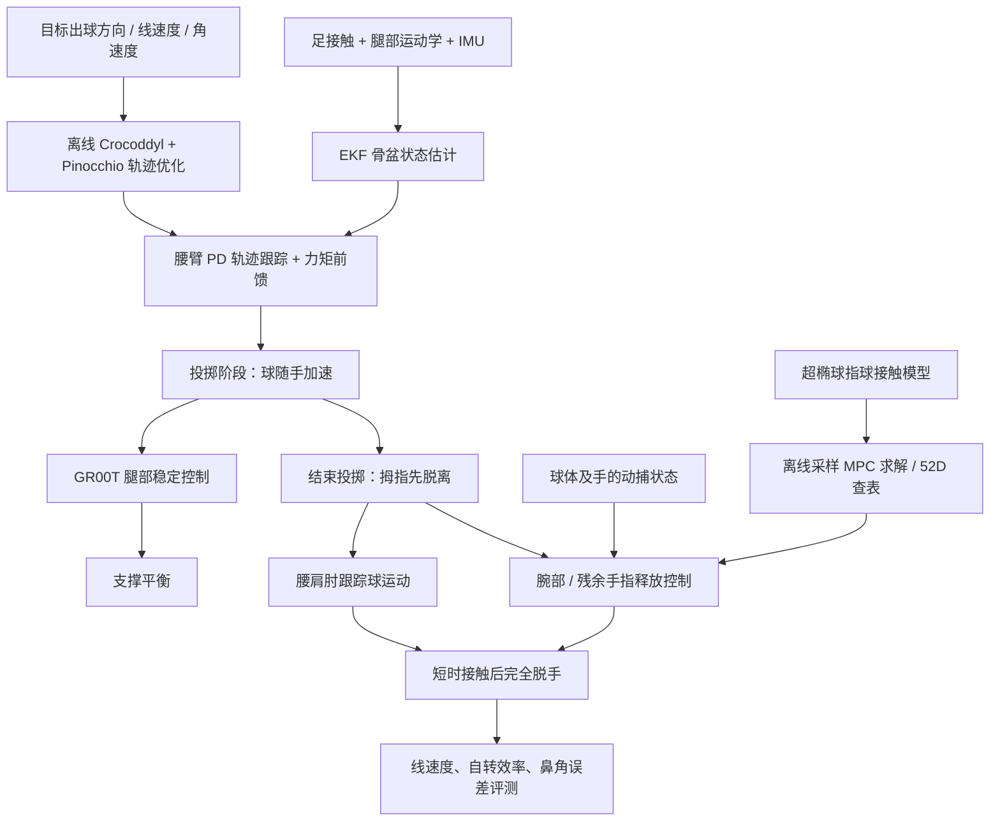

# 人形机器人投掷紧密螺旋美式橄榄球 / Throwing a Tight Spiral American Football by a Humanoid Robot

## 一句话定义

**Tight Spiral Throwing（紧密螺旋投掷）** 将人形机器人的高动态抛投分为**加速赋予线/角动量**与**控制指尖最后接触以稳定旋转**两阶段；在 Unitree G1 上验证了美式橄榄球球头、飞行速度与自转轴的协调对齐，而不只是把球抛出。

## 英文缩写速查

| 缩写 | 英文全称 | 简要说明 |
|---|---|---|
| DoF | Degrees of Freedom | 机器人和灵巧手的可控关节自由度 |
| WBC | Whole-Body Control | 本文腿部稳定与上肢投掷相协调的控制架构 |
| EKF | Extended Kalman Filter | 从腿部运动学、接触和 IMU 推断骨盆运动 |
| IMU | Inertial Measurement Unit | 腿部状态估计所需惯性观测 |
| MPC | Model Predictive Control | 随动阶段预测指尖接触与球体状态 |
| DDP | Differential Dynamic Programming | 离线求解高动态投掷轨迹的优化方法 |
| PD | Proportional–Derivative Control | 追踪投掷优化轨迹的关节反馈项 |

## 核心信息

| 字段 | 内容 |
|---|---|
| 作者 | Zaid Mahboob、Bowen Weng |
| 机构 | 艾奥瓦州立大学（Iowa State University）计算机科学系 |
| 论文 | arXiv:2608.16642v2，2026-10-09；Humanoids 2026 已接收 |
| 平台 | 29-DoF Unitree G1 + 7-DoF Dex3-1 三指灵巧手 |
| 项目 | [作者官方 Tight Spiral 项目页](https://www.zaidmahboob.com/projects/tight-spiral/) |
| 资料 | [论文 HTML](https://arxiv.org/html/2608.16642v2) · [演示视频](https://youtu.be/gw1AeG-Y614) |
| 源码状态 | 截至 2026-11-14 未发现此项目的公开可运行仓库与模型/控制器文件 |

## 为什么重要

传统抛投规划通常在达到目标释放速度后直接张开夹爪；但美式橄榄球具有明显长轴，**脱手后的不足 100 ms 内，球仍会经过指腹滚动与滑动**。未经控制的残余接触可能扰乱球头和旋转轴，导致明显晃动。论文把这个容易被建模为「瞬间开爪」的过程提升为明确的**短时接触动力学与释放控制问题**。

## 核心原理

### 1. 紧密螺旋的可测量定义

用球体长轴/球头单位向量 $\hat n$、线速度 $v$ 与角速度 $\omega$：

- **旋转效率**：$\eta_{spin}=|\hat n^T\omega|/\|\omega\|$，越接近 100% 越好。
- **球头角误差**：$\alpha_{nose}=\arccos(|\hat n^Tv|/\|v\|)$，越接近 0 越好。
- 严格的球头朝前条件还包括 $\hat n^Tv>0$。两个取绝对值的对齐指标单独使用时不表达朝向正反。
- 论文量化的是**释放瞬间的姿态/速度/旋转质量**，没有把完整空气动力学、远距离落点命中率纳入实验结论。

### 2. 分层全身稳定与离线投掷优化

- **下肢：** GR00T Whole-Body controller 执行腿部稳定；腿部接收上肢状态，EKF 融合腿部运动学、足接触及 IMU，向上肢控制器反馈骨盆速度。
- **投掷：** Pinocchio + Crocoddyl 对腰和投掷臂的 **10-DoF** 模型做 **0.60 s / 50 步**离线轨迹优化，满足动力学、扭矩、姿态与末端线/角速度要求；目标发射仰角 35°。
- **执行：** 在线 PD + 前馈力矩跟踪离线优化结果，并补偿骨盆运动。此阶段假定手与球无滑动、等效刚性连接。

### 3. 把释放过程单独控制

- **切换：** 投掷轨迹结束时先打开拇指，其余指尖继续暂时接触球体；3D 打印加长拇指甲有助于干净脱离。
- **并行任务：** 腰、肩、肘继续沿球的轨迹跟踪；MPC 控制腕部与仍接触的手指。
- **接触感知模型：** 把球视为可微的超椭球，通过离散指腹采样估计穿透、法向弹簧力及摩擦力，预测球体牛顿–欧拉运动。由于触觉传感器在极短接触期的力估计不可靠，本文并未将其用作控制所需的接触力估计。
- **MPC 目标：** 减少偏轴旋转、鼻轴与速度方向误差、关节速度变化和指尖向内冲击；时域 15 步 × 4 ms。
- **实现限制：** 一次完整采样式 MPC 求解约需 **500 ms**，难以满足 250 Hz，因此实机使用基于**真实采集数据预先生成的 52 维状态查表 MPC**，不能称为在线完整 MPC 优化。

## 流程总览

## 源码运行时序图

**不适用。** 截至 2026-11-14，作者官方项目页公开论文和演示视频，但未列出该研究的可运行官方控制代码、查表数据、训练或部署脚本。上图依据已核对的**论文系统结构**绘制，非对公开仓库进行源码追踪得到的运行时序，不虚构脚本入口。

## 实验与评测

| 指标 | 原文结果 | 注意口径 |
|---|---|---|
| 试验硬件 | G1 29-DoF、Dex3-1 7-DoF、加长拇指甲、0.252 kg 小号球 | 不是任意尺寸橄榄球 |
| 外部感知 | 6 台 OptiTrack PrimeX 22，相机 360 Hz，精度 ≤0.15 mm | 依赖动捕，不是自主机载感知 |
| 投掷阶段末态 | 17 次中旋转效率 $67.1\%\pm12.1\%$；球头角 $18.9^\circ\pm5.6^\circ$ | 此时球仍与部分指尖接触 |
| 随动阶段时长 | 61 次平均 78.5 ms | 部分试次仅持续 30–40 ms |
| 最佳完整脱手状态 | 自转效率最高 **93.6%**，球头角误差最低 **0.286 rad（16.4°）** | 最佳值不应当成平均值/同一试次 |
| 最高释放运动 | 线速度 5.35 m/s；角速度 14.5 rad/s | 单独报告的峰值 |
| 无主动随动的消融 | 平均旋转效率 **67.1%→60.9%**；平均鼻角 **18.9°→34.7°** | 代表不可控接触引起的劣化 |
| 执行器极限 | 某次投掷末 50 ms 中腰俯仰扭矩饱和 90.9%，肩俯仰与肘各 54.5% | 单次示例，不是整体均值 |

## 结论

**对有显著旋转姿态约束的投掷任务，控制「最后一次手指接触」与生成投掷轨迹同样关键。**

1. **设计 KPI：** 不只看球飞得多快，还应同时量化自转轴效率和球头-速度角度。
2. **建模切分：** 长动作阶段用刚性抓持近似做离线优化，亚百毫秒脱手阶段单独建模手指滚动/滑动。
3. **部署别混淆：** 论文的 250 Hz 实机释放命令依赖离线查表，不能把 500 ms 求解的 MPC 描述成实时在线全解。
4. **比较分清口径：** 93.6% 是峰值；67.1%→60.9% 是未控制释放的均值劣化，不是同一统计量。
5. **复现实验限制：** 外部动捕和特制拇指甲是系统组成部分，尚缺项目官方代码与数据；不能直接宣称可在普通 G1 上一键复现。

## 与其他工作对比

| 技术路线 | 主要关注点 | 本文的差异 |
|---|---|---|
| 传统机器人抛投/开爪 | 提供满足动力学的出球速度与轨迹 | 显式优化出球方向与角动量方向，并建模出手过渡 |
| 二维双指释放动力学 | 平面滑动枢轴与局部接触 | 扩展到三维多指、球体旋转与人形全身稳定 |
| [WBC 通用范式](../concepts/whole-body-control.md) | 全身任务协调与约束求解 | 本文是腿部稳定 + 腰臂抛投 + 手指接触释放的模块化工程实例 |

## 工程实践

- **先验证感知：** 动捕 360 Hz 的球/手位姿和 EKF 的骨盆状态需要时间同步；离开动捕环境要重新解决释放状态估计。
- **明确控制接口：** 离线腰/臂轨迹、在线 PD/力矩前馈、腿部稳定、腕/指查表释放分别独立检查采样频率和时延；不要把 MPC 预测时域误写为在线计算时间。
- **重点监测：** 腰/肩/肘扭矩饱和、高速跟踪误差、拇指与球的最终接触时序，以及脱手时的旋转效率与球头角误差。
- **安全调试：** 原文已报告过热与硬件磨损；高动态抛掷需要物理隔离、人身防护和限位保护。研究结果不等于已有安全验证。

## 局限与风险

- 作者明确指出目前实验还**无法支撑统计显著的重复性分析**；峰值不等于稳健性。
- 释放阶段依赖外部 OptiTrack，高速短接触中没有可用的可靠触觉受力闭环；传感器替换可能改变性能。
- 投掷球模型与末态指标未覆盖完整飞行空气动力学和落点精度，不能据此推断接球成功率。
- 现阶段腰臂加速与腿部稳定是模块化耦合，并非充分利用全身惯量的统一高动量优化。
- 公开论文/演示不等于完整开源控制实现；随动 MPC 查表及真机采样数据没有可核验的官方发布入口。

## 关联页面

- [Whole-Body Control：全身控制](../concepts/whole-body-control.md)
- [Contact Estimation：接触估计](../concepts/contact-estimation.md)
- [机器人雅可比矩阵：关节与末端映射](../formalizations/robot-jacobian.md)

## 参考来源

- [arXiv:2608.16642v2 原文通读归档](../../sources/papers/throwing_tight_spiral_football_arxiv_2608_16642_v2.md)
- [作者官方项目页归档与资源开放检查](../../sources/sites/throwing-tight-spiral-football-project.md)
- [论文原始 HTML](https://arxiv.org/html/2608.16642v2)
- [Tight Spiral 作者项目页](https://www.zaidmahboob.com/projects/tight-spiral/)

## 推荐继续阅读

- [作者演示视频](https://youtu.be/gw1AeG-Y614)
- [论文 PDF v2](https://arxiv.org/pdf/2608.16642v2)
- [接触估计与动力学基础](../concepts/contact-estimation.md)
