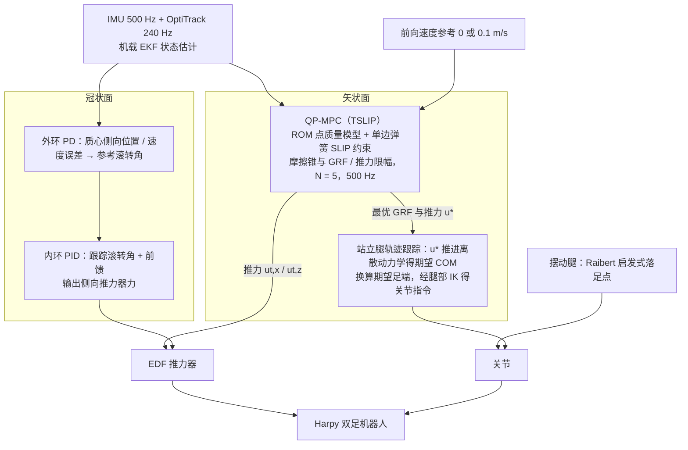

# Thrust-Assisted Trotting：基于实时 QP-MPC 的仿生推力辅助空地双足小跑

**Thrust-Assisted Trotting**（*Bio-inspired Thrust-Assisted Trotting on a Legged-Aerial Robot via Real-Time QP-MPC*，[arXiv:2610.26810](https://arxiv.org/abs/2610.26810)）收录于 senlanke「具身运控lab」10-19–10-23 前沿论文动态（人形/四足）。本页依据**周报条目 + arXiv 摘要页**整理，流程图依据论文方法部分（见参考来源），未逐页核对实验数字；指标与结论以论文为准。

## 一句话定义

**Thrust-Assisted Trotting：基于实时 QP-MPC 的仿生推力辅助空地双足小跑——将推力辅助弹簧倒立摆动力学凝聚成 500 Hz QP-MPC，矢状面由 MPC 控制、侧向由级联姿态控制器稳定；平均速度可跟踪指令且单次求解约 0.18 毫秒。**

## 英文缩写速查

| 缩写 | 英文全称 | 简要说明 |
|------|----------|----------|
| RL | Reinforcement Learning | 强化学习 |
| WBC | Whole-Body Control | 全身控制 |

## 为什么重要

- 周报所述待解决的问题：空地双足机器人小跑时需要同时调节地面反力和推进器矢量，并满足摩擦锥和实时计算要求。

## 流程总览

图依据：论文 §IV–§V、§VI-A（Fig.3 控制架构图仅有图题，数据流依据正文）

## 核心机制

| 项 | 内容 |
|----|------|
| **arXiv** | [2610.26810](https://arxiv.org/abs/2610.26810) · [PDF](https://arxiv.org/pdf/2610.26810) |
| **作者（arXiv）** | Shreyansh Pitroda, Eric Sihite, Alireza Ramezani, Morteza Gharib |
| **机构（周报所述，未逐条核实）** | 东北大学、加州理工学院 |
| **arXiv 评论栏** | To be published in IEEE/RSJ International Conference on Intelligent Robots and Systems (IROS 2026) |
| **开源** | arXiv 摘要页与评论未见代码或项目页链接（仅核对 arXiv 摘要页，不代表未发布）（2026-10-26） |
| **周报所述创新点** | 将推力辅助弹簧倒立摆动力学凝聚成 500 Hz QP-MPC，矢状面由 MPC 控制、侧向由级联姿态控制器稳定；平均速度可跟踪指令且单次求解约 0.18 毫秒。 |

### arXiv 摘要节选（英文原文）

> This paper presents the hardware implementation of a quadratic program-based controller on Harpy: thruster-assisted bipedal robot to perform thruster-assisted trotting. This is inspired by wing-assisted locomotion observed in birds such as the chukar partridge, which employ thrust vectoring to manipulate the ground reaction force.

## 源码运行时序图

**不适用**：arXiv 摘要页与评论未见代码或项目页链接（仅核对 arXiv 摘要页，不代表未发布），无可对齐的官方代码流程。

## 实验与评测

- 周报与摘要给出的数字/场景已写入上表「创新点」与摘要节选；其余实验细节、基线与成功率定义请回到论文正文。
- 读法：先对齐任务设定、传感器与成功定义（仿真/真机），再解读 headline 数字，勿跨论文直接比较。

## 与其他工作对比

| 维度 | 读法 |
|------|------|
| **同周对照** | 见 [人形/四足周报技术地图](../overview/senlanke-weekly-2026-10-19-23-humanoid-quadruped-technology-map.md)，按方向浏览同期论文 |
| **开源状态** | arXiv 摘要页与评论未见代码或项目页链接（仅核对 arXiv 摘要页，不代表未发布） |

## 结论

**Thrust-Assisted Trotting：基于实时 QP-MPC 的仿生推力辅助空地双足小跑。**

1. 本页是入库级摘要，复现前请核对论文正文、附录与代码仓库。
2. 指标须连同实验条件解读。
3. 关注 arXiv 版本更新与代码发布。

## 关联页面

- [senlanke-weekly-2026-10-19-23-humanoid-quadruped-technology-map](../overview/senlanke-weekly-2026-10-19-23-humanoid-quadruped-technology-map.md)
- [locomotion](../tasks/locomotion.md)

## 参考来源

- [thrust-assisted-trotting-legged-aerial-qp-mpc_arxiv_2610_26810.md](../../sources/papers/thrust-assisted-trotting-legged-aerial-qp-mpc_arxiv_2610_26810.md)
- [wechat_senlanke_weekly_humanoid_quadruped_2026-10-19_23.md](../../sources/blogs/wechat_senlanke_weekly_humanoid_quadruped_2026-10-19_23.md)
- [arXiv:2610.26810](https://arxiv.org/abs/2610.26810)
- [arXiv PDF](https://arxiv.org/pdf/2610.26810)：已通读方法部分（实验与附录以略读为准）：§II–§VI（动力学建模、QP-MPC、滚转控制器、站立腿跟踪、实验设置与结果）

## 推荐继续阅读

- [arXiv PDF](https://arxiv.org/pdf/2610.26810)
