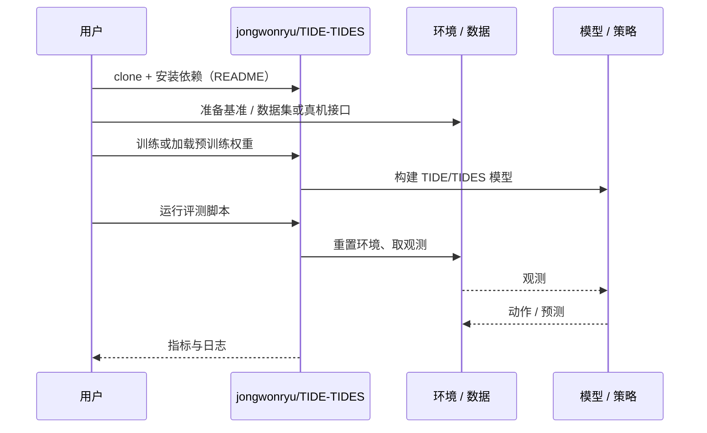

# TIDE/TIDES（arXiv:2610.16167）

**TIDE/TIDES**（*Interactive 4D Volumetric Liquid Forecasting under Moving-Solid Interaction*，[arXiv:2610.16167](https://arxiv.org/abs/2610.16167)，[代码](https://github.com/jongwonryu/TIDE-TIDES)）来自 [具身智能小站 2026-10-14 盘点](../../sources/blogs/wechat_embodied_station_41_papers_streamingwam_2026-10-14.md)，属「感知与 4D 世界」组。

## 一句话定义

**根据已知未来固体运动预测稠密液体速度场，引入界面残差与粒子网格反馈；非双向闭环流固仿真。**

## 英文缩写速查

| 缩写 | 英文全称 | 简要说明 |
|------|----------|----------|
| 4D | 3D + time | 时空体积 |
| PIC | Particle-In-Cell | 粒子网格方法 |
| CFD | Computational Fluid Dynamics | 计算流体力学 |

## 为什么重要

- 液体操作需要对固体动作引发的流体响应建模。
- 开源结论：**已开源**（步骤 2.5，2026-10-14）。仓库可达。
- 同期同组工作见 [流式动作块与世界模型记忆：具身智能小站 10-14 期 41 篇阅读坐标](../overview/embodied-station-2026-10-14-41-papers-technology-map.md)。

## 核心机制

| 项 | 内容 |
|----|------|
| **arXiv** | [2610.16167](https://arxiv.org/abs/2610.16167) |
| **开源** | **已开源** |
| **要点** | 条件输入为给定固体轨迹。 |
| **文内指标** | 以原文为准。 |

## 源码运行时序图

以下为按仓库入口（`jongwonryu/TIDE-TIDES`）推断的通用运行链路；入库日仅核实仓库可达，未逐文件阅读，具体脚本名以 README 为准。

## 实验与评测

- 以原文为准。
- **读法：** 本页为索引级摘要，依据公众号转述的官方摘要与仓库信息整理；逐项数字与 baseline 以原文 PDF 为准。

## 与其他工作对比

- 横向索引见 [流式动作块与世界模型记忆：具身智能小站 10-14 期 41 篇阅读坐标](../overview/embodied-station-2026-10-14-41-papers-technology-map.md)；同 arXiv 不重复造页。

## 结论

**液体预测模型的输入边界（固体轨迹已知）决定其在闭环控制中的用法。**

1. 开源边界：**已开源** — 仓库可达。
2. 核心机制：条件输入为给定固体轨迹。
3. 复现与选型前核对任务协议、硬件与基准口径，勿直接横比公众号摘录数字。

## 关联页面

- [differentiable-simulation](../concepts/differentiable-simulation.md)
- [generative-world-models](../methods/generative-world-models.md)
- [embodied-station-2026-10-14-41-papers-technology-map](../overview/embodied-station-2026-10-14-41-papers-technology-map.md)

## 参考来源

- [tide_tides_4d_liquid_forecasting_arxiv_2610_16167.md](../../sources/papers/tide_tides_4d_liquid_forecasting_arxiv_2610_16167.md)
- [wechat_embodied_station_41_papers_streamingwam_2026-10-14.md](../../sources/blogs/wechat_embodied_station_41_papers_streamingwam_2026-10-14.md)
- [arXiv:2610.16167](https://arxiv.org/abs/2610.16167)

## 推荐继续阅读

- [arXiv PDF](https://arxiv.org/pdf/2610.16167)
- [https://github.com/jongwonryu/TIDE-TIDES](https://github.com/jongwonryu/TIDE-TIDES)
