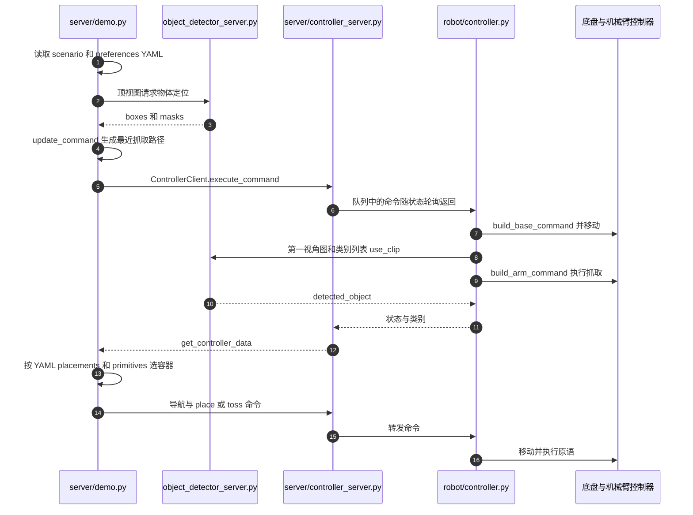

# TidyBot：从少量示例归纳个性化收纳规则

## 一句话定义

TidyBot 用语言模型把少量用户摆放示例归纳为类别级规则，再用开放词汇感知和预定义操作原语完成个性化收纳。

## 英文缩写速查

| 缩写 | 英文全称 | 简要说明 |
|---|---|---|
| LLM | Large Language Model | 归纳用户偏好 |
| CLIP | Contrastive Language-Image Pre-training | 将物体图像匹配到规则中的类别 |
| ViLD | Vision and Language knowledge Distillation | 开放词汇物体定位 |

## 为什么重要

本工作说明了语言反馈如何进入持续适应闭环，并给出了可核对的学习对象、评测协议和实现边界。学习与工程选型时应先明确变化的是偏好规则、动作策略还是语言模型。

## 核心信息

| 项目 | 内容 |
|---|---|
| 论文 | TidyBot: Personalized Robot Assistance with Large Language Models |
| 固定版本 | [arXiv:2305.05658v2](https://arxiv.org/abs/2305.05658v2) |
| 机构 | 普林斯顿大学、斯坦福大学、哥伦比亚大学、Google、The Nueva School |
| 原文核对 | v2 HTML §1–5、§6 提示词、Algorithm 1、Table 1–7、Figure 1–6 的正文说明与图注 |
| 项目页 | [官方入口](https://tidybot.cs.princeton.edu) |

## 核心原理

先把用户示例写成 Python 风格的摆放/操作调用，要求 LLM 总结为通用偏好，再用该总结预测未见物体的容器与操作。总结中的名词短语还提供 CLIP 的候选类别，避免让感知器识别所有细粒度物体名。

机器人用顶视相机与 ViLD 定位物体，ArUco 定位底盘；靠近目标后用第一视角图像做 CLIP 分类，再执行 pick、place 或 toss。容器位置预先给定，移动由占据图最短路径及 pure pursuit 完成。这里的适应主要发生在语言规则层，不涉及在线微调机器人策略。

## 流程总览

依据固定版本方法与系统说明整理：

## 源码运行时序图

静态对照官方仓库 `c060278de506699b46ff7361357109cf9dcd5654`，详见[代码归档](../../sources/repos/agentic-tidybot-code.md)。默认 demo 提前读入偏好 YAML，物体分类在抓取动作附近异步发起；此图以代码交互为准。

## 工程实践

README 要求工作站启动 ViLD 检测服务和 `server/demo.py`，机器人侧启动底盘驱动、停止控制及 `robot/controller.py`。默认 supervised 模式逐命令等待确认，autonomous 模式需显式切换。须配置相机标定、机器人参数和容器位置。本次未接入硬件，也未运行控制。

## 实验与评测

以下均为论文作者报告，非本库复现实测。

| 实验 | 原文结果 | 统计口径 |
|---|---|---|
| 文本偏好基准 | 总结法 91.2%；只给示例 78.5%；CLIP embedding 83.7% | 96 场景，672 个未见摆放，先按场景求准确率再平均 |
| 真机收纳 | 85.0% | 8 场景 × 10 物体 × 3 次，共 240 个放置目标 |
| 真机感知 | 定位 92.5%；已定位物体分类 95.5% | 分类准确率条件于成功定位，不能直接当端到端成功率 |
| 用户研究 | 总结法获偏好 46.9%，CLIP 19.1%，同等 34.1% | 40 名参与者、960 个比较 |

基准含 4 类房间，每场景 2–5 容器、4–10 个已见例子及等量未见例子。原文使用 text-davinci-003、temperature 0；历史模型配置不保证今天能原样调用。真机平均每个物体 15–20 秒。

## 结论

TidyBot 用语言模型把少量用户摆放示例归纳为类别级规则，再用开放词汇感知和预定义操作原语完成个性化收纳。应连同其数据、执行器和反馈预算一起评估。

1. 先检验偏好总结能否覆盖未见物体，再接入执行器。
2. 分别报告容器选择、定位、分类和物理操作的成功率。
3. 复现时检查相机标定、容器配置、机器人驱动与历史模型接口。

## 与其他工作对比

与 [TidyBot2](tidybot2.md) 的另一篇硬件平台论文分别维护身份；与 [OLAF](paper-olaf-verbal-correction.md) 相比，本工作归纳语言偏好规则，OLAF 用语言纠错改变策略训练数据。

## 局限与风险

- 规则可能过度具体地枚举示例，或把上下两个抽屉错误归为同一类。
- 已知容器位置、俯视抓取和手工原语限制任务范围；重度杂乱场景可能阻塞移动路径。
- 默认演示读取提前生成的偏好 YAML，不是每个控制周期实时调用 LLM。
- 源码静态阅读不等于硬件部署或 85% 结果复现。

## 关联页面

- [Agentic Robots 综述](paper-towards-agentic-robots-survey.md)
- [VLA](../methods/vla.md)
- [VLA 纵深路线](../../roadmap/depth-vla.md)

## 参考来源

- [论文核读归档](../../sources/papers/agentic_2305_05658.md)
- [项目页核查](../../sources/sites/agentic-tidybot-2305-05658.md)
- [相关源码归档](../../sources/repos/agentic-tidybot-code.md)

## 推荐继续阅读

- [固定版本原文](https://arxiv.org/html/2305.05658v2)
