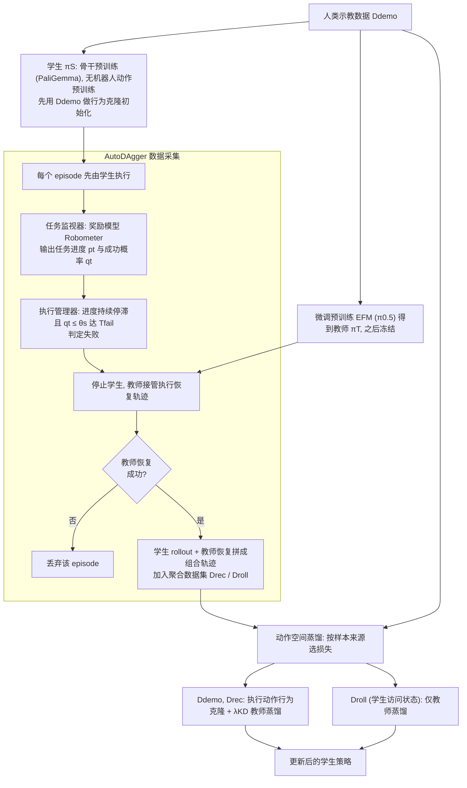

# TILDE（arXiv:2610.25376）

**TILDE**（*TILDE: Teacher-in-the-Loop Distillation from Embodied Foundation Models*，[arXiv:2610.25376](https://arxiv.org/abs/2610.25376)，[项目页](https://hku-sail.github.io/TILDE/)）来自 [具身智能小站 2026-11-01 盘点](../../sources/blogs/wechat_embodied_station_56_papers_libero_dynamic_latency_eval_2026-11-01.md)，属「VLA 与策略学习」组。

## 一句话定义

**TILDE同时学习示范、学生访问状态和教师恢复轨迹，用奖励模型触发接管；三项真机任务展示蒸馏收益，避免只在成功示范分布上模仿教师。**

## 英文缩写速查

| 缩写 | 英文全称 | 简要说明 |
|------|----------|----------|
| TILDE | TILDE: Teacher-in-the-Loop Distillation from Embodied Foundation Models | 本文方法 / 基准的简称 |

## 为什么重要

- 让教师真正接管失败后的恢复。
- 开源结论：**已开源**（步骤 2.5，2026-11-01）。公众号未给代码链接；项目页链接的 hku-sail/TILDE 经 git ls-remote 可达。
- 同期同组工作见 [动态评测、技能编译与环境潜变量适配：具身智能小站 11-01 期 56 篇阅读坐标](../overview/embodied-station-2026-11-01-56-papers-technology-map.md)。

## 流程总览

图依据：论文 §3.2-3.4 / Fig.2 / 式(2)-(9)

## 核心机制

| 项 | 内容 |
|----|------|
| **arXiv** | [2610.25376](https://arxiv.org/abs/2610.25376) |
| **开源** | **已开源** |
| **要点** | TILDE同时学习示范、学生访问状态和教师恢复轨迹，用奖励模型触发接管；三项真机任务展示蒸馏收益，避免只在成功示范分布上模仿教师。 |
| **文内指标** | 公众号未给具体数字，本页不引用。 |

## 源码运行时序图

**不适用（已开源）** — 公众号未给代码链接；项目页链接的 hku-sail/TILDE 经 git ls-remote 可达。 不编造运行脚本；代码公开后再补。

## 实验与评测

- 公众号未给具体数字，本页不引用。
- **读法：** 本页为索引级摘要，依据公众号转述的官方摘要与仓库信息整理；逐项数字与 baseline 以原文 PDF 为准。

## 与其他工作对比

- 横向索引见 [动态评测、技能编译与环境潜变量适配：具身智能小站 11-01 期 56 篇阅读坐标](../overview/embodied-station-2026-11-01-56-papers-technology-map.md)；同 arXiv 不重复造页。

## 结论

**让教师真正接管失败后的恢复：TILDE同时学习示范、学生访问状态和教师恢复轨迹，用奖励模型触发接管；三项真机任务展示蒸馏收益，避免只在成功示范分布上模仿教师。**

1. 开源边界：**已开源** — 公众号未给代码链接；项目页链接的 hku-sail/TILDE 经 git ls-remote 可达。
2. 核心机制：TILDE同时学习示范、学生访问状态和教师恢复轨迹，用奖励模型触发接管；三项真机任务展示蒸馏收益，避免只在成功示范分布上模仿教师。
3. 复现与选型前核对任务协议、硬件与基准口径，勿直接横比公众号摘录数字。

## 关联页面

- [vla](../methods/vla.md)
- [imitation-learning](../methods/imitation-learning.md)
- [reinforcement-learning](../methods/reinforcement-learning.md)
- [embodied-station-2026-11-01-56-papers-technology-map](../overview/embodied-station-2026-11-01-56-papers-technology-map.md)

## 参考来源

- [tilde_arxiv_2610_25376.md](../../sources/papers/tilde_arxiv_2610_25376.md)
- [wechat_embodied_station_56_papers_libero_dynamic_latency_eval_2026-11-01.md](../../sources/blogs/wechat_embodied_station_56_papers_libero_dynamic_latency_eval_2026-11-01.md)
- [arXiv:2610.25376](https://arxiv.org/abs/2610.25376)
- [arXiv PDF](https://arxiv.org/pdf/2610.25376)：已通读方法部分（实验与附录以略读为准）：§3 方法（AutoDAgger、蒸馏目标），§4.1 实验设置与实现细节

## 推荐继续阅读

- [arXiv PDF](https://arxiv.org/pdf/2610.25376)
- [项目页](https://hku-sail.github.io/TILDE/)
