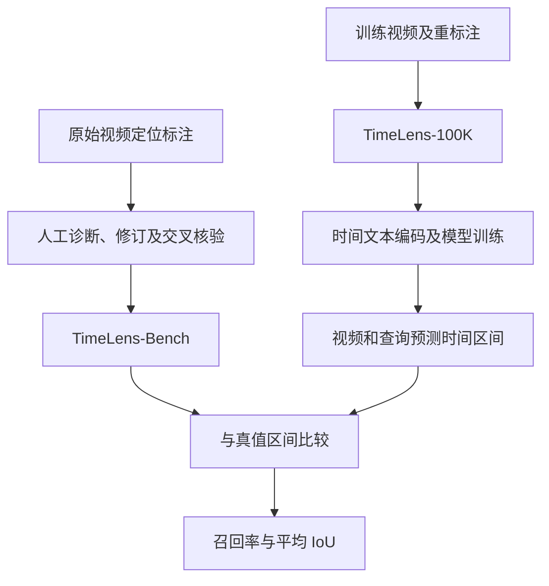
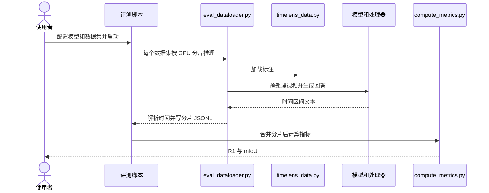

# TimeLens 与 TimeLens-Bench

TimeLens 研究视频时序定位：根据视频和文字查询预测事件的起止时间。TimeLens-Bench 是经过人工审校的评测套件。

## 英文缩写速查

| 缩写 | 英文全称 | 简要说明 |
|------|----------|----------|
| VTG | Video Temporal Grounding | 视频时序定位 |
| IoU | Intersection over Union | 预测和真值时间区间的交并比 |
| RLVR | Reinforcement Learning with Verifiable Rewards | 使用可验证奖励的强化学习 |
| GRPO | Group Relative Policy Optimization | 组相对策略优化 |

## 流程总览

论文 [arXiv:2512.14698v2](https://arxiv.org/html/2512.14698v2) 审核并修订 Charades-STA、ActivityNet Captions 与 QVHighlights 标注；另构建 TimeLens-100K 训练数据。模型利用帧间交错时间文本和视频输入学习输出区间，采用基于时间 IoU 的奖励；论文比较思考与不输出显式思考等训练配置。

## 源码运行时序图

对照官方 [eval_timelens_bench.sh](https://github.com/TencentARC/TimeLens/blob/main/scripts/eval_timelens_bench.sh)、[eval_dataloader.py](https://github.com/TencentARC/TimeLens/blob/main/evaluation/eval_dataloader.py) 及 [compute_metrics.py](https://github.com/TencentARC/TimeLens/blob/main/evaluation/compute_metrics.py)。

## 评测与局限

- 评测报告 R1@0.3、0.5、0.7 和 mIoU；须注明三个子集和视频采样设置。
- 输出解析失败时评测脚本设置视频时长之外的区间；指标脚本对提取失败或无效区间记零，多个区间取第一个。
- 官方仓库 2026-10-26 记载 WITA-Omni 1.0 平均分 66.4；具体名次、聚合方式和完整配置须按官方榜单核对。
- 公开代码、模型与数据；真实交互和机器人动作能力不由此单项基准直接证明。

## 与其他工作对比

| 对象 | 差异 |
|---|---|
| 原始 Charades-STA / ActivityNet Captions / QVHighlights 标注 | TimeLens-Bench 对其人工诊断与修订；论文主张未修订标注会影响排名 |
| [Daily-Omni](./paper-daily-omni.md) | 以问答形式测音视频跨模态时序对齐；TimeLens 直接输出时间区间并以 IoU 评分 |
| [MMAU](./paper-mmau.md) | 纯音频理解与推理选择题，不涉及时间定位 |
| [EmbSpatial-Bench](./embspatial.md) | 静态图像空间关系，与视频时序维度互补 |

## 结论

TimeLens 强调定位指标依赖标注质量，榜单比较应同时核查数据与推理配置。

1. 对照原始与修订标注，避免错误边界影响排名。
2. 同时报告不同 IoU 阈值和各子集分数。
3. 记录帧采样、分辨率、模型版本及失败输出的处理方法。

## 关联页面

- [Daily-Omni](./paper-daily-omni.md)：音视频跨模态时序推理。
- [EmbSpatial-Bench](./embspatial.md)：静态空间关系评测。
- [Query：具身大模型评测基准选型](../queries/embodied-eval-benchmark-selection-loop.md)

## 参考来源

- [官方仓库归档](../../sources/repos/timelens.md)

- [四项基准来源归档](../../sources/sites/multimodal-four-benchmarks-20261030.md)
- [TimeLens 原始论文 v2](https://arxiv.org/abs/2512.14698v2)

## 推荐继续阅读

- [官方榜单](https://timelens-arc-lab.github.io/#leaderboard)
