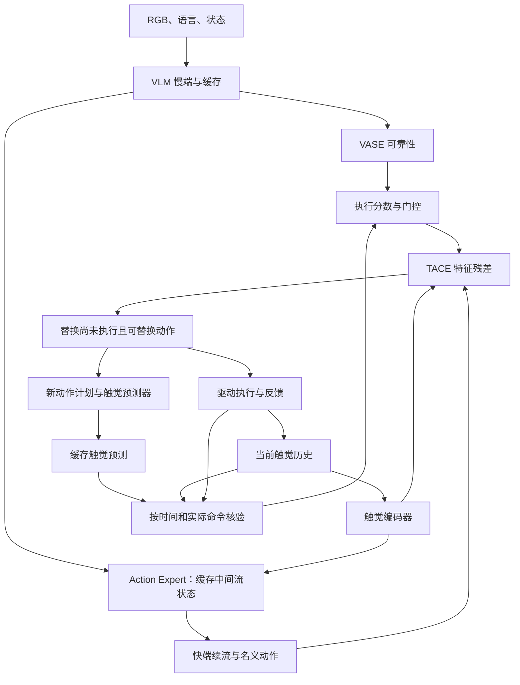
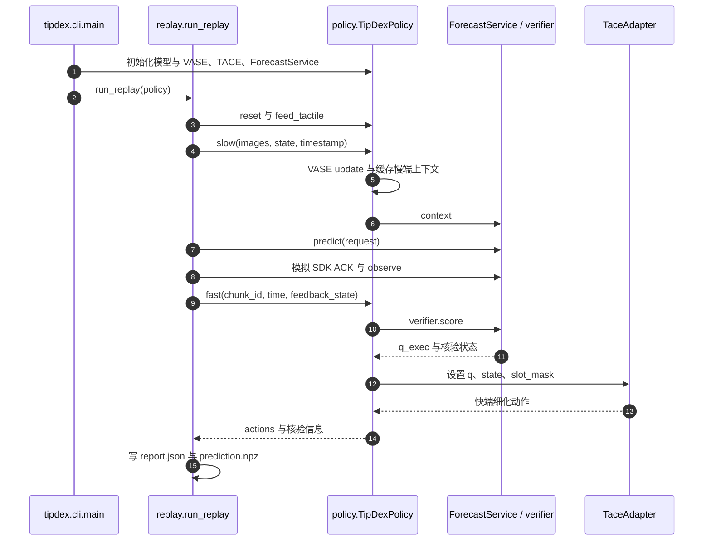

# TipDex-VTLA: Learning to Refine Actions with Visual Reliability and Tactile Feedback for Dexterous Manipulation（基于视觉可靠性与触觉反馈的灵巧操作动作修正）

## 一句话定义

利用光照扰动下的动作敏感性估计视觉可靠性，再以执行中触觉预测偏差调节修正强度，保持已提交动作与执行时刻不变。

## 英文缩写速查

| 缩写 | 英文全称 | 简要说明 |
|---|---|---|
| VTLA | Vision-Tactile-Language-Action | 视触觉语言动作策略 |
| VASE | Visual Action Sensitivity Estimation | 估计动作对光照的敏感程度 |
| TACE | Tactile Anticipation and Correction during Execution | 时间对齐的触觉预测核验与动作修正 |
| VLM | Vision-Language Model | 慢端视觉语言上下文 |
| MAE | Mean Absolute Error | 已归一化触觉预测误差 |
| SDK | Software Development Kit | 实机命令写入确认的接口 |

## 为什么重要

同一物理场景仅改变光照也可能改变策略输出；当前触觉能说明接触结果，但无法单独判断原计划是否可靠。将视觉可靠性与触觉预测一致性分离，可在接触反馈正常但视觉不可靠时仍尝试补偿，在视觉可靠但触觉异常时进行接触修正。

## 核心原理

| 属性 | 内容 |
|---|---|
| 机构 | 武汉大学（Wuhan University）；武汉华威科智能技术有限公司（Wuhan Huaweike Intelligent Technology Co., Ltd.） |
| 版本 | arXiv:2611.25683v2，2026-11-22 |
| 平台 | 两台 RealMan RM75 7-DoF 机械臂、Inspire RH56F2-E2-T1 手，单手 364 触觉读数，30 Hz |
| 时钟 | 项目页慢端 2 Hz、快端 30 Hz；十个流积分步中的后四步用于快端细化 |
| 训练 | Stage 1 200 条示教，20k steps；Stage 2 100 条额外示教并配对 RGB 光照增强，10k steps；8 张 A100，批大小 128 |

### 视觉可靠性与触觉修正

- VASE：对同一观测的正常与扰动图像保持其他输入及随机噪声固定，使用冻结策略预测的归一化动作差，构造监督 $q_v'=\exp(-\mathrm{MSE}(a_a,a_b)/\lambda)$。运行时只用当前前缀估计 $q_v$。
- TACE：寻找早于当前时刻签发、目标时间匹配且与中间已执行指令一致的预测；归一化触觉 MAE 为 $e$。无合格预测取 $e=0$ 回退至视觉分数，并非接触正确。
- 执行分数 $q=G(q_v,e)$ 随视觉可靠性单调不减、随误差单调不增，且 $G(q_v,0)=q_v$。门控 $g=\sigma(S-\kappa\operatorname{logit}(q))$，特征修正 $\tilde U=U+gb\tanh(R)$；$b=0.1$ 是特征级界限，不是关节安全限幅。
- 第一阶段联合流匹配与未来触觉 Huber 损失；第二阶段冻结骨干，以配对动作差监督修正、以 BCE 监督视觉可靠性，修正损失只作用于可替换位置。

| 视觉可靠性 | 触觉预测 | 典型修正倾向 |
|---|---|---|
| 高 | 一致 | 保持名义动作 |
| 低 | 一致 | 视觉补偿 |
| 高 | 偏离 | 接触修正 |
| 低 | 偏离 | 联合修正 |

### 流程总览

## 实验与评测

真机每任务每光照条件 20 次，四任务完整成功率（%）：

| 方法 | 正常光 | 未见光照 |
|---|---:|---:|
| ACT | 18.8 | 0.0 |
| π₀.₅ | 55.0 | 23.8 |
| T-Rex | 71.3 | 22.5 |
| N₀-VTLA | 68.8 | 31.3 |
| TipDex-VTLA | 87.5 | 73.8 |

未见光照下四任务分别为鸡蛋 70%、葡萄 90%、纸巾 60%、绿豆 75%。表 3 消融：去 VASE 42.5%，去触觉核验 62.5%，去 Gate Head 40.0%；完整模型 73.8%。UniVTAC 八任务正常仿真光照各 100 次，均值 84.9%，不应解读为仿真未知光照泛化指标。

## 结论

**真正关键的是在动作执行期根据不同来源的可靠性证据决定修正强度，而非始终放大触觉反馈。**

1. 用物理状态不变的配对光照测试诊断视觉敏感性。
2. 触觉预测必须对齐真实已执行命令与时间；单纯时间相近不能保证预测有效。
3. 对已提交动作保持不可变，避免快端覆盖驱动正在执行的计划。
4. 以正常与未见光照分别评测门控及预测核验；不要把可靠性当成成功率。

## 与其他工作对比

| 工作 | 主要区别 |
|---|---|
| [T-Rex](./paper-trex-tactile-reactive-dexterous-manipulation.md) | 慢快 flow 缓存复用；TipDex 在其执行方式上加入可靠性与核验 |
| [N₀-VTLA](./paper-n0-vtla.md) | 预测潜空间触觉条件；TipDex 核验未来触觉与真实反馈 |
| [TouchWorld](./paper-touchworld-tactile-foundation-dexterous-manipulation.md) | 触觉子目标与反应式残差层级；TipDex 侧重光照诱发的动作漂移 |

## 源码运行时序图

依据官方 pyproject.toml、cli.py、replay.py、policy.py 的实际回放路径绘制；不是现场真机运行记录。

## 工程实践

- 官方已公开推理实现；Linux/Python 3.11/CUDA 12；README 建议 tipdex verify 后运行 tipdex replay，或 tipdex serve 启动 HTTP 推理。
- 实机接口通过 /reset、/feedback、/slow、/fast、/commit 协调；驱动独立负责限位和实际 SDK 写入确认。ACK 代表写入成功，并不等于达到目标。
- 发布模型为鸡蛋转移，输入三路 RGB、19 维状态、16 帧 raw364，输出 30×13 动作。14×26 热图为寄存器顺序显示，非已标定力图。
- HF 公开 50 原始鸡蛋任务轨迹和 50 合成光照变体，不能当作论文全部 300 条独立示教。权重与模型卡见下方来源。

## 局限与风险

- 论文可靠性是参考策略在光照扰动下的代理量，不是准确性、安全性或成功概率；其他视觉扰动和任务泛化待验证。
- 仿真使用光学触觉，真机使用压阻触觉，不能直接比较硬件可迁移性。
- 快端特征残差有界不保证物理力、速度或碰撞安全。
- 正文已核对，独立 supplementary material 未获取，未复现训练与真实权重回放；暂为草稿，待补核和健康度实测。

## 关联页面

- [VLA](../methods/vla.md)
- [操作任务](../tasks/manipulation.md) — 对应抓取、柔性物体处理与接触反馈下的动作修正。
- [视触觉融合](../concepts/visuo-tactile-fusion.md)
- [T-Rex](./paper-trex-tactile-reactive-dexterous-manipulation.md)
- [接触丰富操作纵深](../../roadmap/depth-contact-manipulation.md)
- [VLA 纵深](../../roadmap/depth-vla.md)

## 参考来源

- [论文归档](../../sources/papers/tipdex_vtla_arxiv_2611_25683.md)
- [项目页归档](../../sources/sites/tipdex-vtla.md)
- [源码归档](../../sources/repos/tipdex-vtla.md)

## 推荐继续阅读

- [论文 v2](https://arxiv.org/abs/2611.25683v2)
- [官方项目页](https://tiplab.github.io/TipDex-VTLA/)
- [官方源码](https://github.com/tiplab/TipDex-VTLA)
- [模型](https://huggingface.co/TipDex-VTLA/TipDex-VTLA) · [数据集](https://huggingface.co/datasets/TipDex-VTLA/TipDex-Data)
