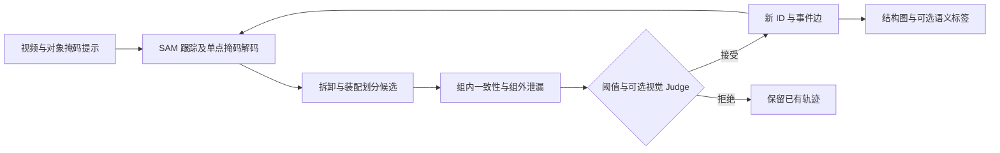
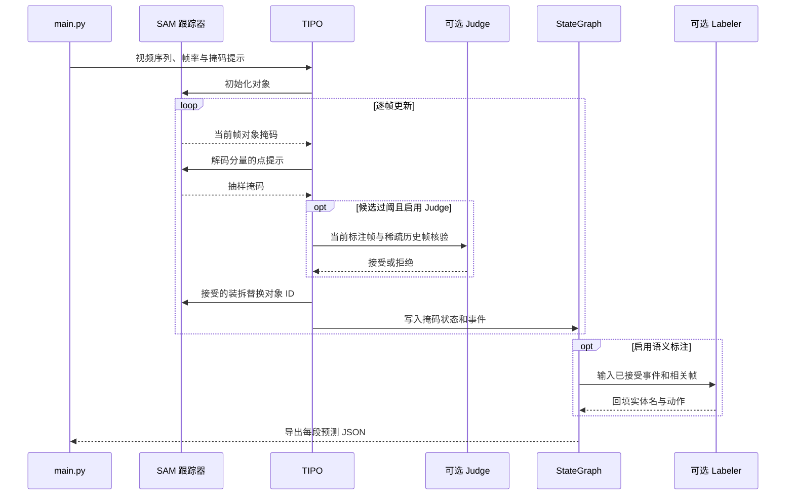

# Taking Apart and Putting Together: Tracking Objects Through Physical Transformations · 拆装过程中的物体跟踪

## 一句话定义

TIPO 让视频跟踪不只回答「像素去哪儿了」，还回答「这个物体变成了哪些零件、哪些零件组装成了一个新物体」。

## 英文缩写速查

| 缩写 | 英文全称 | 说明 |
|---|---|---|
| TTU | Transformation Tracking and Understanding | 同时跟踪物体、识别装拆事件、记录组成关系和动作语义 |
| TIPO | Tracking Instances via Proposals and Overlaps | 用提案与掩码重叠识别结构变化 |
| VISTA | Video Instances, States, and Transformation Annotations | 物体掩码与装拆状态图基准 |
| IoU | Intersection over Union | 预测与真值掩码的交并比 |
| MLLM | Multimodal Large Language Model | Judge 核实事件、Labeler 为结构补名字和动作 |

## 核心信息

| 项目 | 内容 |
|---|---|
| 论文 | arXiv:2611.27398v1，2026-11-20 |
| 作者 | Davide Gardenal、Mingxuan Liu、Flavio Vella、Quentin Guimard、Elisa Ricci |
| 机构 | 特伦托大学、法国国防人工智能机构研究部门（帕莱索）、布鲁诺·凯斯勒基金会 |
| 开放 | 发布 TIPO 跟踪、评测实现和 VISTA 数据；代码与数据卡均标 CC BY 4.0，外部权重和素材另核对 |
| 数据 | 50 段 / 26,470 帧 / 124 个装配与 132 个拆卸事件；发布数据约 10 GB |

## 为什么重要

摩卡壶拆开后，继续跟同一个目标 ID 会丢掉新零件；把暂时被手挡住的掩码当成拆卸也会报错。状态图给每次变换记录前驱、后继和动作，能作为机器人装配的视觉步骤证据，但不是接触、扭矩或到位的安全联锁。

## 核心原理

1. **提案。** SAM 2.1 或 SAM 3 传播掩码，找不连通分量。每个分量以 32 次单点解码的集合探测分割模型认为哪些像素属于同一物体。拆卸划分同一轨迹的分量，装配划分有交叠线索的物体。
2. **打分。** 用组内一致性奖励合理整体，组外交叠作为惩罚。拆卸以跟踪分量为参照，装配以抽样掩码为参照，以免已合成的实体只被旧轨迹覆盖一角。局部集合划分最多 7 项，不是全场目标数上限。
3. **判定与更新。** 仅把过阈的优先提案提交给视觉 Judge。公开实现先检查拆卸，再选不冲突的装配；通过后更新掩码、替换 ID 和写入状态图，运动不改变 ID。结构跟踪完成后，公开代码还可独立执行 Labeler。

### 运行时序：已发布代码

## 实验结果

VISTA 表 2，两个指标越高越好；均为作者报告。TF1 按序列宏平均，匹配要求输入/输出数量相符、时间在相邻真值事件界定的窗口内，并对所有涉及物体核对空间 IoU 和身份谱系。掩码 J 用每帧的并集，因此 J 高并不能说明事件或 ID 正确。

| 方法 | 骨干 | 事件 TF1 | FPS |
|---|---|---:|---:|
| TubeletGraph | SAM 2.1 | 12.5 | 0.2 |
| TIPO 不用 Judge | SAM 2.1 | 36.7 | 3.0 |
| TIPO 完整 | SAM 2.1 | 44.7 | 1.8 |
| TubeletGraph | SAM 3 | 3.3 | 0.4 |
| TIPO 不用 Judge | SAM 3 | 33.4 | 3.9 |
| TIPO 完整 | SAM 3 | 42.5 | 2.4 |

相对 TubeletGraph 的倍速依配置约 6–15 倍，不是相对原生 SAM 的提升；原生 SAM 3 为 6.1 FPS，但不输出事件。只评拆卸的 41 段仍有优势（SAM 2.1 的 39.8 对 25.6 TF1）。换成 Qwen 3.5 35B 做开放权重 Labeler，SAM 3 的结构 TF1 仍是 42.5，综合 HF1 由 28.3 降为 23.2。

**HF1 口径提醒：** 固定版公开评测器用「动作和对象名称都正确」的数量替换 TP，但保留结构匹配的 FP/FN。合成用例里 10 个事件都结构匹配、只有 1 个语义全对，发布实现仍给 HF1 = 1.0；按严格带标签事件算则为 0.10。这里区分作者报告的 HF1 与严格语义事件 F1，未确认表格由该发布提交生成。

## 工程实践

- **使用数据包时读元数据。** 表 1 的 10–20 FPS 不覆盖公开版本的 6 至约 29.61 FPS；发布的 50 段中 3 段在首帧后另有对象提示，复现时不要静默移除。
- **核对跑完的样本。** 评测器会跳过缺少预测 JSON 的序列；应确认汇总确实覆盖全部 50 段。不同配置和随机种子用不同结果目录，避免默认复用旧预测。
- **分开量三类延迟。** 原视频帧率、结构推理吞吐与 Judge 调用时延不是一回事；两张 A100 上的离线视频测量不能替代机器人控制周期测量。
- **以摩卡壶核查图。** 样例两次一拆二、两次二合一；把遮挡下的假拆卸、漏掉的小件、时序晚报分别计入误差，不只看掩码覆盖。

## 局限与风险

- 不需为 TIPO 额外训练并不代表低算力或无预训练模型；完整流程需要 SAM、视觉 Judge 和可选 Labeler。在线结构图不能用未来帧改写过去误报。
- 发布实现的拆卸组内得分与论文式 (6) 不逐项相同；工程复现须固定源码、配置、权重、帧率和提示，不把表格数字视作本地实测。
- 论文没有验证机械装配质量或真机闭环安全；小件、遮挡、形变/流体和模糊语义仍可造成漏检与误报。

## 关联页面

- [机器人视觉感知](../methods/robot-visual-perception.md) — 区分像素、时序身份和任务状态。
- [操作任务](../tasks/manipulation.md) — 把视觉步骤识别和实际接触完成条件分开。
- [SAM 3](./paper-sam3.md)与 [SAM 2](./paper-sam2.md) — 提供掩码传播和提示式分割，TIPO 在其上更新结构身份。
- [机器人视觉感知栈选型闭环](../queries/robot-perception-stack-selection-loop.md) — 将状态跟踪接入视觉感知选型，但不替代位姿、深度或执行反馈。

## 参考来源

- [论文通读归档](../../sources/papers/tipo_arxiv_2611_27398.md)
- [项目页归档](../../sources/sites/tipo-tracking.md)
- [固定源码归档](../../sources/repos/tipo-tracking.md)
- [VISTA 数据档案](../../sources/datasets/vista-transformation-tracking.md)

## 推荐继续阅读

- [VISTA 摩卡壶事件 JSON](https://huggingface.co/datasets/davidegarde/VISTA/blob/d9e1190f4e1a3d8da158e1bc64e16befef0b4233/Transformations/37_moka.json) — 对照参与对象和事件顺序。
- [接触操作纵深](../../roadmap/depth-contact-manipulation.md) — 结合同步力觉、位姿和工艺验收条件设计确认链。
