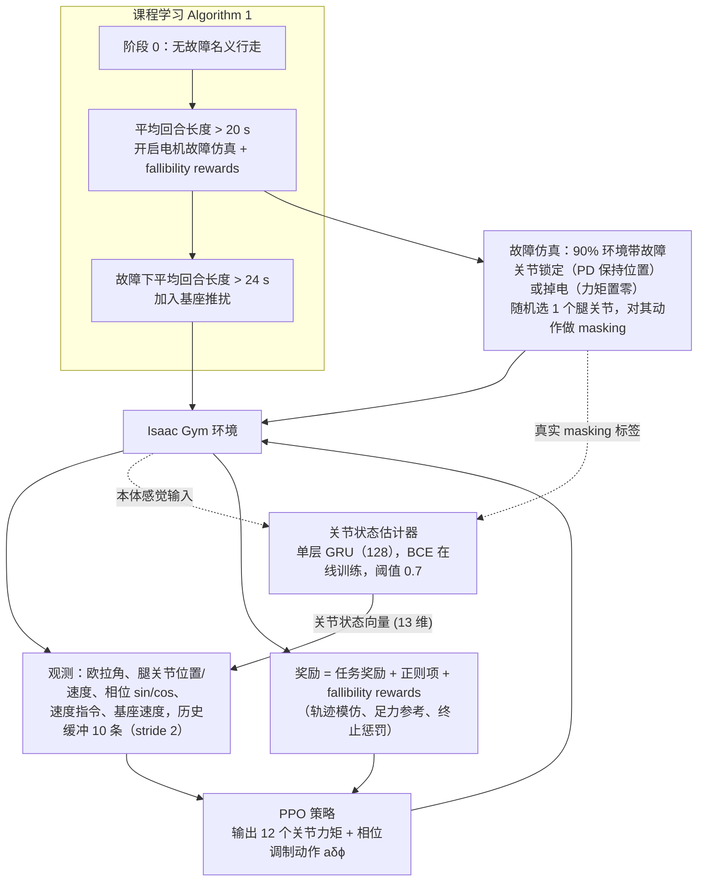

# TOLEBI

**TOLEBI**（TOLEBI: Learning Fault-Tolerant Bipedal Locomotion via Online Status Estimation and Fallibility Rewards）在 [Light Origins · Light REACT：面向规模化部署的全身韧性智能](https://www.lightorigins.com/blog/light-react) 中被引用。

## 一句话定义

**在线关节状态估计 + fallibility rewards 学双足容错行走；仿真注入关节锁定/掉电/扰动，TOCABI 真机验证。**

## 英文缩写速查

| 缩写 | 英文全称 | 简要说明 |
|------|----------|----------|
| MDP | Markov Decision Process | 马尔可夫决策过程，论文把电机故障下的行走建模为 MDP（§III） |
| PPO | Proximal Policy Optimization | 近端策略优化，训练策略所用算法（Isaac Gym） |
| GRU | Gated Recurrent Unit | 关节状态估计器的结构（单层，隐藏 128） |
| DSP / RSSP / LSSP | Double / Right Single / Left Single Support Phase | 双支撑 / 右单支撑 / 左单支撑相，用于足接触奖励 |
| RMSE / MBE | Root Mean Square Error / Mean Bias Error | 速度跟踪误差指标（§V） |

## 为什么重要

- Light REACT 韧性金字塔「硬件受损后调整移动」的对照：TOLEBI 显式估计关节状态而非仅靠交互历史 ICL。
- 博客 ingest 独立节点（非重复 stub）；见 [3 篇技术地图](../overview/lightorigins-3blogs-technology-map.md)。

## 流程总览

图依据：论文 §IV-A–D、Alg. 1、Fig. 2、Table I

## 核心信息

| 项 | 内容 |
|----|------|
| **类型** | paper |
| **出处** | ICRA 2026 |
| **开源** | **待核实** |
| **arXiv** | [2602.05596](https://arxiv.org/abs/2602.05596) |

## 源码运行时序图

**不适用**（截至入库日无官方可运行实现，或仅有博客/论文叙述）。

## 实验与评测

- **故障注入即评测设定：** 仿真中显式注入 **关节锁定、掉电、外部扰动**，评的是这些条件下双足行走能否维持——这与「平地速度跟踪误差」是完全不同的评测面。
- **两个组件对应两类信息：** 在线关节状态估计回答「哪个关节出问题了」，fallibility rewards 回答「已知会坏时该怎么走」；只有前者是诊断，只有后者是盲目保守，二者缺一结论都不成立。
- **真机验证：** TOCABI 平台（原文口径）。
- **数值口径：** 本页为博客 ingest 级摘要，**未复核逐项分数**；各故障模式下的成功率与恢复时间 **以 [原文](https://arxiv.org/abs/2602.05596)（ICRA 2026）为准**；开源状态 **待核实**。

## 与其他工作对比

| 维度 | TOLEBI（本页） | 强域随机化的鲁棒 locomotion | 故障检测 + 切换到安全控制器 |
|------|----------------|------------------------------|------------------------------|
| 对故障的假设 | 故障 **显式建模** 并在训练中注入 | 故障被当作分布内扰动 | 故障发生后才响应 |
| 是否估计故障状态 | **是**，在线关节状态估计 | 否 | 是，但用于触发切换 |
| 故障后目标 | 继续完成行走（降级但可用） | 尽量不倒 | 安全停机 |
| 主要代价 | 需枚举故障模式并设计 fallibility 奖励 | 保守性能损失 | 任务中断 |

- **「容错」与「鲁棒」不是同义词：** 域随机化让策略对 **参数漂移** 不敏感，但关节锁定/掉电是 **结构性变化**（自由度没了），不在随机化能覆盖的连续参数空间里——这是本文需要单独建模故障的原因。
- **与 [Light REACT](./light-react.md) 的关系：** 被引作「全身韧性智能」的能力锚点之一，定位是 **部署期可用性** 而非峰值性能；与敏捷类工作横比成功率没有意义。

## 结论

**TOLEBI 在 Light Origins 三篇 Tech Blog 引用链中承担「Light REACT 韧性金字塔「硬件受损后调整移动」的对照：TOLEBI 显…」角色——部署前以 arXiv/项目页与开源状态为准。**

1. 开源：**待核实**；勿凭博客脚注臆断可复现性。
2. 与 [Light REACT](./light-react.md) / [LightNav-0](./paper-lightnav-0.md) / [Light-Loco-Parkour](./paper-light-loco-parkour.md) 按能力轴交叉阅读。
3. 定量指标以原文 PDF 为准；本页为博客 ingest 级摘要。

## 关联页面

- [亮源新创（Light Origins）](./light-origins.md)
- [lightorigins-3blogs-technology-map](../overview/lightorigins-3blogs-technology-map.md)
- [LightNav-0](./paper-lightnav-0.md)
- [Light REACT](./light-react.md)

## 参考来源

- [tolebi_arxiv_2602_05596.md](../../sources/papers/tolebi_arxiv_2602_05596.md)
- [lightorigins_light_react_2026-09-09.md](../../sources/blogs/lightorigins_light_react_2026-09-09.md)
- [Tech Blog](https://www.lightorigins.com/blog/light-react)
- [arXiv PDF](https://arxiv.org/pdf/2602.05596)：已通读方法部分（实验与附录以略读为准）：§I–II 引言与相关工作、§III 预备、§IV TOLEBI 框架（A–E）、§V-A 实验设定；§V 结果与消融略读
- 核对（2026-11-02）：对照 arXiv:2602.05596v2 全文缩写（MDP、PPO、GRU、DSP/RSSP/LSSP、RMSE/MBE），把「英文缩写速查」中与本文无关的 VLM/VLN/ER/RL/R2S2R 条目替换为本文实际使用的缩写。

## 推荐继续阅读

- [Light Origins 官网](https://www.lightorigins.com/)
- [3 篇技术地图](../overview/lightorigins-3blogs-technology-map.md)
