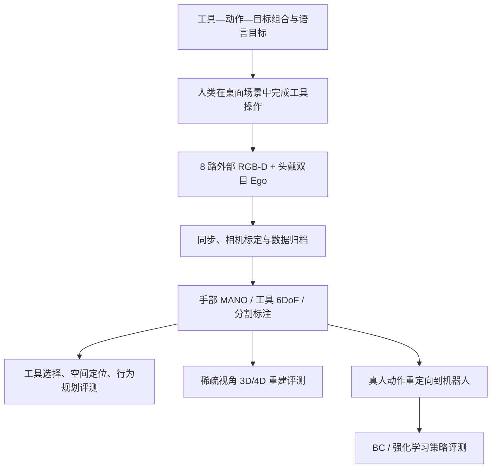

# ToolDex：创造性物理工具使用的第一/第三人称演示数据集 / An Ego-Exo Human Demonstration Dataset

## 一句话定义

**ToolDex 是针对人类创造性工具使用的同步多相机示范数据集，显式标注“手—工具—目标”的接触任务结构，支持物理推理、重建与机器人学习。**

## 英文缩写速查

| 缩写 | 英文全称 | 简要说明 |
|------|----------|----------|
| Ego-Exo | Egocentric–Exocentric | 第一/第三人称多视角 |
| RGB-D | Red Green Blue + Depth | 彩色加深度图 |
| MANO | Model with Articulated and Non-rigid hAnds | 手部参数化姿态 |
| BC | Behavior Cloning | 行为克隆基线 |
| RL | Reinforcement Learning | 强化学习策略基线 |

## 核心信息

| 字段 | 内容 |
|------|------|
| 机构 | 斯坦福大学（Stanford University）、卡内基梅隆大学（Carnegie Mellon University） |
| 论文 | [ToolDex, arXiv:2611.09036v1](https://arxiv.org/abs/2611.09036) |
| 项目页 | [ToolDex 可视化与数据统计](https://tooluse-dataset.github.io/) |
| 演示规模 | **10,853 段 / 58.3M 帧**；60 个高层任务组合、168 变体 |
| 多样性 | 45 种工具、23 种支撑对象、16 类可变形对象、16 类动作 |
| 采集 | 8 台外部 RealSense D435 RGB-D；头戴 Vision Pro + ZED Mini 双目第一视角 |

## 为什么重要

普通抓取数据大多把“手与对象交互”作为目标，但使用工具时需要推断**用哪个对象作工具、如何通过接触间接改变目标状态**。ToolDex 用工具—动作—目标组合显式记录不同工具完成同一动作的替换能力，给工具 affordance 和跨本体操作提供结构化示范。

## 核心原理

- 定义**操作者、工具、目标、支撑物**角色；任务语言描述与最终成功目标共同定义演示。
- 8 路校准外部 RGB-D 及头戴第一视角同步采集；AprilTag + 多视角优化标定，工具三维扫描辅助 6-DoF 追踪。
- 自动/人工校验标注工具姿态、MANO 双手姿态和分割掩码。
- 基准分三条：**工具选择/空间定位/行为规划**、**3D/4D 新视角重建**、**真人动作到机器人策略迁移**。

### 流程总览

## 源码运行时序图

**不适用（2026-11-10）：** 项目页展示可视化、任务 CSV 与摘要 JSON，但未发现可核实的完整数据处理/训练代码仓和运行入口；论文使用的 ManipTrans、Dex-X 属另行引用的基线实现，不应伪装成 ToolDex 官方运行链。

## 实验与评测

| 实验 | 作者报告 | 边界 |
|------|----------|------|
| 规模 | 10,853 trials、58.3M 帧 | 桌面采集，多数为同一采集架构 |
| 3D/4D 稀疏视角 | 对比 InstantSplat 等，报告 PSNR/MUSIQ | 感知质量指标，非操作成功率 |
| 人→机器人策略迁移 | Kinematic 14.0%、BC 4.6%、ManipTrans-RL 40.5%、Dex-X-RL **55.1%** | 论文选择的 6 个工具操作任务平均 |
| 工具选择 / VLM | 工具识别、BBox IoU、轨迹距离 | 允许多个可接受工具；不能等同真机成功 |

## 与其他工作对比

| 工作 | 侧重 | 与 ToolDex 的区别 |
|------|------|-------------------|
| [Ego-Exo4D](./dataset-ego-exo4d.md) | 第一 / 第三视角同步的技能活动视频 | 同为 ego-exo 采集；ToolDex 聚焦桌面工具使用，并显式标注操作者、工具、目标、支撑物角色 |
| [HOI4D](./dataset-hoi4d.md)、[ARCTIC](./dataset-arctic.md) | 手—物交互（含双手操作铰接物体）的 4D / 3D 真值 | 以「手与对象交互」为目标；ToolDex 关注工具经接触间接改变目标状态 |
| [Dex-X](./paper-dex-x.md) | 人类视频 → 仿真 RL 教师 → 蒸馏策略 | 在 ToolDex 的 6 项策略迁移任务中作为基线，平均 55.1%，高于 ManipTrans-RL 40.5% |

## 结论

**ToolDex 的价值在于将工具选择、接触传递与人机动作迁移放到同一个可量化的数据与基准框架中。**

1. 训练/评测应区分工具、目标和支撑物，避免把所有交互对象统称 grasp object。
2. 比较“同一动作、不同工具”的物理 affordance 泛化，不仅比较视频理解。
3. 对强接触任务，直接姿态重定向成功率偏低，RL 迁移更好但仍远未饱和。
4. 重建画质与动作可执行性是不同指标。
5. 全量原始数据是否可下载仍应独立核实，不要由在线可视化推出全量开放。

## 工程实践

- 项目页已公开可视化器、任务 CSV、聚合 JSON；完整原始多视角数据与训练代码的公开入口 **未核实**。
- 训练需处理人手与机器人手之间的 DoF、握持点、接触法线和动力学差异。
- 数据注释可能因遮挡与接触复杂性而存在噪声；实机迁移还需安全限制。

## 局限与风险

- 室内桌面场景和物料类型有限，不能代表室外/移动机器人所有工具操作。
- 作者的 VLM 选择评价准则容忍多个答案，与唯一工具识别的严格设置不等价。
- 论文声明研究数据遵循非商业授权；实际获取、训练、商用前需检查发布条款。
- 未从项目页核实全量视频及原版训练代码的公开下载入口；没有进行独立复现。

## 关联页面

- [Steel：跨任务仿真求解器](steel-newton-solver.md)
- [Apple AMP1：通用模型操作策略](paper-apple-amp1.md)
- [机器人操作任务](../tasks/manipulation.md)

## 参考来源

- [ToolDex 论文全文与证据记录](../../sources/papers/tooldex_arxiv_2611_09036.md)
- [ToolDex 官方项目页资源核对](../../sources/sites/tooldex-project.md)

## 推荐继续阅读

- [ToolDex 原始论文 HTML](https://arxiv.org/html/2611.09036v1)
- [ToolDex 官方数据可视化](https://tooluse-dataset.github.io/)
