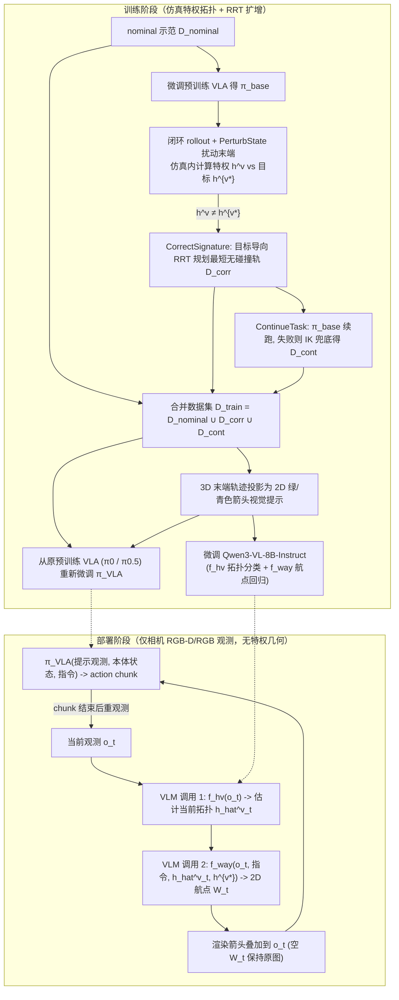

# Topology-VLA（arXiv:2609.23944）

**Topology-VLA**（*Topology-Informed Visual Prompting For Vision Language Action Policies*，[arXiv:2609.23944v1](https://arxiv.org/abs/2609.23944)，[项目页](https://topology-vla.github.io/)）由密歇根大学提出，针对绕缆、穿圈与货架抽箱等**同态/绕行敏感操作**，把拓扑约束转换成 VLM 可读取的 2D 视觉箭头提示来引导预训练 VLA。

## 一句话定义

**用虚拟环路拓扑签名区分视觉相似却需相反绕行方向的接触/避障状态，借助仿真特权拓扑标签与 RRT 自动生成纠偏恢复示范，再训练 VLM 在部署期以图像路径箭头提示预训练 VLA。**

## 英文缩写速查

| 缩写 | 英文全称 | 简要说明 |
|------|----------|----------|
| VLA | Vision-Language-Action | 下游视觉–语言–动作策略（本文基于 π0 与 π0.5） |
| VLM | Vision-Language Model | 视觉语言模型；本文微调单个 Qwen3-VL-8B-Instruct 预测拓扑与航点 |
| RRT | Rapidly-exploring Random Tree | 采样运动规划器，用于在仿真中生成回到目标拓扑的无碰撞修正轨迹 |
| IK | Inverse Kinematics | 逆运动学；仿真收集续跑轨迹 `D_cont` 时的兜底末端控制器 |
| PEEK | Point-based / Mask Visual Prompting Baseline | 论文对比的视觉提示基线，会屏蔽背景区域，导致丢失避障参考结构 |

## 为什么重要

- **单帧动作克隆与“画框/遮罩式”提示失效的原因：** 在绕柱取箱或穿线中，视觉外观相近的状态可能处于完全不同的拓扑绕数（如绳在桩前 vs 桩后），直接决定下一步应从左侧还是右侧退回；类似 PEEK 的遮罩方法会遮蔽货架立柱与环体本身，真机上反而掉至 3%。
- **把特权几何隔离在训练侧：** 训练期利用近似仿真器内可计算的虚拟 h-signature（Gauss Linking Integral）与 RRT 自动采集 `D_corr` 与 `D_cont`；部署阶段不要求在线障碍骨架估计或 3D 重建，仅凭相机图像完成“拓扑估计 → 路径点视觉提示 → VLA 执行”。
- **少数真机数据即可跨到物理平台：** 在物理实验里（先经仿真域随机化预训练），仅补充 15 条到达示范 + 3 条纠偏示范（约仿真帧数的 3%）和 1,000 张真机 VLM 标注图像（约 VLM 训练集的 5%），即可把 π0 在 Box Pickup 上的成功率从 20% 提升至 60%。

## 核心原理

| 组成部分 | 机制说明（论文 §IV–§V） | 关键设计参数 |
|----------|------------------------|--------------|
| **虚拟拓扑签名 `h^v`** | 对开放机械臂–物体链条补上末端至抓握/接触目标的虚拟直线封闭成环 `L_t`，计算其与障碍环 `O` 的高斯环绕积分 `h^v = Lk(L_t, O)` | 二值拓扑目标 `h^{v*} ∈ {0, 1}`（如 Cable Threading `0→1`、Box Pickup `1→0`、Rope Pulling 保持 `0`） |
| **自动化数据扩增（Alg. 1）** | `D_nominal`（100 demos）微调 `π_base`；滚出时加高斯末端扰动 `PerturbState`，一旦 `h^v != h^{v*}` 即调用目标导向 RRT 规划最短无碰撞回到 `h^{v*}` 的轨迹 `D_corr`，并用 `π_base` + IK 兜底走完得 `D_cont` | 随后从**原始预训练 VLA** 出发用 `D_nominal ∪ D_corr ∪ D_cont` 微调 `π_VLA`（LoRA `r=16/32`，20k 步，batch 32，lr `5e-5`，`H_a=10`，224×224） |
| **双调用 VLM 视觉提示** | 单模型 `Qwen3-VL-8B-Instruct`（LoRA `r=8, α=16`，1 epoch）先判别当前拓扑 `f_hv(o_t) → \hat{h}^v_t`，再规划图像航点 `f_way(o_t, l, \hat{h}^v_t, h^{v*}) → W_t` 绘成绿/青色箭头贴图；无需纠偏时输出空 `W_t` 不叠加 | 训练侧用真值末端 3D 轨迹投影成 2D 箭头监督；部署按 action chunk 触发重规划 |

### 流程总览

图依据：论文 §V-A / §V-B / §V-C、Fig. 3 与 Algorithm 1。

## 源码运行时序图

**不适用。** 截至核查日（2026-11-14），项目页 `https://topology-vla.github.io/` 仅发布论文 PDF 与实验视频，未公布 GitHub 源码仓库、RRT 数据生成管线或微调后的 Qwen3-VL / VLA 权重，因此无真实仓库脚本可供对齐。

## 实验与评测

### 1. 仿真闭环成功率（Table I & VLM 拓扑准确率 Table II）

| 任务（仿真测试集） | 骨干 | Base | PEEK（遮罩基线） | **Ours（Topology-VLA）** | VLM 未知场景 `h^v` 准确率（n=100） |
|--------------------|------|------|------------------|--------------------------|------------------------------------|
| **Rope Pulling**（50 trials，`h^v=0`） | π0 | 70% | 54% | 66% | — |
| **Rope Pulling**（同上） | π0.5 | 52% | 50% | **64%** | — |
| **Cable Threading**（100 trials，`0→1`） | π0 | 49% | 13% | **71%** | 74% |
| **Cable Threading**（同上） | π0.5 | 47% | 20% | **77%** | 76% |
| **Box Pickup**（100 trials，`1→0`） | π0 | 31% | 57% | **84%** | 92% |
| **Box Pickup**（同上） | π0.5 | 45% | 66% | **82%** | 92% |

### 2. 项目页补充消融结果（`π0.5`，`sites/topology_vla.html`）

| 变体 | Rope Pulling | Cable Threading | Box Pickup |
|------|--------------|-----------------|------------|
| **完整 Topology-VLA** | **64%** | **77%** | **82%** |
| 去掉 2D 视觉箭头提示（保留全部扩增数据） | 52% | 69% | 75% |
| 仅用延续示范（去纠偏 `D_corr`，只保留 `D_nominal ∪ D_cont`） | N/A | 24% | 54% |

- 仅靠 DAgger 式延续轨迹无法拯救拓扑纠偏失败（Cable Threading 从 77% 掉至 24%）；在纠偏数据上再加入视觉箭头提示又带来 +8 至 +12 pp 提升。

### 3. 真机实验（Box Pickup，30 trials on `π0`，Table III）

| 评估指标 | Base (`π0`) | PEEK (`π0`) | **Ours (`π0`)** | 增幅（vs Base） |
|----------|-------------|-------------|-----------------|-----------------|
| **任务总成功率** | 20% | 3% | **60%** | **+40 pp** |
| **拓扑纠偏成功率** | 30% | 20% | **83%** | **+53 pp** |

- 真机实验在到达箱体把手后由低层抬升原语完成抬箱，以聚焦绕过货架立柱解纠缠并触达把手的规划与控制阶段。

## 与其他工作对比

| 对比维度 | Topology-VLA（本文） | PEEK 等遮罩型视觉提示 | 纯模仿 / DAgger 续跑扩展 |
|----------|----------------------|----------------------|--------------------------|
| 环境背景保留 | 保留完整原始像素，仅局部绘制路径箭头 | 遮罩屏蔽非关注区，容易抹掉立柱/绳环等障体参照 | 无显式空间路径提示，依赖策略隐式记忆 |
| 纠偏数据来源 | 仿真内按特权 `h^v` 违例触发 RRT 最短回到正确绕数轨迹 | 通常直接对演示帧标注关键区域/点 | 仅在接近专家状态处采样或人工干预纠正 |
| 部署先决条件 | 需预先定义任务目标拓扑 `h^{v*}` 并运行两次 Qwen3-VL-8B 推理 | 单次 VLM 掩码预测 | 无额外 VLM 提示器 |

## 结论

**Topology-VLA 把拓扑不变量与仿真 RRT 纠偏、2D 箭头视觉提示串联起来，使预训练 VLA 能在视觉高度混淆的绕行场景中区分“左绕还是右绕”；当前最大缺口是代码尚未公开且依赖预设拓扑签名任务规范。**

1. **视觉提示勿破坏障碍参照：** PEEK 在真机 Box Pickup 暴跌到 3%，证明在接触避障任务上，叠加非破坏性路径箭头显著优于遮罩抹除背景。
2. **数据与提示各有不可替代性：** 网站消融表显示，缺少 `D_corr` 会导致 Cable Threading 掉回 24%；保留 `D_corr` 再去掉视觉箭头也会再掉 7–12 pp。
3. **关注双次 VLM 推理预算：** 部署时每更新一个 action chunk 需串行调用两次 8B VLM（`f_hv` + `f_way`），对高频动态场景需衡量视觉提示更新周期。
4. **真机迁移边界：** 真机仅验证了单任务 Box Pickup，且到达把手后的最终抬升由固定原语接管；复杂柔体全流程闭环能力尚待多任务物理测试验证。

## 工程实践

| 实践环节 | 原文配置（§V–§VI） | 工程迁移注意事项 |
|----------|--------------------|------------------|
| 仿真拓扑工程建模 | 需为每个任务抽象封闭链条 `L_t` 与障碍环 `O`，并用高斯环绕积分判别离散 `h^v` | 仅在近似仿真训练期使用，无需在真机相机侧重构完整 3D 障碍网格 |
| 政策微调口径 | 4× A40 上用 `D_train` 从原始预训练 `π0` / `π0.5` 重头微调（20k 步，batch 32，lr `5e-5`） | 不要在已微调的 `π_base` 上叠加第二轮，应回退原预训练权重以维持动作分布可塑性 |
| VLM 提示训练 | `Qwen3-VL-8B-Instruct` LoRA `r=8, α=16` 训练 1 个 epoch | 真机仅需约 3% 纠偏示范 + 5% VLM 图像标注（约 1,000 张）配合仿真域随机化即可跨机 |
| 部署推理节奏 | 先 `f_hv` 判定是否处于目标 `h^{v*}`，仅在需修正时经 `f_way` 画箭头 | 当状态已对齐且不需要纠偏时跳过叠加，降低图像视觉噪声 |

## 局限与风险

- **代码、数据与权重完全未开源：** 项目页未挂任何 GitHub 链接，难以直接复现虚拟 h-signature 自动化计算与真机推理封装。
- **VLM 拓扑误判风险：** 未见场景下的拓扑识别率并非 100%（Cable Threading 为 74%–76%，Box Pickup 为 92%），VLM 一旦把当前 `h^v` 判反，就会画出错方向的绕行箭头把策略引向错误路径。
- **真机实验范围有限：** 真机仅评估 Box Pickup 单一任务且末端抓取抬起使用低层固定原语；论文实验对目标拓扑 `h^{v*}` 采用人工预设离散二元签名（`0`/`1`），面对多障碍复杂编织拓扑尚需更高维签名设计。
- **两阶段 VLM 串行延迟：** 每次重规划需要执行两次 8B 模型调用，论文未公布在端侧机器人工作站上的完整端到端推理耗时与并发流水设计。

## 关联页面

- [VLA](../methods/vla.md) — 预训练视觉–语言–动作策略基座
- [Manipulation](../tasks/manipulation.md) — 避障与线缆操作任务背景
- [Imitation Learning](../methods/imitation-learning.md) — 扰动纠偏示范收集与 DAgger 思想对照
- [π0.5](./paper-pi05-open-world-vla.md) — 实验所用的主要 VLA 骨干之一
- [具身智能小站 10-18 期 26 篇阅读坐标](../overview/embodied-station-2026-10-18-26-papers-technology-map.md) — 同批次 VLA 评测与部署路线索引

## 参考来源

- [Topology-VLA 论文归档](../../sources/papers/topology_informed_visual_prompting_vla_arxiv_2609_23944.md) — arXiv `2609.23944v1` 全文通读与实验表格核对
- [Topology-VLA 项目页归档](../../sources/sites/topology-informed-visual-prompting-vla.md) — 项目主页及网站独有 `π0.5` 消融表归档
- [具身智能小站 2026-10-18 盘点](../../sources/blogs/wechat_embodied_station_26_papers_embodiedswe_2026-10-18.md)

## 推荐继续阅读

- [arXiv:2609.23944](https://arxiv.org/abs/2609.23944)
- [Topology-VLA 官方项目页](https://topology-vla.github.io/)
