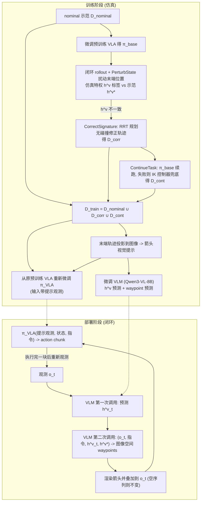

# Topology-VLA（arXiv:2609.23944）

**Topology-VLA**（*Topology-Informed Visual Prompting For Vision Language Action Policies*，[arXiv:2609.23944](https://arxiv.org/abs/2609.23944)，[项目页](https://topology-vla.github.io/)）来自 [具身智能小站 2026-10-18 盘点](../../sources/blogs/wechat_embodied_station_26_papers_embodiedswe_2026-10-18.md)，属「VLA 评测与部署」组。

## 一句话定义

**用拓扑签名区分外观相似却需不同绕行的状态，借仿真规划扩增示范，再让 VLM 生成视觉路径提示。**

## 英文缩写速查

| 缩写 | 英文全称 | 简要说明 |
|------|----------|----------|
| VLM | Vision-Language Model | 视觉语言模型 |

## 为什么重要

- 外观相似的状态可能要求不同绕行方向，拓扑信息补上了 VLA 缺的路线语义。
- 开源结论：**项目页未列 GitHub**（步骤 2.5，2026-10-18）。项目页 HTTP 200；页面仅含学术模板链接，无项目代码。
- 同期同组工作见 [编程智能体造数据与 VLA 闭环评测：具身智能小站 10-18 期 26 篇阅读坐标](../overview/embodied-station-2026-10-18-26-papers-technology-map.md)。

## 流程总览

图依据：论文 §V-A / §V-B / §V-C / Fig.3、Algorithm 1

## 核心机制

| 项 | 内容 |
|----|------|
| **arXiv** | [2609.23944](https://arxiv.org/abs/2609.23944) |
| **开源** | **项目页未列 GitHub** |
| **要点** | 拓扑签名 → 仿真规划扩增示范 → VLM 生成视觉路径提示。 |
| **文内指标** | 公众号提示：训练时几何特权信息与部署时相机引导应分开理解。 |

## 源码运行时序图

**不适用（项目页未列 GitHub）** — 项目页 HTTP 200；页面仅含学术模板链接，无项目代码。 不编造运行脚本；代码公开后再补。

## 实验与评测

- 公众号提示：训练时几何特权信息与部署时相机引导应分开理解。
- **读法：** 本页为索引级摘要，依据公众号转述的官方摘要与仓库信息整理；逐项数字与 baseline 以原文 PDF 为准。

## 与其他工作对比

- 横向索引见 [编程智能体造数据与 VLA 闭环评测：具身智能小站 10-18 期 26 篇阅读坐标](../overview/embodied-station-2026-10-18-26-papers-technology-map.md)；同 arXiv 不重复造页。

## 结论

**拓扑提示让 VLA 的避障路线可显式表达，需区分训练期特权信息与部署期输入。**

1. 开源边界：**项目页未列 GitHub** — 项目页 HTTP 200；页面仅含学术模板链接，无项目代码。
2. 核心机制：拓扑签名 → 仿真规划扩增示范 → VLM 生成视觉路径提示。
3. 复现与选型前核对任务协议、硬件与基准口径，勿直接横比公众号摘录数字。

## 关联页面

- [vla](../methods/vla.md)
- [manipulation](../tasks/manipulation.md)
- [embodied-station-2026-10-18-26-papers-technology-map](../overview/embodied-station-2026-10-18-26-papers-technology-map.md)

## 参考来源

- [topology_informed_visual_prompting_vla_arxiv_2609_23944.md](../../sources/papers/topology_informed_visual_prompting_vla_arxiv_2609_23944.md)
- [wechat_embodied_station_26_papers_embodiedswe_2026-10-18.md](../../sources/blogs/wechat_embodied_station_26_papers_embodiedswe_2026-10-18.md)
- [arXiv:2609.23944](https://arxiv.org/abs/2609.23944)
- [arXiv PDF](https://arxiv.org/pdf/2609.23944)：已通读方法部分（实验与附录以略读为准）：§III 预备知识、§IV 问题设定、§V Method（V-A–V-C）、§VI-B 实现细节

## 推荐继续阅读

- [arXiv PDF](https://arxiv.org/pdf/2609.23944)
- [项目页](https://topology-vla.github.io/)
