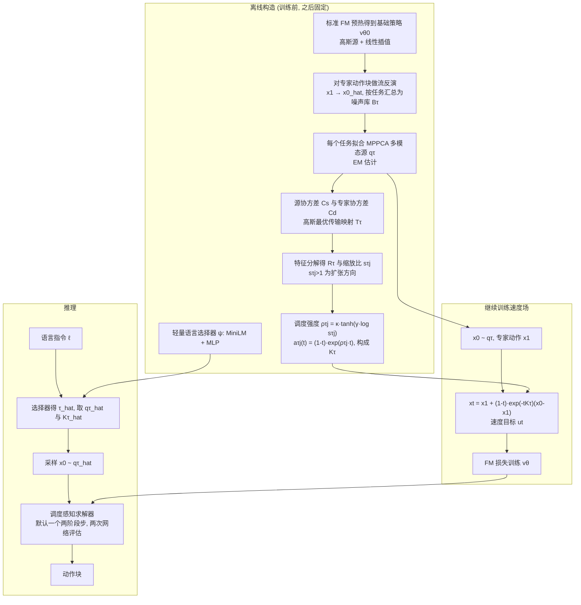

# TOPS：通过重构 Flow 源分布与传输路径实现多任务机器人操作

**TOPS**（*TOPS: Reshaping Flow Source and Transport for Multi-Task Robot Manipulation*，[arXiv:2610.36694](https://arxiv.org/abs/2610.36694)）收录于 senlanke「具身运控lab」10-26–10-30 前沿论文动态（Manipulation）。本页依据**周报条目 + arXiv 摘要页**整理，流程图依据论文方法部分（见参考来源），未逐页核对实验数字；指标与结论以论文为准。

## 一句话定义

**TOPS：通过重构 Flow 源分布与传输路径实现多任务机器人操作——提出 Task-Oriented Priors and Schedules（TOPS）。首先从专家动作反向映射构建任务专用的多模态源分布，再根据源分布与目标动作分布的协方差差异，设计任务专用的 Flow 插值时间调度。在 LIBERO-10 上，单步推理成功率达到 **69.67%**，超过标准 Flow Matching 十步推理的 **53.44%**，推理时间约为基线的六分之一。**

## 英文缩写速查

| 缩写 | 英文全称 | 简要说明 |
|------|----------|----------|
| VLA | Vision-Language-Action | 视觉–语言–动作模型 |
| IL | Imitation Learning | 模仿学习 |

## 为什么重要

- 周报所述待解决的问题：多任务 Flow Matching Policy 通常对所有任务使用相同的高斯噪声分布和线性插值路径，但不同操作任务的动作分布差异很大。

## 流程总览

图依据：论文 §3.2 流反演、§4.1–4.4（任务源构造、插值调度、训练与推理）、Fig.2、式 (3)–(10)

## 核心机制

| 项 | 内容 |
|----|------|
| **arXiv** | [2610.36694](https://arxiv.org/abs/2610.36694) · [PDF](https://arxiv.org/pdf/2610.36694) |
| **作者（arXiv）** | An, Tuo, Zhou, Chuhao, Dong, Jiahua, Li, Jingliang, Bai, Jiaqi, Jia, Jindou, Yang, Jianfei |
| **机构（周报所述，未逐条核实）** | 南洋理工大学 MARS Lab。 |
| **arXiv 评论栏** | （无） |
| **开源** | arXiv 摘要页与评论未见代码或项目页链接（仅核对 arXiv 摘要页，不代表未发布）（2026-11-02） |
| **周报所述创新点** | 提出 Task-Oriented Priors and Schedules（TOPS）。首先从专家动作反向映射构建任务专用的多模态源分布，再根据源分布与目标动作分布的协方差差异，设计任务专用的 Flow 插值时间调度。在 LIBERO-10 上，单步推理成功率达到 **69.67%**，超过标准 Flow Matching 十步推理的 **53.44%**，推理时间约为基线的六分之一。 |

### arXiv 摘要节选（英文原文）

> Flow-based policies for language-conditioned multi-task manipulation commonly share a single $\textit{Gaussian}$ source prior and a common linear transport path across tasks. However, reliably executing multiple tasks with distinct motion requirements remains challenging for a shared policy.

## 源码运行时序图

**不适用**：arXiv 摘要页与评论未见代码或项目页链接（仅核对 arXiv 摘要页，不代表未发布），无可对齐的官方代码流程。

## 实验与评测

- 周报与摘要给出的数字/场景已写入上表「创新点」与摘要节选；其余实验细节、基线与成功率定义请回到论文正文。
- 读法：先对齐任务设定、传感器与成功定义（仿真/真机），再解读 headline 数字，勿跨论文直接比较。

## 与其他工作对比

| 维度 | 读法 |
|------|------|
| **同周对照** | 见 [Manipulation周报技术地图](../overview/senlanke-weekly-2026-10-26-30-manipulation-technology-map.md)，按方向浏览同期论文 |
| **开源状态** | arXiv 摘要页与评论未见代码或项目页链接（仅核对 arXiv 摘要页，不代表未发布） |

## 结论

**TOPS：通过重构 Flow 源分布与传输路径实现多任务机器人操作。**

1. 本页是入库级摘要，复现前请核对论文正文、附录与代码仓库。
2. 指标须连同实验条件解读。
3. 关注 arXiv 版本更新与代码发布。

## 关联页面

- [senlanke-weekly-2026-10-26-30-manipulation-technology-map](../overview/senlanke-weekly-2026-10-26-30-manipulation-technology-map.md)
- [manipulation](../tasks/manipulation.md)
- [vla](../methods/vla.md)

## 参考来源

- [tops-flow-source-transport-multitask_arxiv_2610_36694.md](../../sources/papers/tops-flow-source-transport-multitask_arxiv_2610_36694.md)
- [wechat_senlanke_weekly_manipulation_2026-10-26_30.md](../../sources/blogs/wechat_senlanke_weekly_manipulation_2026-10-26_30.md)
- [arXiv:2610.36694](https://arxiv.org/abs/2610.36694)
- [arXiv PDF](https://arxiv.org/pdf/2610.36694)：已通读方法部分（实验与附录以略读为准）：方法（§3 预备与流反演、§4 任务源构造/插值调度/训练推理）；实验设定（§5.1）仅读到概览，附录证明与超参未逐条核对

## 推荐继续阅读

- [arXiv PDF](https://arxiv.org/pdf/2610.36694)
