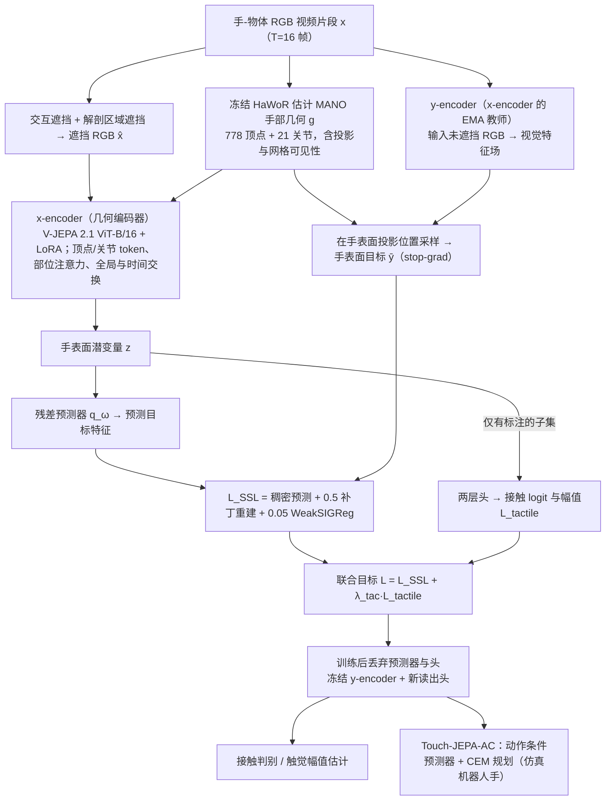

# Touch-JEPA（arXiv:2610.28519）

**Touch-JEPA**（*Touch-JEPA: Tactile Representation Learning from Hand-Object Video with Limited Tactile Supervision*，[arXiv:2610.28519](https://arxiv.org/abs/2610.28519)，[项目页](https://touch-jepa.github.io)）来自 [具身智能小站 2026-10-31 盘点](../../sources/blogs/wechat_embodied_station_50_papers_scenerig_photo_to_sim_2026-10-31.md)，属「触觉与精细操作」组。

## 一句话定义

**Touch-JEPA在手部几何上预测被遮蔽的视觉特征，用少量触觉标注校准表示；覆盖三个人手基准与机器人迁移，触觉幅值不等于跨传感器力标定。**

## 英文缩写速查

| 缩写 | 英文全称 | 简要说明 |
|------|----------|----------|
| Touch-JEPA | Touch-JEPA: Tactile Representation Learning from Hand-Object Video with Limited Tactile Supervision | 本文方法 / 基准的简称 |

## 为什么重要

- 从人手视频学触觉表征。
- 开源结论：**部分开源**（步骤 2.5，2026-10-31）。公众号未给代码链接；项目页链接 mnseong/touch-jepa，git ls-remote 失败（仓库不存在或私有），页面另含 soon 字样，不能当作已开源。
- 同期同组工作见 [单图重建仿真、VLA 适配评测与跨形态世界模型：具身智能小站 10-31 期 50 篇阅读坐标](../overview/embodied-station-2026-10-31-50-papers-technology-map.md)。

## 流程总览

图依据：论文 §3.1–3.5、Fig.2。

## 核心机制

| 项 | 内容 |
|----|------|
| **arXiv** | [2610.28519](https://arxiv.org/abs/2610.28519) |
| **开源** | **部分开源** |
| **要点** | Touch-JEPA在手部几何上预测被遮蔽的视觉特征，用少量触觉标注校准表示；覆盖三个人手基准与机器人迁移，触觉幅值不等于跨传感器力标定。 |
| **文内指标** | 公众号未给具体数字，本页不引用。 |

## 源码运行时序图

**部分开源** — 公众号未给代码链接；项目页链接 mnseong/touch-jepa，git ls-remote 失败（仓库不存在或私有），页面另含 soon 字样，不能当作已开源。 待可运行代码公开后补图。

## 实验与评测

- 公众号未给具体数字，本页不引用。
- **读法：** 本页为索引级摘要，依据公众号转述的官方摘要与仓库信息整理；逐项数字与 baseline 以原文 PDF 为准。

## 与其他工作对比

- 横向索引见 [单图重建仿真、VLA 适配评测与跨形态世界模型：具身智能小站 10-31 期 50 篇阅读坐标](../overview/embodied-station-2026-10-31-50-papers-technology-map.md)；同 arXiv 不重复造页。

## 结论

**从人手视频学触觉表征：Touch-JEPA在手部几何上预测被遮蔽的视觉特征，用少量触觉标注校准表示；覆盖三个人手基准与机器人迁移，触觉幅值不等于跨传感器力标定。**

1. 开源边界：**部分开源** — 公众号未给代码链接；项目页链接 mnseong/touch-jepa，git ls-remote 失败（仓库不存在或私有），页面另含 soon 字样，不能当作已开源。
2. 核心机制：Touch-JEPA在手部几何上预测被遮蔽的视觉特征，用少量触觉标注校准表示；覆盖三个人手基准与机器人迁移，触觉幅值不等于跨传感器力标定。
3. 复现与选型前核对任务协议、硬件与基准口径，勿直接横比公众号摘录数字。

## 关联页面

- [tactile-sensing](../concepts/tactile-sensing.md)
- [contact-rich-manipulation](../concepts/contact-rich-manipulation.md)
- [manipulation](../tasks/manipulation.md)
- [embodied-station-2026-10-31-50-papers-technology-map](../overview/embodied-station-2026-10-31-50-papers-technology-map.md)

## 参考来源

- [touch_jepa_arxiv_2610_28519.md](../../sources/papers/touch_jepa_arxiv_2610_28519.md)
- [wechat_embodied_station_50_papers_scenerig_photo_to_sim_2026-10-31.md](../../sources/blogs/wechat_embodied_station_50_papers_scenerig_photo_to_sim_2026-10-31.md)
- [arXiv:2610.28519](https://arxiv.org/abs/2610.28519)
- [arXiv PDF](https://arxiv.org/pdf/2610.28519)：已通读方法部分（实验与附录以略读为准）：几何引导掩码预测与几何编码器（§3.1–3.2）、自监督与触觉监督训练（§3.3–3.4）、Touch-JEPA-AC（§3.5）、实验设定（§4.1）

## 推荐继续阅读

- [arXiv PDF](https://arxiv.org/pdf/2610.28519)
- [项目页](https://touch-jepa.github.io)
