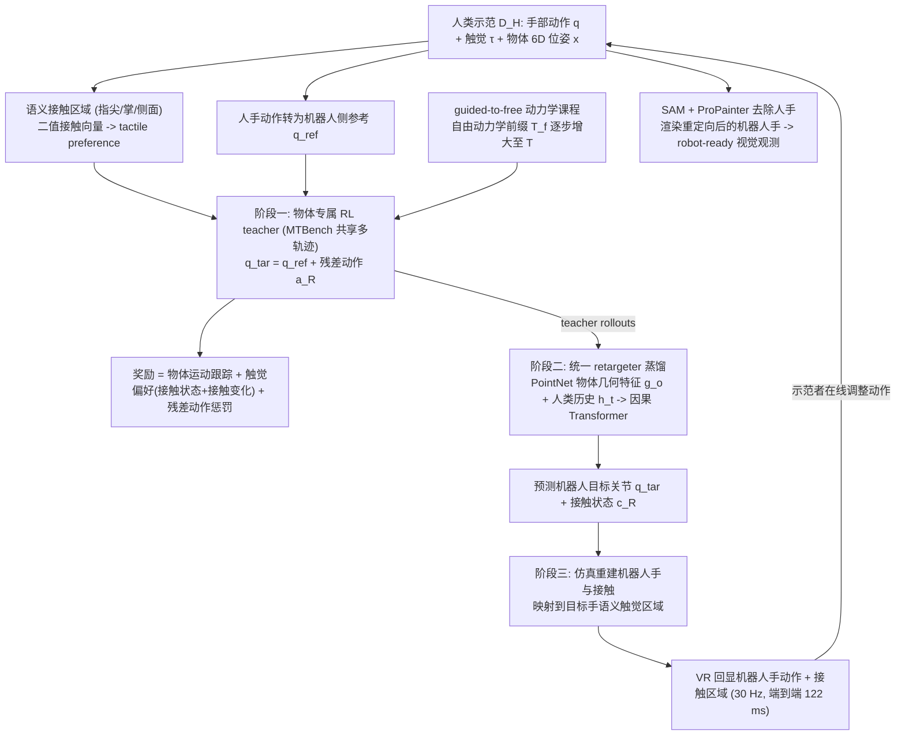

# Touch2Robot（arXiv:2609.24660）

**Touch2Robot**（*Touch2Robot: Robot Touch in the Human Demonstration Loop*，[arXiv:2609.24660](https://arxiv.org/abs/2609.24660)，[项目页](https://touch2robot.github.io/)）来自 [具身智能小站 2026-10-18 盘点](../../sources/blogs/wechat_embodied_station_26_papers_embodiedswe_2026-10-18.md)，属「数据生成与示范」组。

## 一句话定义

**把手套触觉、人体动作和物体跟踪用于实时重定向，让示范者在采集时看到目标机器人的接触反馈。**

## 英文缩写速查

| 缩写 | 英文全称 | 简要说明 |
|------|----------|----------|
| Retargeting | Motion Retargeting | 跨形态动作重定向 |

## 为什么重要

- 人与机器人形态差异要在采集阶段就纠正，事后重定向难以补回接触信息。
- 开源结论：**项目页未列 GitHub**（步骤 2.5，2026-10-18）。项目页 HTTP 200，未见 GitHub 链接或 coming soon 字样。
- 同期同组工作见 [编程智能体造数据与 VLA 闭环评测：具身智能小站 10-18 期 26 篇阅读坐标](../overview/embodied-station-2026-10-18-26-papers-technology-map.md)。

## 流程总览

图依据：论文 §III / §IV-C / Fig.2、Fig.3

## 核心机制

| 项 | 内容 |
|----|------|
| **arXiv** | [2609.24660](https://arxiv.org/abs/2609.24660) |
| **开源** | **项目页未列 GitHub** |
| **要点** | 手套触觉 + 人体动作 + 物体跟踪 → 实时重定向，并把目标机器人的接触反馈回显给示范者。 |
| **文内指标** | 四项真机任务平均回放完成度 37.9%（仅视觉反馈）→ 72.1%；每条回放成功示范的采集时间 58.6 s → 18.2 s；下游 Diffusion Policy 平均完成度 62.0%（视觉 32.9%、离线重定向 23.3%，+29.1 个百分点）。注意是**任务完成度得分**（Pick 按 reach/pick/move/place 四阶段各 25%，其余按旋转角/擦除面积/抽屉位移比例），不是二值成功率。 |
| **硬件** | xArm6 + LEAP Hand（TwinTac 指尖触觉 + 二值 FSR）；MANUS 手套记录动作、Juqiao 触觉手套（256 taxel）记录人手触觉、FoundationPose 跟踪物体、Meta Quest 3 显示。 |
| **任务** | Pick-and-Place、Object Rotation（≥180°）、Board Wiping、Drawer Opening。 |

## 源码运行时序图

**不适用（项目页未列 GitHub）** — 项目页 HTTP 200，未见 GitHub 链接或 coming soon 字样。 不编造运行脚本；代码公开后再补。

## 实验与评测

依据 arXiv v2 全文（含附录）核对：

- **协议：** 每名操作者在 3 种采集界面（Offline Retargeting / Visual Feedback / Touch2Robot）下对四任务各采集 10 次；数据不按回放结果筛选，同时用于回放评测与训练。
- **回放完成度（Table I，平均 %）：** Offline Retarget 28.3、Visual Feedback 37.9、Touch2Robot 72.1；采集时间 66.0 / 58.6 / 18.2 s。增益最大在 Rotate 与 Wipe。各任务标准差很大（如 Pick 62.5±27.0）。
- **下游 Diffusion Policy（Table II，平均 %）：** 23.3 / 32.9 / 62.0；各界面使用相同轨迹数。Drawer 等任务标准差达 40+，样本量小。
- **触觉保真（Table III）：** 重建接触 vs 真机触觉，F1 44.19%（ConTrack 23.77、DexMachina 24.71、去触觉奖励 24.58），接触起始误差 857 ms，但 FPR 升至 6.38%。
- **偏好对齐（Table IV）：** vs 人类触觉偏好 F1 47.53%，起始误差 291.7 ms；FPR 6.52%。
- **用户研究（Table V）：** 10 人、仅 Rotation 任务、7 点 Likert 重标为百分比；Touch2Robot 在接触感知、适应信心、反馈有用性、易用性均显著更高（Holm 校正 p<0.01）。
- **消融：** guided-to-free 课程使教师奖励全程更高；统一 retargeter 保留大部分教师交互质量，去掉几何或接触辅助监督均变差；Table VI 报告单帧推理延迟。
- **跨手：** 仅在 VR 中定性展示三种灵巧手，定量与真机验证列为未来工作。
- **口径提醒：** 绝对 F1 仍不高（<50%）；人类研究样本小且仅一项任务。

## 与其他工作对比

- 横向索引见 [编程智能体造数据与 VLA 闭环评测：具身智能小站 10-18 期 26 篇阅读坐标](../overview/embodied-station-2026-10-18-26-papers-technology-map.md)；同 arXiv 不重复造页。

## 结论

**示范采集回路里加入机器人侧接触反馈，是比事后重定向更早的形态对齐手段。**

1. 开源边界：**项目页未列 GitHub** — 项目页 HTTP 200，未见 GitHub 链接或 coming soon 字样。
2. 核心机制：手套触觉 + 人体动作 + 物体跟踪 → 实时重定向，并把目标机器人的接触反馈回显给示范者。
3. 平均完成度 37.9%→72.1%、下游 +29.1 pp 为论文自报；复现与选型前核对任务协议与硬件（LEAP + TwinTac + 触觉手套），勿跨论文横比。

## 工程实践

- **开源状态：** 项目页未列 GitHub（2026-10-18 核查，HTTP 200，无 coming soon 字样），源码运行时序图不适用。
- **复现：** 需 MANUS + 触觉手套 + Quest 3 + 物体位姿跟踪；PPO 与蒸馏超参见附录 Table VII–IX（如历史长度 16、几何特征 32 维、教师 30 条轨迹/任务增广至 400）；代码公开后再补运行入口。

## 局限

- 无公开代码，无法核验实现细节。
- 接触表示仅为二值语义区域（论文自述未来扩展到更丰富触觉）；仅 LEAP Hand 真机验证。
- 接触重建 F1 <50%，起始误差数百毫秒，且 FPR 上升。
- 作者及未核对的一手实现细节以原文为准；本页未见官方源码，无法核验。

## 关联页面

- [模仿学习](../methods/imitation-learning.md) — 延伸阅读，理解示范数据如何用于策略训练。
- [teleoperation](../tasks/teleoperation.md)
- [tactile-sensing](../concepts/tactile-sensing.md)
- [motion-retargeting](../concepts/motion-retargeting.md)
- [embodied-station-2026-10-18-26-papers-technology-map](../overview/embodied-station-2026-10-18-26-papers-technology-map.md)

## 参考来源

- [touch2robot_arxiv_2609_24660.md](../../sources/papers/touch2robot_arxiv_2609_24660.md)
- [wechat_embodied_station_26_papers_embodiedswe_2026-10-18.md](../../sources/blogs/wechat_embodied_station_26_papers_embodiedswe_2026-10-18.md)
- [arXiv:2609.24660](https://arxiv.org/abs/2609.24660)
- [arXiv PDF](https://arxiv.org/pdf/2609.24660)：已通读正文（v2，不含参考文献）与附录

## 推荐继续阅读

- [arXiv PDF](https://arxiv.org/pdf/2609.24660)
- [项目页](https://touch2robot.github.io/)
