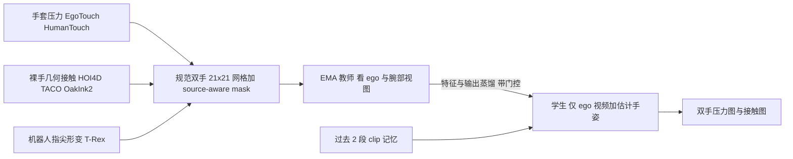

# TouchAnnotator（arXiv:2611.09129）

**TouchAnnotator**（*Multi-Source Tactile Supervision with Privileged-View Distillation*，[arXiv:2611.09129](https://arxiv.org/abs/2611.09129)，清华大学 / 京东，2026-11-06 v1）：给没有触觉传感器的第一视角视频补上双手的接触图与相对压力图。原文归档见 [sources/papers/touchannotator_arxiv_2611_09129.md](../../sources/papers/touchannotator_arxiv_2611_09129.md)（通读已完成，范围与缺项见该文）。

## 一句话定义

**作者自述：** 用一个规范的双手网格，把手套实测压力、几何推得的人手接触、机器人指尖光学形变（6 个数据集、3 类载体）放进同一个训练目标，再让「看 ego + 腕部视图」的 EMA 教师把表征和预测蒸给「只看 ego 视频和估计手姿」的学生，部署时一段第一视角视频进、两只手的 21×21 压力图与接触图出。

## 英文缩写速查

| 缩写 | 英文全称 | 简要说明 |
|------|----------|----------|
| EMA | Exponential Moving Average | 教师权重 = 学生权重的滑动平均，动量 0.996（式 4） |
| ego / wrist | egocentric / wrist view | 头戴第一视角 / 腕部相机；腕部仅训练期给教师 |
| MANO | hand Model with Articulated and Non-rigid defOrmations | 参数化手网格，用来按顶点到物体距离推接触 |
| WiLoR | Wild-image hand pose reconstruction | 从 ego RGB 估计手姿的现成模型，评测均用它 |
| FPHA | First-Person Hand Action benchmark | 第一视角手物数据集，用作零样本接触迁移测试 |
| JSD | Jensen–Shannon Divergence | 接触蒸馏损失（Bernoulli JSD） |
| T.Acc. / C.IoU / V.IoU | Temporal Accuracy / Contact IoU / Volumetric IoU | 帧级接触状态一致率 / 接触区域交并比 / 压力体积交并比（附录 D 定义） |
| MAE | Mean Absolute Error | 全部有效格的平均绝对误差，稀疏图上偏好近零预测 |

## 为什么重要

- 触觉策略学习缺大规模触觉数据；这篇尝试把海量无触觉的人类第一视角视频变成「带密集触觉标注」的数据（第 1 节）。
- 它把三类异质监督（手套压力、裸手几何接触、机器人形变）放进一个带 source-aware mask 的表示里，不给未观测格虚构标签（第 3.2 节）——这是对「跨设备触觉如何共训」的一个具体做法。
- **我的判断：** 对机器人学习的价值目前是潜在的：论文明说下游策略收益未测（第 5 节、附录 E）。

## 核心机制与流程总览

要点（均出自论文）：

1. **统一网格与掩码（第 3.2 节）：** 双手各 21×21；EgoTouch 的 16×16 手套阵列重映射，HumanTouch 的 360 taxel 投到 217 格并用一个数据集级单调映射对齐激活分布；裸手接触取 MANO 顶点–物体距离 5 mm 阈值；T-Rex 形变池化到指尖区域。样本级可用标志 a^p、a^c 与格级 mask 决定哪些目标有效。
2. **查询式预测头（第 3.3 节）：** Qwen3.5-4B 视频塔 + 姿态编码；每只手 64 个触觉 query，姿态条件软 ROI 加权视觉 token；压力、接触两个独立输出投影（式 3）。
3. **特权视图蒸馏（第 3.4 节）：** 教师吃干净 ego + 腕部，学生吃降质 ego；query 特征余弦 + 压力 smooth-ℓ1 + 接触 JSD，总权重 `L_distill = L_q + 0.5 L_p + 0.5 L_c`（式 6），带差异 / 置信门控（作者自述为启发式，不保证教师正确）。
4. **past-only 记忆（第 3.5 节）：** 读前 2 个不重叠 clip，每段压缩为 16 个 token；跨 clip 因果，clip 内（8 帧）双向。
5. **数据规模（Table 1）：** 27,005 段、35.0M 帧、195.3 小时；仅 EgoTouch 与 HumanTouch 提供压力监督。

## 主要结果（作者自述，数字出自论文）

| 评测 | 设置 | 结果 | 出处 |
|------|------|------|------|
| EgoTouch unseen（76 episode） | ego-only | T.Acc 0.8687 / C.IoU 0.4779 / V.IoU 0.3821 / MAE 0.0638 | Table 2 |
| 同上 | 同一 checkpoint 加腕部视图 | 0.9127 / 0.5038 / 0.4061 / 0.0652 | Table 2、附录 C.3 |
| FPHA 零样本接触（124 序列） | RGB+估计手姿 | AUROC 0.7431、Recall 0.6169、F1 0.3658（HACO 0.7376 / 0.5742 / 0.3768；TouchAnything F1 0.1209） | Table 3 |
| 自采手套录像（860 episode、21 任务） | 对比 TouchAnything | T.Acc 63.29→68.67，V.IoU 9.10→14.12，C.IoU 6.89→10.73，MAE 0.0830→0.0875（变差） | Table 4 |

## 工程实践

- **部署形态：** 输入一段 ego 视频，WiLoR 估计手姿，8 帧 / 15 Hz / 224×224 的 clip 逐段推理，输出 2×21×21 的压力与接触图（第 3.1、4.1 节，Table A.1）。因 clip 内双向，**只适合离线标注**，不适合逐帧在线反馈（第 5 节）。
- **代码与权重：** README（静态读取，未运行）称提供推理仓库与 Full 学生权重（约 9.40 GB）；训练代码是否公开未核实。要求 Linux + NVIDIA GPU，依赖 Qwen3.5-4B 与 WiLoR。
- **接到机器人上要想清楚的（我的判断）：** 输出是每条轨迹相对的传感器响应，不同载体的颜色不对应同一物理量（第 4.5 节）；若拿它当策略的触觉输入或奖励，需要先做跨设备标定，论文自己的伦理声明也写明「不应解释为经安全认证的力估计」。
- **自采数据：** Wuji 手套 + ORBBEC Gemini 335L，897 条 / 30 任务 / 约 5 小时；数据是否公开未核实。

## 局限

**论文自述（第 5 节、附录 C–E）：**

- 压力不能从 RGB 唯一确定；传感器相对目标不构成跨设备力标定；规范化丢失传感器特有的空间细节。
- 几何接触依赖手 / 物重建与阈值；FPHA 的 MANO 拟合平均关节误差 10.93 mm，边界附近标签不确定；778 个顶点中只有 244 个在触觉支持域 5 mm 内，其余为外推（附录 C.5）。
- 依赖估计手姿，对模糊、截断、长时间遮挡敏感；非逐帧在线。
- 消融不受控（训练混合、初始化、最佳 epoch 均不同），无法分离特权视图 / 蒸馏 / 记忆 / 数据多样性各自的贡献（附录 C.6）；EgoTouch 划分与 TouchAnything 对比的划分等价性未核实，论文自称不支持 SOTA 结论（第 4.2 节）。
- 下游机器人策略收益未测（第 5 节）。

**我看到的未验证之处：**

- 自采录像评测只用 860 个缓存 episode（21 任务），且 32 条后来被剔除，不等于发布的 897 条（附录 D）；参与者、物体、会话数与切分独立性未给。
- 「触觉价值」分层是人工按任务描述的初步标签；按复杂度分层（Table D.2）时，C2/C3 上并非全面占优（如 C2 的 T.Acc 68.40 对 66.85，C3 为 62.61 对 62.21），摘要的总体提升主要来自 C1 与总体平均。
- 自采评测中实测目标按轨迹最大值归一化而模型输出保持原生尺度，且模型第二频带在训练中被标为 bend 相关，与投影后的近端压力语义是否一致论文自己也说不能确认（附录 D）。
- 总体 MAE 变差；FPHA 上 F1 低于 HACO，且输入组别不同，不是同口径对比。
- 跨载体结果只有定性图（图 5）。

## 关联页面

- [触觉感知](../concepts/tactile-sensing.md)
- [特权训练 / 特权信息](../concepts/privileged-training.md)
- [接触估计](../concepts/contact-estimation.md)
- [视觉–触觉融合](../concepts/visuo-tactile-fusion.md)
- [TouchAnything（EgoTouch 数据集与基线）](./paper-sa-2605-13083-touchanything-a-dataset-and-framework-for-bimanu.md)
- [HumanTouch（压阻手套数据）](./humantouch.md)
- [T-Rex（触觉反应式灵巧操作）](./paper-trex-tactile-reactive-dexterous-manipulation.md)
- [OpenTouch](./dataset-opentouch.md)

## 参考来源

- [sources/papers/touchannotator_arxiv_2611_09129.md](../../sources/papers/touchannotator_arxiv_2611_09129.md)
- [sources/papers/touchanything_arxiv_2605_13083.md](../../sources/papers/touchanything_arxiv_2605_13083.md)
- [sources/papers/trex_arxiv_2606_17055.md](../../sources/papers/trex_arxiv_2606_17055.md)
- [arXiv:2611.09129](https://arxiv.org/abs/2611.09129)
- [GitHub: RammusLeo/TouchAnnotator](https://github.com/RammusLeo/TouchAnnotator)

## 推荐继续阅读

- [arXiv PDF（v1）](https://arxiv.org/pdf/2611.09129v1)
- [Hugging Face 权重](https://huggingface.co/RammusLeo/TouchAnnotator)
- [TouchAnything 论文页](./paper-sa-2605-13083-touchanything-a-dataset-and-framework-for-bimanu.md)
