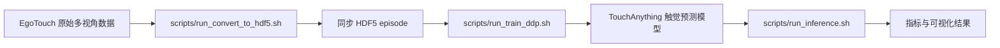
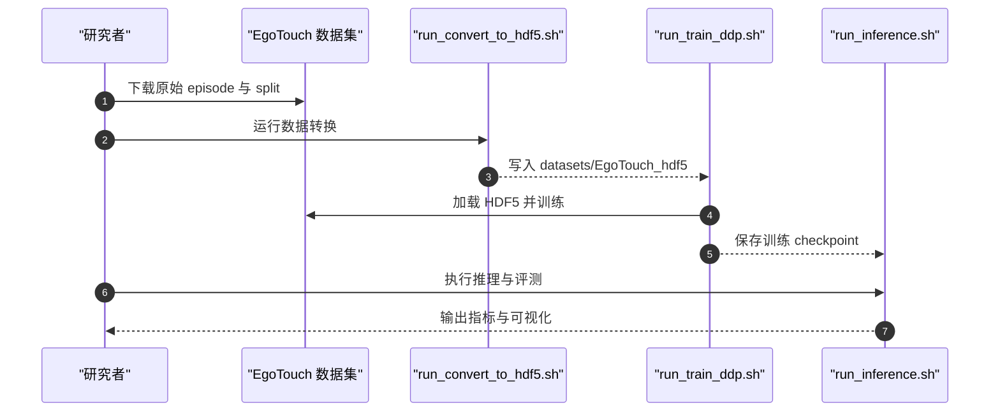

# TouchAnything 与 EgoTouch

## 一句话定义

**TouchAnything** 是从第一人称多视角视频预测双手触觉压力的基线框架；**EgoTouch** 是为其建立的同步视触觉人手操作数据集。

## 英文缩写速查

| 缩写 | 英文全称 | 简要说明 |
| --- | --- | --- |
| RGB | Red-Green-Blue | 数据中的彩色相机图像 |
| IoU | Intersection over Union | 评估接触区域重叠的指标 |
| HDF5 | Hierarchical Data Format version 5 | 仓库采用的 episode 数据容器 |
| DDP | Distributed Data Parallel | README 提供的分布式训练入口 |

## 为什么重要

- 视频提供易扩展的全局上下文，腕部视角能补充被头戴相机遮挡的手物接触区域。
- 数据将影像、手姿和真实可穿戴触觉压力同步起来，可用于研究从视觉中学习接触预测，而不需要在每段视频上都依赖机器人末端触觉硬件。
- 与机器人触觉策略不同，该工作聚焦人手操作数据的触觉估计；用于机器人学习时还需处理人机形态和传感器映射差异。

## 核心原理

EgoTouch 收录室内外人手操作：208 项任务、1,891 段 episode，含头戴第一人称 RGB、双腕 RGB、双手 42 关节 3D 姿态和连续压力图。项目页给出约 2M 帧、约 1,000 个物体的统计。

TouchAnything 以第一人称图像为主输入；共享 DINOv2 视觉编码器提取各视角特征，视角嵌入区分相机位置，跨视角 Transformer 注意力融合互补观察。训练时使用 view dropout，使模型能在缺少腕部输入时运行。输出是双手压力图预测，不应直接解释为以牛顿计的接触力。

## 训练与推理流程

原始数据由转换脚本整理成 HDF5 episode，随后分布式训练并运行推理评测：

## 源码运行时序图

图描述 README 的离线数据训练和评测路径，不代表机器人在线力控部署。

## 实验与评测

- 论文 / 项目页报告：加入腕部视角通常优于只使用第一人称视角。
- 最高相对改进为 Contact IoU 5.0%、Volumetric IoU 6.1%；这些是相对提升，不是绝对百分点。
- 评测覆盖已见与未见物体及不同相机视角配置；解读时应区分单视角和多视角输入条件。

## 与其他工作对比

与 OpenTouch 等直接同步发布视觉和触觉的具身数据相比，EgoTouch 的突出采集设计是头戴视角加双腕相机，并提供双手姿态与压力监督；TouchAnything 进一步提供多视角到触觉的基准模型。两类工作的数据定义和任务协议不同，跨论文比较前应先对齐压力来源、视角和评价指标。

## 结论

**一句话总判：这项工作的主要价值在于把真实人手压力监督、腕部视角和第一人称视频结合起来，检验视觉能否补出遮挡下的触觉线索。**

1. 复现从公开 HDF5 数据和转换脚本开始；确认数据 split 与模型 checkpoint 的实际可用性。
2. 做消融时按 ego-only、ego + left wrist、ego + dual wrists 分开比较，避免把输入增加带来的收益归因到模型结构。
3. Contact IoU 和 Volumetric IoU 的相对增益不能直接当作下游机器人操作成功率。
4. 将压力图用于机器人时需重新标定传感器与坐标，并验证人手到机器人手的迁移。

## 工程实践

| 项 | 公开信息 |
| --- | --- |
| 代码许可 | MIT |
| 环境 | environment.yaml 创建 Conda 环境 |
| 数据转换 | scripts/run_convert_to_hdf5.sh |
| 训练 | scripts/run_train_ddp.sh |
| 推理评测 | scripts/run_inference.sh |
| 数据率 | README 标注 HDF5 episode 为 30 FPS |
| 压力网格 | README HDF5 为 21×21；项目页采集描述为 16×16，使用前需核对转换定义 |
| 机器人部署 | 公开 README 提供训练与推理评测，不等同于可直接部署到机器人上的实时力控策略 |

## 局限与风险

- 主要学习信号来自穿戴压力手套和人手动作，转移到特定机器人灵巧手需处理形态、坐标与传感器差异。
- 预测压力分布不自动给出经物理标定的接触力，也不替代闭环触觉反馈。
- README 的五月更新曾提示数据上传进行中；虽然当前 Hugging Face 页面已显示数据文件，复现前仍应校验需要的 episode、split 与版本。
- 16×16 采集描述与 21×21 HDF5 网格存在表达差异，避免混用其物理含义。

## 关联页面

- [视触觉融合](../concepts/visuo-tactile-fusion.md)
- [触觉感知](../concepts/tactile-sensing.md)
- [Manipulation 任务](../tasks/manipulation.md)
- [OpenTouch](./dataset-opentouch.md)

## 参考来源

- [论文来源归档](../../sources/papers/touchanything_arxiv_2605_13083.md)
- [项目页与数据开放核查](../../sources/sites/touchanything-github-io.md)
- [官方代码仓库归档](../../sources/repos/touchanything.md)

## 推荐继续阅读

- [arXiv 论文](https://arxiv.org/abs/2605.13083)
- [TouchAnything 项目页](https://jianyi2004.github.io/TouchAnything-Website/)
- [EgoTouch 数据集](https://huggingface.co/datasets/zhouzhoujy/EgoTouch)
