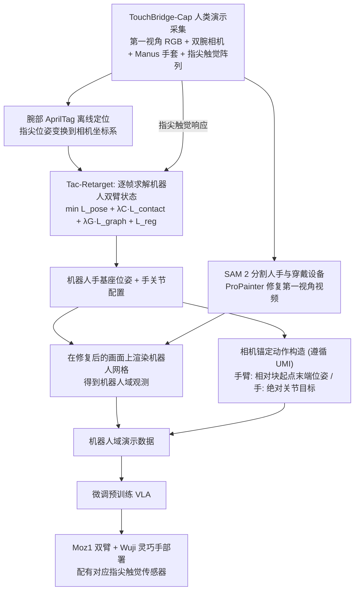

# TouchBridge：从人类交互中学习接触感知灵巧操作

**TouchBridge**（*TouchBridge: Learning Contact-Aware Dexterous Manipulation from Human Interaction*，[arXiv:2610.40349](https://arxiv.org/abs/2610.40349)）收录于 senlanke「具身运控lab」10-26–10-30 前沿论文动态（Manipulation）。本页依据**周报条目 + arXiv 摘要页**整理，流程图依据论文方法部分（见参考来源），未逐页核对实验数字；指标与结论以论文为准。

## 一句话定义

**TouchBridge：从人类交互中学习接触感知灵巧操作——研究将人类交互中的接触信息与机器人动作学习结合，使策略能够利用接触相关表示进行灵巧控制。**

## 英文缩写速查

| 缩写 | 英文全称 | 简要说明 |
|------|----------|----------|
| VLA | Vision-Language-Action | 视觉–语言–动作模型 |
| IL | Imitation Learning | 模仿学习 |

## 为什么重要

- 周报所述待解决的问题：人类操作示范能够提供动作信息，但机器人还需要学习接触发生的位置和方式，才能准确执行灵巧操作。

## 流程总览

图依据：论文 §III-A 人机视觉触觉系统、§III-B Tac-Retarget（式 1–6）、§III-C 数据转换管线、Fig.2–4

## 核心机制

| 项 | 内容 |
|----|------|
| **arXiv** | [2610.40349](https://arxiv.org/abs/2610.40349) · [PDF](https://arxiv.org/pdf/2610.40349) |
| **作者（arXiv）** | Zhang, Haozhe, Zhang, Gu, Zou, Zirui, Chen, Yuzheng, Wu, Jinlong, Hu, Zixuan, Zhang, Jianke, Hu, Yucheng et al. |
| **机构（周报所述，未逐条核实）** | 待核实（作者联合研究团队）。 |
| **arXiv 评论栏** | （无） |
| **开源** | arXiv 摘要页与评论未见代码或项目页链接（仅核对 arXiv 摘要页，不代表未发布）（2026-11-02） |
| **周报所述创新点** | 研究将人类交互中的接触信息与机器人动作学习结合，使策略能够利用接触相关表示进行灵巧控制。 |

### arXiv 摘要节选（英文原文）

> Human demonstrations offer an efficient and scalable source of data for dexterous robot manipulation, but differences in sensing and hand morphology complicate the transfer of contact-rich interactions. We present TouchBridge, a hardware--software co-designed framework for human-to-robot data transformation.

## 源码运行时序图

**不适用**：arXiv 摘要页与评论未见代码或项目页链接（仅核对 arXiv 摘要页，不代表未发布），无可对齐的官方代码流程。

## 实验与评测

- 周报与摘要给出的数字/场景已写入上表「创新点」与摘要节选；其余实验细节、基线与成功率定义请回到论文正文。
- 读法：先对齐任务设定、传感器与成功定义（仿真/真机），再解读 headline 数字，勿跨论文直接比较。

## 与其他工作对比

| 维度 | 读法 |
|------|------|
| **同周对照** | 见 [Manipulation周报技术地图](../overview/senlanke-weekly-2026-10-26-30-manipulation-technology-map.md)，按方向浏览同期论文 |
| **开源状态** | arXiv 摘要页与评论未见代码或项目页链接（仅核对 arXiv 摘要页，不代表未发布） |

## 结论

**TouchBridge：从人类交互中学习接触感知灵巧操作。**

1. 本页是入库级摘要，复现前请核对论文正文、附录与代码仓库。
2. 指标须连同实验条件解读。
3. 关注 arXiv 版本更新与代码发布。

## 关联页面

- [senlanke-weekly-2026-10-26-30-manipulation-technology-map](../overview/senlanke-weekly-2026-10-26-30-manipulation-technology-map.md)
- [manipulation](../tasks/manipulation.md)
- [vla](../methods/vla.md)

## 参考来源

- [touchbridge-contact-aware-dexterous-human-interaction_arxiv_2610_40349.md](../../sources/papers/touchbridge-contact-aware-dexterous-human-interaction_arxiv_2610_40349.md)
- [wechat_senlanke_weekly_manipulation_2026-10-26_30.md](../../sources/blogs/wechat_senlanke_weekly_manipulation_2026-10-26_30.md)
- [arXiv:2610.40349](https://arxiv.org/abs/2610.40349)
- [arXiv PDF](https://arxiv.org/pdf/2610.40349)：已通读方法部分（实验与附录以略读为准）：方法（§III-A 硬件、§III-B Tac-Retarget、§III-C 视觉合成与相机锚定动作）与实验设定概览（§IV-A）

## 推荐继续阅读

- [arXiv PDF](https://arxiv.org/pdf/2610.40349)
