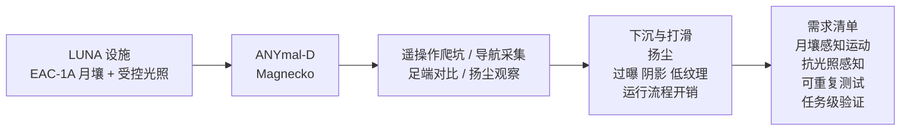

# Toward Lunar Legged Robots：LUNA 月面模拟场的部署教训

**Toward Lunar Legged Robots**（[arXiv:2610.12276](https://arxiv.org/abs/2610.12276)，Adrian Fuhrer、Marco Hutter 等，苏黎世联邦理工学院 Robotic Systems Lab）总结 2025 年在 ESA/DLR **LUNA** 月面模拟设施的实地战役：用 **ANYmal-D** 与自研 **Magnecko** 在月壤模拟物和陨石坑地形上行走、导航并采集视觉惯性数据，据此提出面向月面的运动、感知与验证需求。

## 一句话定义

**一份“把现成地面四足带到月壤模拟场会坏在哪”的经验报告：用两台四足的真实部署，把下沉/打滑、扬尘、极端光照和运行流程四类问题变成月面腿式机器人的设计与验证清单。**

## 英文缩写速查

| 缩写 | 英文全称 | 简要说明 |
|------|----------|----------|
| LUNA | Lunar Analogue facility (ESA/DLR) | 德国科隆 DLR 场地的室内月面模拟设施 |
| EAC-1A | ESA-Astronaut-Centre lunar simulant 1A | 场地所用月壤模拟物 |
| RL | Reinforcement Learning | Magnecko 步行策略的训练范式（PPO） |
| PACE | 执行器/关节动力学辨识的 sim-to-real 标定 | Magnecko 策略训练所用，见 [PACE 页](./paper-pace-sim2real-legged-robots.md) |
| TRL | Technology Readiness Level | 论文判断腿式月面机器人当前约为 4–5 |
| CONOPS | Concept of Operations | 任务级运行概念，需要验证 |
| HDR | High Dynamic Range | 对抗强眩光/阴影的曝光手段 |

## 为什么重要

- **腿式机器人的月面价值与证据缺口并存：** 腿能越过轮式月球车难以通过的陡峭、松软、多岩地形，但足–月壤接触、扬尘等长时实地数据此前很少。
- **揭示“地面策略直接上月壤”会失败的具体方式：** 训练中没有沉陷的 RL 策略在松软斜坡上吃力；ANYmal-D 的平地、地球重力策略同样没有为月壤优化。
- **把扬尘提升为运动约束：** 高牵引锯齿足扬尘更大，提示设计目标里需要把切向运动与冲击速度纳入奖励或约束。
- **给后续研究一个共同语言：** 需求清单覆盖运动、感知、测试与任务四层，可作为课题分解依据。

## 核心信息

| 项 | 内容 |
|----|------|
| **机构** | 苏黎世联邦理工学院（ETH Zürich）Robotic Systems Lab |
| **设施** | ESA/DLR LUNA，约 700 m² EAC-1A 场地，可用 19 m × 17 m，松土约 200 mm 深 |
| **平台** | ANYmal-D（BOXi 载荷，IP67）与 Magnecko（16 kg，3 DoF/腿，45 N·m 峰值扭矩） |
| **时间** | 2025 年战役，论文 2026-10-08 上线 |
| **开源** | **无**：页面与正文未列项目页、仓库或数据 |

## 核心原理

### 实验对象

| 机器人 | 控制 | 月面相关处理 |
|--------|------|--------------|
| Magnecko | IsaacLab 中 PPO 训练的速度跟踪策略，PACE 标定；仿真为刚性库仑摩擦 | 遥操作；恒力弹簧卷盘 + 重力补偿前馈近似降低法向载荷；防尘罩 |
| ANYmal-D | 厂商自带平地策略 | 11 次 20–100 m 导航/数据采集任务；相机高 70 cm；全站仪真值 |

### 流程总览

## 方法

这是一篇部署经验论文，没有算法模块；关键设计在“怎样把问题测出来”：

- **运动：** Magnecko 在遥操作与重力卸载下走过较大陨石坑与自身尺度的小坑；记录下沉、滑移与指令调整（t = 13 s 改指令脱困）。
- **足端：** 标准球足 65 mm、大球足 75 mm、锯齿高牵引足 95 mm，在整平后的月壤上做定性对比。
- **感知：** ANYmal-D 在不同光照下采集视觉惯性与导航数据，记录失败工况。
- **运行：** 记录遮罩、通信、安全、地形准备与散热等流程性问题。

## 实验与评测

论文没有大规模定量表，主要结果为观察：

- **下沉与打滑：** 足端下沉到坑沿、后腿打滑，小坑内侧腿牵引不足；训练时无沉陷的策略在松软斜坡上吃力。
- **足端对比：** 三种足端无明确性能差异（定性），压实程度变化影响更大。
- **扬尘：** 拖足与踩踏冲击都会扬尘，高牵引足云团更大。
- **感知失效：** 面向光源过曝、阴影、低纹理区域、视野内扬尘、快速运动的模糊、算力限制导致帧率下降；其余时间总体稳定。
- **运行：** 设施墙面需视觉遮罩；WiFi 时有不稳；手工整平影响可重复性；Magnecko 的罩子限制散热，ANYmal-D 关节也有相关问题。
- **可核对数字：** ANYmal-D 速度 0.2–0.6 m/s，11 次任务各 20–100 m；设施 700 m²、19 m × 17 m、约 200 mm 松土；照明 5600–5900 K、强度 90–100%。

## 源码运行时序图

**不适用**：论文为部署经验报告，没有发布代码、策略或数据，截至 2026-10-12 页面无项目页或仓库链接。

## 工程实践

- **运动：** 在仿真里加入沉陷、滑移、拖曳模型（颗粒介质或等效），并把扬尘作为约束/奖励；Magnecko 的仿真只有刚性库仑摩擦，是论文点名的缺口。
- **感知：** 光照感知曝光与快门控制、HDR、超越 RGB 的传感融合；检测视觉不可靠后切换保守定位。
- **测试流程：** 标准化地形整备、通信与遮罩；散热预算要把防尘罩算进去。
- **开源状态：** 无代码、无数据；若要复现需要 ANYmal-D 或类似平台与月壤模拟场。

## 结论

**腿式机器人走月壤的短板已经不是“能不能走”，而是接触建模、扬尘和曝光鲁棒性这些尚未被地面策略覆盖的问题；论文给出的价值是一份可分解的需求清单。**

1. **训练要含沉陷：** 没有沉陷的 RL 策略在松软斜坡上吃力，这是仿真改进的第一优先项。
2. **足型不是主要杠杆：** 三种足端无明确差异，压实程度影响更大，别过早在足型上投入。
3. **扬尘进指标：** 把切向运动与冲击速度纳入奖励或约束。
4. **感知要能退化：** 过曝、阴影、低纹理和扬尘需要显式检测并降级。
5. **验证要联合：** 论文指出没有单一地面设施能完全复现月面，需要热真空、尘箱、重力卸载和室外试验联合。
6. **成熟度判断：** 当前约 TRL 4–5，需要专为月面设计的机器人。

## 与其他工作对比

| 对照 | 差异读法 |
|------|----------|
| [地形感知自主行星探索](./paper-terrain-aware-autonomous-planetary-exploration.md) | 侧重规划/探索；本文提供腿式平台的实地接触与感知失效证据 |
| [PACE sim2real 标定](./paper-pace-sim2real-legged-robots.md) | Magnecko 策略所用的标定方法；本文显示标定后仍缺颗粒介质建模 |
| [ANYmal](../entities/anymal.md) | 本文把其商用平台带入月壤场，说明地面策略的外推边界 |
| [Walking on Roofs](./paper-walking-on-roofs-quadruped-go2.md) | 同周另一份“商用四足遇到非常规地面”的实测，侧重屋顶坡度与摩擦 |

## 局限与风险

- **适用边界：** EAC-1A 在地球重力与大气下，缺少静电带电；重力卸载只是一阶近似且受系绳约束。
- **证据强度：** 足端比较为定性；扬尘与感知结论来自单次战役，可重复性有限；机器人均非为行星环境设计。
- **开源：** 无代码或数据。
- **推测：** 将结论外推到真实月面需另行验证。

## 关联页面

- [人形/四足前沿周报 2026-10-05~10-09](../overview/frontier-humanoid-quadruped-2026-10-05-10-09.md)
- [运动控制任务页](../tasks/locomotion.md)
- [ANYmal](../entities/anymal.md)
- [Sim2Real](../concepts/sim2real.md)
- [地形适应](../concepts/terrain-adaptation.md)

## 参考来源

- [Toward Lunar Legged Robots 论文归档](../../sources/papers/toward_lunar_legged_robots_arxiv_2610_12276.md)
- [人形/四足周报来源](../../sources/blogs/frontier_humanoid_quadruped_2026_10_05_10_09.md)

## 推荐继续阅读

- [arXiv HTML 全文](https://arxiv.org/html/2610.12276v1)
- [ESA LUNA 设施介绍](https://www.esa.int/Science_Exploration/Human_and_Robotic_Exploration/Exploration/LUNA)
