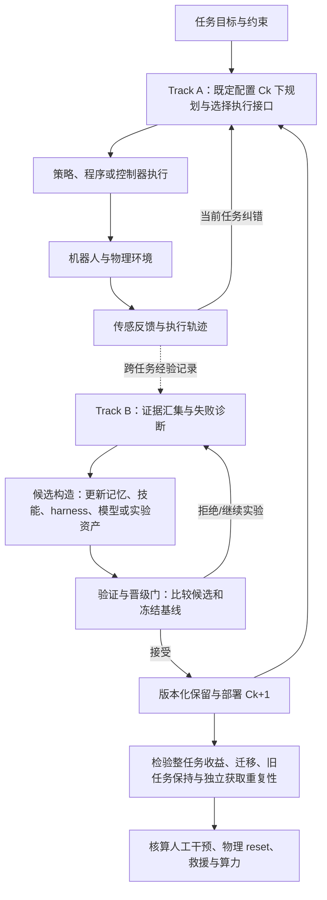

# Toward Self-Improving Robotic Agents：迈向自我改进机器人智能体

**英文副标题：** From Interaction Experience to Reusable Manipulation Capabilities  
**中文副标题：** 从交互经验到可复用操作能力

## 一句话定义

**这是一篇机制导向综述，回答机器人如何将真实或仿真的交互经历转化成后续可复用的操作能力，并用可审计的实验链条区分「执行成功」「能力保留」「测得改进」与「可重复自主改进」。**

## 英文缩写速查

| 缩写 | 英文全称 | 简要说明 |
|---|---|---|
| VLA | Vision-Language-Action | 视觉语言动作模型，可作为底层 actor |
| RSI | Recursive Self-Improvement | 自我改进及进一步改进其获取机制的研究语境 |
| LLM | Large Language Model | 可在高层决策、生成程序与诊断环节使用 |
| API | Application Programming Interface | 程序化操作和工具接口，连接策略与执行器 |
| IK | Inverse Kinematics | 将空间目标转化为关节运动的一类求解过程 |

## 为什么重要

- **复用不是自动学习的同义词。** 修好一次失败抓取，只有保存可再次调用的技能、规则或模型更新，才构成跨次能力获取证据。
- **策略权重并非唯一更新对象。** 冻结底层 actor 时，记忆、工具、可执行脚本、harness 的改动也可能改善操作；应先定位瓶颈再决定修改层级。
- **局部成功无法保证整个任务成功。** 技能交接需要满足物理状态、进入条件、接触和重置约束。
- 本文是 **2026-10-30 发布的未同行评审综述预印本**，不是已经实现 L5 的新机器人系统。原文 DOI：[10.20944/preprints202610.3088.v1](https://doi.org/10.20944/preprints202610.3088.v1)。

## 核心原理

### 两条不同时间尺度的轨道

1. **Track A（执行）：** 在既定配置 `C_k` 下，目标与视觉/状态观测经决策接口驱动策略、控制器与机器人；传感器反馈提供当前 episode 内的修正，临时信念不是永久技能。
2. **Track B（获取）：** 把跨次轨迹、示教、纠错和评测证据用于诊断、构造候选更新、验证接受或拒绝、保留新配置与实验资产。

论文 §2 的配置元组：`C_k = (θ_k, H_k, M_k, S_k, T_k, E_k)`。分别是神经参数、执行编排 harness、陈述性记忆、技能/程序、工具契约和实验/训练资产。前五类直接塑造执行，第六类通过后续训练和验证发挥作用。

**五类决策接口**（§3）：集成推理-动作、技能/策略调用、程序化编排、空间目标和约束、增量运动指令；**五类更新靶点**（§4）：记忆知识、程序技能、harness/工具、神经参数、实验资产。它们是正交分类，不应误认为一一对应。

### 原文机制流程总览

这是根据论文图 1–2 和 §5 的**分析性生命周期**绘制，不声称作者提供了可执行的单一机器人系统。

## 源码运行时序图

**不适用。** 本文是对 **162 项研究**的证据审计，未查得该综述专属、可运行的软件入口。用户提供的项目页目前无法读取；没有源码入口与模块调用证据，不能用通用 `sequenceDiagram` 冒充源码分析。第三方论文的代码也不能视为本综述自己的实现。

## 工程实践

| 实践问题 | 建议核查内容 |
|---|---|
| 改进目标定位 | 明确失败来自语义决策、空间约束、执行程序、神经 actor、感知或 verifier |
| 版本化 | 保存 artifact 的输入经验、更新靶点、构造过程、验证门和后续调用证据 |
| 评估隔离 | 固定 actor、工具、重试与人工帮助；将候选筛选与最终测试数据隔离 |
| 复用验证 | 检查技能前置/终止状态、长程接续、旧任务保持及分布变化 |
| 真机成本 | 分别记示教、准备、工程、标注、reset、rescue、评测的人时与物理消耗 |
| 代码与数据 | 开源状态待项目页进一步核验；此综述不等同于独立已开源算法 |

## 实验与评测

作者按统一 ledger 编码 **162 篇**机器人操作原始研究（并非新方法在统一 benchmark 上的 162 次实验），最高证据等级分布（论文表 4）：

| 等级 | 需要证明的最强事实 | 篇数 |
|---|---|---:|
| L1 | agent 执行已有能力 | 9 |
| L2 | 构造了候选能力 artifact | 18 |
| L3 | artifact 保留并在之后调用 | 70 |
| L4 | 与冻结基线比较有操作增益、声明了评测隔离 | 65 |
| L5 | 独立获取历史、受保护评测、迁移、旧任务保持及低人工依赖/完整物理成本核算同时成立 | 0 |

- **正向例子：** Conquer 在仿真中进行 3 次独立 14 任务获取；最终 **95.6±0.6%** 对比 Scratch **89.2±0.6%**，报告迁移与旧任务保持，但不构成独立重复真机自改进证据（§6.5）。
- **局部/整任务脱节：** 论文讨论的 RSI 冰箱补货案例持续生成可复用局部技能，整任务 rollout 仍为 **0% 成功**（§4.6、6.4）。
- **可能的退化：** ENCORE 的 plate 扰动条件从 **50/50** 退化到 **0/50**（表 7），说明总体均值掩盖某些场景中的灾难性失败；不能外推为所有任务都退化。
- **分级解释：** L5=0 是**本综述联合条件下**未找到完整证据链，并不是对其他体系「L5」名称或所有自改进潜力作统一否定。

## 结论

**最重要的贡献是把“经验如何改变下一次物理执行”变成有版本、有基线、有成本的可核验因果链，而不是宣称机器人已经自主迭代出通用操作能力。**

1. **先定位更新层。** 记忆、程序、harness、模型参数和实验资产可各自成为改进对象。
2. **先测后保留。** 候选通过局部检验不等于整任务链可成功，必须检查技能衔接状态。
3. **隔离最终测试。** 比较冻结版本，防止开发筛选指标充当最终改进证据。
4. **重测旧任务。** 只增加新技能或平均成功率，不代表已有能力未被破坏。
5. **重复的是获取流程。** 同一 artifact 多次执行不能代替从独立初始条件重新获取能力。
6. **把人工和 reset 记账。** 真机脱离人员干预的结论必须有示教、工程、救援、重置等费用/工时记录。

## 与其他工作对比

- [RSI 概念](../concepts/recursive-self-improvement.md)：该页既包含完全后继模型级 RSI 的定义，也收录能力增量 L1–L4；**本文 L1–L5 是经验验证强度**，不能机械映射。
- [RoboGene](./paper-robogene.md)：改进操作训练的**任务规格与数据覆盖**；其人类遥操作采集不意味着完成本文的低人工依赖 L5 条件。
- [RoboDoctor](./paper-robodoctor.md)：关注冻结策略周围的 agent/执行系统改进；可用本文的 `H/S/M` 更新靶点与固定 actor 对照方法审视其证据边界。

## 局限与风险

- **预印本、非同行评审。** 作者目的性选择 162 项研究，结论受样本范围、论文报告完整度与编码标准影响。
- **本文 L5 有额外的人工与物理成本门槛。** 仿真中已展示部分重复获取、迁移和保留的联合证据；未披露成本不等于已证明存在高人工干预。
- **真机不可用软件回滚替代 reset。** 物体移动、碰撞和救援有真实成本；不能只算训练 token/算力。
- **源码和站点未闭环核验。** 论文 PDF 可读，用户提供的项目站点抓取失败，不能认定其项目归属、开源数据或实际运行入口。

## 关联页面

- [递归自改进（不同分级的适用边界）](../concepts/recursive-self-improvement.md)
- [机器人操作任务](../tasks/manipulation.md)
- [RoboGene：任务智能体生成](./paper-robogene.md)
- [RoboDoctor：训练免费机器人策略改进](./paper-robodoctor.md)

## 参考来源

- [论文 v1 全文通读归档](../../sources/papers/toward_self_improving_robotic_agents_preprints_202610_3088.md)
- [项目入口与开源状态核验](../../sources/sites/self-improving-robotic-agents-project.md)

## 推荐继续阅读

- [Preprints.org 官方全文（2026-10-30）](https://www.preprints.org/manuscript/202610.3088)
- [原始 PDF（49 页，含完整参考文献）](https://www.preprints.org/frontend/manuscript/99bb554a84175a69f18cf5e492b737db/download_pub)
