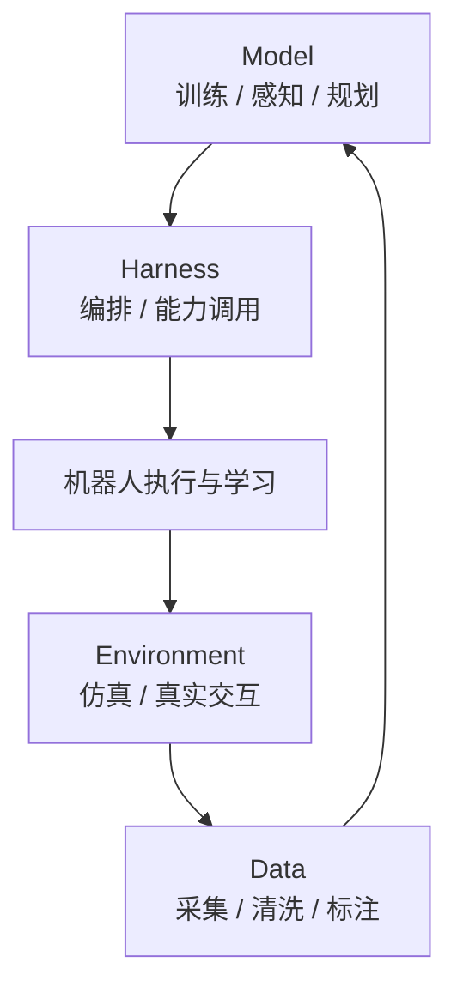

# Towards Agentic Robots：模型、数据、环境与编排的综述

**一句话定义：** 一篇综述，把基础模型驱动的机器人执行从任务专用策略扩展到"代理式"协同，并按模型、数据、环境与编排（harness）四个领域组织相关文献。

## 英文缩写速查

| 缩写 | 英文全称 | 简要说明 |
|------|----------|----------|
| VLA | Vision-Language-Action | 综述中 Model 域的核心策略范式之一 |
| WM | World Model | 综述中用于预测与规划的环境模型，与 VLA 并列讨论 |
| WAM | World-Action Model | 同时建模世界演化与动作的模型，综述将其归入模型类别 |

## 为什么重要

- 机器人研究正从"单个策略"转向包含数据采集、训练、规划与执行编排的整体系统，需要统一的地图。
- 四域分类把模型、数据、环境与编排放在同一框架下，便于定位一篇具体工作处于哪个环节。
- 配套文献索引仓库可作为持续跟踪的入口。

## 核心信息

| 项目 | 内容 |
|------|------|
| 论文 | Towards Agentic Robots: Model, Data, Environment, and Harness |
| arXiv | 2610.20442（v1，2026-10-14） |
| 作者 | Chonghan Qin、Dongming Wu、Kaituo Feng 等 16 人（含 Dahua Lin、Yu-Gang Jiang、Xiangyu Yue） |
| 机构 | 未核实（arXiv 摘要页未列出） |
| 数据 / 平台 | 文献综述；无实验数据集 |
| 开源 status | **不适用**（综述，无方法代码）；配套 Awesome 文献索引仓库公开可读（2026-10-15 核查） |
| 来源 | [sources/papers/towards_agentic_robots_arxiv_2610_20442.md](../../sources/papers/towards_agentic_robots_arxiv_2610_20442.md) |

## 核心原理

综述的组织方式是四个功能域加一张交叉关系图：Model 负责决策（训练、感知、规划），Data 负责数据采集与清洗，Environment 负责仿真与真实环境交互，Harness 负责把各能力编排成可执行的机器人系统。十七个类别可以跨域归属。

## 工程实践

- **阅读路径：** 先按 Model 与 Harness 理解系统结构，再进入 Data 与 Environment 查看支撑条件。
- **检索路径：** 使用配套仓库的 `data/papers.yaml` 按类别查找条目（仓库含校验与 README 生成脚本）。
- **映射本库：** 综述中的 VLA、世界模型与世界-动作模型可对应本库的 [VLA](../methods/vla.md)、[世界-动作模型](../concepts/world-action-models.md) 与 [生成式世界模型](../methods/generative-world-models.md) 页面。
- **源码运行时序图：** **不适用**（综述论文，无可运行的方法代码）。

## 实验与评测

- 综述不包含新的实验；评测部分以文献梳理为主，具体指标与基准需回到各被引工作阅读。
- 摘要称讨论了开放挑战与未来方向，具体条目未在摘要中展开，本页未逐条核实。

## 结论

**一句话总判：这篇综述的价值在于给出了"代理式机器人"的分域地图，而不是提供新的方法结论。**

1. **四域分类是主要贡献** — Model / Data / Environment / Harness 让一项工作可以被放进系统语境中定位。
2. **编排层被单列** — Harness 把能力调用与执行组织显式化，是区别于单纯策略的关键点。
3. **类别可交叉** — 十七个类别非互斥，读者应按问题选择入口，而不是只读单一域。
4. **适合作为阅读起点** — 对需要建立全局图景的读者比逐篇论文更省时间。
5. **需回到原始工作核对细节** — 综述结论的具体数字与基准应在被引论文中核实。

## 与其他工作对比

- 与 [VLA](../methods/vla.md) 等单一范式综述相比，本文把 VLA、世界模型与编排放在同一框架下讨论。
- 与 [机器人三层控制架构](../concepts/embodied-three-layer-control-architecture.md) 相比，本文把"编排"与"数据、环境"也纳入系统范围，覆盖面更宽但不再限于控制层级。
- 与本库的数据飞轮相关页面（见 [数据飞轮](../concepts/data-flywheel.md)）相比，本文把数据视为与模型并列的一个域，而非闭环中的单一环节。

## 局限与风险

- **综述视角：** 分类是作者的组织方式，类别边界会因读者视角而变化。
- **时效性：** 综述发表于 2026-10，领域变化快，具体工作列表可能很快过时。
- **未做实验验证：** 本页记录的是分类框架，不代表任何方法已被验证。
- **配套仓库：** 文献索引依赖作者维护，条目完整性与准确性需逐条核对。

## 关联页面

- [VLA](../methods/vla.md) — 综述 Model 域的核心范式
- [世界-动作模型](../concepts/world-action-models.md) — 综述中的交叉类别
- [生成式世界模型](../methods/generative-world-models.md) — 综述中的环境模型一脉
- [数据飞轮](../concepts/data-flywheel.md) — Data 域相关的闭环思路

## 参考来源

- [Towards Agentic Robots 来源归档](../../sources/papers/towards_agentic_robots_arxiv_2610_20442.md)
- 微信「具身站 31 篇论文」摘要：[sources/raw/wechat_embodied_station_robot_31_papers_2026-10-15.md](../../sources/raw/wechat_embodied_station_robot_31_papers_2026-10-15.md)

## 推荐继续阅读

- [arXiv:2610.20442 — Towards Agentic Robots](https://arxiv.org/abs/2610.20442)
- [配套文献索引 Awesome-Agentic-Robots](https://github.com/chonghanqin/Awesome-Agentic-Robots)
