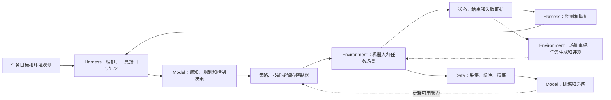

# Towards Agentic Robots：迈向智能体机器人——模型、数据、环境与编排

**英文论文：** *Towards Agentic Robots: Model, Data, Environment, and Harness*，Chonghan Qin 等，arXiv:2610.20442v1（2026-10-14）。

## 一句话定义

一篇机器人智能体综述，以 Model、Data、Environment、Harness 四域、17 个非互斥类别刻画自主规划、执行协调、数据积累和反馈改进；不是一套新训练算法或机器人产品。

## 英文缩写速查

| 缩写 | 英文全称 | 简要说明 |
|---|---|---|
| VLA | Vision-Language-Action | 视觉与语言条件驱动的机器人动作策略 |
| WM | World Model | 预测状态/观测演化，支持想象和规划 |
| WAM | World-Action Model | 结合世界演化与动作生成的模型 |
| LLM | Large Language Model | 可担任高层规划、决策与工具调用的基础模型 |
| VLM | Vision-Language Model | 从视觉与语言证据中获得任务相关信息 |

## 为什么重要

- 长时程任务不能只看一次动作预测：要选择技能、核验完成、响应环境变化并从失败恢复。
- 四域分类关注智能体**控制和改进了什么对象**，一个研究项目可同时落在多个类别。
- Harness 被单独列为系统领域，提醒工程师区分高层推理、可调用执行器和具有实时约束的底层控制。

## 核心信息

| 项目 | 内容 |
|---|---|
| 论文 | [arXiv:2610.20442v1](https://arxiv.org/abs/2610.20442v1)，2026-10-14 |
| 作者 | Chonghan Qin、Dongming Wu、Kaituo Feng 等 16 人 |
| 机构 | 论文首页列 MMLab / 香港中文大学、复旦大学、NovaXBot、清华大学、浙江大学、中山大学（非逐人对应） |
| 图表 | v1 PDF Figure 1、Figure 2、Figure 7 及第 10 页 Table 1 |
| 研究类型 | 文献综述，未提出统一的新机器人实验或控制网络 |
| 代码开放 | 论文无专属可运行训练/推理代码；[官方 Awesome 文献索引](../../sources/repos/awesome-agentic-robots-survey-index.md) 公开 |
| 核读状态 | 已通读 arXiv v1 HTML 正文 §1–§9，核对四域 17 类、正文表格和主要图注；TeX 原包与全部被引论文未单独审计，不影响本综述正文的通读状态 |

## 核心原理

### 定义和边界（§2–3）

作者定义的 Agentic Robots 是：智能体根据任务目标、环境观察和执行反馈，自主规划并协调动作、技能或工具；执行时继续监测进展，在必要时增加观察、改计划或纠正失败。这一范围涵盖真实机器人和仿真。它**不意味着完全不需要人类指导**，也不意味着传统自主机器人原本没有规划、监测和学习能力。

Figure 1 将任务专用策略、VLA、WM/WAM、Agentic Robots 放在演进脉络中，作者明确这些能力能在单个系统中重叠和协同，而不是后一范式取代前一范式。相对具身 AI，本文强调如何组织能力；相对机器人基础模型，强调已有能力如何参与持续执行流程。

### Table 1：四域十七个非互斥类别（PDF v1 第 10 页）

| 领域 | 类别 | 原文定义的中文归纳 |
|---|---|---|
| **Model** | Training（训练） | 设计/修订奖励、目标、训练配方和学习实验 |
| | Perception（感知） | 理解任务相关概念、关系、几何、信念，并判断是否需要更多证据 |
| | Planning（规划） | 随任务进展选择/修订子目标、动作序列、依赖、方案 |
| | Robot Control（机器人控制） | 将选定操作转为动作、姿态、程序或运动约束 |
| | Adaptation（适应） | 利用经验更新参数、任务条件或决策规则 |
| **Data** | Collection（采集） | 获取或生成新机器人经验 |
| | Annotation（标注） | 加入文本、空间、交互目标、执行结果等结构化监督 |
| | Refinement（精炼） | 筛选有效记录/片段并修正不可靠的监督 |
| **Environment** | Reconstruction（重建） | 构建/修订可执行场景、资产、几何和物性 |
| | Task Generation（任务生成） | 定义/生成目标、约束、课程和任务分布 |
| | Benchmarking（评测） | 构造测试、扰动、指标、评估器、评测流程 |
| **Harness** | Orchestration（编排） | 选择模型/策略/技能/工具，并管理调用与交接 |
| | Memory（记忆） | 存储、更新并检索历史或知识 |
| | Monitoring and Recovery（监测与恢复） | 判断进展、成功、失败、约束并组织纠错 |
| | Skills（技能） | 产生、验证、保留、修订或淘汰可复用行为 |
| | Infrastructure（基础设施） | 用接口、服务、运行时检查提供与门控策略/工具 |
| | Layered Systems（分层系统） | 分配规划、学习策略与解析控制间的信息、权限、运行频率 |

类别不是互斥产品标签：论文用 Zero2Skill（Data ↔ Model）、HarnessVLA（编排/记忆/恢复）和 ENPIRE（实验管理和训练改进）说明跨域、跨类别贡献。

### 流程总览（按 Figure 2、Figure 7 和 §4–7 重绘）

这是依据论文**功能关系**整理的系统示意，不是原论文提供的统一算法或端到端训练流程，也不暗示上述角色都由同一模型实现。

## 工程实践

以抽屉取物任务为例（论文 Figure 4）：

1. **感知/规划：** 确认把手、目标物与依赖；看不清先收集证据，计划不合适则重新规划。
2. **控制：** 选择原语、目标位姿或优化约束；逆运动学、避障、轨迹控制由符合时限的执行器承担。
3. **编排/交接：** 给技能定义参数、前置条件、完成判据、错误类型和下一技能的起始状态；防止上一个动作未结束便盲目接续。
4. **监测/恢复：** 失败后辨明是观测不足、计划错误、运动不可行还是策略能力不足，分别重观测、改计划、换执行器或积累训练数据。
5. **数据/环境：** 记录成功/失败并改标注；分别验证仿真场景物理可行性、任务定义、评估器可靠性，避免只看图像相似。

**源码运行时序图：不适用。** 这是文献综述，配套仓库为数据清单与 README 生成/校验脚本，而不是本论文的训练、推理或真机部署实现；因此不伪造运行时序。

## 源码与工程接口的边界

论文 §7.1–7.6 把工具路由、跨执行器状态交接、历史更新、监测恢复、技能复用和实时推理服务都归入 Harness 的系统职责。特别是 §7.6 的 **System 2（任务推理）→ System 1（学习策略）→ System 0（解析控制）** 是对已有分层方案的总结，而非可直接安装运行的单一三层软件包。高层输出须有明确类型、有效期、完成条件；底层保持执行反馈与安全门控。

## 实验与评测

- 论文 §4–7 比较的是**不同被引项目**的模型、任务、动作输出、技能交接等，不是作者在同一个 benchmark 上新跑的对照实验。
- §8.1 指出相同任务成功率可能出于更强的底层 VLA 或 agent 的额外观察、工具调用、重试。要归因智能体增益，应固定执行器、工具/观察范围、交互预算，并做 memory、replanning、recovery 消融。
- 应报告端到端执行时间、额外观测、推理/计算成本、人工帮助、异常恢复与跨任务泛化；真机还应检查指令可达性、状态新鲜度和执行完成判据。
- §8 的四个开放方向：**Fair Benchmarking、Real-robot Agentic Robotics、Efficient Robot Use、Cross-Embodiment Generalization**；不是本文已验证的实验收益。

## 结论

**总判：本文提供一张从单个策略到具身系统的决策/执行组织地图，而不是证明新的策略或架构在真机上必然占优。**

1. **按决策对象分类**：判断一项工作改的是训练、数据、环境还是运行时编排；允许多类别。
2. **动作生成与任务完成要分别验收**：VLA 能输出动作不自动等于长程可靠执行。
3. **高层 agent 和实时控制分工**：工具选择/重试由编排层管理，执行器负责物理与实时约束。
4. **成功率必须带预算**：工具、观测、重试和时间成本不同就不能直接比较 agent 的能力。
5. **动态资源与静态论文分开**：Awesome 适合继续检索，但 2026-10-14 的论点须回到 v1。

## 与其他工作对比

- [VLA](../methods/vla.md) 与 [WAM](../concepts/world-action-models.md) 属于可用的模型能力；Agentic Robotics 着重它们如何在任务中被选择和组合。
- [机器人三层控制架构](../concepts/embodied-three-layer-control-architecture.md) 强调控制频率分工；Harness 的 Layered Systems 进一步讨论信息与权限边界。
- [数据飞轮](../concepts/data-flywheel.md) 关注经验回流；本文把数据、场景和评测构建也分为独立功能域。
- [行为树 VLA 编排](../concepts/behavior-tree-vla-orchestration.md) 是一类工程实现，不能等同于本文覆盖更广的 Harness 概念。

## 局限与风险

- **概念框架：** 17 类是作者的研究组织法，不是互斥的系统架构标准。
- **实验证据：** 不同项目的基座、机器人、任务、工具和重试预算不统一；本综述并未验证「四域组合必更强」。
- **物理安全：** 模型可能请求不可达动作或使用过期状态；独立执行检查、安全门控、恢复与人工接管仍必要。
- **版本：** 本页锁定论文 v1；[配套文献索引](../../sources/repos/awesome-agentic-robots-survey-index.md) 是动态材料。
- **核读边界：** [来源归档](../../sources/papers/towards_agentic_robots_arxiv_2610_20442.md) 已记录 v1 HTML 正文 §1–§9 的通读范围；TeX 原包未能解包，所有被引研究未逐篇独立审计。`complete` 表示本综述节点内容与正文核对完成，不代表作者引用的每个项目均经复现实验。

## 分批补全的独立详情节点

- [PAFF](paper-paff-2212-07398.md)：基础模型反馈重标注与策略适应；对应 Model / Adaptation。

## 关联页面

- [VLA](../methods/vla.md)
- [世界–动作模型](../concepts/world-action-models.md)
- [生成式世界模型](../methods/generative-world-models.md)
- [数据飞轮](../concepts/data-flywheel.md)
- [机器人三层控制架构](../concepts/embodied-three-layer-control-architecture.md)
- [VLA 纵深 Stage 4](../../roadmap/depth-vla.md)

## 参考来源

- [论文 v1 来源归档](../../sources/papers/towards_agentic_robots_arxiv_2610_20442.md)
- [官方 Awesome 动态文献索引归档](../../sources/repos/awesome-agentic-robots-survey-index.md)

## 推荐继续阅读

- [HTML 正文 v1](https://arxiv.org/html/2610.20442v1) · [PDF v1](https://arxiv.org/pdf/2610.20442v1) · [TeX 源包 v1](https://arxiv.org/e-print/2610.20442v1)
- [作者维护的 Awesome-Agentic-Robots（动态资源）](https://github.com/chonghanqin/Awesome-Agentic-Robots)
