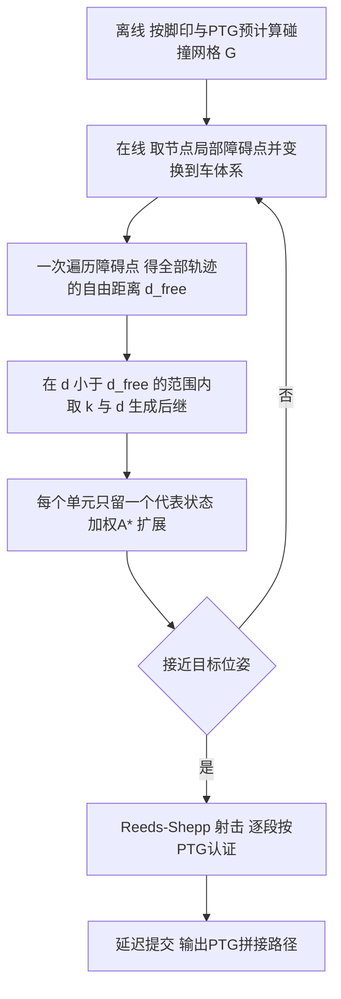

# TPS-A*：任意形状车辆的认证碰撞检查规划（arXiv:2611.09210）

**TPS-A***（*TPS-A\*: Path Planning for Any-Shape Vehicles with Certified Collision Checking in Trajectory Parameter Space*，[arXiv:2611.09210](https://arxiv.org/abs/2611.09210)，v1 2026-11-06）来自阿尔梅里亚大学 Blanco-Claraco 等。收录于「具身智能小站」2026-11-10 更新。注意：这是**经典搜索式规划**论文，不含强化学习或学习组件。

## 一句话定义

**一个确定性的 SE(2) 格点加权 A* 规划器：边是参数化轨迹生成器（PTG）给出的运动学可行轨迹，碰撞检查在轨迹参数空间用「按脚印预计算、经证明不高估自由距离」的网格完成，单节点成本与脚印复杂度、分支数无关。**

## 英文缩写速查

| 缩写 | 英文全称 | 简要说明 |
|------|----------|----------|
| TPS / TP-Space | Trajectory Parameter Space | 以（轨迹编号 k，行进距离 d）为坐标的空间，车辆在其中是自由飞行的点（第 III 节） |
| PTG | Parameterized Trajectory Generator | 一族从车体原点出发、按构造满足运动学与速度界的轨迹（第 III 节） |
| C-PTG | Circular-arc PTG | 恒定曲率圆弧族，前进/倒车（第 III 节） |
| SE(2) | Special Euclidean group in 2D | 平面位置加航向 |
| A* / 加权 A* | A-star / weighted A-star | 启发式搜索；f=g+εh，本文 ε=1.5（第 V-C 节） |
| RS | Reeds-Shepp | 可前进倒车的最短曲线；用作启发式与「射击」（第 V 节） |
| BARN | Benchmark Autonomous Robot Navigation | 300 个 30×30 杂乱世界的数据集（第 VII-C 节） |
| SBPL | Search-Based Planning Library | 状态格点 ARA* 基线（第 II 节） |
| Nav2 / Smac | Navigation2 / Smac Planner | ROS 2 导航栈及其 Hybrid-A* 规划器基线 |
| OMPL / FCL | Open Motion Planning Library / Flexible Collision Library | 采样规划库与碰撞库基线 |
| TPCAP | Trajectory Planning for automated parking benchmark | 自动泊车基准（第 VII-E 节） |

## 为什么重要

- 对长条形、非凸的移动机器人，圆形近似二选一：外接圆拒掉本可通过的门，内切圆产生真实身体走不过去的路径（第 I 节）。论文在 HouseExpo 窄门上测得：外接圆 Nav2 只解 20/40，内切圆解 40/40 但 4 条与真实脚印扫掠碰撞（第 VII-D 节）。
- 逐位姿的精确多边形检查成本随脚印顶点数、后继数增长；TPS-A* 把成本改为随局部障碍点数线性（命题 1）。
- 安全性可证明：定理 1/2 保证返回路径在连续运动中不与给定障碍相交，并有独立精确检验作佐证（作者自述）。
- 对机器人 RL 读者：它是 RL 导航策略常拿来对照的「全局规划 + 精确脚印」基线，也展示了 Nav2 默认 Hybrid-A* 在 BARN 上有 45% 路径与占据格重叠（表 III）。

## 核心原理

1. **认证网格（第 IV-A、C 节）：** 对每个单元 c、轨迹 k，G[c][k] 为使脚印与该单元距离不超过 r_{k,n}+m 的最小采样距离 d_n（式 2），其中 r 为相邻采样间脚印任意点的位移上界（式 1）。定理 1：G 不超过真实首次接触距离，因此长度小于 d_free 的边在整个连续运动中障碍保持在 m 之外。
2. **在线查询（式 3，算法 1）：** d_free(k)=min_j G[cell(p_j)][k]，一次遍历所有障碍点得到全部 K 条轨迹。命题 1：成本 O(N·L̄)，与顶点数 V 无关（V 只影响离线构建）。
3. **搜索（第 V 节，算法 2）：** (x,y,θ) 单元内保留一个连续代表状态（同 Hybrid-A*）；边代价为执行时间；位置目标用欧氏距离启发式，位姿目标用 Reeds-Shepp 长度启发式（可采纳且一致）；目标落入格点的最便宜边先作候选，待其代价不超过开放集最小 f 才提交。
4. **保证（第 VI 节）：** 路径无碰撞且运动学可行（定理 2）；C ≤ ε(C*_G+δ)（命题 2），相对格点抽象 G 而非原问题；**不是**严格分辨率完备（单元代表使 G 依赖扩展顺序）。
5. **区域障碍（推论 1）：** 把占据区域边界按间距 2ρ 采样成点，网格用 m≥ρ 构建，则认证对整个占据方块成立；BARN 用 0.05 m 间隔（ρ=0.025 m）（第 VII-A 节）。

## 实验与评测结果（均为论文自述，规划耗时不含感知与控制，第 VII-A 节）

| 设置 | 结果 | 出处 |
|------|------|------|
| 单节点碰撞成本，B 从 5 到 121 | 批量查询 3.1-3.5 μs，对 B、V 平坦；FCL 0.29-10.2 ms，Nav2 栅格检查 0.23-10.7 ms；B=20、64 顶点时约快 440 倍和 500 倍 | 第 VII-B 节，图 1 |
| BARN 共享目标位姿，最多 277 个可解 | TPS-A*、SBPL 均解 277 并全部验证；TPS-A* 中位 2.9 ms，SBPL 169 ms，Nav2 5.4 ms（正文 5.1 ms） | 第 VII-C 节，表 III |
| 同上，Nav2 Hybrid-A* | 300 个全返回路径，45% 与占据格重叠，54.7% 通过验证 | 同上 |
| BARN 位置目标 | TPS-A* 300/300 全验证，中位 1.9 ms；Nav2（Kilted）中位 170 ms、57.3% 验证 | 同上 |
| 窄门 HouseExpo 40 例 | TPS-A* 与带膨胀层的精确多边形 Nav2 均 40/40；中位 1.9 vs 4.8 ms | 第 VII-D 节 |
| TPCAP 泊车 20 例 | 各解 19；时间、长度无统计差异；Nav2 默认有 9 条重叠 | 第 VII-E 节，表 IV |
| 叉形非凸脚印 20 例 | 均全解；Nav2 中位 0.10 s 比 0.26 s 快；Nav2 有 7 条重叠 | 第 VII-F 节 |
| Husky 校园实机 | 15 个目标到达 8 个，共 210 m；首条路径 0.2-0.7 s | 第 VII-G 节，表 V |

## 与其他工作对比

| 对照 | 碰撞检查方式 | 论文中的对比读法 |
|------|--------------|------------------|
| [Nav2](./navigation2.md) Smac Hybrid-A* | 栅格化脚印，逐位姿检查 | 默认配置对 BARN 300 个查询全返回路径，但 45% 与占据格重叠；窄门实验中带膨胀层的精确多边形配置同为 40/40，叉车实验更快（表 III，第 VII-D、F 节） |
| SBPL ARA*（状态格点） | 逐位姿检查 | BARN 同解 277 并全部验证，中位 169 ms 对 2.9 ms（表 III） |
| FCL 精确碰撞库 | 逐位姿多边形检查 | 单节点 0.29-10.2 ms，随分支数与顶点数增长；TPS-A* 批量查询 3.1-3.5 μs 基本不变（图 1） |
| [A*](../methods/a-star.md) / Hybrid-A* | 搜索框架 | TPS-A* 沿用单元代表状态，改的是边（PTG 轨迹）与碰撞检查位置（TP-Space） |

## 结论

**TPS-A* 把碰撞检查搬到轨迹参数空间并离线预计算保守网格，使任意形状车辆的 SE(2) 规划在保有可证明无碰撞的同时，单节点成本与脚印复杂度、分支数无关。**

1. 认证来自定理 1/2：返回路径在连续运动中与给定障碍保持至少 m 的距离，并经独立精确检验佐证（第 IV、VI 节）。
2. 速度优势在 BARN 上最明显（中位 2.9 ms，全部验证）；但 BARN 不检验任意形状优势，形状收益要看窄门与叉车实验。
3. 代价是保守与尾部：粗网格会丢最窄通道，不可行查询需耗尽搜索，姿态目标均值 24 ms 高于 Nav2 的 10 ms（第 VIII 节）。
4. 只保证运动学可行与对给定障碍安全，不含定位跟踪误差与动态障碍；实机仅为演示（8/15 到达）。

## 工程实践

- **接口：** 输入是障碍点（激光点或栅格边界采样点），不需要代价地图做碰撞判定；实机用静态地图层加两台激光雷达当前扫描的点（第 VII-G 节）。
- **关键参数（BARN 默认）：** 前进+倒车各 41 条轨迹，Δc=0.05 m，Δθ=7.5°，ε=1.5，Δxy=0.15 m，射击阈值 L_shot=5 m（第 VII-A 节）。
- **离线构建：** Δc=0.05 m 下 5-8 s、网格约 0.95 MB（单 PTG，第 VII-B 节）；叉车 12 顶点非凸脚印约 3 分钟（第 VII-F 节）。
- **设计取舍：** ε=1 需约 24 倍扩展且慢一个数量级；去掉 Reeds-Shepp 射击后位姿目标中位扩展 14 变 722、耗时 68 ms（表 II、第 VII-C 节）；加距离障碍代价后约 91 ms 且扩展多 26-41 倍。
- **集成：** 库开源，ROS 2 封装在 mrpt_navigation；实机以每秒滚动根节点、提交前 3 s 路径的方式连续重规划（第 VII-G 节）。README 称支持差速、Ackermann、全向与双向变体（仅读 README，未运行）。

## 局限

论文自述（第 VIII 节）：

- 保证相对格点抽象，非严格分辨率完备；位姿目标的次优界含对汽车较大的加性项（R=3 m 时 δ≈1.5 m，第 VI 节）。
- 保守性代价：粗网格会丢最窄通道，Δc=0.10 m 时位置目标 BARN 解 288/300（96.0%）。
- 碰撞检查随局部障碍点数线性，点极多时栅格检查更省；汽车尺度的覆盖范围每次查询约 4,400 点，是 BARN 的 7 倍。
- 尾部更重（姿态目标均值 24 ms、最大 0.66 s，对 Nav2 均值 10 ms），路径长 2-3%；不可行查询须耗尽搜索，需数秒。
- PTG 定速，只声称运动学而非动力学可行；基准为纯规划仿真；实机只是演示，不是统计评估；保证仅针对给定障碍与膨胀 m，不含定位跟踪误差，不预测动态障碍。

我的判断（非作者自述）：

- BARN 是开阔圆柱场，作者自己承认它不检验任意形状优势（第 VII-C 节）；因此「2.9 ms」是速度结论，形状优势要看窄门与叉车实验，而窄门实验里相对配置得当的 Nav2 并无成功率优势（第 VII-D 节）。
- 对比对象的配置影响大：Nav2 的重叠多源于其栅格化脚印与平滑器；去掉平滑器重叠仍有（BARN 98 条）；比较的是「默认配置」，不等于 Hybrid-A* 的上限。
- 基准代码「发表后释放」，目前外部无法复现数字；实机 8/15 到达，其余为替换或取消，样本小。
- 结果为单机单次运行（AMD Ryzen 7 2700X），计时仅规划。
- 论文正文 Nav2 中位耗时 5.1 ms 与表 III 的 5.4 ms 不一致，应以哪一个为准待核。

## 关联页面
- [具身智能小站 11-10：22 篇论文阅读坐标](../overview/embodied-station-2026-11-10-22-papers-technology-map.md)

- [A* 方法页](../methods/a-star.md)：本文为其带 PTG 边、单元代表与加权的 SE(2) 变体。
- [RRT* 方法页](../methods/rrt-star.md)：论文基线之一为 OMPL RRT*/BIT*（采样式）。
- [DWA](../methods/dwa.md)：局部反应式避障，对照全局认证规划。
- [Nav2](../entities/navigation2.md)：论文主要对比的 Smac Hybrid-A* 所在栈。
- [Arena-Rosnav](../entities/arena-rosnav.md)：导航基准与学习式规划的对照环境。
- [碰撞距离优化](../concepts/collision-distance-optimization.md)：相邻的碰撞距离概念。
- [运动学可行 vs 动力学可行](../concepts/kinematic-vs-dynamic-feasibility.md)：本文只声称前者。
- [路径规划五范式对比](../comparisons/robot-path-planning-five-paradigms-taxonomy.md)：在搜索式范式中的位置。

## 参考来源

- [TPS-A* 论文归档](../../sources/papers/tps-astar_arxiv_2611_09210.md)
- 论文：<https://arxiv.org/abs/2611.09210>；代码：<https://github.com/MRPT/mrpt_path_planning>

## 继续阅读

- 论文引用的 TP-Space 原文（Blanco 等，IROS 2006）与 TP-Space RRT（IJARS 2015）；Hybrid-A*（Dolgov 等，IJRR 2010）；Bench-MR（Heiden 等，RA-L 2021）；BARN（Perille 等，SSRR 2020）。
- 官方仓库 README 与 mrpt_navigation ROS 2 封装。
