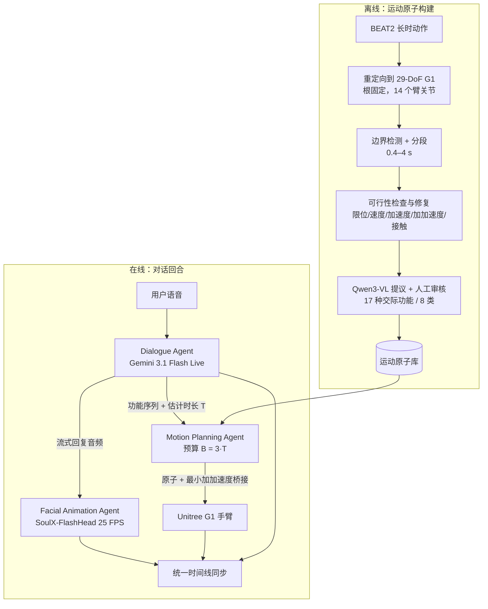
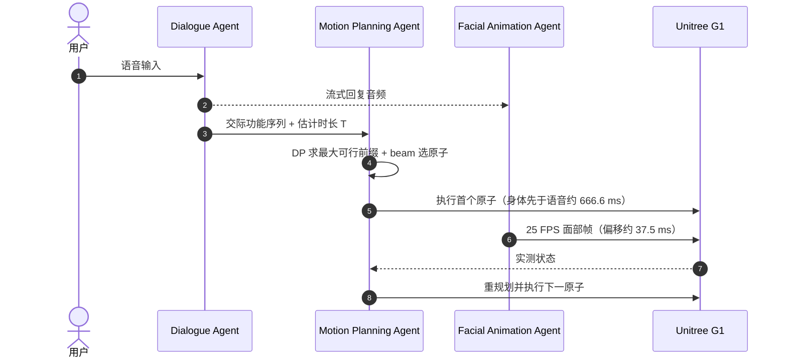

# TRABot：说、演、动

**TRABot（Talk, Render, Act）**（[arXiv:2610.06153](https://arxiv.org/abs/2610.06153)，Jiang 等）是一个让 **Unitree G1 人形边说话边做语义匹配手势、同时驱动数字人脸** 的四 agent 系统：离线把 BEAT2 手势构建成可执行、带交际功能标签的 **运动原子库**，在线由 Dialogue、Motion Planning、Facial Animation 三个 agent 把流式语音、规划好的手臂动作和面部帧对齐到同一条时间线。

## 英文缩写速查

| 缩写 | 英文全称 | 简要说明 |
|------|----------|----------|
| TRABot | Talk, Render, Act Robot | 本文系统名，对应说话、面部渲染、肢体动作 |
| BEAT2 | Body-Expressive Audio-Text dataset v2 | 长时共语动作数据，原子库的来源 |
| BAS | Beat Alignment Score | 动作节拍与语音节拍的对齐度量 |
| G1 | Unitree G1 | 29-DoF 人形，本文控制其中 14 个手臂关节 |
| VLM | Vision-Language Model | 离线用 Qwen3-VL-8B-Instruct 给原子提议语义标签 |

## 为什么重要

- **把「生成手势」改成「检索 + 组合可执行原子」**：原子在入库前已过关节限位、速度/加速度/加加速度和接触检查，在线阶段不再生成可能不可行的动作。
- **以回复时长为预算做规划**：规划器知道回复要说多久、要表达哪些交际功能，所以手势既跟语义顺序又不超时，对比随机拼接可减少 58.2% 的未用预算。
- **三模态同步给出了可测数字**（面部偏移 37.5 ms、身体先行 666.6 ms），而不是只给视频。

## 流程总览

## 方法

**运动原子构建（离线）**
- 25 Hz 活动信号上做边界检测（活动度按关节范围归一化，每段录音取百分位阈值）；起始需 0.12 s 超阈、结束需 0.16 s 低于阈，小于 0.12 s 的间隙合并，1.0 s 内的收回并入手势；边界精修窗 0.32 s，片段 0.4–4 s；可执行轨迹保留 30 Hz。
- 可行性：关节限位留 0.05 rad，速度/加速度/加加速度上限 7 rad/s、120 rad/s²、2200 rad/s³，接触深于中立位 2 mm 则拒绝，固定根 MuJoCo 回放；修复用幅度缩放、平滑、时间拉伸，需拉伸 > 3 倍或原子 > 10 s 的配方丢弃。
- 语义：Qwen3-VL-8B-Instruct 提议，随后人工审核；17 种交际功能分 8 类（强调、枚举、对比、指代、描绘、话轮管理、社交、立场）。原子库规模与审核拒绝率原文未报告。

**语义条件组合规划器（在线）**
- 动态规划求预算内可行的最大功能前缀 L*；beam search（宽度 32）选原子，偏好剩余预算小、重复少、左右手平衡；预算 B = 3·T̂，保护间隔 0.35 s；原子间最小加加速度桥接（速度上限文中为 11 rad/s）。
- 只执行首个原子，之后以实测状态重规划剩余功能（状态感知序列执行器）；另有 force-first 模式。

**模型栈**：对话用 Gemini 3.1 Flash Live（TTS 论文未单列，推测语音来自同一模型）；面部用 SoulX-FlashHead；G1 上显示数字脸的具体硬件原文未说明。

## 源码运行时序图

不适用：截至 2026-10-12 项目页仅标注 “Code (soon)”，无仓库。下图为依据论文的在线回合 **算法级** 时序：

## 工程实践

- **开源状态（2026-10-12 核查）**：项目页（[归档](../../sources/sites/trabot-project.md)）为 “Code (soon)”，无 GitHub、数据集或原子库链接；上游 BEAT2、SoulX-FlashHead、Gemini Live、Qwen3-VL 在致谢中列出。
- **可借鉴**：把可行性检查前置到离线库构建；在线只做检索式组合；用「身体先于语音」的负偏移补偿手势起手时间。
- **硬件**：人形为 Unitree G1，仅控制 14 个臂关节、根固定；站立/行走扰动下的稳定性未验证。

## 实验与评测

**实时同步（12 条回复）**：面部偏移 37.5 ms，身体偏移 −666.6 ms，语音–身体重叠 84.72%，12 条全部无失败完成。

**节拍对齐（BAS，12 条回复）**

| 方法 | 二值 BAS | 高斯 BAS（σ=0.30 s） |
|------|------|------|
| Simple Motion | 0.297 ± 0.206 | 0.210 ± 0.129 |
| Random Motion | 0.281 ± 0.197 | 0.190 ± 0.145 |
| Full（TRABot） | 0.308 ± 0.141 | 0.225 ± 0.130 |

提升约 0.011–0.035，且标准差较大，不宜读成显著优势。

**用户研究（20 人 × 12 轮，平均排名 1–5）**

| 条件 | 自然度 | 表现力 | 一致性 | 手势–语音 | 偏好 |
|------|------|------|------|------|------|
| Speech | 1.10 | 1.10 | 1.10 | — | 0.83% |
| Speech+Face | 2.10 | 2.10 | 2.08 | — | 0.42% |
| Simple Motion | 3.15 | 3.13 | 3.16 | 3.15 | 0.42% |
| Random Motion | 3.87 | 3.91 | 3.87 | 3.86 | 13.75% |
| Full | 4.79 | 4.76 | 4.79 | 4.77 | 84.58%（240 次中 203 次） |

**规划器自动评测（200 条固定回复）**：平均规划原子数 1.705（Full）vs 1.451（Random Match，+17.5%）；未用预算 0.993 s vs 2.376 s（−58.2%）。未报告规划器内部组件（如 beam 排序准则）的消融。

## 结论

**TRABot 的贡献是「预先筛选的可执行手势原子 + 按回复语义/时长组合 + 三模态时间线同步」，用户研究显示显著偏好，但客观节拍指标提升很小且无代码。**

1. **主观提升最大** — Full 在自然度/表现力/一致性均约 4.8，Random Motion 约 3.9，说明「语义匹配」比「有动作」贡献更多。
2. **客观 BAS 差距小** — Full 0.308 vs Random 0.281（二值），标准差大，不能单靠 BAS 证明节拍对齐。
3. **预算感知规划有量化收益** — 未用预算 −58.2%，原子数 +17.5%。
4. **同步参数可直接借鉴** — 身体先于语音约 666.6 ms、面部约 37.5 ms。
5. **行为多样性受原子库限制** — 库规模未报告，需自建时先估计覆盖的交际功能。
6. **不要外推到移动/负重场景** — 根固定且仅 14 个臂关节，可行性只在固定根 MuJoCo 里验证。

## 与其他工作对比

| 对照 | 差异读法 |
|------|----------|
| [ECHO-G](./paper-echo-g-cospeech-humanoid.md) | 把音频韵律映射为全身共语动作再由 SONIC 跟踪；TRABot 用离散原子库 + 规划，并加入数字脸 |
| [RoboGesture](./paper-robogesture.md) | 大规模手势数据 + 生成式对齐；TRABot 走检索组合，不训练生成器 |
| [语义共语手势合成笔记](./paper-notebook-semantic-co-speech-gesture-synthesis-and-real-ti.md) | 同样先语义检索，TRABot 强调回复时长预算与面部同步 |
| [人形语音交互](../methods/humanoid-voice-interaction.md) | 提供语音交互整体背景 |

## 局限与风险

- **适用边界**：行为多样性受原子库限制；可行性检查在固定根 MuJoCo 中；用户研究仅 20 人。
- **透明度**：原子库规模、审核拒绝率、数字脸显示硬件、TTS 来源均未报告（TTS 为推测）。
- **开源状态**：截至 2026-10-12 未发布代码，也未发布原子库。

## 关联页面

- [人形/四足周报汇总（2026-10-05 至 10-09）](../overview/frontier-humanoid-quadruped-2026-10-05-10-09.md)
- [人形语音交互](../methods/humanoid-voice-interaction.md)
- [ECHO-G](./paper-echo-g-cospeech-humanoid.md)
- [RoboGesture](./paper-robogesture.md)

## 参考来源

- [trabot_arxiv_2610_06153.md](../../sources/papers/trabot_arxiv_2610_06153.md) — 论文来源归档
- [trabot-project.md](../../sources/sites/trabot-project.md) — 项目页核查
- [frontier_humanoid_quadruped_2026_10_05_10_09.md](../../sources/blogs/frontier_humanoid_quadruped_2026_10_05_10_09.md) — 周报线索
- 论文：<https://arxiv.org/abs/2610.06153>

## 推荐继续阅读

- [项目页](https://trabot-humanoid.github.io)
- [论文 HTML 全文（v2）](https://arxiv.org/html/2610.06153v2)
- [BEAT2 / EMAGE（arXiv:2401.00374）](https://arxiv.org/abs/2401.00374)
