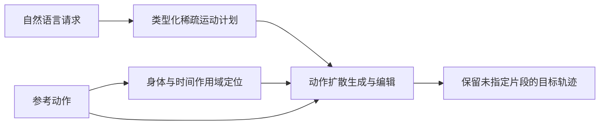

# TRACE：具有参考保持约束的对话式人形动作编辑

## 一句话定义

**把自然语言要求转成有类型的运动事件、身体部位与时间作用域，在尽可能保留原参考动作的前提下对人形动作扩散轨迹进行修改。**

## 英文缩写速查

| 缩写 | 英文全称 | 简要说明 |
|------|----------|----------|
| TRACE | Typed Reference-Aware Conversational Editing | 引用保持的语言动作编辑框架 |
| G1 | Unitree G1 Humanoid | 实验机器人形态 |
| FID | Fréchet Inception Distance | 生成分布指标 |

## 为什么重要

语言驱动的人形动作局部时空编辑，关注现有控制、数据或机器人学习方法在复杂任务中的失效点。这里单独建论文实体，避免与其他论文共用详情页；当前是待完成全文与源码复核的草稿。

## 核心机制

从文本和原动作生成稀疏运动规划条件；扩散模型在重力对齐与接触一致性约束下生成动作；针对编辑请求自动构建 body-time mask，以源动作为参考保留未指定的区域与时间段。

## 方法流程（待全文逐节复核）

以下流程仅依据已核对的论文 HTML 方法描述，不代替源代码调用图。

## 源码运行时序图

**待核实，不绘制未经代码阅读确认的时序图。** 官方存在公开仓库，但本次仅核对了 README 和部分发布说明；需继续阅读真实运行入口及关键模块后补充。

## 实验与评测

论文包含动作生成、连续多轮编辑和用户研究；真机展示属于定性验证，主要实验对运动学轨迹进行评测，不能直接当作真机闭环控制成功率。

## 局限与工程实践

- 轨迹生成质量不等价于实机动力学可执行性；真实跟踪仍需下游控制器和机器人约束。
- **源码状态：** 官方仓库公开 Unitree G1 generation inference、模型与资源，并列有训练文档；本次尚未核查具体源码调用。
- **原文状态：** 本轮已核查 arXiv 部分章节，尚未通读全部正文/附录，保持 draft，不宣称健康度满分。

## 结论

**需要对话编辑时，应同时衡量修改是否生效与未指定动作保留程度。**

1. 使用与论文一致的任务、硬件和评测协议复验，不跨实验口径比较数据。
2. 把方法改善的指标与额外的数据、计算或控制成本分开记录。
3. 对未经独立核查的复现入口，暂不声称完成验证。

## 关联页面

- [亚毫秒反射：连续人机物理交互的无锁控制切换](./paper-submillisecond-reflex-engine.md)
- [MOSS：从初始噪声选定 Flow Matching 动作模式](./paper-moss-mode-source-shaping.md)

## 参考来源

- [论文归档](../../sources/papers/trace-conversational-humanoid-motion_arxiv_2610_21515.md)
- [官方仓库归档](../../sources/repos/trace-conversational-humanoid-motion.md)

## 推荐继续阅读

- [arXiv 原文](https://arxiv.org/abs/2610.21515)
- [公开仓库](https://github.com/Multimodal-Perception-Action/TRACE)
